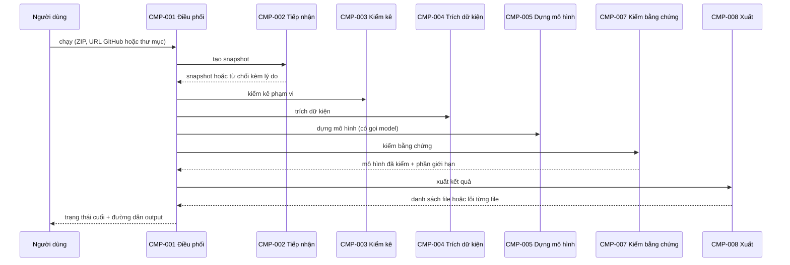

# CMP-L3GEN-001 — Điều phối lần chạy

## 1. Trách nhiệm

Thực hiện phần điều phối của [CAP-L3GEN-007](../l1/CAP-L3GEN-007.md). Component này là điểm vào của dòng lệnh và web. Nó giữ trạng thái, ngân sách và hàng đợi của mọi lần chạy.

- Nhận lệnh chạy, cấp mã lần chạy, gọi các component khác theo thứ tự.
- Giữ trạng thái `running` / `completed` / `partial` / `failed` kèm lý do.
- Giữ ngân sách: 30 phút, 2 GiB bộ nhớ (NFR-L3GEN-OPS-001). Trần token và request do [CMP-L3GEN-006](CMP-L3GEN-006.md) đếm rồi báo về đây.
- Mỗi lúc chỉ 1 lần chạy; lần sau xếp hàng.
- Trên web: xóa source và output 24 giờ sau khi lần chạy kết thúc (NFR-L3GEN-SEC-002).

Không làm: không đọc source, không gọi model, không tự quyết trạng thái của từng phần kết quả.

## 2. Cấu trúc bên trong

| Phần | Việc |
|---|---|
| Điểm vào | Lệnh dòng lệnh và API web: gửi lần chạy, xem trạng thái |
| Hàng đợi | Giữ lần chạy chờ; chỉ cho 1 lần chạy cùng lúc |
| Theo dõi lần chạy | Trạng thái, giai đoạn đang chạy, thời gian từng giai đoạn, bộ nhớ đỉnh |
| Dọn dữ liệu | Xóa dữ liệu hết hạn trên web; chạy cả lúc khởi động |

## 3. Sequence

## 4. Failure mode

| Hỏng ở đâu | Hành vi |
|---|---|
| Tiếp nhận từ chối | `failed`, nêu lý do và cách sửa; không tạo thư mục output |
| Hết 30 phút hoặc vượt bộ nhớ | Dừng giai đoạn đang chạy, trả `partial` với phần đã xong |
| Model lỗi hoặc hết quota | Không dừng lần chạy. Nhận phần do code dựng từ CMP-005, trạng thái `partial` |
| Một đơn vị phân tích lỗi | Chạy tiếp phần còn lại, trạng thái `partial` |
| Tiến trình chết giữa chừng | Lần khởi động sau đánh dấu lần chạy đó `failed`, xóa output dở |

## 5. Transaction boundary

Đơn vị trọn vẹn là **một lần chạy**. Output chỉ được đánh `completed` khi mọi artifact đã ghi xong và CMP-008 báo thành công. Trạng thái cuối ghi sau cùng, sau khi output đã nằm đủ trên đĩa.

## 6. Idempotency

Gửi cùng một đầu vào hai lần sinh ra hai lần chạy riêng, hai mã riêng. Không gộp, vì phần do model làm có thể khác nhau giữa hai lần. Xem trạng thái hay dọn dữ liệu nhiều lần thì không gây tác dụng phụ.

## 7. Concurrency

Mỗi lúc chỉ 1 lần chạy (NFR-L3GEN-OPS-001), vì các lần chạy dùng chung quota model. Lần sau xếp hàng theo thứ tự đến. Mỗi lần chạy có vùng làm việc riêng, không dùng chung thư mục tạm.

## Liên quan

| Nguồn | Nội dung |
|---|---|
| [CAP-L3GEN-007](../l1/CAP-L3GEN-007.md) | Tiếp nhận source và điều phối lần chạy |
| [ADR-2026-003](../adr/ADR-2026-003.md) | Chia component khi có mô hình ngôn ngữ |
| [NFR-L3GEN-OPS-001](../../requirements/nfr/NFR-L3GEN-OPS-001.md) | Thời gian, bộ nhớ, 1 lần chạy cùng lúc |
