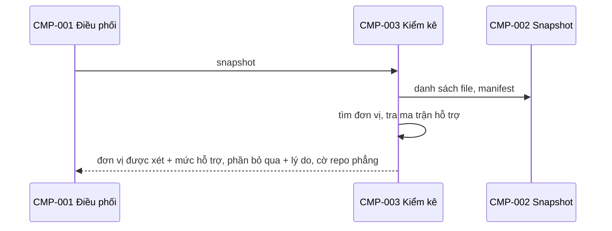

# CMP-L3GEN-003 — Kiểm kê phạm vi

## 1. Trách nhiệm

Thực hiện [CAP-L3GEN-008](../l1/CAP-L3GEN-008.md). Từ snapshot, trả lời: phân tích phần nào, bỏ phần nào, vì sao.

- Tìm đơn vị phân tích (ví dụ mỗi app FastAPI là một đơn vị) từ file manifest và cấu trúc thư mục.
- Nhận diện ngôn ngữ và framework của từng đơn vị.
- Tra ma trận hỗ trợ để gán mức hỗ trợ cho từng đơn vị. Phase đầu chỉ Python/FastAPI có mức đầy đủ.
- Liệt kê phần bỏ qua kèm lý do: ngoài ma trận hỗ trợ, file sinh tự động, thư mục thư viện.
- Nhận biết repository phẳng (khái niệm theo glossary) để CMP-005 biết khi nào nhờ model chia nhóm.

Không làm: không đọc nội dung code để trích dữ kiện.

## 2. Cấu trúc bên trong

| Phần | Việc |
|---|---|
| Tìm đơn vị | Đọc manifest và thư mục |
| Ma trận hỗ trợ | Bảng khai báo ngôn ngữ, framework, mức hỗ trợ; là nguồn duy nhất trả lời "công cụ hỗ trợ gì" (NFR-L3GEN-OPS-001) |
| Danh sách bỏ qua | Ghi từng phần bị bỏ kèm lý do |

## 3. Sequence

## 4. Failure mode

| Hỏng ở đâu | Hành vi |
|---|---|
| Repository rỗng | Báo rỗng; không trả kết quả thành công rỗng (AC-L3GEN-020-02) |
| Mọi đơn vị ngoài ma trận hỗ trợ | Báo ngoài phạm vi, nêu ngôn ngữ đã thấy |
| Manifest hỏng | Ghi thành giới hạn, vẫn nhận diện theo thư mục |
| Hai cách nhận diện mâu thuẫn | Ghi mâu thuẫn thành giới hạn, không lặng lẽ chọn một |

## 5. Transaction boundary

Kết quả kiểm kê giao đi một lần, đủ cả danh sách xét và danh sách bỏ qua. Không giao danh sách xét mà thiếu danh sách bỏ qua.

## 6. Idempotency

Tất định: cùng snapshot và cùng ma trận hỗ trợ cho cùng kết quả, cùng thứ tự.

## 7. Concurrency

Không có trạng thái riêng. Ma trận hỗ trợ chỉ đọc. Không cần khóa.

## Liên quan

| Nguồn | Nội dung |
|---|---|
| [CAP-L3GEN-008](../l1/CAP-L3GEN-008.md) | Kiểm kê phạm vi |
| [FR-L3GEN-020](../../requirements/fr/FR-L3GEN-020.md) | Xác định phạm vi phân tích |
| [NFR-L3GEN-OPS-001](../../requirements/nfr/NFR-L3GEN-OPS-001.md) | Ma trận hỗ trợ |
