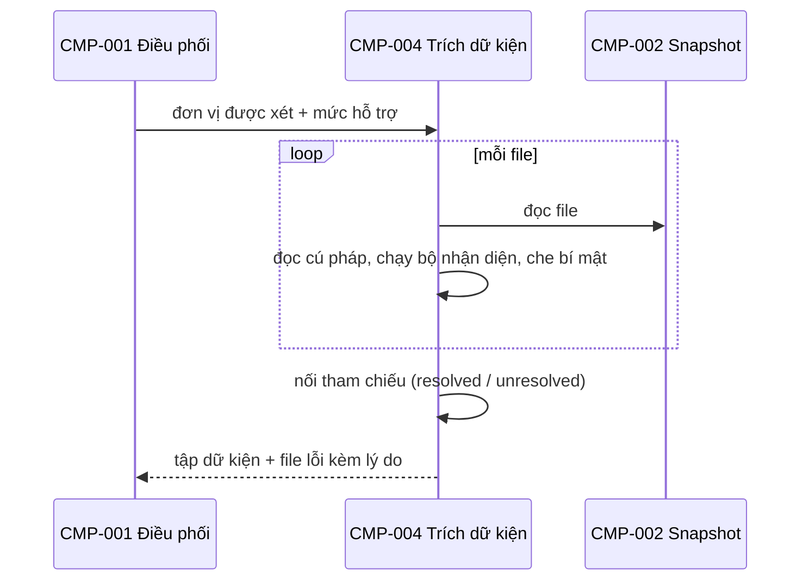

# CMP-L3GEN-004 — Trích dữ kiện

## 1. Trách nhiệm

Thực hiện [CAP-L3GEN-009](../l1/CAP-L3GEN-009.md). Đọc source bằng phân tích tĩnh (duyệt cây cú pháp, không chạy code) và sinh tập dữ kiện, mỗi dữ kiện kèm file và dòng:

- Route: method, path đầy đủ sau khi ghép prefix, handler, request/response model (tên, trường, kiểu, bắt buộc), status code.
- Lớp dữ liệu ánh xạ bảng: tên bảng, cột, kiểu, khóa chính, khóa ngoại, nullable.
- Lời gọi HTTP, config, sự kiện, thư viện.
- Tham chiếu xuyên file (import, lời gọi hàm), nối tới đích khi xác định được.

Component này cũng giữ **luật che bí mật**. Giá trị mang dấu hiệu bí mật bị che ngay khi trích. CMP-006 dùng lại luật này để che đoạn code gửi cho model.

Không làm: không dùng model. Không phân tích luồng dữ liệu sâu để tìm lời gọi động; việc đó giao cho model đề xuất ở CMP-005.

### Dữ kiện phục vụ tài liệu L3

| Loại | Dữ kiện chuyển tiếp | Nguồn yêu cầu |
|---|---|---|
| API | Điểm khai báo route và handler; method, path/prefix/mount; tham số, request/response model và từng trường; status, dependency/auth nếu xác định được | AC-021-01, AC-021-05, AC-027-01 |
| TBL | Điểm khai báo model/bảng; từng cột, kiểu, khóa chính/ngoại và nullable | AC-021-02, AC-027-02 |
| EVT | Điểm phát/nhận; topic, căn cứ broker/cấu hình, payload nếu xác định được | AC-021-03, AC-027-03 |

Mỗi giá trị có dữ kiện và vị trí chứng minh riêng. Trường chưa biết giữ lý do thiếu và vị trí liên quan; không dùng tên biến để điền kiểu, tên bảng hoặc schema payload. Model được tham chiếu từ file khác phải giữ cả vị trí khai báo lẫn liên kết từ nơi sử dụng. Cấu hình gửi tiếp đã che bí mật.

## 2. Cấu trúc bên trong

| Phần | Việc | Vì sao tách |
|---|---|---|
| Đọc cú pháp theo ngôn ngữ | Python phase đầu | Thêm ngôn ngữ chỉ thêm phần này |
| Bộ nhận diện theo framework | FastAPI, SQLAlchemy, thư viện HTTP | Thêm framework chỉ thêm một bộ |
| Nối tham chiếu | Nối lời gọi, import tới đích; không nối được thì `unresolved` | Là đầu vào để dựng cạnh tĩnh |
| Che bí mật | Nhận diện và che giá trị bí mật | Một luật, dùng ở hai chỗ |

## 3. Sequence

## 4. Failure mode

| Hỏng ở đâu | Hành vi |
|---|---|
| File lỗi cú pháp | Bỏ file đó, ghi lý do; chạy tiếp file khác (AC-L3GEN-024-01) |
| Path ghép từ biến không xác định | Ghi phần biết được, nhãn `partial` kèm lý do (AC-L3GEN-021-01) |
| Tên bảng sinh lúc chạy | Ghi `unknown` kèm nguồn; không suy từ tên lớp (AC-L3GEN-021-02) |
| Tham chiếu không nối được | Giữ với nhãn `unresolved`; không thành cạnh (AC-L3GEN-021-04) |
| Request/response model, kiểu cột hoặc payload không đọc được | Giữ phần đã biết, ghi trường thiếu và lý do; không loại cả route, bảng hoặc điểm phát/nhận chỉ vì thiếu một thuộc tính |
| Chỉ thấy dependency/auth dưới dạng tham chiếu chưa xác định | Giữ tham chiếu và lý do; không kết luận cơ chế xác thực từ tên hàm |
| Broker hoặc manifest ngoài phạm vi hỗ trợ | Ghi vào phần giới hạn |

## 5. Transaction boundary

Đơn vị trọn vẹn là **một file**. Dữ kiện của một file được nhận hết hoặc bỏ hết; không giữ nửa file. Nối tham chiếu chạy sau khi mọi file đã trích xong.

## 6. Idempotency

Tất định: cùng snapshot và cùng phiên bản bộ nhận diện cho cùng tập dữ kiện, cùng mã định danh dữ kiện. Mã định danh suy từ file, dòng và loại dữ kiện, không theo thứ tự xử lý.

## 7. Concurrency

Trích từng file độc lập nên có thể chạy song song. Phase đầu chạy tuần tự cho đơn giản; song song hóa khi đo thấy chậm. Nối tham chiếu chạy một luồng vì cần toàn bộ dữ kiện.

## Liên quan

| Nguồn | Nội dung |
|---|---|
| [CAP-L3GEN-009](../l1/CAP-L3GEN-009.md) | Trích dữ kiện code |
| [FR-L3GEN-021](../../requirements/fr/FR-L3GEN-021.md) | Các loại dữ kiện |
| [NFR-L3GEN-SEC-002](../../requirements/nfr/NFR-L3GEN-SEC-002.md) | Che bí mật, không chạy source |
