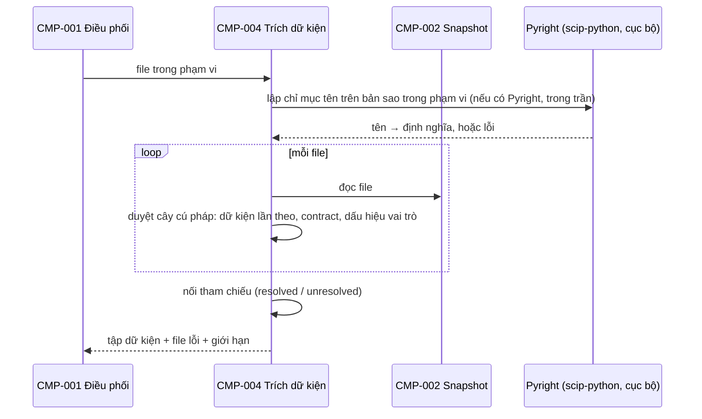

# CMP-L3GEN-004 — Trích dữ kiện

**Revision 3 (02/10/2026):** viết lại theo code thật và FR-L3GEN-028 đến 031. Thêm phân giải tên bằng Pyright, dữ kiện lần theo cho việc chia component ([ADR-2026-004](../adr/ADR-2026-004.md)) và dấu hiệu vai trò file. Code ở `experiments/quote-evidence/`.

**Revision 4 (02/10/2026):** sửa theo review REVIEW-ARCH-L3GEN-2026-001 (A3, A5, A9, A10, A16) và rà soát của phiên chính: một nguồn duy nhất cho tập contract (Khiêm quyết A5 ngày 02/10/2026, theo cách so hai engine ngày 02/10); Pyright theo [ADR-2026-005](../adr/ADR-2026-005.md); ai che bí mật ở đâu; thêm 6 lệch.

**Revision 5 (09/10/2026):** theo ADR-2026-006, dữ kiện contract của FR-029 do model đề xuất và CMP-007 kiểm; nhóm "Dữ kiện contract" ở mục 1 không còn là nguồn cho FR-029. Bản nháp theo [ADR-2026-006](../adr/ADR-2026-006.md) (draft, chờ Architecture Gate và OQ-L3GEN-018). Ghi muộn: code đã có từ 07–09/10/2026.

## 1. Trách nhiệm

Thực hiện [CAP-L3GEN-009](../l1/CAP-L3GEN-009.md). Đọc source bằng phân tích tĩnh (duyệt cây cú pháp, không chạy code) và sinh dữ kiện, mỗi dữ kiện kèm file và dòng. Ba nhóm dữ kiện:

| Nhóm | Dữ kiện | Dùng ở |
|---|---|---|
| Dữ kiện lần theo | Lời gọi đã xác định đích và cách gọi (luồng, kiểm tra, lắp ráp, chỉ truyền session); dòng mở kết nối tới hệ thống ngoài; điểm vào; gửi tác vụ nền | Chia component, mũi tên (FR-L3GEN-028) |
| Dữ kiện contract | Route: method, path đủ prefix, handler, tham số, request/response model và từng trường, status, dependency. Bảng: cột, kiểu, khóa, nullable. Khóa cấu hình, thư viện, lời gọi HTTP ra ngoài, điểm gửi và nhận sự kiện | Tài liệu L3 (FR-L3GEN-029 đến 031) |
| Dấu hiệu vai trò file | Decorator route, model bảng, dòng tạo kết nối, gọi method trên session hoặc dựng truy vấn, lớp làm request/response model, lớp `BaseSettings` hoặc đọc `os.environ` | Mục "Cấu trúc component" (FR-L3GEN-029) |

**Nguồn duy nhất của tập contract.** Tập route, bảng và tác vụ nền do bộ đọc thứ nhất lập (dữ kiện lần theo, có Pyright). Bộ đọc contract chỉ điền chi tiết cho từng contract trong tập đó, ghép theo file và dòng khai báo. Contract mà bộ đọc contract không đọc được chi tiết vẫn nằm trong tập, các trường ghi `unknown` kèm lý do. Nhờ vậy sơ đồ và `tech-specs/` có cùng tập route (AC-L3GEN-029-04).

Hai việc dùng chung:

- **Phân giải tên:** tên trỏ tới định nghĩa nào trong repository. Theo [ADR-2026-005](../adr/ADR-2026-005.md): Pyright (qua scip-python) chạy trên bản sao trong phạm vi của [CMP-L3GEN-002](CMP-L3GEN-002.md), trong phần trần được chia; không có, lỗi hoặc vượt trần thì dùng phần tự đọc và ghi lý do ở phần giới hạn ([NFR-L3GEN-OPS-001](../../requirements/nfr/NFR-L3GEN-OPS-001.md)). Dữ kiện ghi đường nào đã dùng.
- **Luật che bí mật:** nhận dạng giá trị mang dấu hiệu bí mật. [CMP-L3GEN-006](CMP-L3GEN-006.md) dùng luật này cho payload gửi model; [CMP-L3GEN-007](CMP-L3GEN-007.md) dùng cho mọi dòng bằng chứng hiện ra. CMP-008 chỉ in nội dung đã che.

Không làm: không dùng model. Không chạy, không import source. Không điền kiểu, tên bảng hay schema payload từ tên biến. Route khai không qua decorator (`add_api_route`, `add_route`, `add_websocket_route`) chưa đọc ở đợt này; mỗi lời gọi như vậy thành một dữ kiện giới hạn kèm `file:dòng` (AC-L3GEN-029-05).

## 2. Cấu trúc bên trong

| Phần | Việc | Code hiện tại |
|---|---|---|
| Phân giải tên | Pyright qua scip-python, chạy Node cục bộ; chỉ giữ đích nằm trong repository | `names.py`, `pyindex.py` |
| Dữ kiện lần theo | Lời gọi, cách gọi, hệ thống ngoài, dấu hiệu, điểm vào | `calls.py` |
| Tập contract | Liệt kê route (đủ prefix), bảng, tác vụ nền: nguồn duy nhất | `contract_trace.py` (`contracts`) |
| Chi tiết contract | Tham số, model, cột, cấu hình, thư viện, HTTP, sự kiện; ghép vào tập contract theo vị trí khai báo | `l3slice/extract.py`, `l3slice/pyindex.py` |
| Che bí mật | Một luật che giá trị bí mật | `l3slice/common.py` (`mask`), `verify.py` (`redact`) |

## 3. Sequence

## 4. Failure mode

| Hỏng ở đâu | Hành vi |
|---|---|
| File lỗi cú pháp | Bỏ file đó, ghi lý do; chạy tiếp file khác |
| Pyright không có hoặc lỗi | Dùng phần tự đọc; ghi lý do ở phần giới hạn |
| Path ghép từ giá trị lúc chạy | Lấy giá trị mặc định khai trong code nếu có; không có thì `unknown` kèm lý do |
| Tên bảng sinh lúc chạy | `unknown` kèm nguồn; không suy từ tên lớp |
| Tham chiếu không nối được | Giữ nhãn `unresolved`; không thành mũi tên |
| Request/response model, kiểu cột hoặc payload không đọc được | Giữ phần đã biết, ghi trường thiếu và lý do; không loại cả route, bảng hay điểm gửi/nhận |
| Dependency hoặc auth chỉ thấy qua tên | Giữ tham chiếu và lý do; không kết luận cơ chế xác thực từ tên hàm |
| Thư viện I/O, HTTP, hàng đợi ngoài danh sách đọc được | Ghi ở phần giới hạn kèm nơi dùng |

## 5. Transaction boundary

Đơn vị trọn vẹn là **một file**: dữ kiện của một file được nhận hết hoặc bỏ hết. Nối tham chiếu chạy sau khi mọi file đã trích xong.

## 6. Idempotency

Tất định: cùng snapshot, cùng phiên bản bộ đọc và cùng phiên bản Pyright (ghi trong provenance, CMP-006) cho cùng tập dữ kiện, cùng mã dữ kiện. Mã dữ kiện suy từ file, vị trí và loại, không theo thứ tự xử lý.

## 7. Concurrency

Chạy tuần tự. Pyright chạy một tiến trình con; thời gian và bộ nhớ của nó nằm trong phần trần chung được chia (ADR-2026-005), vượt thì dừng Pyright và dùng phần tự đọc. Nối tham chiếu chạy một luồng vì cần toàn bộ dữ kiện.

## 8. Lệch với code hiện tại

Đếm ngày 02/10/2026 trên `runs/l3gen-v1/` (7 repository). Mỗi dòng là ứng viên Task ở bước 11.

| # | Lệch | Căn cứ |
|---|---|---|
| 004-1 | `l3slice/extract.py` tự lập tập route riêng thay vì điền chi tiết cho tập của bộ đọc thứ nhất. Hai tập lệch: boilerplate có `GET /health` khai trong app factory, bộ thứ nhất thấy, bộ thứ hai không (34 so với 33 route) | AC-L3GEN-029-04 |
| 004-2 | `add_api_route`, `add_route`, `add_websocket_route` chưa thành dữ kiện giới hạn | AC-L3GEN-029-05 |
| 004-3 | Lời gọi HTTP ra ngoài chỉ nhận `httpx`/`requests` gọi thẳng hàm của module; chưa nhận `aiohttp` và lời gọi qua đối tượng client. 0/7 repository có dữ kiện này | AC-L3GEN-029-08 |
| 004-4 | Hai luật che bí mật (`l3slice/common.py`, `verify.py`) | NFR-L3GEN-SEC-002 |
| 004-5 | `session.get(...)` bị hiểu là gọi vào file khai session | AC-L3GEN-028-06 |
| 004-6 | Pyright đặt riêng 3 GiB bộ nhớ Node và 900 giây, cộng thêm 900 giây cho bước `scip print`, ngoài trần chung; chạy trên thư mục gốc (`--cwd`); không kiểm phiên bản scip-python, Node | NFR-L3GEN-OPS-001, ADR-2026-005 |
| 004-7 | FR-031 gần như chưa có: `l3slice/extract.py` xếp Celery vào "thư viện hàng đợi chưa hỗ trợ"; `BackgroundTasks.add_task` không thành dữ kiện sự kiện. 0/7 repository có file EVT | FR-L3GEN-031 "Phạm vi đọc" |
| 004-8 | Model của ORM khác (Tortoise ở tdd-docker) không được ghi ở phần giới hạn | FR-L3GEN-030 "Phạm vi đọc" |
| 004-9 | 0/7 repository có khối DDL; dữ kiện bảng ghi "dialect chưa biết". Chưa kiểm repository nào có khai biến thể SQL trong code | AC-L3GEN-030-02 |
| 004-10 | Hệ thống ngoài nhận bằng bảng đóng `IO_LIBS`; thư viện I/O không có trong bảng bị bỏ im lặng, không ghi ở phần giới hạn | FR-L3GEN-028 "Phạm vi đọc", AC-L3GEN-028-09 |
| 004-11 | Cách gọi "chỉ truyền session" nhận theo tên tham số (`SESSION_NAMES` trong `calls.py`), trái câu "không suy từ tên" ở mục 1 | FR-L3GEN-028 "Mũi tên nào được vẽ" |
| 004-12 | Tám lỗi đọc import và thuộc tính tìm thấy ngày 01/10/2026 trên repository giả (ví dụ `from m import *`, `self.repo = repo or Repo()`) chưa đo lại sau khi có Pyright | AC-L3GEN-028-06 |
| 004-13 | Luồng FR-029 không dùng `l3slice/extract.py`; phân tích tĩnh của bộ kiểm nằm ở `slice/l3slice/astscan.py` (CMP-007). Hai bộ đọc cây cú pháp tồn tại song song | ADR-2026-006 |

## Liên quan

| Nguồn | Nội dung |
|---|---|
| [CAP-L3GEN-009](../l1/CAP-L3GEN-009.md) | Trích dữ kiện code |
| [FR-L3GEN-028](../../requirements/fr/FR-L3GEN-028.md) | Phạm vi đọc: điểm vào, hệ thống ngoài, cấu hình, thư viện |
| [FR-L3GEN-029](../../requirements/fr/FR-L3GEN-029.md) | Route, model, vai trò file, HTTP ra ngoài |
| [ADR-2026-004](../adr/ADR-2026-004.md) | Chia component theo contract |
| [NFR-L3GEN-SEC-002](../../requirements/nfr/NFR-L3GEN-SEC-002.md) | Che bí mật, không chạy source |
