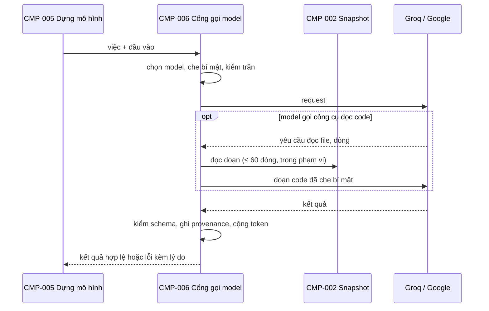

# CMP-L3GEN-006 — Cổng gọi model

## 1. Trách nhiệm

Hỗ trợ [CAP-L3GEN-010](../l1/CAP-L3GEN-010.md). Đây là **chỗ duy nhất gửi dữ liệu ra ngoài**. Mọi request tới Groq và Google đi qua đây.

- Chọn model theo việc, đúng bảng của NFR-L3GEN-AI-002. Không chuyển sang model kia khi lỗi.
- Che bí mật trong mọi payload bằng luật của CMP-004 trước khi gửi.
- Đếm và chặn trần: token, request, timeout 30 giây, thử lại tối đa 2 lần.
- Cung cấp công cụ đọc code cho model: chỉ file trong snapshot và phạm vi đang xét, ≤ 6 lần mỗi phạm vi, ≤ 60 dòng mỗi lần, đã che bí mật.
- Kiểm kết quả trả về đúng schema; sai thì loại, ghi lý do.
- Ghi provenance: provider, model, phiên bản prompt, số token.
- Giữ khóa API trong bộ nhớ, không ghi ra output, log hay bằng chứng.

Không làm: không quyết đề xuất nào đúng về nội dung (việc của CMP-005 và CMP-007).

## 2. Cấu trúc bên trong

| Phần | Việc |
|---|---|
| Bảng phân việc | Việc → provider, model, trần |
| Bộ đếm trần | Token và request mỗi lần chạy; báo về CMP-001. Giữ nhịp gửi theo phút (mục 7) |
| Client provider | Một client cho Groq, một cho Google; thay bằng provider giả trong test |
| Công cụ đọc code | Đọc đoạn file qua CMP-002, áp giới hạn, che bí mật |
| Kiểm schema | Kiểm JSON trả về theo schema của từng việc |

Groq không cho dùng công cụ và JSON strict trong cùng request, nên việc của `gpt-oss-120b` gọi hai pha: đọc code, rồi trả JSON (OQ-L3GEN-008).

## 3. Sequence

## 4. Failure mode

| Hỏng ở đâu | Hành vi |
|---|---|
| Thiếu khóa API | Không gửi request; báo lỗi cho việc đó |
| Rate limit, hết quota | Dừng việc đó, báo rõ; không đổi model, không trả phí |
| Timeout | Thử lại tối đa 2 lần rồi báo lỗi |
| Chạm trần token hoặc request của lần chạy | Dừng mọi việc còn lại của model |
| Đầu vào của một việc vượt trần token mỗi request (Gemini ≤ 50.000) | Không gửi; báo lỗi cho riêng việc đó, việc khác chạy tiếp |
| Model đòi đọc file ngoài snapshot hoặc ngoài phạm vi | Từ chối lần đọc đó, ghi lại |
| JSON sai schema | Loại, ghi lý do |
| Provider trả 503 quá tải | Tính như timeout |

## 5. Transaction boundary

Đơn vị là **một việc** gửi model (có thể gồm nhiều request khi model đọc code). Việc chỉ trả kết quả khi đã qua kiểm schema. Lỗi giữa chừng thì cả việc trả lỗi; không trả nửa kết quả.

## 6. Idempotency

Không tất định: gửi lại cùng đầu vào có thể nhận kết quả khác. Vì vậy không tự gửi lại việc đã thành công. Thử lại chỉ áp cho request lỗi mạng hoặc timeout.

## 7. Concurrency

Bộ đếm trần dùng chung cho cả lần chạy nên phải cộng dồn an toàn khi có request song song.

Tốc độ gửi giữ dưới cả hai giới hạn theo phút của gói: số request và số token (NFR-L3GEN-AI-002).

| Provider | Giới hạn chặn trước | Hệ quả |
|---|---|---|
| Groq `gpt-oss-120b` | 8.000 token/phút, không phải 30 request/phút | Một request tới 6.000 token, nên thực tế chỉ 1–2 request/phút. Cổng ước tính token của request và chờ đủ chỗ trong phút hiện tại rồi mới gửi |
| Google `gemini-3.5-flash` | 5 request/phút | Mỗi lần chạy ≤ 2 request nên không chạm |

Giãn nhịp để tránh lỗi rate limit, vì gặp lỗi đó thì việc phải dừng (mục 4).

## Liên quan

| Nguồn | Nội dung |
|---|---|
| [NFR-L3GEN-AI-002](../../requirements/nfr/NFR-L3GEN-AI-002.md) | Phân việc hai model, trần |
| [NFR-L3GEN-SEC-002](../../requirements/nfr/NFR-L3GEN-SEC-002.md) | Dữ liệu gửi ra ngoài |
| [OQ-L3GEN-008](../../lifecycle/change-sets/CHG-L3GEN-2026-002/open-questions/OQ-L3GEN-008.md) | Kết quả thử model |
| [ADR-2026-003](../adr/ADR-2026-003.md) | Vì sao tách component này |
