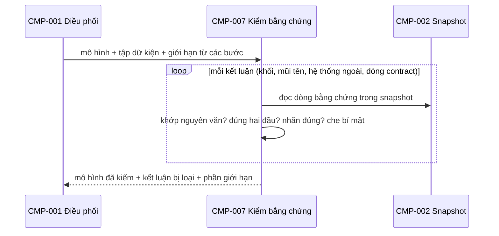
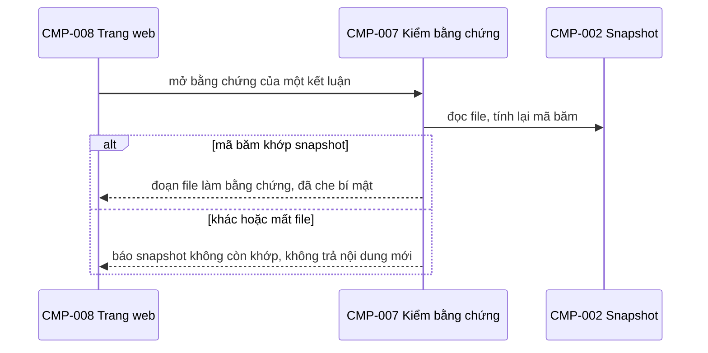

# CMP-L3GEN-007 — Kiểm bằng chứng

**Revision 3 (02/10/2026):** viết lại theo code thật và FR-L3GEN-028 đến 031. Thêm kiểm bằng chứng của sơ đồ và che bí mật trong dòng bằng chứng. Phần kiểm khi mở bằng chứng trên web giữ như revision 2. Code ở `experiments/quote-evidence/`.

**Revision 4 (02/10/2026):** sửa theo review REVIEW-ARCH-L3GEN-2026-001 (A9, A10): việc che dòng bằng chứng làm ở đây, một lần; sửa tên hàm che trong code.

## 1. Trách nhiệm

Thực hiện [CAP-L3GEN-011](../l1/CAP-L3GEN-011.md). Là **cửa kiểm cuối** trước khi công bố. Mọi kết luận đều qua đây, dù do code dựng hay do model đề xuất rồi đã qua [CMP-L3GEN-005](CMP-L3GEN-005.md).

- Mỗi kết luận trỏ tới dữ kiện có trong lần chạy, nằm ở file có trong snapshot.
- Bằng chứng dạng `file:dòng| nguyên văn` khớp đúng dòng trong snapshot gốc. Dòng chứa giá trị bí mật hiện với giá trị đã che, đánh dấu "đã che" (AC-L3GEN-028-07). Áp cho cả sơ đồ lẫn tài liệu L3. Việc che dòng bằng chứng làm ở đây, một lần; [CMP-L3GEN-008](CMP-L3GEN-008.md) chỉ in nội dung đã che. Payload gửi model do [CMP-L3GEN-006](CMP-L3GEN-006.md) che.
- Mỗi mũi tên A→B có lời gọi thuộc A và đích thuộc B.
- Nhãn `exact` / `inferred` và `full` / `partial` đúng nghĩa; `inferred`, `partial`, `unknown` kèm lý do.
- Gom phần giới hạn: file lỗi, phần ngoài phạm vi, đề xuất bị loại, bước model không chạy, Pyright không chạy.
- Trên web: khi người đọc mở bằng chứng, kiểm source còn khớp snapshot.

Không làm: không dùng model. Không sửa kết luận cho vừa bằng chứng; thiếu thì loại.

### Kiểm nội dung contract trước khi xuất

| Kiểm | Điều kiện |
|---|---|
| Nguồn từng trường | Dữ kiện được dẫn có trong lần chạy, đúng snapshot, và chứng minh đúng giá trị đó; file tồn tại chưa đủ chứng minh mọi trường |
| Component sở hữu | Component tồn tại; chủ contract theo luật ở CMP-005 |
| API | Path giữ căn cứ ghép prefix và mount; model và từng trường truy được về khai báo; không xác nhận auth chỉ từ tên dependency |
| TBL | Tên bảng, cột, kiểu, khóa, nullable đối chiếu với dữ kiện; không nhận tên bảng suy từ tên lớp |
| EVT | Từng điểm gửi và nhận có nguồn; quan hệ giữa chúng có căn cứ ngoài tên topic |

Giá trị không có bằng chứng bị loại; phần còn biết được giữ lại cùng lý do thiếu. [CMP-L3GEN-008](CMP-L3GEN-008.md) nhận nội dung đã kiểm kèm nguồn ở mức trường.

## 2. Cấu trúc bên trong

| Phần | Việc | Code hiện tại |
|---|---|---|
| Kiểm bằng chứng L3 | Vùng dòng của bằng chứng, trường contract, chủ contract, cạnh tĩnh, nhãn | `l3slice/verify.py` (`verify`) |
| Kiểm trích dẫn | Dòng có thật, nguyên văn khớp, file thuộc đúng component | `verify.py` (`check`) |
| Che bí mật trong dòng hiện ra | Luật che của CMP-004 | `verify.py` (`redact`), `l3slice/common.py` (`mask`) |
| Gom giới hạn | Gộp giới hạn từ mọi component | `l3slice/verify.py`; `l3gen.archdia` (giới hạn của sơ đồ) |
| Kiểm khi mở bằng chứng (web) | So mã băm file với snapshot | `l3slice/verify.py` (`open_evidence`) |

## 3. Sequence

Khi người đọc mở bằng chứng trên web:

## 4. Failure mode

| Hỏng ở đâu | Hành vi |
|---|---|
| Kết luận không có bằng chứng hợp lệ | Loại, không hạ thành cảnh báo |
| Một giá trị contract không có bằng chứng | Loại giá trị đó; giữ phần có bằng chứng, ghi phần thiếu và lý do; không thay bằng giá trị model đoán |
| Nhãn `exact` cho kết luận suy ra | Hạ về `inferred`, ghi lý do |
| Phạm vi chưa xét đủ | Ghi là giới hạn, không ghi "không phát hiện thấy" |
| Source trên đĩa khác snapshot | Báo snapshot không còn khớp; không dùng source mới làm bằng chứng |
| Loại hết mọi kết luận | Trả mô hình rỗng kèm giới hạn, `partial` |

## 5. Transaction boundary

Kiểm toàn bộ mô hình rồi mới giao đi. Không giao mô hình đã kiểm một nửa.

## 6. Idempotency

Tất định: cùng mô hình, cùng tập dữ kiện, cùng snapshot cho cùng kết quả kiểm.

## 7. Concurrency

Không có trạng thái riêng, chỉ đọc đầu vào. Chạy tuần tự. Kiểm khi mở bằng chứng chỉ đọc, nên nhiều người mở cùng lúc được.

## 8. Lệch với code hiện tại

Đếm ngày 02/10/2026. Mỗi dòng là ứng viên Task ở bước 11.

| # | Lệch | Căn cứ |
|---|---|---|
| 007-1 | Bằng chứng của sơ đồ (khối, mũi tên, hệ thống ngoài, điểm vào) do `l3gen.archdia` lấy thẳng từ dòng code, không qua bước kiểm và **không che bí mật** | AC-L3GEN-028-07, NFR-L3GEN-SEC-002 |
| 007-2 | `l3slice/verify.py` chỉ kiểm phần L3; nhãn của sơ đồ chưa được kiểm | NFR-L3GEN-ACC-002 |

## Liên quan

| Nguồn | Nội dung |
|---|---|
| [CAP-L3GEN-011](../l1/CAP-L3GEN-011.md) | Kiểm bằng chứng, công bố giới hạn |
| [FR-L3GEN-028](../../requirements/fr/FR-L3GEN-028.md) | Nhãn, bí mật trong bằng chứng |
| [NFR-L3GEN-ACC-002](../../requirements/nfr/NFR-L3GEN-ACC-002.md) | Bằng chứng hợp lệ, cách chấm |
| [NFR-L3GEN-SEC-002](../../requirements/nfr/NFR-L3GEN-SEC-002.md) | Che bí mật |
