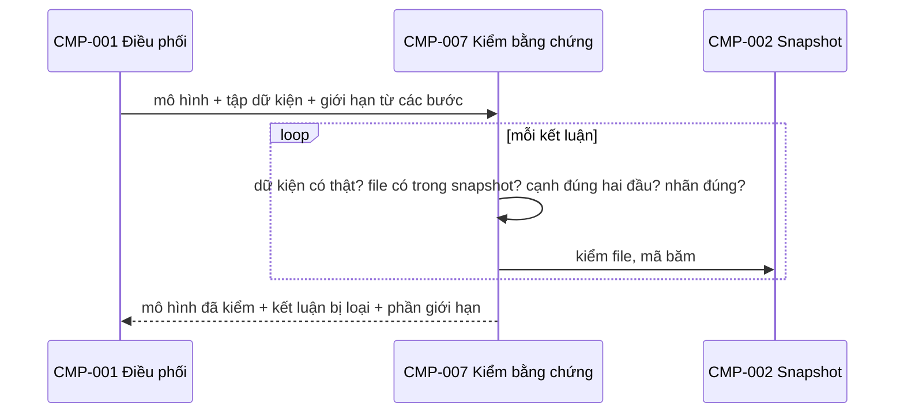
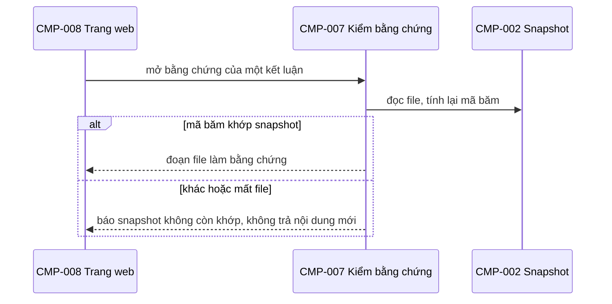

# CMP-L3GEN-007 — Kiểm bằng chứng

## 1. Trách nhiệm

Thực hiện [CAP-L3GEN-011](../l1/CAP-L3GEN-011.md). Là **cửa kiểm cuối** trước khi công bố. Mọi kết luận đều qua đây, dù do code dựng hay do model đề xuất.

- Mỗi kết luận phải trỏ tới dữ kiện có trong tập dữ kiện, nằm ở file có trong snapshot.
- Mỗi cạnh A→B phải có dữ kiện thuộc A và đích thuộc B.
- Nhãn `exact` / `inferred` và `full` / `partial` phải đúng nghĩa; `inferred` và `partial` phải kèm lý do.
- Gom phần giới hạn: file lỗi, phần ngoài phạm vi, đề xuất bị loại, bước model không chạy.
- Phát hiện source trên đĩa đã đổi sau khi chụp snapshot. Kiểm ở hai lúc: khi chạy, và khi người đọc mở bằng chứng trên web (CMP-008 gọi sang, AC-L3GEN-023-03).

Không làm: không dùng model. Không sửa kết luận cho vừa bằng chứng; thiếu thì loại.

## 2. Cấu trúc bên trong

| Phần | Việc |
|---|---|
| Kiểm bằng chứng | Đối chiếu dữ kiện, file, hai đầu cạnh |
| Kiểm nhãn | Kiểm `exact` chỉ dùng cho kết luận đọc thẳng từ bằng chứng |
| Gom giới hạn | Gộp giới hạn từ mọi component thành một danh sách |
| Kiểm khi mở bằng chứng | So mã băm file với snapshot; khớp thì trả đoạn file, không khớp hoặc mất file thì báo snapshot không còn khớp |

## 3. Sequence

Khi người đọc mở bằng chứng trên web:

## 4. Failure mode

| Hỏng ở đâu | Hành vi |
|---|---|
| Kết luận không có bằng chứng hợp lệ | Loại, không hạ thành cảnh báo (AC-L3GEN-023-04) |
| Nhãn `exact` cho kết luận suy ra | Hạ về `inferred`, ghi lý do |
| Phạm vi chưa xét đủ | Ghi là giới hạn, không ghi "không phát hiện thấy" (AC-L3GEN-024-04) |
| Source trên đĩa khác snapshot | Báo snapshot không còn khớp; không dùng source mới làm bằng chứng (AC-L3GEN-023-03) |
| Loại hết mọi kết luận | Trả mô hình rỗng kèm giới hạn, trạng thái `partial` |

## 5. Transaction boundary

Kiểm toàn bộ mô hình rồi mới giao đi. Không giao mô hình đã kiểm một nửa.

## 6. Idempotency

Tất định: cùng mô hình, cùng tập dữ kiện, cùng snapshot thì cùng kết quả kiểm.

## 7. Concurrency

Không có trạng thái riêng, chỉ đọc đầu vào. Kiểm từng kết luận độc lập; phase đầu chạy tuần tự. Kiểm khi mở bằng chứng chỉ đọc, nên nhiều người mở cùng lúc được.

## Liên quan

| Nguồn | Nội dung |
|---|---|
| [CAP-L3GEN-011](../l1/CAP-L3GEN-011.md) | Kiểm bằng chứng, công bố giới hạn |
| [FR-L3GEN-023](../../requirements/fr/FR-L3GEN-023.md), [FR-L3GEN-024](../../requirements/fr/FR-L3GEN-024.md) | Bằng chứng, giới hạn |
| [NFR-L3GEN-ACC-002](../../requirements/nfr/NFR-L3GEN-ACC-002.md) | 100% kết luận có bằng chứng |
