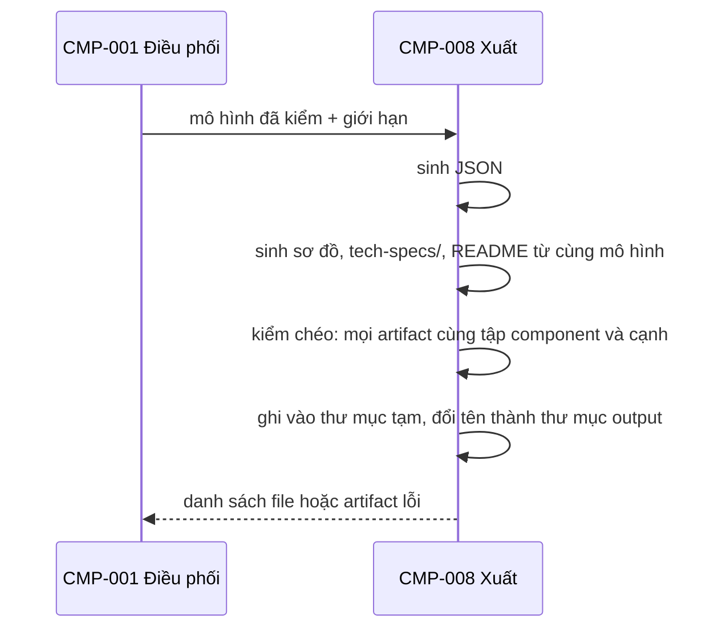

# CMP-L3GEN-008 — Trình bày và xuất

## 1. Trách nhiệm

Thực hiện [CAP-L3GEN-012](../l1/CAP-L3GEN-012.md). Từ **một** mô hình đã kiểm của CMP-007, sinh mọi output:

- Sơ đồ component và dependency, kèm mã nguồn sơ đồ.
- Tài liệu L3 contract trong `tech-specs/`, tên file theo [FR-L3GEN-027](../../requirements/fr/FR-L3GEN-027.md).
- JSON có schema version và mã snapshot.
- `README.md` mục lục kèm phần giới hạn.
- Trang web: theo dõi lần chạy, tổng quan, đi sâu từng component, mở bằng chứng.

Không làm: không đọc source, không gọi model, không thêm kết luận.

## 2. Cấu trúc bên trong

| Phần | Việc |
|---|---|
| Sơ đồ | Sinh mã sơ đồ; giữ mức application/component, ≤ 50 node |
| Tài liệu L3 | API (bảng + OpenAPI 3.1), TBL (bảng + DDL), EVT; chỉ component có contract mới có thư mục |
| JSON | Bộ dữ liệu máy đọc, có schema version |
| Trang web | Các màn hình đọc từ cùng bộ JSON. Mở bằng chứng thì gọi CMP-007 kiểm snapshot còn khớp, không tự đọc source |
| Ghi file | Ghi vào thư mục tạm rồi đổi tên một lần |

## 3. Sequence

## 4. Failure mode

| Hỏng ở đâu | Hành vi |
|---|---|
| Một artifact sinh lỗi | Báo artifact nào lỗi, giữ artifact hợp lệ, cho thử lại (AC-L3GEN-025-03) |
| Artifact lệch nhau về component hoặc cạnh | Không xuất; đây là lỗi của công cụ |
| JSON có cạnh trỏ tới thực thể không có | Không xuất (AC-L3GEN-025-02) |
| Hai component trùng tên thư mục | Thêm `-2`, `-3` theo FR-L3GEN-027 |
| Output quá hạn 24 giờ trên web | Không phục vụ; báo đã hết hạn |
| Mở bằng chứng mà file đã đổi hoặc mất so với snapshot | Hiện "snapshot không còn khớp", không hiện nội dung mới (AC-L3GEN-023-03) |

## 5. Transaction boundary

Đơn vị trọn vẹn là **cả bộ output** của một lần chạy. Kết quả `partial` vẫn xuất đủ phần đã có. Thư mục tạm chỉ để tránh file bị cắt nửa chừng khi tiến trình chết: ghi vào thư mục tạm, ghi xong mới đổi tên thành thư mục output.

## 6. Idempotency

Tất định: cùng mô hình đã kiểm cho cùng bộ file, cùng nội dung. Sinh lại một artifact lỗi không đổi các artifact khác.

## 7. Concurrency

Mỗi lần chạy ghi vào thư mục riêng. Trang web chỉ đọc. Không cần khóa.

## Liên quan

| Nguồn | Nội dung |
|---|---|
| [CAP-L3GEN-012](../l1/CAP-L3GEN-012.md) | Trình bày và xuất |
| [CMP-L3GEN-007](CMP-L3GEN-007.md) | Kiểm snapshot khi mở bằng chứng |
| [FR-L3GEN-025](../../requirements/fr/FR-L3GEN-025.md), [FR-L3GEN-026](../../requirements/fr/FR-L3GEN-026.md), [FR-L3GEN-027](../../requirements/fr/FR-L3GEN-027.md) | Xuất, web, tài liệu L3 |
| [NFR-L3GEN-ABST-002](../../requirements/nfr/NFR-L3GEN-ABST-002.md) | Mức trừu tượng |
