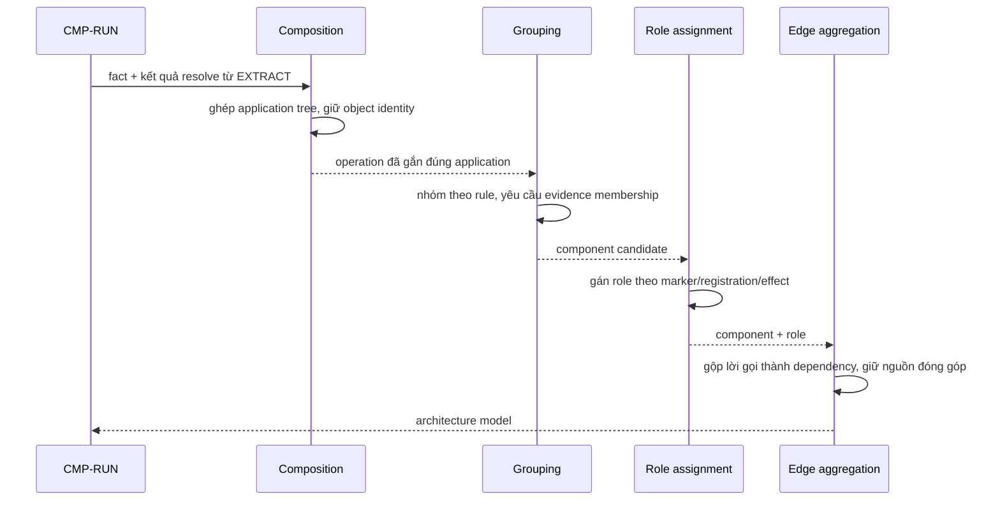

# CMP-L3GEN-ARCH — Dựng mô hình kiến trúc mức component

## 1. Trách nhiệm

Component này thực hiện [CAP-L3GEN-004](../l1/CAP-L3GEN-004.md): biến `code fact` thành
`architecture claim`. Nhóm thành viên code thành `component` theo rule grouping đã công
bố, gán `component role`, ghép registration thành application tree, và tổng hợp nhiều lời
gọi giữa hai component thành **một** `dependency` kèm danh sách nguồn đóng góp.

Nó là **chủ của bất biến miền #7** và là nơi [ADR-2026-001](../adr/ADR-2026-001.md) bám
vào: đây là chỗ duy nhất quyết định cái gì được nâng lên mức kiến trúc và cái gì ở lại
lớp dữ kiện.

Nó **không** đọc source (đầu vào là fact từ `EXTRACT`), không quyết định cách hiển thị
(thuộc `PRESENT`).

## 2. Cấu trúc bên trong

| Phần | Việc | Vì sao tách |
|---|---|---|
| Composition | Ghép registration: object identity, parent/child, prefix, condition, call context | Thay đổi khi thêm kiểu composition của framework mới |
| Grouping | Nhóm thành viên code thành component theo rule đã công bố | Thay đổi khi thêm hoặc sửa rule grouping |
| Role assignment | Gán nhãn api / service / repository / worker / integration / unknown | Thay đổi khi thêm tín hiệu nhận diện vai trò |
| Edge aggregation | Gộp nhiều lời gọi code thành một dependency, giữ danh sách nguồn | Là nơi bất biến #7 được thực thi |

Edge aggregation tách riêng vì nó là chỗ **mất thông tin có chủ ý**: từ N lời gọi xuống 1
cạnh. Việc này phải làm ở một chỗ, theo một luật, và luôn giữ được đường về N lời gọi gốc.

## 3. Sequence

1. Nhận fact và kết quả resolve.
2. Composition ghép registration, **không trộn hai object cùng kiểu**.
3. Grouping nhóm thành component; mỗi thành viên phải có evidence membership.
4. Role assignment gán nhãn; thiếu bằng chứng thì `unknown`, không đoán.
5. Edge aggregation gộp lời gọi thành dependency.

## 4. Failure mode

| Hỏng ở đâu | Hành vi bắt buộc |
|---|---|
| Không đủ bằng chứng để nhóm một nhóm file | Giữ ở mức module hoặc application node, **không** ép thành component cho đồ thị đẹp |
| Nhiều rule grouping cho cùng một file | Ghi xung đột thành limitation; không im lặng chọn rule đầu tiên |
| Không xác định được role | Gán `unknown` kèm lý do. **Không** suy role từ tên thư mục hay tên class |
| Registration có điều kiện | Giữ nguyên điều kiện; đánh `registered_candidate`, không gọi là route đang hoạt động |
| Hai application cùng kiểu trong một repo | Giữ riêng theo object identity. Trộn là lỗi |
| Quan hệ `unresolved` / `ambiguous` / `runtime-dependent` | **Không** thành cạnh kiến trúc (bất biến #3). Giữ ở lớp dữ kiện để `PRESENT` dựng lớp phủ |
| Đồ thị rỗng vì không nhóm được gì | Trả model rỗng kèm limitation, không báo "repository không có component" |

## 5. Transaction boundary

Đơn vị trọn vẹn là **một architecture model của một analysis unit**.

Model chỉ được giao đi khi đã qua kiểm nhất quán tối thiểu: mọi ID node duy nhất, mọi
cạnh có cả hai đầu tồn tại, mọi cạnh có ít nhất một evidence, không cạnh nào bắt nguồn từ
quan hệ chưa resolve.

Model khuyết không được giao đi như model đủ. Nếu một phần không dựng được, phần đó thành
limitation và model ghi rõ là `partial` — nhưng vẫn là một model **nhất quán**, không phải
một model dở dang.

## 6. Idempotency

Cùng tập fact + cùng rule version phải cho **cùng model, cùng ID node và cạnh**.

Yêu cầu khó nhất ở đây là **ID node phải ổn định**. ID không được sinh theo thứ tự xử lý;
nó phải suy ra từ danh tính của thứ được biểu diễn — đường dẫn tương đối, tên đầy đủ, vai
trò. Nếu ID đổi giữa hai lần chạy trên cùng đầu vào thì mọi evidence trỏ tới nó đều hỏng,
và bất biến #6 bị phá.

Gộp cạnh phải tất định: N lời gọi gộp thành 1 cạnh, và danh sách nguồn đóng góp phải cùng
thứ tự giữa hai lần chạy.

Chạy lại không có tác dụng phụ; component không giữ trạng thái giữa các run.

## 7. Concurrency

**Không song song hoá bên trong component này ở phase đầu.** Đây là quyết định có chủ ý,
không phải thiếu sót.

Lý do: grouping và aggregation là các phép **toàn cục** — quyết định nhóm một file phụ
thuộc vào những file khác đã nhóm thế nào, và gộp cạnh phụ thuộc vào toàn bộ tập lời gọi.
Song song hoá ở đây làm tăng rủi ro kết quả phụ thuộc thứ tự luồng, tức phá tính tất định,
trong khi phần tốn thời gian thật nằm ở `EXTRACT` chứ không ở đây.

Giữa các run: không chia sẻ trạng thái. Rule grouping là dữ liệu chỉ đọc, dùng chung được.

Nếu sau này đo được chặng này là nút cổ chai, việc song song hoá phải kèm chứng minh
ID và thứ tự vẫn ổn định — đó sẽ là một quyết định mới, không nằm trong revision này.

## Capability và FR liên quan

| Nguồn | Nội dung |
|---|---|
| [CAP-L3GEN-004](../l1/CAP-L3GEN-004.md) | Dựng mô hình kiến trúc mức component |
| [FR-L3GEN-011](../../requirements/fr/FR-L3GEN-011.md) | Xem component và tài liệu L3 của service |
| [ADR-2026-001](../adr/ADR-2026-001.md) | Phân tích sâu, trình bày ở L3 |
| [NFR-ABST-001](../../requirements/nfr/NFR-L3GEN-ABST-001.md) | Mức trừu tượng của kết quả trình bày |
| [NFR-ACC-001](../../requirements/nfr/NFR-L3GEN-ACC-001.md) | Độ chính xác của quan hệ |
