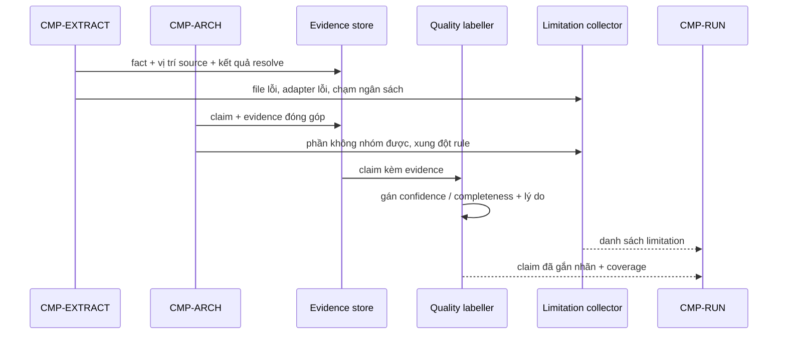

# CMP-L3GEN-EVIDENCE — Bằng chứng, giới hạn và chất lượng

## 1. Trách nhiệm

Component này thực hiện [CAP-L3GEN-005](../l1/CAP-L3GEN-005.md): giữ đường truy ngược từ
mỗi claim về đúng `source snapshot` của lần chạy, gắn nhãn chất lượng, và tổng hợp
`limitation` cùng `coverage` của toàn run.

Nó là **chủ của ba bất biến về sự thật**: #1 (evidence chỉ trỏ vào snapshot của chính run
đó), #3 (mọi claim công bố phải có evidence), #5 (confidence, completeness và coverage là
ba trục độc lập).

Nó **không** tạo claim mới, **không** sửa claim, **không** quyết định cách hiển thị. Nó
chỉ mô tả chất lượng của cái đã có.

## 2. Cấu trúc bên trong

| Phần | Việc | Vì sao tách |
|---|---|---|
| Evidence store | Giữ evidence, liên kết cha–con, đánh dấu khi bị rút gọn | Thay đổi khi đổi cách lưu đường suy luận |
| Quality labeller | Gán `exact`/`inferred`, `full`/`partial`, `unresolved`/`ambiguous` kèm lý do | Thay đổi khi thêm nhãn hoặc luật gán |
| Limitation collector | Nhận báo cáo giới hạn từ mọi component, gom thành một danh sách | Là điểm gom duy nhất của bất biến #4 |
| Coverage reporter | Tổng hợp phần đã xét, bị loại, lỗi, ngoài phạm vi của toàn run | Thay đổi khi đổi cách trình bày độ phủ |

Ba trục độc lập của bất biến #5 được thực thi bằng cấu trúc: Quality labeller gán
confidence và completeness cho **từng claim**, còn Coverage reporter mô tả phạm vi của
**toàn run**. Hai phần khác nhau, không đọc dữ liệu của nhau, nên không thể vô tình lấy
trục này thay trục kia.

## 3. Sequence

1. `EXTRACT` và `ARCH` gửi evidence và báo cáo giới hạn trong suốt quá trình chạy, **không
   phải chỉ ở bước cuối**.
2. Evidence store giữ liên kết cha–con của đường suy luận.
3. Quality labeller gán nhãn cho từng claim kèm lý do khi không phải `exact`/`full`.
4. Limitation collector gom mọi giới hạn thành một danh sách.

## 4. Failure mode

| Hỏng ở đâu | Hành vi bắt buộc |
|---|---|
| Một claim không có evidence nào | **Không xảy ra nếu code đúng** — `ARCH` đã chặn ở mục 5. Nếu vẫn lọt tới đây thì đó là lỗi lập trình: **gắn nhãn cảnh báo "thiếu bằng chứng"** và chạy tiếp, không giết cả run |
| Evidence trỏ tới file không còn trong snapshot | Giữ evidence, **gắn nhãn cảnh báo "nguồn không còn"**. Người đọc thấy ngay là không mở được |
| Đường suy luận quá dài | Rút gọn được, nhưng **phải giữ vị trí đầu và cuối cùng lý do**, và đánh dấu đã rút gọn |
| Không gán được nhãn chất lượng | Dùng nhãn thận trọng nhất kèm lý do, không để trống |
| Một component không báo cáo giới hạn | Không phát hiện được từ đây. Đây là **rủi ro đã biết**: xem mục 7 |
| Coverage không cân (`analyzed + skipped` khác `files_found`) | Run chuyển sang **`partial`**, và limitation ghi rõ số chênh lệch cùng danh sách file không rõ tung tích. Không chặn run, không giữ `completed` |

**Bất biến #3 không bị nới.** Luật vẫn là: mọi architecture claim công bố phải có evidence,
và `ARCH` mục 5 chặn ngay từ chỗ dựng model. Hai dòng đầu bảng trên nói về **cách xử lý khi
luật bị vi phạm do lỗi lập trình**, không phải cho phép claim thiếu bằng chứng.

Chọn ghi chú thay vì chặn run vì hai lỗi này là **sai lộ ra**: người đọc nhìn thấy nhãn
cảnh báo và tự đánh giá được. Giết cả run vì một claim hỏng sẽ làm mất toàn bộ phần còn
lại vốn dùng được — trái tinh thần bất biến #9. Nhưng nhãn cảnh báo loại này phải được coi
là **lỗi cần sửa trong code**, không phải trạng thái bình thường của sản phẩm.

**Vì sao coverage không cân lại khác.** Nó là **sai ẩn đi**: kết quả trông hoàn hảo trong
khi một số file biến mất không dấu vết, và người đọc tin rằng phạm vi đã xét đủ. Không có
gì hiện ra để họ nghi ngờ. Vì vậy nó không chặn run, nhưng **phải** kéo trạng thái xuống
`partial` — đó là tín hiệu duy nhất người đọc nhận được. Cách kiểm tương ứng ở
AC-L3GEN-009-01.

Ranh giới then chốt: `finding` ở đây là **cảnh báo tất định cần xác minh**, không phải kết
luận lỗ hổng bảo mật hay lỗi nghiệp vụ của repository được phân tích.

## 5. Transaction boundary

Đơn vị trọn vẹn là **bộ evidence và limitation của một run**.

Không giao từng phần ra ngoài: `PRESENT` nhận một bộ đã hoàn chỉnh, vì một danh sách
limitation thiếu còn nguy hiểm hơn không có danh sách nào — người đọc sẽ tin rằng phần
không được nhắc tới là đã xét đủ.

Evidence là **append-only trong phạm vi một run**: đã ghi thì không sửa, không xoá. Sai
thì thêm bản đính chính. Lý do: evidence sửa được sau khi đã kết luận thì không chứng minh
được gì.

## 6. Idempotency

Cùng tập fact + claim phải cho **cùng evidence, cùng nhãn, cùng danh sách limitation, cùng
thứ tự**.

ID của evidence phải ổn định giữa các lần chạy, cùng lý do như ID node ở `ARCH`: nếu ID
đổi thì đường truy ngược hỏng.

Thứ tự trong danh sách limitation phải xác định, không theo thứ tự nhận được — vì các
component gửi báo cáo bất đồng bộ, thứ tự đến sẽ khác nhau giữa hai lần chạy.

Gán nhãn hai lần cho cùng một claim phải cho cùng kết quả; luật gán nhãn không được phụ
thuộc trạng thái tích luỹ.

## 7. Concurrency

Limitation collector nhận báo cáo từ nhiều component, và ở `EXTRACT` có thể từ nhiều luồng
cùng lúc. Nó phải chịu được ghi đồng thời, và sắp lại theo khoá xác định trước khi giao đi.

Evidence store cũng nhận ghi đồng thời. Vì append-only nên không có xung đột sửa; rủi ro
duy nhất là thứ tự, và thứ tự được xử lý bằng cách sắp lại.

**Rủi ro đã biết, chưa có cơ chế chặn:** component này không tự phát hiện được việc một
component khác **quên** báo cáo giới hạn. Bất biến #4 dựa vào việc mọi component đều báo
cáo trung thực. Cách kiểm bằng máy — ví dụ đối chiếu số file trong inventory với số file
thực sự có fact — là **quyết định còn phải chốt ở L3 contract**. Cho tới lúc đó, đây là
điểm phải soi kỹ khi review code.

## Capability và FR liên quan

| Nguồn | Nội dung |
|---|---|
| [CAP-L3GEN-005](../l1/CAP-L3GEN-005.md) | Công bố bằng chứng, giới hạn và chất lượng |
| [FR-L3GEN-007](../../requirements/fr/FR-L3GEN-007.md) | Kiểm chứng kết luận bằng nguồn và nhãn |
| [FR-L3GEN-009](../../requirements/fr/FR-L3GEN-009.md) | Báo lỗi và giới hạn theo từng lần phân tích |
| [NFR-TRACE-001](../../requirements/nfr/NFR-L3GEN-TRACE-001.md) | Nguồn bằng chứng và phiên bản |
| [NFR-REL-001](../../requirements/nfr/NFR-L3GEN-REL-001.md) | Hoàn tất và lỗi một phần |
