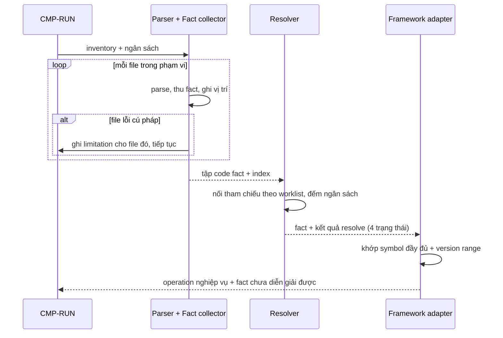

# CMP-L3GEN-EXTRACT — Trích xuất code fact theo stack

## 1. Trách nhiệm

Component này thực hiện [CAP-L3GEN-003](../l1/CAP-L3GEN-003.md): đọc source trong phạm vi
inventory đã chốt, sinh `code fact` tất định kèm vị trí source, và nối tham chiếu tới đích
với đúng một trạng thái `resolved` / `ambiguous` / `unresolved` / `runtime-dependent`.

Nó là **chủ của bất biến miền #9**: lỗi một file hoặc một adapter không được che mất phần
hợp lệ của run.

Nó **không** nâng fact thành `architecture claim` (thuộc `ARCH`), không quyết định nhãn
chất lượng công bố ra ngoài (thuộc `EVIDENCE`), không thực thi source (bất biến #2).

## 2. Cấu trúc bên trong

Bốn tầng, xếp theo mức phụ thuộc vào framework — tầng dưới không biết gì về tầng trên:

| Tầng | Việc | Biết về framework? |
|---|---|---|
| Parser | Sinh cây cú pháp cho một file | Không |
| Fact collector | Thu import, definition, scope, assignment, call, parameter, return, inheritance, decorator, condition, vị trí | Không |
| Resolver | Nối tham chiếu tới đích bằng index và worklist, có ngân sách | Không |
| Framework adapter | Diễn giải fact thành operation nghiệp vụ theo luật đã công bố | Có |

Adapter nằm **trên cùng và tách rời** là điểm quan trọng nhất của cấu trúc này: thêm
Java/Spring Boot ở phase sau chỉ cần thêm một Parser + Fact collector cho ngôn ngữ và một
bộ adapter, không đụng Resolver hay các component khác. Đây là tiêu chí "thay adapter
không lan" của ADR-2026-002.

Ba tầng dưới **không được** kết luận framework semantics. Thấy `router.get(...)` mới chỉ
là thấy một lời gọi và một tên; kết luận đó là route FastAPI là việc của adapter, và chỉ
khi khớp symbol đầy đủ.

### Ghi chú về cách giữ dữ liệu trong bộ nhớ

Hướng tối ưu đang cân nhắc, **chưa chốt** — thuộc L3 contract:

- Giữ dữ liệu xử lý nội bộ dạng bảng gọn (`files`, `strings`, `locations`, `scopes`,
  `symbols`, `imports`, `calls`, `edges`), mỗi record tham chiếu nhau bằng ID số thay vì
  lặp lại đường dẫn, tên và khoảng dòng.
- Lập index import/symbol tối thiểu cho toàn repository; nhưng assignment, argument,
  return và dataflow chi tiết **chỉ dựng quanh architectural anchor** khi cần.
- Giải phóng cây cú pháp sau khi đã trích fact của file đó.
- JSON đầy đủ dành cho output, fixture và debug — không phải định dạng làm việc bên trong.

Bốn điểm này ảnh hưởng tới bộ nhớ và tốc độ, không ảnh hưởng tới ranh giới trách nhiệm,
nên chúng là đầu vào cho L3 chứ không phải quyết định của CMP này.

## 3. Sequence

1. Run giao inventory và phần ngân sách còn lại.
2. Parser và Fact collector xử lý từng file; file lỗi được ghi limitation rồi bỏ qua.
3. Resolver nối tham chiếu bằng index và worklist, dừng khi chạm ngân sách.
4. Adapter diễn giải fact thành operation, chỉ khi khớp symbol đầy đủ và version range.
5. Fact không adapter nào diễn giải được vẫn giữ lại, kèm lý do.

## 4. Failure mode

| Hỏng ở đâu | Hành vi bắt buộc |
|---|---|
| Một file lỗi cú pháp hoặc encoding | Ghi limitation cho **file đó**, mọi file khác vẫn xử lý bình thường (bất biến #9) |
| Một adapter ném lỗi | Ghi limitation cho **adapter đó**, các adapter khác vẫn chạy. Không mất fact đã thu |
| Resolver không dừng được (vòng lặp, bùng nổ candidate) | Ngân sách cắt; phần chưa nối được đánh `unresolved` kèm lý do "chạm ngân sách" |
| Đích nối được nhưng có nhiều khả năng | Đánh `ambiguous`, giữ danh sách ứng viên. **Không** chọn bừa một cái |
| Đích phụ thuộc giá trị lúc chạy | Đánh `runtime-dependent`. Phase đầu không chạy source để xác nhận |
| Fact không adapter nào nhận | Giữ nguyên là code fact chưa diễn giải, không vứt bỏ |

Nguyên tắc: **hỏng một phần tử không được lan ra phần tử khác.** Đơn vị cách ly là một
file với Parser, một adapter với tầng adapter.

## 5. Transaction boundary

Đơn vị trọn vẹn là **tập fact của một analysis unit**, không phải của một file.

Lý do: một quan hệ xuyên file chỉ có nghĩa khi cả hai đầu đã được thu. Giao fact ra ngoài
khi mới xử lý nửa số file sẽ khiến `ARCH` thấy một đồ thị khuyết mà không biết là khuyết.

Bên trong, mỗi file vẫn là một đơn vị cách ly lỗi — nhưng đó là ranh giới **failure**,
không phải ranh giới **transaction**. Hai khái niệm này khác nhau và không được trộn.

Component không ghi gì ra đĩa; kết quả nằm trong bộ nhớ của run và chuyển tiếp cho chặng
sau.

## 6. Idempotency

Cùng snapshot + cùng inventory + cùng rule version phải cho **cùng tập fact, cùng ID,
cùng thứ tự**.

Ba nguồn có thể phá tính tất định, đều phải chặn:

| Nguồn rủi ro | Cách chặn |
|---|---|
| Thứ tự duyệt file | Nhận thứ tự đã sắp từ `INVENTORY`, không tự duyệt lại |
| ID sinh theo bộ đếm khi chạy song song | ID phải suy ra từ nội dung và vị trí, không từ thứ tự hoàn thành |
| Ngân sách cắt ở điểm khác nhau giữa hai lần chạy | Ngân sách phải đếm theo đơn vị tất định (số file, số candidate), **không** theo đồng hồ, ở những chỗ ảnh hưởng tới kết quả |

Điểm cuối là ràng buộc thật sự khó: cắt theo thời gian thực sẽ cho kết quả khác nhau giữa
hai lần chạy trên cùng đầu vào, phá bất biến #6. Cách đếm ngân sách tất định là **quyết
định còn phải chốt ở L3**.

Chạy lại không có tác dụng phụ: không cache, không ghi trạng thái ra ngoài run.

## 7. Concurrency

Xử lý nhiều file song song được phép ở tầng Parser và Fact collector, vì mỗi file độc lập.

Hai ràng buộc bắt buộc:

- Kết quả phải được gom và sắp lại theo khoá xác định trước khi giao cho Resolver.
- ID của fact không được phụ thuộc thứ tự hoàn thành của các luồng.

Resolver **không** song song hoá theo cách làm đổi kết quả: worklist có thể chạy nhiều
luồng, nhưng thứ tự lấy ra khỏi hàng đợi phải xác định, và ngân sách phải được đếm tập
trung — nếu mỗi luồng đếm riêng thì tổng sẽ khác nhau giữa các lần chạy.

Giữa các run: không chia sẻ gì. Adapter registry là dữ liệu chỉ đọc, dùng chung được.

## Capability và FR liên quan

| Nguồn | Nội dung |
|---|---|
| [CAP-L3GEN-003](../l1/CAP-L3GEN-003.md) | Trích xuất code fact theo stack |
| [FR-L3GEN-003](../../requirements/fr/FR-L3GEN-003.md) | Liệt kê API routes và handler |
| [FR-L3GEN-004](../../requirements/fr/FR-L3GEN-004.md) | Liệt kê mô hình dữ liệu |
| [FR-L3GEN-005](../../requirements/fr/FR-L3GEN-005.md) | Liệt kê lời gọi HTTP và đích bên ngoài |
| [FR-L3GEN-006](../../requirements/fr/FR-L3GEN-006.md) | Truy vết tham chiếu và lời gọi xuyên file |
| [FR-L3GEN-014](../../requirements/fr/FR-L3GEN-014.md) | Xem cấu hình mà hệ thống sử dụng |
| [FR-L3GEN-015](../../requirements/fr/FR-L3GEN-015.md) | Xem quan hệ phát và nhận sự kiện |
| [NFR-ACC-001](../../requirements/nfr/NFR-L3GEN-ACC-001.md) | Độ chính xác của dữ kiện |
| [NFR-DET-001](../../requirements/nfr/NFR-L3GEN-DET-001.md) | Tái lập dữ kiện và định danh |
