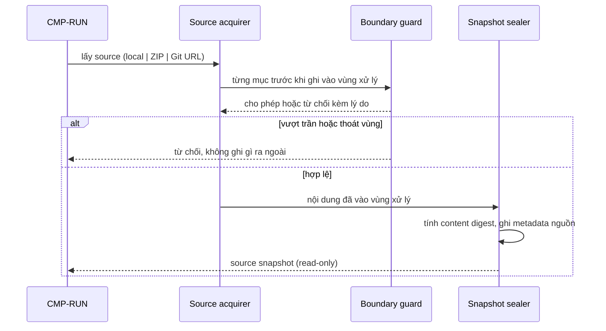

# CMP-L3GEN-INTAKE — Tiếp nhận source và chốt snapshot

## 1. Trách nhiệm

Component này gánh phần **tiếp nhận** của [CAP-L3GEN-001](../l1/CAP-L3GEN-001.md) và phần
khoanh vùng source vật lý của [CAP-L3GEN-002](../l1/CAP-L3GEN-002.md): nhận một trong ba
hình thức đầu vào, kiểm tính hợp lệ và an toàn, đưa nội dung vào vùng xử lý riêng, rồi
chốt `source snapshot` có content digest.

Đây là **chỗ duy nhất trong hệ thống chạm thế giới bên ngoài** — filesystem của người
dùng, file ZIP do người khác tạo, mạng Internet. ADR-2026-002 tách nó ra riêng chính vì
lý do này: dồn toàn bộ bề mặt tấn công về một component để threat model có chỗ bám.

Nó là **chủ của bất biến miền #2** (source read-only).

Nó **không** đọc nội dung source để hiểu (thuộc `EXTRACT`), không quyết định file nào
trong phạm vi phân tích (thuộc `INVENTORY`).

## 2. Cấu trúc bên trong

Bốn phần, chia theo **loại rủi ro** chứ không theo loại đầu vào:

| Phần | Việc | Rủi ro nó chặn |
|---|---|---|
| Source acquirer | Lấy byte về: đọc thư mục, giải nén ZIP, fetch Git | Đầu vào không tới được, hoặc tới quá chậm |
| Boundary guard | Chặn đường dẫn thoát vùng, symlink, trần kích thước và số file | Ghi file ra ngoài vùng xử lý |
| Snapshot sealer | Tính content digest, ghi metadata nguồn, khoá nội dung | Evidence trỏ nhầm khi source đổi |
| Workspace manager | Cấp và thu hồi vùng làm việc theo run id | Hai run giẫm lên nhau |

Boundary guard tách riêng vì nó phải chạy **trên mọi đường vào**, kể cả thư mục local.
Gộp nó vào từng acquirer thì ba đường sẽ có ba mức kiểm khác nhau, và đường yếu nhất
quyết định độ an toàn của cả hệ thống.

## 3. Sequence

1. Run yêu cầu lấy source theo một trong ba hình thức.
2. Acquirer lấy byte về, nhưng **mọi mục phải qua Boundary guard trước khi ghi**.
3. Guard từ chối mục thoát vùng, symlink trỏ ra ngoài, hoặc vượt trần kích thước/số file.
4. Nếu hợp lệ, Snapshot sealer tính digest và khoá nội dung.
5. Từ thời điểm này, snapshot là read-only với toàn hệ thống.

Với Git: ghi lại commit thực tế đã lấy, không chỉ ref người dùng yêu cầu. Với thư mục
local: commit SHA (nếu có) **không thay thế** digest, vì thư mục có thể có thay đổi chưa
commit.

## 4. Failure mode

| Hỏng ở đâu | Hành vi bắt buộc |
|---|---|
| Thư mục không tồn tại hoặc không có quyền đọc | Dừng trước khi phân tích, nói rõ đường dẫn và quyền cần sửa |
| ZIP hỏng hoặc sai định dạng | Từ chối; không giải nén một phần rồi phân tích tiếp |
| ZIP chứa đường dẫn thoát vùng giải nén | Từ chối toàn bộ; **không file nào được ghi ra ngoài vùng xử lý** |
| ZIP nén nhỏ nhưng giải nén vượt trần | Dừng giữa chừng, xoá phần đã giải, báo lý do |
| URL sai hoặc repository không tồn tại | Báo lỗi truy cập; **không** trả về kết quả như repository rỗng |
| Repository yêu cầu quyền | Nói rõ chưa có quyền; **không** hỏi người dùng credential |
| Mất kết nối giữa chừng | Cho thử lại; **không** dùng snapshot cũ thay thế |
| Output nằm lồng trong source | Phát hiện và loại, để output không bị quét ngược thành source của chính run đó |

Nguyên tắc chung: **thất bại phải rõ ràng**, không bao giờ biến thành "phân tích xong,
không tìm thấy gì".

## 5. Transaction boundary

Đơn vị trọn vẹn là **một snapshot đã seal**.

Một snapshot chỉ hợp lệ khi toàn bộ nội dung đã vào vùng xử lý và digest đã tính xong.
Giải nén dở, fetch dở, copy dở đều **không** tạo ra snapshot — chúng tạo ra lỗi.

Không có trạng thái trung gian nào được đưa cho component khác. `EXTRACT` không bao giờ
thấy một snapshot đang hình thành.

Vùng làm việc được dọn khi: run kết thúc và chính sách lưu trữ không yêu cầu giữ, hoặc
khi tiếp nhận thất bại giữa chừng. Dọn thất bại không làm hỏng run đang chạy, nhưng phải
được ghi lại để lần khởi động sau dọn nốt (NFR-PRIV-001).

## 6. Idempotency

Cùng một nguồn đưa vào hai lần **không bảo đảm** cùng digest, và đó là hành vi đúng:

| Nguồn | Hai lần lấy có cùng digest không |
|---|---|
| Git URL + commit SHA cụ thể | Có — nội dung cố định |
| Git URL + branch | Không bảo đảm — branch có thể đã đổi. Phải ghi commit thực tế đã lấy |
| ZIP cùng file | Có |
| Thư mục local | Không bảo đảm — người dùng có thể đã sửa file |

Đây chính là lý do bất biến #1 tồn tại: digest là thứ định danh nội dung, không phải
đường dẫn hay ref. Component này **không** cố làm cho hai lần lấy giống nhau; nó chỉ bảo
đảm mỗi lần đều ghi đúng digest của nội dung thật.

Việc lấy source **không** để lại tác dụng phụ lên nguồn: không tạo file, không sửa quyền,
không chạy Git hook, không lấy submodule. Lấy hai lần liên tiếp không làm nguồn thay đổi.

## 7. Concurrency

Mỗi run có vùng làm việc riêng theo run id. Hai run tiếp nhận cùng lúc không dùng chung
thư mục giải nén, không dùng chung thư mục clone.

Đọc song song cùng một thư mục local là hợp lệ vì source read-only. Không đặt khoá lên
source của người dùng — đó là can thiệp vào thứ không thuộc về hệ thống này.

**Rủi ro đã biết, chấp nhận ở phase đầu:** source local có thể bị sửa *trong lúc* đang đọc.
Digest tính xong không chứng minh mọi byte đã đọc thuộc cùng một trạng thái. Cách bảo đảm
chặt hơn (copy trước rồi mới đọc, hoặc phát hiện thay đổi giữa chừng) là **quyết định
thiết kế còn phải chốt ở L3 contract**, không chốt ở đây. Cho tới lúc đó, phải ghi giới
hạn này ra cho người đọc.

## Capability và FR liên quan

| Nguồn | Nội dung |
|---|---|
| [CAP-L3GEN-001](../l1/CAP-L3GEN-001.md) | Tiếp nhận source và điều phối lần phân tích |
| [CAP-L3GEN-002](../l1/CAP-L3GEN-002.md) | Kiểm kê phạm vi — phần khoanh vùng vật lý |
| [FR-L3GEN-001](../../requirements/fr/FR-L3GEN-001.md) | Nhận thư mục source |
| [FR-L3GEN-016](../../requirements/fr/FR-L3GEN-016.md) | Nhận Git URL và bản nén |
| [NFR-SEC-001](../../requirements/nfr/NFR-L3GEN-SEC-001.md) | An toàn khi tiếp nhận và phân tích source |
| [NFR-PRIV-001](../../requirements/nfr/NFR-L3GEN-PRIV-001.md) | Vòng đời dữ liệu và cleanup |
| [NFR-PERF-001](../../requirements/nfr/NFR-L3GEN-PERF-001.md) | Trần ZIP, số file và timeout fetch |
