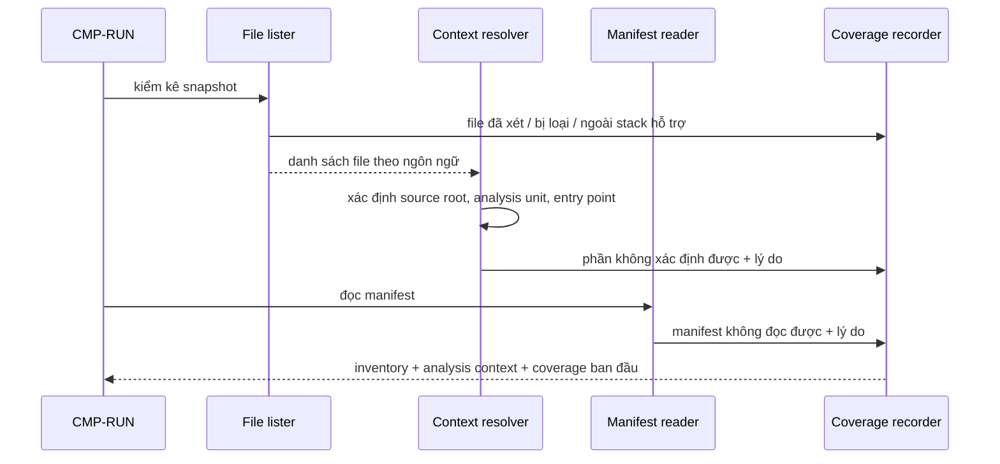

# CMP-L3GEN-INVENTORY — Kiểm kê phạm vi và ngữ cảnh phân tích

## 1. Trách nhiệm

Component này thực hiện [CAP-L3GEN-002](../l1/CAP-L3GEN-002.md): từ một `source snapshot`
đã seal, lập danh sách file ổn định, xác định `analysis unit`, `entry point` và
`analysis context`, đồng thời liệt kê thư viện bên ngoài mà repository khai báo.

Nó là **chủ của bất biến miền #4**: phần không đọc được hoặc ngoài stack hỗ trợ phải
thành `limitation`, không thành kết quả rỗng. Mọi kết luận "không phát hiện thấy" ở các
component sau đều dựa vào phạm vi mà component này công bố.

Nó **không** đọc nội dung code để hiểu ngữ nghĩa (thuộc `EXTRACT`), không kết luận quan hệ
giữa component (thuộc `ARCH`).

## 2. Cấu trúc bên trong

| Phần | Việc | Vì sao tách |
|---|---|---|
| File lister | Duyệt snapshot, sắp xếp ổn định, phân loại theo ngôn ngữ | Thay đổi khi thêm extension hoặc luật loại trừ |
| Context resolver | Xác định source root, package root, analysis unit, entry point | Thay đổi khi thêm kiểu bố cục dự án |
| Manifest reader | Đọc manifest theo định dạng hỗ trợ, rút dependency khai báo | Thay đổi khi thêm hệ quản lý gói (pip, Maven) |
| Coverage recorder | Ghi phần đã xét, bị loại, lỗi, ngoài phạm vi | Là nơi bất biến #4 được thực thi |

Coverage recorder tách riêng vì nó phải nhận báo cáo từ cả ba phần kia. Nếu mỗi phần tự
ghi coverage theo cách riêng thì không ai bảo đảm được tổng số khớp.

## 3. Sequence

1. Run yêu cầu kiểm kê trên snapshot đã seal.
2. File lister duyệt và phân loại; mọi file bị loại đều được ghi kèm lý do.
3. Context resolver xác định ranh giới đơn vị phân tích từ bố cục và entry point.
4. Manifest reader rút dependency đã khai báo.
5. Coverage recorder tổng hợp, bảo đảm tổng số file khớp.

## 4. Failure mode

| Hỏng ở đâu | Hành vi bắt buộc |
|---|---|
| Một file không đọc được (quyền, encoding) | Ghi vào coverage với lý do, tiếp tục file khác |
| Manifest sai cú pháp | Ghi limitation; **không** suy dependency từ import để lấp chỗ trống |
| Không xác định được source root | Dùng phạm vi rộng hơn và ghi rõ là suy đoán; không đoán một root rồi im lặng |
| Repository phẳng hoặc trộn nhiều ngôn ngữ | **Không được bỏ sót âm thầm**; mọi file hỗ trợ phải vào inventory |
| Hai source root có module trùng tên | Giữ riêng, **không** gộp làm một |
| Không file nào thuộc stack hỗ trợ | Trả inventory rỗng kèm limitation "toàn bộ ngoài stack hỗ trợ", **không** báo repository rỗng |

Ranh giới then chốt: `files_found` phải bằng `analyzed + skipped` trong tập đã chọn
(AC-L3GEN-009-01). Con số không khớp là lỗi của component này.

## 5. Transaction boundary

Đơn vị trọn vẹn là **một bản inventory của một snapshot**.

Inventory chỉ được giao cho chặng sau khi đã duyệt hết snapshot và coverage đã cân. Không
có inventory từng phần: `EXTRACT` không bao giờ bắt đầu trên một danh sách đang được bổ
sung, vì như vậy phạm vi sẽ đổi giữa chừng và mọi kết luận "không phát hiện thấy" mất
nghĩa.

Component này **không ghi gì ra đĩa ngoài vùng làm việc** và không sửa snapshot.

## 6. Idempotency

Cùng snapshot digest + cùng cấu hình phạm vi phải cho **cùng inventory, cùng thứ tự**.

Thứ tự ổn định là yêu cầu bắt buộc, không phải tuỳ chọn: thứ tự duyệt file ảnh hưởng tới
thứ tự fact ở chặng sau, và qua đó ảnh hưởng tới ID trong kết quả. Thứ tự do hệ điều hành
trả về **không** được dùng trực tiếp; phải sắp xếp theo một khoá xác định.

Chạy lại trên cùng snapshot không có tác dụng phụ: component không ghi cache, không đánh
dấu file đã xử lý.

## 7. Concurrency

Bên trong một run, kiểm kê nhiều file song song là được phép, với hai điều kiện: kết quả
phải được sắp lại theo khoá xác định trước khi giao đi, và Coverage recorder phải là điểm
gom duy nhất.

Giữa các run: không chia sẻ trạng thái. Hai run trên cùng một thư mục local đọc độc lập.

**Không có tài nguyên tranh chấp** trong component này vì nó chỉ đọc. Mục này tồn tại để
ghi rõ điều đó, không phải vì không nghĩ tới: rủi ro thật nằm ở chỗ khác — song song hoá
làm mất thứ tự ổn định, và đó là lỗi tính tất định chứ không phải lỗi tranh chấp.

## Capability và FR liên quan

| Nguồn | Nội dung |
|---|---|
| [CAP-L3GEN-002](../l1/CAP-L3GEN-002.md) | Kiểm kê phạm vi và đơn vị phân tích |
| [FR-L3GEN-002](../../requirements/fr/FR-L3GEN-002.md) | Nhận diện đơn vị phân tích và phạm vi hỗ trợ |
| [FR-L3GEN-018](../../requirements/fr/FR-L3GEN-018.md) | Xem thư viện bên ngoài mà hệ thống phụ thuộc |
| [NFR-COMP-001](../../requirements/nfr/NFR-L3GEN-COMP-001.md) | Phạm vi stack được công bố |
| [NFR-TRACE-001](../../requirements/nfr/NFR-L3GEN-TRACE-001.md) | Nguồn bằng chứng và phiên bản |
