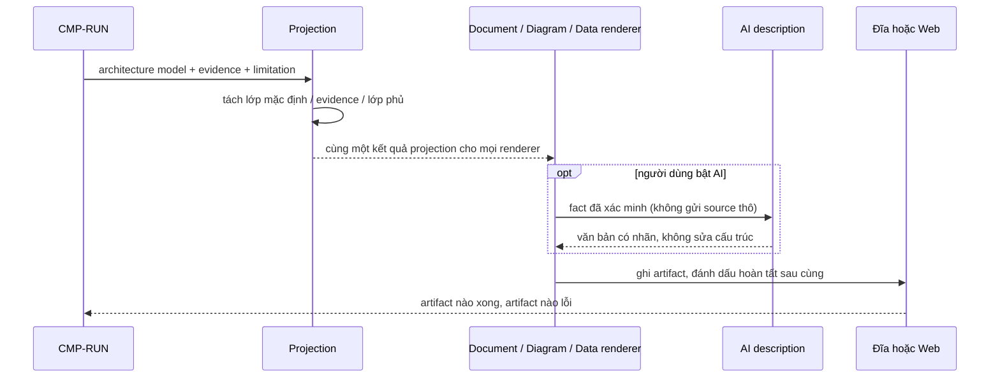

# CMP-L3GEN-PRESENT — Trình bày và xuất kết quả

## 1. Trách nhiệm

Component này thực hiện [CAP-L3GEN-006](../l1/CAP-L3GEN-006.md): đưa `architecture model`
tới người đọc và tới công cụ khác — giao diện web, tài liệu Markdown, diagram-as-code,
JSON có schema version, và mô tả bằng AI khi người dùng bật.

Nó là **chủ của bất biến miền #6**: không kênh nào được tự phân tích source theo luật
riêng; mọi cấu trúc trình bày phải đến từ cùng một architecture model.

Nó **không** tạo claim hay evidence mới, **không** suy thêm quan hệ, **không** sửa nhãn
chất lượng.

## 2. Cấu trúc bên trong

Năm phần. Ranh giới quan trọng nhất là giữa **projection** và các **renderer**:

| Phần | Việc | Vì sao tách |
|---|---|---|
| Projection | Chọn phần nào của model là lớp mặc định, phần nào là evidence, phần nào là lớp phủ | Là nơi bất biến #7 và #3 được thực thi một lần cho mọi kênh |
| Document renderer | Sinh Markdown L3 | Thay đổi khi đổi bố cục tài liệu |
| Diagram renderer | Sinh diagram-as-code | Thay đổi khi đổi công cụ vẽ |
| Data exporter | Sinh JSON có schema version | Thay đổi khi bump schema |
| Web view | Phục vụ giao diện khám phá | Thay đổi khi đổi màn hình |

Projection đứng trước cả bốn renderer là điểm mấu chốt: nếu mỗi renderer tự quyết định
hiển thị gì thì web và CLI sẽ lệch nhau, phá bất biến #6. Bốn renderer nhận **cùng một**
kết quả projection.

Web view **không được** gọi thẳng `EXTRACT` hay `ARCH`, không import parser.

## 3. Sequence

1. Nhận model, evidence và limitation.
2. Projection tách ba lớp một lần duy nhất.
3. Các renderer sinh artifact từ cùng kết quả đó.
4. Nếu AI được bật, nó chỉ nhận fact đã xác minh và chỉ trả về văn bản có nhãn.
5. Ghi artifact; dấu hiệu hoàn tất ghi **sau cùng**.

## 4. Failure mode

| Hỏng ở đâu | Hành vi bắt buộc |
|---|---|
| Một artifact ghi lỗi (hết đĩa, không có quyền) | Giữ nguyên kết quả phân tích, báo **artifact nào** lỗi, cho thử lại. Không mất các artifact khác |
| AI không có key, hết quota hoặc mất mạng | Tiếp tục bình thường, bỏ phần mô tả. **Không** ảnh hưởng cấu trúc (bất biến #8) |
| AI trả về nội dung không hợp lệ | Bỏ nội dung đó, giữ artifact cấu trúc. Không để AI chèn fact mới |
| Diagram vượt trần số node | Rút gọn **có thông báo** và dẫn tới dữ liệu đầy đủ; không xuất đồ thị khổng lồ để người đọc tự lọc |
| Web mất kết nối giữa chừng | Kết quả trên đĩa không bị ảnh hưởng |
| Model rỗng | Vẫn xuất đủ bộ artifact, với phần limitation nói rõ vì sao rỗng |

## 5. Transaction boundary

Đơn vị trọn vẹn là **bộ artifact bắt buộc của một run**.

Quy tắc ghi: mọi artifact được ghi trước, **dấu hiệu hoàn tất ghi sau cùng**. Ngắt giữa
chừng để lại một thư mục không mang dấu hoàn tất — người đọc và công cụ khác phân biệt
được ngay, và dữ liệu của lần chạy thành công trước đó không bị phá
(AC-L3GEN-009-04).

Mô tả AI **nằm ngoài** ranh giới này: nó là phần bổ sung, thiếu nó không làm bộ artifact
mất tính trọn vẹn.

Web view không có transaction: nó đọc kết quả đã chốt, không ghi gì vào bộ artifact.

## 6. Idempotency

Cùng model + cùng cấu hình xuất phải cho **cùng nội dung artifact cấu trúc**, không phụ
thuộc thư mục đích, kênh sử dụng hay chế độ AI.

Phần được phép khác giữa hai lần chạy: mốc thời gian, thời lượng, run id, đường dẫn tuyệt
đối của vùng làm việc — tất cả nằm trong run metadata. **Không được** làm giả các giá trị
này thành hằng số để đạt bằng nhau theo byte.

Văn bản AI không nằm trong cam kết tất định, và phải tách khỏi artifact cấu trúc để phần
còn lại vẫn so sánh được.

Ghi lại lần thứ hai vào cùng thư mục: phải ghi đè an toàn hoặc hỏi xác nhận, không trộn
artifact của hai run thành một thư mục lẫn lộn.

## 7. Concurrency

Hai phiên web chạy song song (trần 2 phiên, NFR-PERF-001) phải ghi vào **hai thư mục kết
quả khác nhau**. Ghi chung một thư mục là lỗi, vì artifact của hai run sẽ trộn nhau mà
không có cách phân biệt.

Web view phục vụ nhiều người xem cùng lúc trên **cùng một kết quả đã chốt**: kết quả là
dữ liệu chỉ đọc, nhiều người xem không tranh chấp.

Bên trong một run, bốn renderer có thể chạy song song vì chúng đọc cùng một kết quả
projection bất biến và ghi vào các file khác nhau. Điều kiện bắt buộc: dấu hiệu hoàn tất
chỉ được ghi sau khi **mọi** renderer bắt buộc đã xong.

Gọi AI là thao tác chậm và có thể thất bại; nó phải chạy tách khỏi đường ghi artifact cấu
trúc, để AI chậm không giữ bộ artifact ở trạng thái dở dang.

## Capability và FR liên quan

| Nguồn | Nội dung |
|---|---|
| [CAP-L3GEN-006](../l1/CAP-L3GEN-006.md) | Trình bày và xuất kết quả |
| [FR-L3GEN-008](../../requirements/fr/FR-L3GEN-008.md) | Xuất và sử dụng bộ kết quả |
| [FR-L3GEN-012](../../requirements/fr/FR-L3GEN-012.md) | Bổ sung mô tả bằng AI |
| [FR-L3GEN-013](../../requirements/fr/FR-L3GEN-013.md) | Phân tích và khám phá qua giao diện web |
| [ADR-2026-001](../adr/ADR-2026-001.md) | Mức trừu tượng của kết quả |
| [NFR-DET-001](../../requirements/nfr/NFR-L3GEN-DET-001.md) | Độc lập kênh và tái lập |
| [NFR-ABST-001](../../requirements/nfr/NFR-L3GEN-ABST-001.md) | Trần node của diagram mặc định |
| [NFR-AI-001](../../requirements/nfr/NFR-L3GEN-AI-001.md) | Ranh giới AI |
| [NFR-USA-001](../../requirements/nfr/NFR-L3GEN-USA-001.md) | Khả năng sử dụng |
