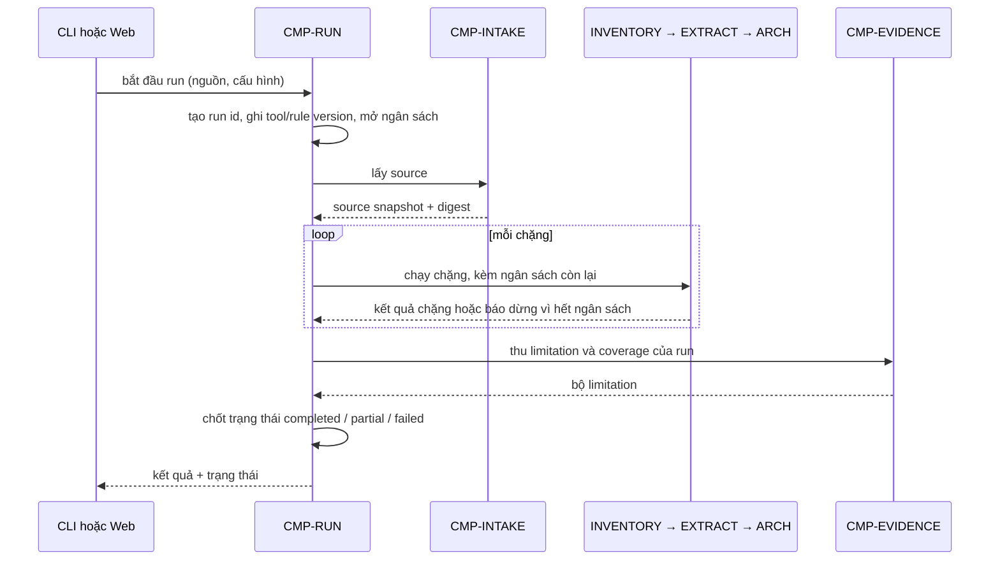

# CMP-L3GEN-RUN — Điều phối lần phân tích

## 1. Trách nhiệm

Component này gánh phần **điều phối** của [CAP-L3GEN-001](../l1/CAP-L3GEN-001.md): tạo
một `analysis run`, gọi các component khác theo đúng thứ tự phụ thuộc, giữ trạng thái và
ngân sách của lần chạy, rồi kết thúc run với đúng một trạng thái
`completed` / `partial` / `failed`.

Nó là **chủ duy nhất của bất biến miền #10**. Không component nào khác được quyền quyết
định một run là `completed` hay `partial`.

Nó **không** làm: lấy source (thuộc `INTAKE`), đọc source (thuộc `EXTRACT`), quyết định
phần nào là giới hạn (thuộc `EVIDENCE`), hiển thị (thuộc `PRESENT`).

## 2. Cấu trúc bên trong

Ba phần, chia theo thứ nguyên thay đổi khác nhau:

| Phần | Việc | Vì sao tách |
|---|---|---|
| Run state | Giữ định danh run, trạng thái, mốc thời gian, tool/rule version | Thay đổi khi contract trạng thái đổi |
| Stage driver | Gọi các component theo thứ tự phụ thuộc, nhận kết quả từng chặng | Thay đổi khi thêm hoặc bớt chặng |
| Budget guard | Đếm thời gian, bộ nhớ, số file, số candidate; phát tín hiệu dừng | Thay đổi khi ngưỡng NFR đổi |

Budget guard tách riêng vì nó là thứ duy nhất được phép **ngắt** một chặng đang chạy. Gộp
nó vào stage driver thì mỗi chặng sẽ tự kiểm ngân sách theo cách riêng, và bất biến #10
mất chủ.

## 3. Sequence

1. Người gọi (dòng lệnh hoặc web) yêu cầu một lần phân tích.
2. Run tạo định danh, ghi phiên bản công cụ và rule, mở ngân sách theo NFR-PERF-001.
3. Run gọi `INTAKE` lấy source; nhận về `source snapshot` có digest.
4. Run chạy lần lượt các chặng, mỗi chặng nhận phần ngân sách còn lại.
5. Run thu `limitation` và `coverage` từ `EVIDENCE`.
6. Run chốt trạng thái và trả kết quả.

## 4. Failure mode

| Hỏng ở đâu | Hành vi bắt buộc |
|---|---|
| `INTAKE` không lấy được source | Run kết thúc `failed`. Không có bộ kết quả; không tạo thư mục output trông như đã chạy |
| Một chặng ném lỗi không lường trước | Run kết thúc `failed`, ghi chặng nào lỗi. Không giữ lại kết quả nửa vời của chặng đó |
| Một file hoặc một adapter lỗi bên trong chặng | **Không** làm hỏng run. Chặng tự xử lý và báo lên; Run giữ nguyên trạng thái đang chạy (bất biến #9) |
| Hết ngân sách giữa chừng | Run dừng chặng đang chạy, chốt `partial`, giữ phần đã xong (bất biến #10) |
| Người gọi hủy giữa chừng | Xử lý như hết ngân sách: `partial` kèm lý do "bị hủy" |
| `EVIDENCE` báo coverage không cân | Run chuyển sang `partial` dù mọi chặng đã chạy xong. Số file trong inventory không khớp số file có dữ kiện nghĩa là phạm vi thực tế hẹp hơn phạm vi công bố |

Ranh giới quan trọng: **lỗi một phần tử bên trong chặng** khác **lỗi của chặng**. Cái đầu
là limitation, cái sau là failure của run.

## 5. Transaction boundary

Đơn vị trọn vẹn là **một analysis run**, không phải một chặng.

Run chỉ được đánh dấu `completed` khi mọi chặng bắt buộc đã chạy xong và `PRESENT` báo đã
ghi đủ artifact bắt buộc. Trước thời điểm đó, thư mục kết quả **không được mang dấu hiệu
hoàn tất** — dấu hiệu đó (ví dụ tệp metadata của run) là thứ ghi sau cùng.

Nằm ngoài ranh giới: bản sao source trong vùng làm việc của `INTAKE`. Nó có vòng đời riêng
theo chính sách hết hạn ở NFR-PRIV-001, không bị xoá hay giữ theo trạng thái run.

## 6. Idempotency

Khoá idempotency: `(source digest, cấu hình phân tích, tool version, rule version)`.

Hai run cùng khoá này phải cho cùng deterministic core — cùng tập fact, claim, evidence,
limitation và nhãn. Đây là bất biến #6, và Run là nơi **ghi lại** bốn thành phần của khoá
để kiểm được; nó không tự bảo đảm tính tất định, việc đó thuộc từng chặng.

Được phép khác giữa hai run cùng khoá: run id, mốc thời gian, thời lượng, đường dẫn tuyệt
đối của vùng làm việc. Những thứ này thuộc run metadata, không được đưa vào phần so sánh.

Run **không** tái sử dụng kết quả cũ khi gặp lại cùng khoá. Không có cache giữa các run ở
phase đầu; mỗi yêu cầu là một run mới.

## 7. Concurrency

Trần 2 phiên chạy đồng thời theo NFR-PERF-001; phiên thứ ba xếp hàng.

Mỗi run có **vùng làm việc riêng** định danh theo run id. Hai run không dùng chung thư mục
tạm, không dùng chung bộ nhớ đệm có trạng thái, và không ghi vào cùng thư mục kết quả.

Không có khoá trên source: source là read-only (bất biến #2), nhiều run đọc cùng một thư
mục local cùng lúc là hợp lệ. Nhưng mỗi run tự chốt digest của riêng nó, nên nếu source
đổi giữa hai lần chạy thì hai digest khác nhau — đúng theo bất biến #1, không phải lỗi.

Ngân sách bộ nhớ 2 GiB là **cho mỗi phiên**, không phải tổng. Budget guard đếm riêng từng
run.

## Capability và FR liên quan

| Nguồn | Nội dung |
|---|---|
| [CAP-L3GEN-001](../l1/CAP-L3GEN-001.md) | Tiếp nhận source và điều phối lần phân tích |
| [FR-L3GEN-001](../../requirements/fr/FR-L3GEN-001.md) | Nhận thư mục source và bắt đầu phân tích |
| [FR-L3GEN-010](../../requirements/fr/FR-L3GEN-010.md) | Chạy phân tích không phụ thuộc AI |
| [FR-L3GEN-017](../../requirements/fr/FR-L3GEN-017.md) | Theo dõi phiên phân tích — phase sau |
| [NFR-PERF-001](../../requirements/nfr/NFR-L3GEN-PERF-001.md) | Trần thời gian, bộ nhớ và số phiên |
| [NFR-REL-001](../../requirements/nfr/NFR-L3GEN-REL-001.md) | Hoàn tất, lỗi một phần và cách ly phiên |
