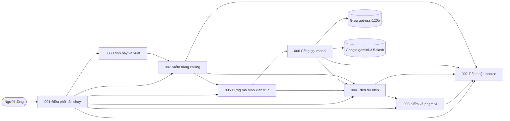

# Architecture view — CHG-L3GEN-2026-002

Bản gộp để review ở Architecture Gate, viết tay từ tám CMP, [ADR-2026-003](../../architecture/adr/ADR-2026-003.md) và [threat model](../../architecture/threat-model/TM-SYS-L3GEN.md), vì chưa có công cụ sinh. Khi view và nguồn khác nhau, **nguồn thắng**. CMP, ADR hay threat model đổi thì phải sửa lại view này.

## 1. Sơ đồ component

Mũi tên A → B nghĩa là A dùng B (`depends_on`).

## 2. Component, năng lực và mối đe dọa

| CMP | Tên | CAP | FR | Mối đe dọa | Mức |
|---|---|---|---|---|---|
| [CMP-L3GEN-001](../../architecture/l2/CMP-L3GEN-001.md) | Điều phối lần chạy | 007 | 019 | T-05, T-07 | Trung bình |
| [CMP-L3GEN-002](../../architecture/l2/CMP-L3GEN-002.md) | Tiếp nhận source | 007, 008 | 019, 020 | T-02, T-03, T-05 | Cao |
| [CMP-L3GEN-003](../../architecture/l2/CMP-L3GEN-003.md) | Kiểm kê phạm vi | 008 | 020 | Không trực tiếp | Thấp |
| [CMP-L3GEN-004](../../architecture/l2/CMP-L3GEN-004.md) | Trích dữ kiện | 009 | 021 | T-01, T-04, T-08 | Cao |
| [CMP-L3GEN-005](../../architecture/l2/CMP-L3GEN-005.md) | Dựng mô hình kiến trúc | 010 | 022 | T-10 | Trung bình |
| [CMP-L3GEN-006](../../architecture/l2/CMP-L3GEN-006.md) | Cổng gọi model | 010 | 022 | T-04, T-09, T-10, T-11, T-12 | Cao |
| [CMP-L3GEN-007](../../architecture/l2/CMP-L3GEN-007.md) | Kiểm bằng chứng | 011 | 023, 024 | T-08, T-10 | Trung bình |
| [CMP-L3GEN-008](../../architecture/l2/CMP-L3GEN-008.md) | Trình bày và xuất | 012 | 025, 026, 027 | T-06 | Trung bình |

Mọi CAP có ít nhất một CMP thực hiện.

## 3. Nguồn

| Artifact | Revision | Trạng thái |
|---|---|---|
| ADR-2026-003 | 1 | draft |
| TM-SYS-L3GEN | 3 | draft |
| CMP-L3GEN-001 | 1 | draft |
| CMP-L3GEN-002 | 1 | draft |
| CMP-L3GEN-003 | 1 | draft |
| CMP-L3GEN-004 | 1 | draft |
| CMP-L3GEN-005 | 1 | draft |
| CMP-L3GEN-006 | 1 | draft |
| CMP-L3GEN-007 | 1 | draft |
| CMP-L3GEN-008 | 1 | draft |

## 4. Chưa có trong view này

Phần sinh tài liệu L3 contract (gán contract cho component sở hữu, dựng OpenAPI và DDL, kiểm bằng chứng từng dòng) chưa thiết kế chi tiết ở L2. Khiêm quyết làm sau phần sơ đồ.
