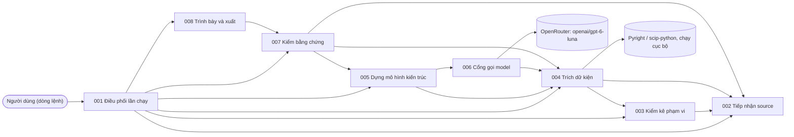

# Architecture view — CHG-L3GEN-2026-002

Bản gộp để review ở Architecture Gate, viết tay ngày 02/10/2026 từ tám CMP revision 4, [ADR-2026-003](../../architecture/adr/ADR-2026-003.md) revision 4, [ADR-2026-004](../../architecture/adr/ADR-2026-004.md) revision 2, [ADR-2026-005](../../architecture/adr/ADR-2026-005.md) revision 1 và [threat model](../../architecture/threat-model/TM-SYS-L3GEN.md) revision 6, vì chưa có công cụ sinh. Khi view và nguồn khác nhau, **nguồn thắng**. Nguồn đổi thì phải sửa lại view này. Bản này đã sửa theo review REVIEW-ARCH-L3GEN-2026-001.

Phạm vi: công cụ đọc một repository Python/FastAPI và sinh, trong một lần chạy, sơ đồ component có bằng chứng (FR-L3GEN-028) và tài liệu L3 theo component (FR-L3GEN-029 đến 031). Đợt này chỉ có dòng lệnh. Code ở `experiments/quote-evidence/`.

**Cập nhật 09/10/2026 (viết tay, theo BL-r11):** thêm [ADR-2026-006](../../architecture/adr/ADR-2026-006.md) r1 và CMP-L3GEN-004, 006, 007 revision 5 cho luồng agent FR-029 (model đề xuất, code kiểm bằng chứng). Sơ đồ ở mục 1 chưa vẽ lại; mục 2, 3, 5, 6 đã cập nhật. Nguồn thắng khi khác view.
## 1. Sơ đồ component

Mũi tên A → B nghĩa là A dùng B (`depends_on`).

CMP-006 dùng CMP-004 vì luật che bí mật nằm ở CMP-004.

## 2. Component, code, mối đe dọa, lệch

Mỗi CAP-L3GEN-007 đến 012 `covers` cả FR-L3GEN-028 đến 031, vì mỗi FR dọc đi qua đủ sáu năng lực. Cột "Lệch" là số dòng ở mục 8 của CMP đó.

| CMP | Tên | CAP | Code chính | Mối đe dọa | Mức | Lệch |
|---|---|---|---|---|---|---:|
| [CMP-L3GEN-001](../../architecture/l2/CMP-L3GEN-001.md) | Điều phối lần chạy | 007 | `l3gen.py`; `l3slice/engine.py`, `web.py` (web) | T-02, T-05, T-07 | Trung bình | 5 |
| [CMP-L3GEN-002](../../architecture/l2/CMP-L3GEN-002.md) | Tiếp nhận source | 007, 008 | `l3slice/snapshot.py`, `github.py`; `l3gen._in_scope` | T-02, T-03, T-05 | Cao (web), Trung bình | 2 |
| [CMP-L3GEN-003](../../architecture/l2/CMP-L3GEN-003.md) | Kiểm kê phạm vi | 008 | `inventory.py` | Không trực tiếp | Thấp | 4 |
| [CMP-L3GEN-004](../../architecture/l2/CMP-L3GEN-004.md) | Trích dữ kiện | 009 | `calls.py`, `pyindex.py`, `names.py`, `contract_trace.contracts`; `l3slice/extract.py` (không còn trên đường FR-029) | T-01, T-04, T-05, T-08 | Cao | 13 |
| [CMP-L3GEN-005](../../architecture/l2/CMP-L3GEN-005.md) | Dựng mô hình kiến trúc | 010 | `contract_trace.analyse`, `contract_llm.py`, `l3gen.split/role/archdia`; `l3slice/model.py` | T-08, T-10 | Trung bình | 10 |
| [CMP-L3GEN-006](../../architecture/l2/CMP-L3GEN-006.md) | Cổng gọi model | 010 | `llm.py`; `l3slice/docagent.py` (vòng agent FR-029) | T-04, T-07, T-09, T-10, T-11, T-12 | Cao | 7 |
| [CMP-L3GEN-007](../../architecture/l2/CMP-L3GEN-007.md) | Kiểm bằng chứng | 011 | `l3slice/verify.py`, `verify.py`; `l3slice/docfacts.py`, `astscan.py` (bộ kiểm FR-029) | T-04, T-08, T-10 | Trung bình | 7 |
| [CMP-L3GEN-008](../../architecture/l2/CMP-L3GEN-008.md) | Trình bày và xuất | 012 | `l3slice/render.py`; `l3gen.mermaid/markdown` | T-02, T-06, T-08, T-13 | Trung bình | 6 |

## 3. Bốn quyết định đem ra gate

| ADR | Quyết định | Ghi chú |
|---|---|---|
| [ADR-2026-003](../../architecture/adr/ADR-2026-003.md) r4 | Tám component; mọi request ra provider đi qua một component riêng (CMP-006) | Chọn 23/09/2026. Revision 3, 4 chỉ sửa bối cảnh (một provider OpenRouter) và cạnh `constrains` |
| [ADR-2026-004](../../architecture/adr/ADR-2026-004.md) r2 | Công cụ chia component của repository được phân tích theo contract (phương án D trong 4) | Ghi lại quyết định ngày 02/10/2026, đã vào FR-L3GEN-028 r3. Tiêu chí lập sau khi chọn. **Chưa có P/R** |
| [ADR-2026-005](../../architecture/adr/ADR-2026-005.md) r1 | Phân giải tên bằng Pyright, phần tự đọc làm dự phòng; Pyright chạy trên bản sao trong phạm vi, trong trần chung | Ghi lại quyết định 01–02/10/2026. Bộ nhớ đỉnh của Pyright chưa đo |
| [ADR-2026-006](../../architecture/adr/ADR-2026-006.md) r1 | FR-029: model đề xuất mọi dữ kiện API, code kiểm bằng chứng (từ chối, đánh dấu dòng nghi ngờ, nhắc; không tạo mục) | Ghi lại quyết định 07/10/2026 sau khi đã có code. Chờ OQ-L3GEN-018. Cả 4 repository nghiệm thu đạt NFR-ACC-002 (prompt v14, đo không mù); bộ kiểm 0 lỗi trên 37 bộ gold. Lệch NFR-SEC-002, NFR-AI-002 theo waiver chưa đủ |

## 4. Một lần chạy dòng lệnh

1. CMP-001 kiểm thư mục source và output; sai thì dừng, không tạo gì.
2. CMP-002 chụp snapshot; CMP-003 quyết file nào được xét trên snapshot; CMP-002 dựng bản sao chỉ gồm file trong phạm vi.
3. CMP-004 lập tập contract bằng bộ đọc có Pyright, điền chi tiết từng contract bằng bộ đọc contract, trích dữ kiện lần theo và dấu hiệu vai trò file.
4. CMP-005 lần theo từng contract, lập nhóm route; gửi nhóm qua CMP-006 cho model gộp và đặt tên; kiểm câu trả lời; dựng một mô hình: file, chủ contract, mũi tên, vai trò file.
5. CMP-007 kiểm mọi bằng chứng trên snapshot, che bí mật một lần, gom giới hạn.
6. CMP-008 escape chuỗi không tin cậy, ghi `archdia.*`, `tech-specs/`, `README.md`, `result.json` (có trạng thái) vào thư mục tạm rồi đổi tên một lần. Phần nào lỗi thì vẫn xuất phần còn lại, đánh `partial`.

## 5. Lệch giữa thiết kế và code

47 dòng lệch ở mục 8 của tám CMP, đếm ngày 02/10/2026 trên `runs/l3gen-v1/` (7 repository, 0 token, chưa đo với đáp án). Dòng liên quan AC của FR-L3GEN-029:

| AC | Hiện trạng code | Lệch |
|---|---|---|
| 029-01, 029-04 | Tập route khớp ở 6/7 repository. boilerplate: `GET /health` có trên sơ đồ, không có trong file API; component `interfaces` không có thư mục. Quá 50 node thì phần L3 dừng | 004-1, 008-3, 008-5 |
| 029-05 | Route trong test bị loại; `add_api_route` chưa ghi giới hạn | 004-2 |
| 029-06 | README thiếu "Cấu trúc component", "Lời gọi HTTP ra ngoài"; sơ đồ README khác `archdia` | 008-1, 008-2, 005-9 |
| 029-07 | Vai trò file lệch tên, mặc định sai, thiếu Service | 005-1 |
| 029-08 | Chưa có | 004-3 |

AC-029-02 và 029-03 không có dòng lệch ở CMP nào.

**Thêm 09/10/2026:** 7 dòng lệch mới cho luồng agent FR-029: 004-13, 006-7, 007-3 đến 007-7 (hai bộ kiểm song song, chưa có test chặn "không tạo mục", bỏ sót và nhiễu còn biết, bản quy tắc lỗi thời, đụng OQ-L3GEN-013). Bảng AC ở trên mô tả luồng extractor, chưa phản ánh luồng agent. FR-L3GEN-030: 004-8, 004-9. FR-L3GEN-031: 004-7.

Lệch chung ảnh hưởng mọi FR: model chỉ chạy khi có cờ (001-1); output không được kiểm trước (001-2); snapshot không chụp trước, nhiều bước đọc thư mục gốc (002-1); Pyright ngoài trần (004-6); mũi tên còn gồm lời gọi tắt và log (005-10); trần model không theo từng lần chạy (006-1); cache model nằm ngoài thư mục output (006-6); bằng chứng sơ đồ không che bí mật (007-1); sơ đồ chưa escape chuỗi (008-6).

## 6. Nguồn

| Artifact | Revision | Trạng thái |
|---|---|---|
| ADR-2026-003 | 4 | draft |
| ADR-2026-004 | 2 | draft |
| ADR-2026-005 | 1 | draft |
| TM-SYS-L3GEN | 6 | draft |
| ADR-2026-006 | 1 | draft |
| CMP-L3GEN-001, 002, 003, 005, 008 | 4 | draft |
| CMP-L3GEN-004, 006, 007 | 5 | draft |
| CAP-L3GEN-007 đến 011 | 2 | draft |
| CAP-L3GEN-012 | 4 | draft |
| GLOSS-L3GEN-001 | 10 | draft |

## 7. Ngoài phạm vi lần review này

- Contract nội bộ của chính công cụ (bước 9; bản nháp API-L3GEN-001 đến 008 ở nhánh `feature/l3-slice`).
- Web: thiết kế giữ từ CMP revision 2, chưa có FR; không lập Task tới khi có FR.
- Số đo KPI-L3GEN-006, 008, 009: chưa có đáp án theo định nghĩa mới.
