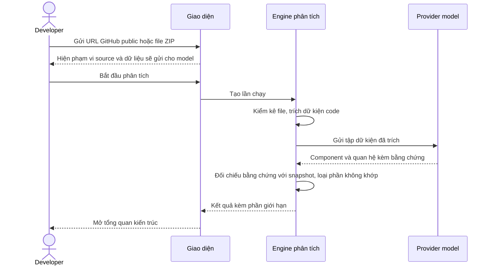
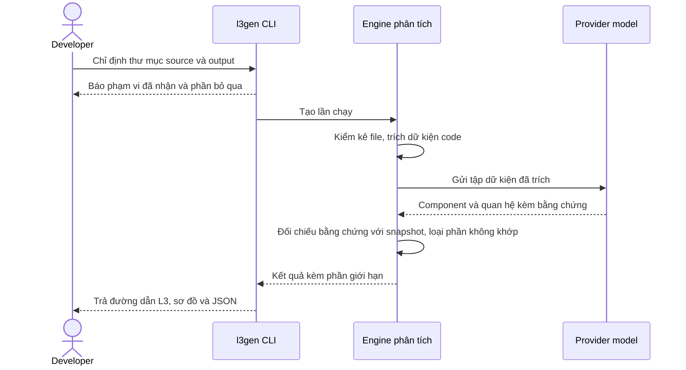
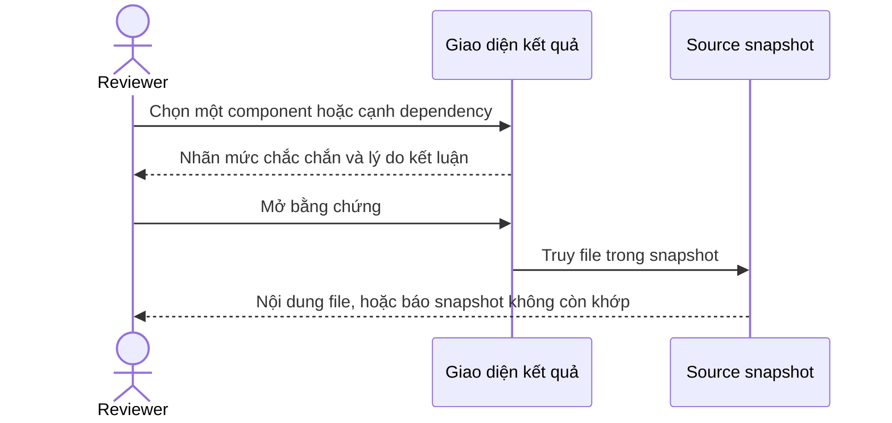

# PRD — Code → Architecture / L3 Generator

> Tạo tài liệu và sơ đồ kiến trúc ban đầu từ source, để developer và architect hiểu hệ thống và kiểm chứng từng kết luận tại mã nguồn.

**Trạng thái bản này:** viết lại theo hướng mentor giao ngày 22/09/2026. Phân tích tĩnh trích dữ kiện code kèm vị trí. Mô hình ngôn ngữ đề xuất component và quan hệ từ tập dữ kiện đó. Code kiểm từng đề xuất với dữ kiện trước khi công bố. Thay đổi đụng vào ràng buộc cốt lõi của bản đã duyệt, nên **BL-r14 và approval Scope Gate ngày 18/09/2026 đã superseded**. Bản này thuộc Change Set mới [CHG-L3GEN-2026-002](../../lifecycle/change-sets/CHG-L3GEN-2026-002/change-set.yaml) và phải ký lại Scope Gate.

**Phạm vi tài liệu:** mô tả full product roadmap và đánh dấu rõ cam kết phase đầu. Phạm vi và lịch phase đầu ở mục VIII. Code hiện có không quyết định phạm vi hoặc là bằng chứng đã đạt yêu cầu. Bản này chưa approved và chưa có kết quả nghiệm thu.

# I. THÔNG TIN TÀI LIỆU

| Trường | Nội dung |
|---|---|
| Loại tính năng | Platform Feature — mini-product kỹ thuật độc lập, satellite project #6 |
| Người chịu trách nhiệm | Khiêm — đầu mối Product và người ký Scope Gate; AI hỗ trợ soạn thảo |
| Reviewers | Hoàng — reviewer nội bộ và UAT mặc định; Nguyễn Chí Thức, Đinh Thái Hà — mentor reviewer/cố vấn |
| Epics liên quan | Chưa tạo: decomposition sau Scope Gate và thiết kế |
| Nguồn | [Đề bài gốc](../../../Đề%20bài.md), mục 3.6 và yêu cầu chung; [Ghi chép cơ chế phân tích](../../../docs/ARCHITECTURE_V2_IDEA.md); [mẫu PRD mentor](../../../docs/sdlc-sources/05-prd-template.md); [Execution Guide](../../../docs/agentic-sdlc-execution-guide.md), A, B.2–B.5, C.4, D.1b–D.2 |
| Change Set | [CHG-L3GEN-2026-002](../../lifecycle/change-sets/CHG-L3GEN-2026-002/change-set.yaml), thay cho CHG-L3GEN-2026-001 đã duyệt ngày 18/09/2026 |

## Nguồn yêu cầu và phần đề xuất

| Cơ sở | Nội dung và cách chốt |
|---|---|
| Đề bài mục 3.6 | Phân tích trên 1–2 stack; phát hiện module, entry point, API, business/data access, DB, external API, config/event và dependency. Tạo mô hình trung gian, component, L3 Markdown, các quan hệ và mã nguồn sơ đồ. Đề bài ghi AI chỉ bổ sung mô tả, còn quan hệ chính phải chứng minh được từ source bằng phân tích tĩnh. Bản này giữ phần "chứng minh bằng source" nhưng cho AI đề xuất quan hệ, theo hướng mentor ở dòng dưới |
| Yêu cầu người phụ trách PRD | Mô tả full product, không thu phạm vi theo base đang có. Yêu cầu này không tự xác định mọi tính năng mở rộng là bắt buộc. |
| Quyết định cách sử dụng và tích hợp | Phase đầu có hai kênh: CLI nhận thư mục local; web nhận ZIP/GitHub public và cho khám phá/evidence/export của lần chạy hiện tại. Lịch sử và public job API thuộc FR-L3GEN-017 cũ, chuyển sang phase sau. Ranh giới đã chốt tại OQ-L3GEN-002. |
| Đề xuất kỹ thuật và chất lượng | Python/FastAPI là stack phase đầu; Java/Spring Boot thuộc phase sau. Ma trận mức hỗ trợ theo ngôn ngữ và framework, cùng ngưỡng NFR, đã chốt tại OQ-L3GEN-003/004 của CHG-L3GEN-2026-001. Tên file và schema chi tiết thuộc contract sau Scope Gate. |
| Hướng mentor, 22/09/2026 | Dùng mô hình ngôn ngữ để đề xuất quan hệ kiến trúc; code vẫn phải chứng minh bằng chứng tại source. Mục đích là mở rộng sang framework khác mà không phải viết bộ luật riêng cho từng stack. Phase đầu vẫn là Python/FastAPI. Ghi nhận tại [CR-L3GEN-2026-002](../../evidence/requests/CR-L3GEN-2026-002.yaml) theo lời Khiêm truyền đạt; chưa có văn bản gốc của mentor |
| Quyết định ngày 22–23/09/2026 | Mô hình ngôn ngữ không đọc thẳng toàn bộ source. Phân tích tĩnh chạy trước để trích dữ kiện code kèm vị trí. Model đề xuất component và quan hệ từ tập dữ kiện đó. Một bước kiểm tất định giữ lại đề xuất có dữ kiện chứng minh và loại phần còn lại. Provider và model chốt tại OQ-L3GEN-008. Độ sâu của tầng tĩnh khai báo theo từng ngôn ngữ; ranh giới chi tiết thuộc ADR và L2 |

## Lịch sử thay đổi

| Version | Ngày | Người thực hiện | Mô tả |
|---|---|---|---|
| 0.1 / revision 1 | 2026-09-15 | AI hỗ trợ người phụ trách PRD | Bản đề xuất full product theo yêu cầu người dùng; không lấy code hiện tại làm scope |
| 0.2 / revision 2 | 2026-09-15 | AI hỗ trợ người phụ trách PRD | Làm rõ intake/gate còn thiếu, nguồn đề bài, người chịu trách nhiệm và tập revision khi ký; giữ nguyên scope full product |
| 0.3 / revision 3 | 2026-09-15 | AI hỗ trợ người phụ trách PRD | Đồng bộ blocker, NFR giao diện theo checklist sáng/tối; phân biệt mốc nội bộ với release; candidate r3 và cách kiểm hồ sơ |
| 0.4 / revision 4 | 2026-09-15 | AI hỗ trợ người phụ trách PRD | Gộp hướng dẫn vào một README, cập nhật liên kết và candidate r4; không đổi yêu cầu sản phẩm |
| 0.5 / revision 5 | 2026-09-15 | AI hỗ trợ người phụ trách PRD | Bỏ ví dụ repo đã thử và tên file bắt buộc; giới hạn cảnh báo ở kết quả phân tích kiến trúc; phân biệt yêu cầu gốc với đề xuất; sửa lỗi chữ ở dòng revision 4; candidate r5 |
| 0.6 / revision 6 | 2026-09-15 | AI hỗ trợ người phụ trách PRD | Dùng PRD và Change Set View làm luồng đọc chính; candidate r6; không đổi FR/AC/NFR |
| 0.7 / revision 7 | 2026-09-15 | AI hỗ trợ người phụ trách PRD | Phân biệt mốc bắt đầu với nghiệm thu đầy đủ; làm rõ phụ thuộc output/component/config/event; candidate r7; không đổi AC hoặc ngưỡng NFR |
| 0.8 / revision 8 | 2026-09-16 | Khiêm + AI hỗ trợ | Chốt ranh giới trình bày L3 (NFR-ABST-001, ADR-2026-001); chốt hai stack Python/FastAPI và Java/Spring Boot, event giới hạn Kafka; chốt lịch sử 10 lần/14 ngày và xóa thủ công; cập nhật ngưỡng tài nguyên; ràng buộc CLI và web cho cùng kết quả (NFR-DET-001, AC-L3GEN-019-05); bổ sung 6 edge case; đóng một phần OQ-003 |
| 0.9 / revision 9 | 2026-09-17 | Khiêm + AI hỗ trợ | Gộp nội dung mục I–V từ hai hướng: tên mentor và nguồn UC/Scenario; mô tả sản phẩm theo hai kênh; viết lại vấn đề, mục tiêu, giả định, ràng buộc, phụ thuộc, in/out scope; KPI thành 5 chỉ số và đánh số lại OBS theo đó; user flow gắn scenario và thêm luồng đối chiếu hai kênh |
| 1.0 / revision 10 | 2026-09-17 | Khiêm + AI hỗ trợ | Gộp mục VI–IX: DoD chia sáu nhóm và giới hạn phạm vi bàn giao ở mức pilot; thiết kế liệt kê bảy màn hình web kèm FR liên quan; timeline chuyển sang khung 4 tuần 11/09–09/10 với M0–M3 và ghi rủi ro lịch; phê duyệt thêm hàng mentor và nêu vấn đề thiếu người cho các vai ký |
| 1.1 / revision 11 | 2026-09-17 | Khiêm + AI hỗ trợ | Rà soát FR/NFR/OQ: mô tả FR-003/004/005 trung tính về ngôn ngữ và thêm AC Java cho FR-003/004/014; gỡ ngưỡng bị chép lại ở FR-017 và ba chỗ trong PRD, trỏ về NFR; thu hẹp OQ-002/004/005 theo phần đã chốt, sửa đường dẫn sai ở OQ-006; hạn OQ chuyển sang 19/09 |
| 1.2 / revision 12 | 2026-09-17 | Khiêm + AI hỗ trợ | IV.3 nhóm 17 FR theo ba use case, thêm cột Kênh và cập nhật mô tả theo hai stack; V.2 tách bảng edge case thành bảy nhóm theo SCENARIOS, tách các lỗi dòng lệnh và web vốn bị gộp thô, thêm cột Kênh; thêm AC-L3GEN-019-06 cho trường hợp source và output lồng nhau |
| 1.3 / revision 13 | 2026-09-17 | Khiêm + AI hỗ trợ | Rà lại sáu Open Question: viết lại câu hỏi cho khớp phần đã chốt thay vì chỉ thêm ghi chú ở dưới; gỡ thông tin lỗi thời về mentor, timebox và Git private; thu hẹp Blocking của OQ-004; đồng bộ bảng OQ trong PRD và thêm cột trạng thái |
| 1.4 / revision 14 | 2026-09-17 | Khiêm + AI hỗ trợ | Sửa 5 lỗi review: gỡ cỡ mẫu tự đặt ở II.4 và trỏ về OBS-001; gỡ ngưỡng 500 function chép lại ở V.2 và FR-011, trỏ về NFR-ABST-001; thêm trần số node vào AC-011-05; bổ sung ranh giới được phép khác vào AC-001-05; sửa cách kiểm AC-013-03; AC-001-03 cho phép xác nhận trước khi ghi đè |
| Revision 16 | 2026-09-17 | AI hỗ trợ theo yêu cầu rà soát | Đồng bộ Java, OQ đề xuất, KPI, vòng đời dữ liệu và candidate BL-r13; chưa có mentor approval |
| Revision 17 | 2026-09-18 | Khiêm + AI hỗ trợ | Đóng OQ-001: mentor trao quyền quyết định cho Khiêm và Hoàng; Khiêm là đầu mối Product/ký Scope Gate, Hoàng reviewer nội bộ/UAT mặc định; mentor là reviewer/cố vấn |
| Revision 18 | 2026-09-18 | Khiêm + AI hỗ trợ | Đóng OQ-002: phase đầu bốn tuần dùng Python qua CLI và web, giữ FR-013/016; chuyển Java và FR-017 đầy đủ sang phase sau; AI tiếp tục là Should |
| Revision 19 | 2026-09-18 | Khiêm + AI hỗ trợ | Đóng OQ-003: chốt ma trận supported/partial/unsupported cho Python phase đầu, YAML application config và Java roadmap; gỡ blocker khỏi FR liên quan |
| Revision 20 | 2026-09-18 | Khiêm + AI hỗ trợ | Đóng OQ-004: precision exact và component dependency 90%; chốt dataset/benchmark/ground truth; pilot ngoài nhóm không chặn phase đầu và KPI để not_evaluated nếu chưa tuyển được người |
| Revision 21 | 2026-09-18 | Khiêm + AI hỗ trợ | Đóng OQ-005: web chạy local, khóa intake GitHub/ZIP, AI mặc định tắt và chỉ dùng quota miễn phí với trần trả phí 0 đồng; chốt expiry/cleanup khi máy tắt |
| Revision 22 | 2026-09-18 | Khiêm + AI hỗ trợ | Đóng OQ-006: chấp nhận schema/tooling/impact cục bộ có công bố giới hạn cho Gate 1; giữ UID; mapping component/test hoàn tất trước Definition of Ready; chốt cách theo dõi Agent implementation |
| Revision 23 | 2026-09-18 | Khiêm + AI hỗ trợ | Chuẩn bị candidate BL-r14 sau khi đóng đủ OQ-001 đến OQ-006; chưa phải Scope Gate approval |
| Revision 24 | 2026-09-22 | Khiêm + AI hỗ trợ | Viết lại toàn bộ mục I đến IX theo hướng phân tích tĩnh trích dữ kiện rồi mô hình ngôn ngữ dựng quan hệ kiến trúc. Bỏ hai KPI pilot, thay bằng năm chỉ số tính được; bốn GOAL mới. Gộp 18 FR thành 8 và 11 NFR thành 5, đánh số lại, file cũ chuyển sang `requirements/_superseded-r23/`. Hạ tái lập xuống mức ghi nhận; model chuyển từ tùy chọn thành bắt buộc, chỉ dùng API với trần trả phí 0 đồng. Xóa use case, scenario và PRD trùng vai. Đóng OQ-007 ở mức 80%, mở OQ-008. BL-r14 và approval 18/09 superseded, phải ký lại |
| Revision 25 | 2026-09-23 | Khiêm + AI hỗ trợ | Chuyển sang Change Set mới CHG-L3GEN-2026-002 với CR-L3GEN-2026-002. Cấp key mới cho mọi yêu cầu, không dùng lại key cũ: GOAL-004 đến 007, KPI-006 đến 010, FR-019 đến 026, NFR-ABST/ACC/AI/SEC-002. Làm rõ model chỉ đề xuất, code kiểm dữ kiện chứng minh (AC-L3GEN-022-02, KPI-L3GEN-007). Đóng OQ-008: Groq, `openai/gpt-oss-120b`, gói miễn phí. Mang lại các ngưỡng đã duyệt ở BL-r14 bị rơi khi gộp NFR |

# II. TỔNG QUAN (EXECUTIVE SUMMARY)

## 1. Tóm tắt tính năng

L3 Generator đọc một source repository và tạo bản mô tả kiến trúc ban đầu ở mức application/component: component, API, dữ liệu, tích hợp, event, configuration và quan hệ giữa chúng. Người dùng là Developer tiếp quản một codebase chưa quen và Architect/Reviewer cần đối chiếu code với tài liệu. Mỗi kết luận kiến trúc đều kèm vị trí trong source để người đọc tự kiểm chứng; phần công cụ chưa đọc được hoặc chưa chắc chắn được nói rõ thay vì bỏ trống.

Sản phẩm có hai kênh với phạm vi khác nhau:

| Kênh | Đầu vào | Phạm vi |
|---|---|---|
| Dòng lệnh | Thư mục cục bộ | Phân tích rồi ghi L3, diagram và JSON ra đĩa |
| Giao diện web | File ZIP, URL GitHub public | Phân tích, khám phá kiến trúc, xem bằng chứng, xuất tài liệu |

Hai kênh dùng chung một engine. Dòng lệnh không cần web server; khám phá kiến trúc và truy vết theo từng quan hệ chỉ có trên web.

Phase đầu cam kết Python/FastAPI, và kết quả trình bày cho người đọc dừng ở mức application/component. Mở rộng sang framework khác thuộc roadmap phase sau; một framework chỉ được công bố là hỗ trợ sau khi có bộ đánh giá riêng cho nó. Mức hỗ trợ khai báo theo từng ngôn ngữ, và nhãn chất lượng của kết luận phải phản ánh đúng mức đó.

Component và quan hệ kiến trúc do mô hình ngôn ngữ đề xuất. Code chỉ giữ đề xuất có dữ kiện chứng minh. Vì phần đề xuất đến từ model, hai lần chạy trên cùng một repository có thể ra kết quả khác nhau. Mỗi lần chạy ghi lại model và phiên bản đã dùng. Cách hoạt động, các phương án đã cân nhắc và lý do chọn thuộc ADR và L2 ở bước thiết kế, không viết trong PRD.

## 2. Vấn đề cần giải quyết

Khi tiếp cận một codebase chưa quen, Developer và Architect phải đọc nhiều file, lần theo route, service, repository, dữ liệu và tích hợp bằng tay trước khi có được bức tranh tổng thể. Quá trình này tốn thời gian, phụ thuộc kinh nghiệm cá nhân và dễ tạo tài liệu nhanh lỗi thời hoặc không chỉ ra được kết luận dựa trên đoạn source nào.

Công cụ chỉ liệt kê function/class hoặc vẽ call graph quá chi tiết không trực tiếp trả lời câu hỏi ở mức L3. Ngược lại, một bản mô tả được tạo bằng suy đoán mà thiếu bằng chứng có thể khiến người đọc hiểu sai hệ thống. Dự án cần tạo mô hình đủ tổng quát để đọc nhanh, nhưng vẫn cho phép kiểm chứng và nhận biết giới hạn.

Công cụ phân tích tĩnh source để trích ra dữ kiện code kèm vị trí, rồi đưa tập dữ kiện đó cho mô hình ngôn ngữ đề xuất quan hệ kiến trúc. Code kiểm từng đề xuất với dữ kiện; đề xuất không có dữ kiện chứng minh bị loại. Mọi kết luận đều phải kèm vị trí trong source. Giá trị nhắm tới là giúp người mới hiểu và tiếp cận dự án dễ hơn, nhanh hơn. Dự án không hứa con số tiết kiệm thời gian: chưa có baseline về thời gian đọc code thủ công, và việc này không đo được trong phạm vi hiện tại. Phần đo được nằm ở mục II.4.

## 3. Mục tiêu kinh doanh

Bốn mục tiêu, xếp theo thứ tự: sinh ra được gì, rồi mới tới tin được tới đâu.

| Goal key | Mục tiêu | Liên kết KPI |
|---|---|---|
| GOAL-L3GEN-004 | Dựng được sơ đồ cấu trúc hệ thống ở mức application/component, phản ánh code đang chạy chứ không phải tài liệu cũ | KPI-L3GEN-006 |
| GOAL-L3GEN-005 | Mọi kết luận trên sơ đồ và tài liệu đều lần ngược được về đúng đoạn source sinh ra nó, để người đọc tự kiểm chứng thay vì phải tin | KPI-L3GEN-007 |
| GOAL-L3GEN-006 | Từ cùng mô hình đó sinh ra tài liệu L3 đủ để người mới đọc hiểu hệ thống mà không cần mở source | KPI-L3GEN-008 |
| GOAL-L3GEN-007 | Nói thật về giới hạn của chính mình: tách rõ phần đọc trực tiếp từ bằng chứng, phần suy ra, và phần không kết luận được, để người đọc biết chỗ nào tin ngay và chỗ nào phải tự kiểm | KPI-L3GEN-009, KPI-L3GEN-010 |

## 4. Chỉ số thành công

`KPI-L3GEN-xxx` là mã của chỉ số nằm ngay trong PRD này. `OBS-L3GEN-xxx` là tài liệu đo lường riêng, quy định nguồn dữ liệu, cách tính, cỡ mẫu và người chịu trách nhiệm. PRD không giữ bản sao công thức hoặc ngưỡng.

Cả năm chỉ số đều tính ra số được. Không chỉ số nào dựa trên cảm nhận người dùng.

| KPI key | KPI | Giải thích | Baseline | Target | Timeline | measured_by |
|---|---|---|---|---|---|---|
| KPI-L3GEN-006 | Độ đúng sơ đồ cấu trúc | Precision/recall của thành viên component và của cạnh dependency, so với mapping do người duyệt lập. Đo ở mức application/component theo [NFR-L3GEN-ABST-002](../../requirements/nfr/NFR-L3GEN-ABST-002.md) | Chưa đo | Đạt [NFR-L3GEN-ACC-002](../../requirements/nfr/NFR-L3GEN-ACC-002.md) với mẫu đủ | Trước nghiệm thu M3 | [OBS-L3GEN-001](../../observability/OBS-L3GEN-001.md) |
| KPI-L3GEN-007 | Độ đúng bằng chứng | Tỷ lệ kết luận công bố có bằng chứng hợp lệ: bằng chứng là dữ kiện code có trong tập dữ kiện của lần chạy, nằm ở file có thật trong snapshot; với cạnh dependency, dữ kiện đó phải nối đúng hai đầu của cạnh. Máy chấm được toàn bộ, không cần người | Chưa đo | 100%, không ngoại lệ; ràng buộc ở [NFR-L3GEN-ACC-002](../../requirements/nfr/NFR-L3GEN-ACC-002.md) | Trước nghiệm thu M3 | [OBS-L3GEN-001](../../observability/OBS-L3GEN-001.md) |
| KPI-L3GEN-008 | Độ đúng dữ kiện L3 | Precision/recall riêng từng loại: route, entity/table, lời gọi HTTP, config, event và thư viện bên ngoài | Kết quả của bộ luật tĩnh FastAPI hiện có (nhánh `feat/language-first-semantic-v2`) trên cùng dataset; chưa chạy lại | Không thấp hơn baseline, và đạt NFR-L3GEN-ACC-002 | Trước nghiệm thu M3 | [OBS-L3GEN-001](../../observability/OBS-L3GEN-001.md) |
| KPI-L3GEN-009 | Nhãn mức chắc chắn có đúng không | Tỷ lệ nhãn `exact`/`inferred`/`unresolved` khớp đánh giá người duyệt, và riêng tỷ lệ gán `exact` cho kết luận thật ra sai. Nghĩa các nhãn ở [glossary](../../domain/glossary-core.md) mục 4 | Chưa đo | Đạt ngưỡng NFR-L3GEN-ACC-002 với mẫu đủ | Trước nghiệm thu M3 | [OBS-L3GEN-001](../../observability/OBS-L3GEN-001.md) |
| KPI-L3GEN-010 | Công cụ có tự báo phần nó không đọc được không | Trong số các chỗ công cụ không phân tích được — file lỗi cú pháp, file ngoài phạm vi hỗ trợ, quan hệ không xác định được đích — bao nhiêu phần trăm được nêu ở mục giới hạn của kết quả, thay vì bị bỏ qua im lặng | Chưa đo | 100% | Trước nghiệm thu M3 | [OBS-L3GEN-001](../../observability/OBS-L3GEN-001.md) |

Cách đo, cỡ mẫu tối thiểu và bộ dữ liệu của cả năm chỉ số nằm ở [OBS-L3GEN-001](../../observability/OBS-L3GEN-001.md). Chưa đủ mẫu thì báo số lượng và `not_evaluated`, không báo phần trăm.

# III. BỐI CẢNH VÀ PHÂN TÍCH

## 1. Đối tượng người dùng

| Persona | Bối cảnh | Khó khăn hiện tại | Nhu cầu chính |
|---|---|---|---|
| Developer tiếp quản codebase | Kỹ sư cần sửa hoặc tích hợp một repository chưa quen | Mất thời gian tìm entry point, component, API, data access và external dependency | Có bản đồ kiến trúc ban đầu, xem chi tiết và truy về source |
| Architect / Reviewer | Người đánh giá cấu trúc, dependency và mức khớp giữa code với tài liệu | Tài liệu có thể đã cũ; sơ đồ thiếu bằng chứng hoặc quá chi tiết để đọc | Xem mô hình L3 tổng quát, coverage, giới hạn và evidence |
| Platform engineer | Tích hợp kết quả kiến trúc vào catalog hoặc công cụ nội bộ | Output thiếu schema và định danh ổn định nên khó dùng lại | JSON có schema version, định danh ổn định và API lấy kết quả |

## 2. Giả định

- Người dùng có quyền hợp pháp đọc repository đầu vào. Sai thì phải xem lại FR-L3GEN-019 và yêu cầu bảo mật liên quan.
- Repository chứa đủ source và config để suy ra ít nhất một phần kiến trúc. Sai thì phải xem lại FR-L3GEN-020 và cách trình bày kết quả rỗng hoặc partial.
- Dữ kiện code trích được bằng phân tích tĩnh đủ để mô hình ngôn ngữ đề xuất quan hệ kiến trúc, không cần đưa toàn bộ source cho model. Sai thì phải xem lại độ sâu tầng tĩnh ở ADR và ngưỡng ở NFR-L3GEN-ACC-002.
- Quota miễn phí của provider model đủ để chạy hết một repository trong phạm vi kích thước đã công bố, và chất lượng model ở mức đó đạt ngưỡng NFR-L3GEN-ACC-002. Sai thì hoặc thu hẹp kích thước repository hỗ trợ, hoặc xem lại trần chi phí ở NFR-L3GEN-AI-002.
- Người dùng coi tài liệu sinh ra là bản đầu cần review, không phải sự thật tuyệt đối về deployment thực tế.
- Manifest và cấu trúc thư mục giúp tìm đơn vị phân tích nhưng không chứng minh ranh giới deployment. Nhóm component thành service cần rule công bố và mapping của người review.
- Có hai người độc lập lập đáp án nghiệm thu. Thiếu thì KPI giữ `not_evaluated`.

## 3. Ràng buộc

- Nhóm thực hiện có hai người. Cam kết phase đầu đã chốt tại OQ-L3GEN-002; full product roadmap không đồng nghĩa toàn bộ FR/AC phải hoàn tất trong phase đầu. Lịch ở mục VIII.
- Hệ thống phải read-only với repository đầu vào: không chạy, không import, không `exec`, không sửa và không ghi ngược source.
- Phase đầu chỉ cam kết Python/FastAPI. Ngôn ngữ và framework khác chỉ được công bố là hỗ trợ khi có bộ đánh giá riêng cho nó.
- Mọi kết luận kiến trúc công bố ra đều phải có bằng chứng là dữ kiện code có thật trong snapshot, và bằng chứng đó được code kiểm chứ không dựa vào lời model. Không có bằng chứng thì không được xuất hiện như một kết luận.
- Mức hỗ trợ và độ sâu phân tích khai báo riêng theo từng ngôn ngữ. Nhãn chất lượng của kết luận phải phản ánh đúng mức đó; không được nâng `inferred` thành `exact` để kết quả trông chắc chắn hơn.
- Công cụ chỉ dùng model qua API. Phase đầu dùng Groq, model `openai/gpt-oss-120b`, theo OQ-L3GEN-008. Phase đầu giới hạn ở quota miễn phí, trần chi phí trả phí bằng 0 đồng; hết quota thì dừng và báo, không tự chuyển sang phương án tính tiền.
- L3 và diagram tập trung ở mức application/component. Chi tiết function/call chỉ dùng làm bằng chứng hoặc dữ liệu chẩn đoán, theo NFR-L3GEN-ABST-002.
- Hai kênh có phạm vi khác nhau nhưng dùng chung một engine. Không kênh nào được sinh thêm hoặc bớt dữ kiện so với kênh kia.
- Requirements, design và evidence được quản lý trong Git. Thay đổi AC sau khi duyệt do Product quyết qua change request.
- Một PRD cho toàn hệ thống. Các đợt triển khai dùng Change Set và baseline, không tạo bản PRD phase cạnh tranh.

## 4. Phụ thuộc

| Dependency | Loại | Trách nhiệm | Trạng thái / ETA |
|---|---|---|---|
| Tầng phân tích tĩnh — kiểm kê file, cây cú pháp, bảng import và symbol | Internal platform component | TEAM-L3GEN | Có một phần cho Python; độ sâu theo từng ngôn ngữ chốt ở ADR |
| Provider model qua API, dùng quota miễn phí | Bắt buộc — không có thì không có đề xuất quan hệ kiến trúc | TEAM-L3GEN | Groq, `openai/gpt-oss-120b`, gói miễn phí; chốt tại OQ-L3GEN-008. Giới hạn gói và trần mỗi lần chạy ở NFR-L3GEN-AI-002. Trần chi phí trả phí 0 đồng |
| Bộ sinh Markdown, Diagram-as-Code và model có cấu trúc | Internal output component | TEAM-L3GEN | Đã có một phần; contract chưa chuẩn hóa |
| GitHub public HTTPS | 3rd party integration | Tech Lead | Chỉ repository public; không nhận hoặc lưu credential. Allowlist và threat model cần duyệt |
| Môi trường web cho lần chạy hiện tại | Hạ tầng | TEAM-L3GEN | Máy local hoặc workspace tin cậy; không cam kết SLA public |
| Repository và đáp án nghiệm thu đã pin snapshot | Dữ liệu nghiệm thu | Product/QA | Cần chọn và kiểm độc lập trước benchmark |
| Registry/PROC/tooling SDLC | Quy trình | TEAM-L3GEN | Chưa có bộ chính thức; Gate 1 dùng schema và tooling cục bộ theo OQ-L3GEN-006 |

# IV. YÊU CẦU TÍNH NĂNG

## 1. Trong phạm vi

**Tiếp nhận đầu vào.** Nhận source từ thư mục cục bộ qua dòng lệnh, hoặc file ZIP và URL GitHub public qua web. Kiểm đầu vào trước khi phân tích và giải thích lỗi truy cập, quyền hay định dạng thay vì trả kết quả rỗng. Chỉ giữ snapshot và trạng thái của lần chạy hiện tại.

**Phân tích.** Phân tích tĩnh trích dữ kiện code kèm vị trí file, không thực thi source. Mô hình ngôn ngữ đề xuất component, vai trò và cạnh dependency từ tập dữ kiện đó. Code giữ lại đề xuất có dữ kiện chứng minh và loại phần còn lại kèm lý do. Phạm vi dữ kiện gồm module, điểm khởi động, API route, service, data access, entity và bảng, hệ thống ngoài, cấu hình, quan hệ sự kiện và thư viện phụ thuộc. Phase đầu chỉ cam kết Python/FastAPI; ngôn ngữ và framework khác chỉ được công bố hỗ trợ khi có bộ đánh giá riêng.

**Trình bày và kiểm chứng.** Kết quả cho người đọc dừng ở mức application/component; chi tiết function và class chỉ là bằng chứng, theo [NFR-L3GEN-ABST-002](../../requirements/nfr/NFR-L3GEN-ABST-002.md) và [ADR-2026-001](../../architecture/adr/ADR-2026-001.md). Mỗi kết luận trỏ được về dữ kiện code và file trong snapshot, mang nhãn confidence và completeness ở hai trường riêng. Phần công cụ không đọc được phải hiện ra ở mục giới hạn, không bị bỏ qua im lặng. Trên web có tổng quan kiến trúc, các góc nhìn chi tiết, tìm lọc và mở bằng chứng.

**Xuất kết quả.** Tài liệu L3 Markdown, sơ đồ component và dependency, mã nguồn sơ đồ, và JSON có schema version. Các artifact sinh từ cùng một mô hình nên không artifact nào chứa thứ artifact khác không có.

## 2. Ngoài phạm vi phiên bản đầu

**Phạm vi phân tích.** Ngôn ngữ và framework ngoài Python/FastAPI, kể cả Java/Spring Boot — thuộc roadmap phase sau, không báo pass ở nghiệm thu phase đầu. Message broker ngoài Kafka. Thực thi source để khám phá runtime, dynamic import và metaprogramming tổng quát. Suy luận deployment topology khi source và config không đủ bằng chứng.

**Mức trình bày.** Sơ đồ vẽ toàn bộ function hoặc class của repository, và call graph đầy đủ ở mức function như một đầu ra cho người đọc. Repository Knowledge Graph nói chung gồm graph query API, graph traversal và incremental graph — đây là phạm vi của đề bài mục 3.8, muốn đưa vào cần đề xuất và AC riêng.

**Lịch sử và tích hợp.** Danh sách nhiều lần chạy, mở lại kết quả cũ, retention theo repository, xóa từng phiên, và public API để hệ thống khác theo dõi trạng thái. Toàn bộ nhóm này thuộc phase sau.

**Ghi ngược và phân tích thay đổi.** Sửa code hoặc tài liệu nguồn tự động, tạo pull request, ghi ngược vào repository đầu vào. Rà code không dùng, kết luận lỗ hổng bảo mật hoặc lỗi nghiệp vụ. Change impact, test impact, architecture drift và incremental analysis. Chỉnh mô hình thủ công trên giao diện.

**Truy cập và vận hành.** GitHub private repository và mọi cơ chế nhận hoặc lưu credential. Git submodules, đăng nhập và multi-tenant public hosting. Quản trị tài khoản và phân quyền tổ chức. Khám phá kiến trúc tương tác trên dòng lệnh — đây là phạm vi của kênh web. SLA production cấp doanh nghiệp.

**Mô hình ngôn ngữ.** Model chạy cục bộ, và mọi phương án dùng model có tính phí. Phase đầu chỉ dùng API với quota miễn phí.

Các mục trên muốn đưa vào phạm vi đều cần đề xuất phạm vi và AC riêng.

## 3. Danh sách tính năng

Các hàng sau chỉ là chỉ mục. AC đầy đủ ở file FR; PRD không giữ bản sao có thể sửa độc lập.

Tám FR thay cho 18 FR của BL-r14. FR mới mang key mới, từ FR-L3GEN-019 đến FR-L3GEN-026; không key nào dùng lại key FR-L3GEN-001 đến FR-L3GEN-018. Bảng ánh xạ cũ sang mới ở cuối mục này. Bản cũ giữ tại `requirements/_superseded-r23/` để tra cứu, trạng thái deprecated.

| Biz Process | FR key | Tên tính năng | Mô tả ngắn | Priority | Milestone |
|---|---|---|---|---|---|
| Tiếp nhận và phân tích | [FR-L3GEN-019](../../requirements/fr/FR-L3GEN-019.md) | Nhận source và chạy phân tích | Thư mục cục bộ qua CLI, ZIP hoặc URL GitHub public qua web; kiểm đầu vào trước khi chạy | Must Have | M1 cho CLI; M2 cho web |
| Tiếp nhận và phân tích | [FR-L3GEN-020](../../requirements/fr/FR-L3GEN-020.md) | Xác định phạm vi phân tích | Phần nào được xét, phần nào bỏ qua, phần nào ngoài stack hỗ trợ | Must Have | M1 |
| Tiếp nhận và phân tích | [FR-L3GEN-021](../../requirements/fr/FR-L3GEN-021.md) | Trích dữ kiện code | Route, entity, lời gọi HTTP, tham chiếu, cấu hình, sự kiện và thư viện, mỗi dữ kiện kèm vị trí file | Must Have | M1 cho bốn loại đầu; M3 cho ba loại sau |
| Dựng mô hình kiến trúc | [FR-L3GEN-022](../../requirements/fr/FR-L3GEN-022.md) | Dựng component và quan hệ kiến trúc | Component, vai trò và cạnh dependency ở mức application/component | Must Have | M2 |
| Kiểm chứng | [FR-L3GEN-023](../../requirements/fr/FR-L3GEN-023.md) | Bằng chứng và nhãn mức chắc chắn | Lần ngược kết luận về dữ kiện code và file trong snapshot; nhãn confidence và completeness | Must Have | M1 |
| Kiểm chứng | [FR-L3GEN-024](../../requirements/fr/FR-L3GEN-024.md) | Công bố giới hạn của lần chạy | Phần không đọc được phải hiện ra, không bỏ qua im lặng | Must Have | M1 |
| Sử dụng kết quả | [FR-L3GEN-025](../../requirements/fr/FR-L3GEN-025.md) | Xuất kết quả | L3 Markdown, sơ đồ, mã nguồn sơ đồ và JSON có schema version | Must Have | M1 cho bản đầu; M2 khi có component |
| Sử dụng kết quả | [FR-L3GEN-026](../../requirements/fr/FR-L3GEN-026.md) | Khám phá kết quả trên web | Trạng thái lần chạy, tổng quan, góc nhìn chi tiết, tìm lọc và mở bằng chứng | Must Have | M2 |

Tổng 31 AC. FR-L3GEN-026 chỉ có trên web; bảy FR còn lại áp dụng cho cả hai kênh, trừ phần riêng của từng kênh đã ghi trong AC.

**Ánh xạ từ BL-r14.**

| FR mới | Gộp từ FR cũ (key đầy đủ `FR-L3GEN-0xx`) |
|---|---|
| FR-L3GEN-019 | 001, 016 |
| FR-L3GEN-020 | 002 |
| FR-L3GEN-021 | 003, 004, 005, 006, 014, 015, 018 |
| FR-L3GEN-022 | 011 |
| FR-L3GEN-023 | 007 |
| FR-L3GEN-024 | 009 |
| FR-L3GEN-025 | 008 |
| FR-L3GEN-026 | 013 |
| *(bỏ)* | 010 — chạy không cần AI, mâu thuẫn với hướng mới |
| *(bỏ)* | 012 — AI bổ sung mô tả, không còn là tính năng phụ |
| *(phase sau)* | 017 — job API và lịch sử nhiều lần chạy |

## 4. Yêu cầu phi chức năng

Con số và ngưỡng chỉ sống trong file NFR. Năm NFR thay cho 11 NFR của BL-r14, cũng mang key mới.

| NFR key | Loại | Mô tả ngắn | Áp lên |
|---|---|---|---|
| [NFR-L3GEN-ACC-002](../../requirements/nfr/NFR-L3GEN-ACC-002.md) | Accuracy | Độ đúng của dữ kiện và component, bằng chứng phải là dữ kiện code có thật, nhãn phải phản ánh đúng mức chắc chắn | FR-L3GEN-020 đến 024 |
| [NFR-L3GEN-ABST-002](../../requirements/nfr/NFR-L3GEN-ABST-002.md) | Abstraction level | Kết quả trình bày dừng ở mức application/component | FR-L3GEN-022, 023, 025, 026 |
| [NFR-L3GEN-AI-002](../../requirements/nfr/NFR-L3GEN-AI-002.md) | AI reliability | Ranh giới đầu vào và đầu ra của model, trần chi phí, và thông tin truy vết ghi lại mỗi lần chạy | FR-L3GEN-021, 022, 024 |
| [NFR-L3GEN-SEC-002](../../requirements/nfr/NFR-L3GEN-SEC-002.md) | Security và Privacy | Read-only với source, tiếp nhận an toàn, dữ liệu gửi ra ngoài và vòng đời dữ liệu | FR-L3GEN-019, 021, 025, 026 |
| [NFR-L3GEN-OPS-001](../../requirements/nfr/NFR-L3GEN-OPS-001.md) | Operability | Thời gian và tài nguyên, lỗi một phần, ma trận phạm vi hỗ trợ, thông báo lỗi | FR-L3GEN-019, 020, 024, 025, 026 |

**Ánh xạ từ BL-r14.** NFR-ACC-001 và TRACE-001 cũ gộp thành NFR-L3GEN-ACC-002. AI-001 và DET-001 cũ gộp thành NFR-L3GEN-AI-002, sau khi tái lập bị hạ xuống mức ghi nhận. SEC-001 và PRIV-001 cũ gộp thành NFR-L3GEN-SEC-002. PERF-001, REL-001, COMP-001 và phần còn dùng được của USA-001 gộp thành NFR-L3GEN-OPS-001 (key này chưa từng có). ABST-001 cũ giữ nguyên phạm vi và ngưỡng, sang key NFR-L3GEN-ABST-002. Các ngưỡng số đã duyệt ở BL-r14 mà vẫn còn đúng được mang sang NFR mới.

# V. LUỒNG NGƯỜI DÙNG (USER FLOWS)

## 1. Luồng chính

### 1.1 Phân tích repository qua web

1. Người dùng nhập URL GitHub public hoặc tải file ZIP, xem trước phạm vi source và dữ liệu sẽ được gửi tới provider model.
2. Hệ thống tiếp nhận snapshot và trả mã lần chạy để theo dõi. Lỗi truy cập hoặc thiếu quyền được báo đúng nguyên nhân, không hiển thị như repository rỗng.
3. Engine kiểm kê file rồi trích dữ kiện code kèm vị trí, gửi tập dữ kiện đó cho model, rồi đối chiếu bằng chứng model trả về với snapshot. Phần không khớp bị loại kèm lý do.
4. Khi hoàn tất hoặc có kết quả một phần, giao diện mở tổng quan kiến trúc cùng phần giới hạn của lần chạy.

### 1.2 Chạy local bằng dòng lệnh

1. Người dùng chỉ định thư mục source cục bộ và thư mục output.
2. Công cụ kiểm đường dẫn, quyền đọc và quyền ghi **trước khi** phân tích; lỗi ở bước này dừng ngay và không tạo output dở dang.
3. Dòng lệnh gọi đúng engine mà kênh web dùng, gồm cả bước gửi dữ kiện cho provider model. Vì vậy dòng lệnh cần mạng và cần khóa API; không có thì lần chạy dừng ở bước dựng quan hệ kiến trúc theo AC-L3GEN-022-03.
4. Engine trả kết quả, công cụ ghi tài liệu L3, sơ đồ và JSON vào thư mục output.
5. Dòng lệnh dừng ở đây. Không có màn hình khám phá và không đi sâu theo từng quan hệ; cần những thứ đó thì dùng web.

### 1.3 Kiểm chứng một quan hệ kiến trúc

1. Reviewer tìm component, API, dữ liệu hoặc tích hợp cần hiểu trong kết quả vừa chạy.
2. Xem nhãn confidence và completeness cùng lý do kết luận.
3. Mở bằng chứng để tự kiểm tại file trong snapshot. Nếu source trên đĩa đã đổi, công cụ báo snapshot không còn khớp thay vì trỏ vào nội dung mới.

## 2. Edge Cases và Error States

Xếp theo thứ tự FR sở hữu. Hành vi chi tiết ở AC được trỏ tới.

| Tình huống | Hành vi mong muốn | AC sở hữu |
|---|---|---|
| **Đầu vào cục bộ hỏng** — đường dẫn source không tồn tại hoặc không đọc được, thư mục output không ghi được, source và output lồng nhau | Dừng trước khi phân tích, nêu nguyên nhân và cách sửa; không tạo output dở dang, không ghi vào cây source | AC-L3GEN-019-02, AC-L3GEN-019-03 |
| **Đầu vào từ xa hỏng** — ZIP sai định dạng hoặc chứa đường dẫn thoát khỏi vùng giải nén, URL GitHub sai hoặc cần quyền, repository vượt trần tiếp nhận | Từ chối kèm đúng nguyên nhân; không ghi file ra ngoài vùng xử lý, không hiển thị như repository rỗng, không yêu cầu credential | AC-L3GEN-019-04, AC-L3GEN-019-05 |
| **Repository ngoài hoặc một phần ngoài phạm vi** — rỗng, toàn bộ thuộc ngôn ngữ chưa hỗ trợ, hoặc trộn nhiều framework | Không trả kết quả thành công rỗng. Liệt kê đơn vị đã xét kèm đường dẫn, và phần bỏ qua kèm lý do | AC-L3GEN-020-01, AC-L3GEN-020-02 |
| **Đơn vị ở mức hỗ trợ thấp hơn Python** | Công bố mức hỗ trợ áp cho đơn vị đó, để người đọc biết nhãn chất lượng ở đây đặt theo mức nào | AC-L3GEN-020-03 |
| **Dữ kiện biết một phần** — path route thiếu prefix hoặc mount, tên bảng sinh lúc chạy, lời gọi và import động không xác định được đích | Giữ phần biết được với nhãn partial hoặc unresolved kèm lý do; không suy tên bảng từ tên lớp, không nâng quan hệ chưa xác định thành cạnh kiến trúc | AC-L3GEN-021-01, AC-L3GEN-021-02, AC-L3GEN-021-04 |
| **Cấu hình chứa giá trị bí mật** | Che giá trị trước khi vào mọi đầu ra, kể cả payload gửi model | AC-L3GEN-021-03 |
| **Model trả kết quả không dùng được** — đề xuất trích dẫn dữ kiện không có, trỏ file không có trong snapshot, hoặc dữ kiện không nối được hai đầu của cạnh; payload sai schema; hết quota, tập dữ kiện vượt trần token của lần chạy, hoặc provider không khả dụng | Loại phần không hợp lệ kèm lý do, hoặc dừng bước dựng quan hệ và báo rõ; giữ lại dữ kiện code đã trích, không đoán để lấp chỗ trống | AC-L3GEN-022-02, AC-L3GEN-022-03, AC-L3GEN-024-02 |
| **Bằng chứng không dùng được** — kết luận không có bằng chứng, hoặc source đã đổi sau lần phân tích | Không công bố kết luận không có bằng chứng. Snapshot không còn khớp thì báo rõ, không dùng source mới làm bằng chứng cho kết luận cũ | AC-L3GEN-023-03, AC-L3GEN-023-04 |
| **Phân tích không trọn vẹn** — file lỗi cú pháp, framework hoặc broker ngoài phạm vi, chạm giới hạn tài nguyên, bị ngắt giữa chừng | Xử lý tiếp phần hợp lệ và trả partial kèm phạm vi đã xong. Mọi phần chưa xét đủ ghi là giới hạn, không ghi là không phát hiện thấy, không để lại output trông như hoàn chỉnh | AC-L3GEN-024-01, AC-L3GEN-024-02, AC-L3GEN-024-03, AC-L3GEN-024-04 |
| **Một artifact xuất lỗi** | Nêu rõ artifact nào lỗi và cho thử lại; giữ nguyên các artifact hợp lệ | AC-L3GEN-025-03 |

Kết quả đúng schema và có bằng chứng hợp lệ nhưng nội dung vẫn sai không phải một error state, nên không nằm ở bảng này. Nó được đo bằng KPI-L3GEN-008 và KPI-L3GEN-009, ràng buộc ở [NFR-L3GEN-ACC-002](../../requirements/nfr/NFR-L3GEN-ACC-002.md).

# VI. DEFINITION OF DONE (DoD)

Chỉ điều kiện cắt ngang nhiều FR. Điều kiện riêng của từng tính năng nằm ở AC của FR đó.

## Hồ sơ đủ để xin review phạm vi

- [x] Có mục tiêu, persona, scope in/out, FR có AC, NFR có cách kiểm, KPI có OBS và user flows.
- [x] Mọi Open Question có owner và due; không FR nào đã cam kết mà đang bị OQ mở chặn.
- [ ] Candidate baseline mới khớp hash và vượt kiểm tra cục bộ.
- [ ] Scope Gate ghi quyết định với đúng revision của PRD và của từng FR/NFR.

## Yêu cầu và độ phủ

- [ ] Mọi FR Must trong baseline được duyệt và mọi AC tương ứng pass.
- [ ] Coverage FR→AC, AC→implementation_target, AC→test, FR→NFR và KPI→OBS đều đủ.

## Chất lượng kết luận

- [ ] Mọi kết luận công bố đều có bằng chứng là dữ kiện code có thật trong snapshot, đã qua bước kiểm của code; không có bằng chứng thì không được xuất hiện. KPI-L3GEN-007 đạt 100%.
- [ ] Phần công cụ không đọc được đều hiện ở mục giới hạn; không biến "chưa đọc được" thành "không tồn tại". KPI-L3GEN-010 đạt 100%.
- [ ] Năm KPI ở mục II.4 đã đo trên dataset đủ mẫu, hoặc ghi `not_evaluated` kèm lý do. Không dùng checklist tài liệu đã xong để suy rằng sản phẩm đã đạt.
- [ ] Kiểm chứng hệ thống không chạy, không import và không sửa source repository đầu vào.

## Kỹ thuật và bàn giao

- [ ] Thiết kế và contract được duyệt theo gate áp dụng; năm NFR đều có artifact riêng và đã qua reviewer chịu trách nhiệm.
- [ ] Code và test được review độc lập; blocking finding đã đóng hoặc có waiver hợp lệ; MR đã merge kèm test evidence.
- [ ] UAT chức năng trên build xác định đi hết luồng CLI và web; người nghiệm thu độc lập với người sở hữu FR/AC tương ứng.
- [ ] Có gói cài đặt và hướng dẫn chạy cho cả hai kênh, đủ để người ngoài nhóm tự dựng lại. Những thứ chưa chạy ghi `not_run`.

Mapping component/API/test được tạo ở bước thiết kế và planning sau Scope Gate. `implementation_target` và `validated_by` có thể để trống trong candidate Gate 1, nhưng phải hoàn tất trước Definition of Ready cho code; không tạo ID giả.

**Theo dõi Agent implementation.** Không bắt buộc lưu mọi prompt hội thoại. Mỗi task implementation phải truy được tới spec/AC, context hoặc plan, diff/MR, test evidence và nhật ký quyết định của Agent. Nếu người sửa production code để gỡ vướng, nhật ký phải ghi lý do, phạm vi file, cách kiểm và bài học cần đưa ngược vào spec, instruction hoặc test. Task chưa triển khai chỉ cần trạng thái và lý do trong task hoặc plan; không tạo evidence giả như thể đã code.

# VII. THIẾT KẾ VÀ MOCKUPS

Phần này chỉ áp dụng cho kênh web. Dòng lệnh không có màn hình; yêu cầu trình bày của nó nằm ở [FR-L3GEN-019](../../requirements/fr/FR-L3GEN-019.md) và [FR-L3GEN-024](../../requirements/fr/FR-L3GEN-024.md).

| Màn hình | Nội dung tối thiểu | FR liên quan |
|---|---|---|
| Cung cấp mã nguồn | Hai lựa chọn tải ZIP và nhập URL GitHub public; vùng báo lỗi riêng cho từng loại; hiển thị phạm vi source dự kiến và dữ liệu sẽ gửi tới provider model trước khi chạy | FR-L3GEN-019 |
| Trạng thái lần chạy | Giai đoạn đang chạy; trạng thái running, completed, partial hoặc failed kèm lý do lỗi | FR-L3GEN-026 |
| Tổng quan kiến trúc | Application, điểm khởi động, component chính, sơ đồ dependency ở mức component, và phần giới hạn nổi bật | FR-L3GEN-022, FR-L3GEN-026 |
| Kết quả chi tiết | Các góc nhìn component, API, dữ liệu, tích hợp và dependency; tìm và lọc trong kết quả | FR-L3GEN-022, FR-L3GEN-026 |
| Bằng chứng | File trong snapshot làm cơ sở cho một kết luận được chọn; nhãn confidence và completeness kèm lý do; báo khi snapshot không còn khớp | FR-L3GEN-023 |
| Xuất tài liệu | Chọn artifact được hỗ trợ; trạng thái tạo file; lỗi riêng từng artifact và cho phép thử lại | FR-L3GEN-025 |

**Nguyên tắc tổ chức.** Nhìn tổng quan trước, đi sâu theo thành phần, truy về bằng chứng tại source, và luôn thấy giới hạn của lần chạy. Bốn nguyên tắc này áp cho mọi màn hình kết quả.

**Mức trình bày.** Sơ đồ mặc định trên mọi màn hình dừng ở mức application/component theo [NFR-L3GEN-ABST-002](../../requirements/nfr/NFR-L3GEN-ABST-002.md). Chi tiết function và class chỉ xuất hiện ở lớp bằng chứng khi người dùng chủ động mở.

Đây là danh sách đầu vào cho thiết kế, chưa phải UX/UI được duyệt. Chưa có mock hoặc Figma nào được tạo. Sau Scope Gate: tạo UX flow, screen inventory, design tokens và mock để qua UI/UX Gate; UI Specification có field và endpoint chốt sau contract L3. Không tạo link Figma giả.

# VIII. TIMELINE VÀ PHASING

Bốn mốc nội bộ, không phải bốn lần phát hành. Thời điểm cụ thể chưa chốt: lịch cũ tính từ 11/09/2026 đã không còn đúng sau khi đổi hướng ở revision 24, và lịch mới phụ thuộc ngày ký Scope Gate nên đặt lại sau khi ký.

| Mốc nội bộ | Kết quả kiểm tra tiến độ | FR liên quan |
|---|---|---|
| M0 — Chốt yêu cầu | PRD, FR/AC, NFR và user flow đủ để xin review phạm vi | Rà soát 8 FR và 5 NFR; chưa FR nào bắt đầu triển khai trước khi qua Scope Gate |
| M1 — Lõi phân tích và dòng lệnh | Tầng phân tích tĩnh trích được dữ kiện code kèm vị trí; dòng lệnh chạy được trên thư mục cục bộ; bản xuất ban đầu | FR-L3GEN-019 đến FR-L3GEN-021, FR-L3GEN-023 đến FR-L3GEN-025, trong phạm vi Python/FastAPI |
| M2 — Dựng mô hình kiến trúc và web | Mô hình ngôn ngữ đề xuất component và quan hệ; code giữ phần có dữ kiện chứng minh; web nhận ZIP và URL GitHub public, hiển thị kết quả và bằng chứng | FR-L3GEN-022, FR-L3GEN-026; bổ sung component vào output của FR-L3GEN-025 |
| M3 — Hoàn thiện dữ kiện và nghiệm thu | Tích hợp cấu hình, sự kiện và thư viện vào mô hình và output; đo năm KPI và nghiệm thu toàn bộ Must của phase đầu | Phần còn lại của FR-L3GEN-021; hardening và nghiệm thu cả 8 FR |
| Phase sau | Ngôn ngữ và framework ngoài Python/FastAPI; job API và lịch sử nhiều lần chạy; broker ngoài Kafka; incremental analysis | Tạo baseline và change decision riêng trước khi trở thành cam kết |

**Điều kiện chuyển mốc.** M2 chỉ bắt đầu khi M1 cho ra tập dữ kiện code có bằng chứng ổn định, vì mô hình ngôn ngữ nhận chính tập đó làm đầu vào. M3 chỉ nghiệm thu khi KPI-L3GEN-007 và KPI-L3GEN-010 đạt 100%; hai chỉ số này không có mức chấp nhận một phần.

**Rollout.** Technical pilot trong workspace tin cậy, trên tập repository đã được cấp quyền và có đáp án nghiệm thu. Bàn giao gói dòng lệnh và web cùng schema version. Không dùng output chưa review làm căn cứ duy nhất cho quyết định kiến trúc quan trọng. Chưa có public rollout.

# IX. PHÊ DUYỆT — Scope Gate

| Vai trò | Họ tên | Ngày review | Quyết định | Ghi chú |
|---|---|---|---|---|
| Product / người ký Scope Gate | Khiêm | Chưa review revision 25 | Chưa ký Gate | Ký sau khi Hoàng review candidate BL-r1 của CHG-L3GEN-2026-002 |
| Reviewer nội bộ / UAT mặc định | Hoàng | Chưa review revision 25 | Chưa quyết định | UAT diễn ra sau triển khai; người nghiệm thu phải khác người sở hữu FR/AC tương ứng |
| Mentor reviewer/cố vấn | Nguyễn Chí Thức, Đinh Thái Hà | Theo lịch review | Không phải chữ ký bắt buộc | Đã trao quyền quyết định dự án cho Khiêm và Hoàng |

Hai mentor là reviewer và cố vấn. Nhóm hai người được tự quyết và có thể kiêm vai kỹ thuật; bảng chỉ ghi trách nhiệm thực tế, không tạo chữ ký hình thức. `ai_assisted` được khai ở frontmatter.

**Người chịu trách nhiệm cuối:** Khiêm ở Scope Gate. Hoàng là reviewer nội bộ và UAT mặc định; nếu Hoàng sở hữu một FR/AC thì Khiêm nghiệm thu phần đó.

**Baseline được duyệt:** chưa có. Candidate đang chờ review là `BL-r1` của CHG-L3GEN-2026-002. **BL-r14 và approval Scope Gate ngày 18/09/2026 đã superseded**, vì thay đổi lần này đụng vào ràng buộc cốt lõi chứ không phải làm rõ câu chữ. Bộ FR và NFR mà BL-r14 khóa lại đã deprecated: 18 FR gộp thành 8, 11 NFR gộp thành 5, mọi yêu cầu mới mang key mới. Approval cũ giữ nguyên làm lịch sử, không sửa.

**Khi ký:** ghi ngay tại mục IX từng key PRD/FR/NFR và revision thực tế được duyệt, kèm quyết định, người ký và ngày ký; không chỉ ghi một BL-key. Đóng băng baseline cùng commit được review. AC đổi sau khi duyệt phải qua Product và change request.

## Open Questions

Sáu OQ của CHG-L3GEN-2026-001 đều đã closed và giữ trong Change Set đó. Hai OQ dưới đây thuộc CHG-L3GEN-2026-002, mở do đổi sang mô hình ngôn ngữ; cả hai đã closed.

| OQ key | Câu hỏi | Owner | Due | Blocking | Trạng thái |
|---|---|---|---|---|---|
| OQ-L3GEN-007 | Ngưỡng precision và recall cho bộ trích xuất dùng mô hình ngôn ngữ, gồm cả ngưỡng cho nhãn mức chắc chắn | Khiêm và Hoàng | 2026-09-22 | Đã gỡ blocker | Closed ngày 22/09: chốt 80% cho mọi nhóm, thay ngưỡng 90% vốn đặt cho bộ luật tất định. Ngưỡng ghi tại NFR-L3GEN-ACC-002 |
| OQ-L3GEN-008 | Provider và model cụ thể dùng quota miễn phí, và trần kích thước repository còn chạy nổi trong quota đó | Khiêm | 2026-09-23 | Đã gỡ blocker | Closed ngày 23/09: Groq, `openai/gpt-oss-120b`, gói miễn phí. Trần tính theo token của tập dữ kiện, ghi tại NFR-L3GEN-AI-002; quy đổi sang số dòng code chưa đo |

Hồ sơ OQ đầy đủ ở [CHG-L3GEN-2026-002/open-questions/](../../lifecycle/change-sets/CHG-L3GEN-2026-002/open-questions/).

## Tài liệu liên quan

- [Nguồn đề bài và attachment đã ghi nhận](../../evidence/requests/CR-L3GEN-2026-001-sources-01.yaml).
- [Yêu cầu đổi hướng dùng mô hình ngôn ngữ](../../evidence/requests/CR-L3GEN-2026-002.yaml).
- [Quy trình đã ghép](../../../docs/agentic-sdlc-execution-guide.md).
- [Thuật ngữ](../../domain/glossary-core.md).
- FR/AC: từng link ở IV.3. NFR: từng link ở IV.4. Phương pháp đo: [OBS-L3GEN-001](../../observability/OBS-L3GEN-001.md).
- [ADR-2026-001](../../architecture/adr/ADR-2026-001.md) — mức trừu tượng của kết quả.
- Quyết định chọn mô hình ngôn ngữ làm bộ trích xuất chính, độ sâu tầng tĩnh theo từng ngôn ngữ, và các phương án bị loại: viết thành ADR mới ở bước 7, chưa tồn tại.
- L1, L2, contract và UX/UI: tạo sau Scope Gate; không coi là đã có chỉ vì được liệt kê ở đây. L1/L2 theo hướng cũ đã gỡ khỏi repo, còn trong lịch sử git. ADR-2026-002 và threat model theo hướng cũ phải xét lại ở bước 7.
