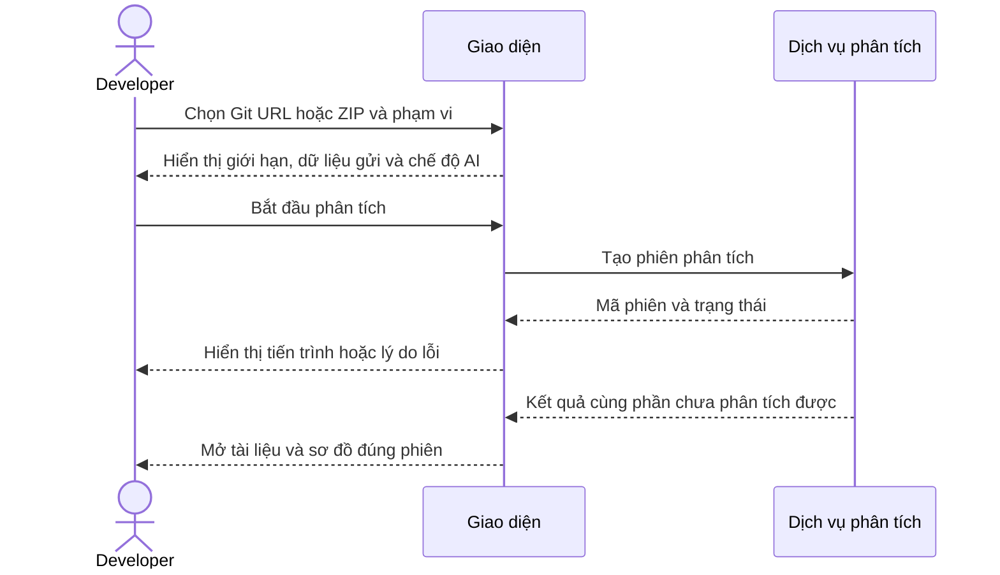
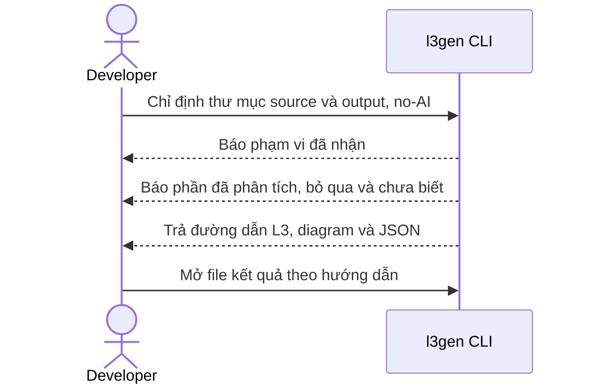
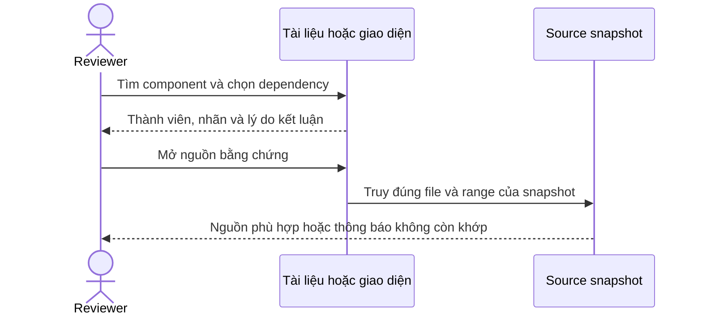
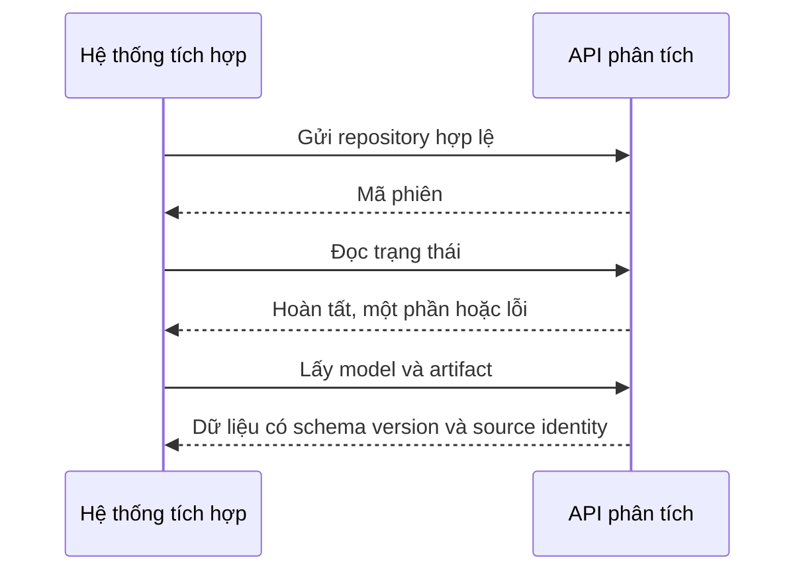
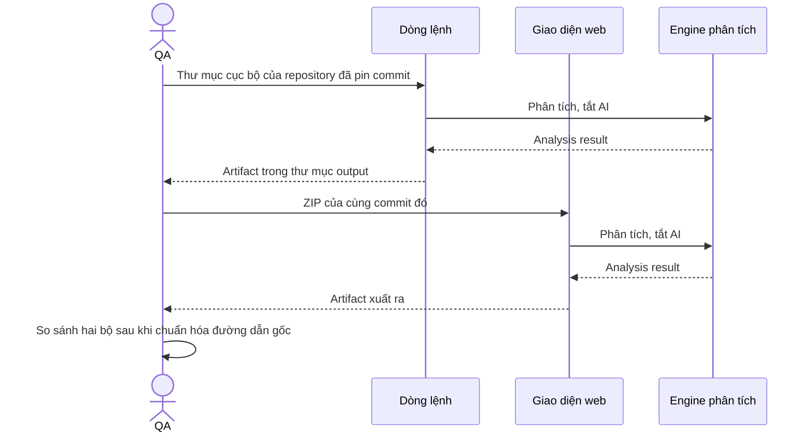

# PRD — Code → Architecture / L3 Generator

> Tạo tài liệu và sơ đồ kiến trúc ban đầu từ source, để developer và architect hiểu hệ thống và kiểm chứng từng kết luận tại mã nguồn.

**Phạm vi tài liệu:** toàn bộ sản phẩm mục tiêu theo đề bài và các đề xuất nêu dưới đây. Code hiện có không quyết định phạm vi hoặc là bằng chứng đã đạt yêu cầu. M0–M3 là mốc kiểm tra tiến độ nội bộ của cùng sản phẩm, trong khung 4 tuần từ 11/09 đến 09/10/2026. Bản này dùng để lấy ý kiến; còn quyết định cần mentor chốt tại mục IX. Chưa approved, chưa có kết quả nghiệm thu.

# I. THÔNG TIN TÀI LIỆU

| Trường | Nội dung |
|---|---|
| Loại tính năng | Platform Feature — mini-product kỹ thuật độc lập, satellite project #6 |
| Người soạn | AI hỗ trợ theo yêu cầu người phụ trách PRD; tên người chịu trách nhiệm ghi nhận tại OQ-L3GEN-001 |
| Reviewers | Nguyễn Chí Thức (Mentor), Đinh Thái Hà (Mentor); kiểm tra nội bộ: Khiêm và Hoàng. Vai ký chính thức chưa chốt, xem OQ-L3GEN-001 |
| Epics liên quan | Chưa tạo: decomposition sau Scope Gate và thiết kế |
| Nguồn | [Đề bài gốc](../../../Đề%20bài.md), mục 3.6 và yêu cầu chung; [Use cases](../../../docs/USE_CASES.md); [Scenarios](../../../docs/SCENARIOS.md); [Ghi chép cơ chế phân tích](../../../docs/ARCHITECTURE_V2_IDEA.md); [mẫu PRD mentor](../../../docs/sdlc-sources/05-prd-template.md); [Execution Guide](../../../docs/agentic-sdlc-execution-guide.md), A, B.2–B.5, C.4, D.1b–D.2 |
| Change Set dự thảo | [CHG-L3GEN-2026-001](../../lifecycle/change-sets/CHG-L3GEN-2026-001/change-set.yaml) |

## Nguồn yêu cầu và phần đề xuất

| Cơ sở | Nội dung và cách chốt |
|---|---|
| Đề bài mục 3.6 | Phân tích tĩnh trên 1–2 stack; phát hiện module, entry point, API, business/data access, DB, external API, config/event và dependency. Tạo mô hình trung gian, component, L3 Markdown, các quan hệ và mã nguồn sơ đồ. AI có thể bổ sung mô tả; quan hệ chính phải có chứng cứ. |
| Yêu cầu người phụ trách PRD | Mô tả full product, không thu phạm vi theo base đang có. Yêu cầu này không tự xác định mọi tính năng mở rộng là bắt buộc. |
| Đề xuất cách sử dụng và tích hợp | Hai kênh có phạm vi khác nhau: dòng lệnh nhận thư mục cục bộ rồi phân tích và ghi file; web nhận ZIP hoặc URL GitHub và thêm khám phá, evidence, lịch sử, job/API, tìm/lọc và export. Giữ trong bản full product để review; mức Must/Should và lịch chờ OQ-L3GEN-002. Đề bài không bắt buộc cụ thể các kênh này. |
| Đề xuất kỹ thuật và chất lượng | Python/FastAPI cùng các adapter, phiên bản hỗ trợ, JSON/Mermaid và ngưỡng NFR là lựa chọn dự thảo nhằm có phạm vi kiểm chứng được; chốt qua OQ-L3GEN-002/003/004. Tên file và schema chi tiết thuộc contract sau Scope Gate. |

## Lịch sử thay đổi

| Version | Ngày | Người thực hiện | Mô tả |
|---|---|---|---|
| 0.1 / revision 1 | 2026-09-15 | AI hỗ trợ người phụ trách PRD | Bản đề xuất full product theo yêu cầu người dùng; không lấy code hiện tại làm scope |
| 0.2 / revision 2 | 2026-09-15 | AI hỗ trợ người phụ trách PRD | Làm rõ intake/gate còn thiếu, nguồn đề bài, người chịu trách nhiệm và tập revision khi ký; giữ nguyên scope full product |
| 0.3 / revision 3 | 2026-09-15 | AI hỗ trợ người phụ trách PRD | Đồng bộ blocker, NFR giao diện theo checklist sáng/tối; phân biệt mốc nội bộ với release; candidate r3 và cách kiểm hồ sơ |
| 0.4 / revision 4 | 2026-09-15 | AI hỗ trợ người phụ trách PRD | Gộp hướng dẫn vào một README, cập nhật liên kết và candidate r4; không đổi yêu cầu sản phẩm |
| 0.5 / revision 5 | 2026-09-15 | AI hỗ trợ người phụ trách PRD | Bỏ ví dụ repo đã thử và tên file bắt buộc; giới hạn cảnh báo ở kết quả phân tích kiến trúc; phân biệt yêu cầu gốc với đề xuất; sửa lỗi chữ ở dòng revision 4; candidate r5 |
| 0.6 / revision 6 | 2026-09-15 | AI hỗ trợ người phụ trách PRD | Dùng PRD và Change Set View làm luồng đọc chính; candidate r6; không đổi FR/AC/NFR |
| 0.7 / revision 7 | 2026-09-15 | AI hỗ trợ người phụ trách PRD | Phân biệt mốc bắt đầu với nghiệm thu đầy đủ; làm rõ phụ thuộc output/component/config/event; candidate r7; không đổi AC hoặc ngưỡng NFR |
| 0.8 / revision 8 | 2026-09-16 | Khiêm + AI hỗ trợ | Chốt ranh giới trình bày L3 (NFR-ABST-001, ADR-2026-001); chốt hai stack Python/FastAPI và Java/Spring Boot, event giới hạn Kafka; chốt lịch sử 10 lần/14 ngày và xóa thủ công; cập nhật ngưỡng tài nguyên; ràng buộc CLI và web cho cùng kết quả (NFR-DET-001, AC-L3GEN-001-05); bổ sung 6 edge case; đóng một phần OQ-003 |
| 0.9 / revision 9 | 2026-09-17 | Khiêm + AI hỗ trợ | Gộp nội dung mục I–V từ hai hướng: tên mentor và nguồn UC/Scenario; mô tả sản phẩm theo hai kênh; viết lại vấn đề, mục tiêu, giả định, ràng buộc, phụ thuộc, in/out scope; KPI thành 5 chỉ số và đánh số lại OBS theo đó; user flow gắn scenario và thêm luồng đối chiếu hai kênh |
| 1.0 / revision 10 | 2026-09-17 | Khiêm + AI hỗ trợ | Gộp mục VI–IX: DoD chia sáu nhóm và giới hạn phạm vi bàn giao ở mức pilot; thiết kế liệt kê bảy màn hình web kèm FR liên quan; timeline chuyển sang khung 4 tuần 11/09–09/10 với M0–M3 và ghi rủi ro lịch; phê duyệt thêm hàng mentor và nêu vấn đề thiếu người cho các vai ký |
| 1.1 / revision 11 | 2026-09-17 | Khiêm + AI hỗ trợ | Rà soát FR/NFR/OQ: mô tả FR-003/004/005 trung tính về ngôn ngữ và thêm AC Java cho FR-003/004/014; gỡ ngưỡng bị chép lại ở FR-017 và ba chỗ trong PRD, trỏ về NFR; thu hẹp OQ-002/004/005 theo phần đã chốt, sửa đường dẫn sai ở OQ-006; hạn OQ chuyển sang 19/09 |
| 1.2 / revision 12 | 2026-09-17 | Khiêm + AI hỗ trợ | IV.3 nhóm 17 FR theo ba use case, thêm cột Kênh và cập nhật mô tả theo hai stack; V.2 tách bảng edge case thành bảy nhóm theo SCENARIOS, tách các lỗi dòng lệnh và web vốn bị gộp thô, thêm cột Kênh; thêm AC-L3GEN-001-06 cho trường hợp source và output lồng nhau |
| 1.3 / revision 13 | 2026-09-17 | Khiêm + AI hỗ trợ | Rà lại sáu Open Question: viết lại câu hỏi cho khớp phần đã chốt thay vì chỉ thêm ghi chú ở dưới; gỡ thông tin lỗi thời về mentor, timebox và Git private; thu hẹp Blocking của OQ-004; đồng bộ bảng OQ trong PRD và thêm cột trạng thái |
| 1.4 / revision 14 | 2026-09-17 | Khiêm + AI hỗ trợ | Sửa 5 lỗi review: gỡ cỡ mẫu tự đặt ở II.4 và trỏ về OBS-001; gỡ ngưỡng 500 function chép lại ở V.2 và FR-011, trỏ về NFR-ABST-001; thêm trần số node vào AC-011-05; bổ sung ranh giới được phép khác vào AC-001-05; sửa cách kiểm AC-013-03; AC-001-03 cho phép xác nhận trước khi ghi đè |

# II. TỔNG QUAN (EXECUTIVE SUMMARY)

## 1. Tóm tắt tính năng

L3 Generator giúp Developer và Architect tạo bản mô tả kiến trúc ban đầu từ source repository. Người dùng xem application, component, API, dữ liệu, tích hợp và các quan hệ quan trọng giữa chúng. Mỗi kết luận kiến trúc có bằng chứng truy về source, và phần chưa hỗ trợ hoặc chưa đủ dữ liệu được nói rõ thay vì bỏ trống.

Sản phẩm có hai kênh với phạm vi khác nhau:

| Kênh | Đầu vào | Phạm vi |
|---|---|---|
| Dòng lệnh | Thư mục cục bộ | Phân tích rồi ghi L3, diagram và JSON ra đĩa |
| Giao diện web | File ZIP, URL GitHub public | Phân tích, khám phá kiến trúc, xem bằng chứng, mở lịch sử, xuất tài liệu |

Dòng lệnh không cần web server, chạy được khi không có mạng và khi tắt AI. Khám phá kiến trúc, truy vết theo từng quan hệ và lịch sử phân tích chỉ có trên web. Hai kênh dùng chung một engine: cùng một source phải cho cùng kết luận, chỉ khác cách trình bày.

Dữ kiện được tạo từ phân tích tĩnh, không thực thi source. AI là tùy chọn bổ sung diễn giải có nhãn và không có quyền tạo hoặc sửa component, quan hệ hay dữ kiện.

## 2. Vấn đề cần giải quyết

Khi tiếp cận một codebase chưa quen, Developer và Architect phải đọc nhiều file, lần theo route, service, repository, dữ liệu và tích hợp bằng tay trước khi có được bức tranh tổng thể. Quá trình này tốn thời gian, phụ thuộc kinh nghiệm cá nhân và dễ tạo tài liệu nhanh lỗi thời hoặc không chỉ ra được kết luận dựa trên đoạn source nào.

Công cụ chỉ liệt kê function/class hoặc vẽ call graph quá chi tiết không trực tiếp trả lời câu hỏi ở mức L3. Ngược lại, một bản mô tả được tạo bằng suy đoán mà thiếu bằng chứng có thể khiến người đọc hiểu sai hệ thống. Dự án cần tạo mô hình đủ tổng quát để đọc nhanh, nhưng vẫn cho phép kiểm chứng và nhận biết giới hạn.

Đây là problem hypothesis từ đề bài. Hiện chưa có baseline định lượng về thời gian đọc code thủ công hoặc tỷ lệ kết luận đúng; phải thu trong pilot theo OBS-L3GEN-002 trước khi PRD được baseline. Không đưa số tiết kiệm công sức giả vào business case.

## 3. Mục tiêu kinh doanh

| Goal key | Mục tiêu | Liên kết OKR/KPI |
|---|---|---|
| GOAL-L3GEN-001 | Giảm thời gian để một kỹ sư hình thành hiểu biết kiến trúc ban đầu về codebase chưa quen | KPI-L3GEN-001, KPI-L3GEN-002. Không áp dụng OKR cấp khối trong đồ án |
| GOAL-L3GEN-002 | Tăng khả năng kiểm chứng tài liệu kiến trúc bằng bằng chứng trực tiếp từ source | KPI-L3GEN-003, KPI-L3GEN-004 |
| GOAL-L3GEN-003 | Giảm công sức tạo bản L3 ban đầu nhưng không đánh đổi bằng các quan hệ suy đoán | KPI-L3GEN-002, KPI-L3GEN-003, KPI-L3GEN-005 |

## 4. Chỉ số thành công

`KPI-L3GEN-xxx` là mã của chỉ số nằm ngay trong PRD này. `OBS-L3GEN-xxx` là tài liệu đo lường riêng, quy định nguồn dữ liệu, cách tính, cỡ mẫu và người chịu trách nhiệm.

| KPI key | KPI | Giải thích | Baseline | Target đề xuất | Timeline | measured_by |
|---|---|---|---|---|---|---|
| KPI-L3GEN-001 | Tự hoàn thành luồng chính không cần hướng dẫn | Người dùng pilot tự cung cấp source, xem kết quả và xuất tài liệu mà không cần tác giả hướng dẫn | Chưa đo | ≥80% người tham gia đủ điều kiện | Pilot trước nghiệm thu M3 | [OBS-L3GEN-002](../../observability/OBS-L3GEN-002.md) |
| KPI-L3GEN-002 | Thời gian tạo hiểu biết L3 ban đầu | So sánh thời gian hoàn thành cùng một bài đọc kiến trúc có và không có công cụ | Chưa đo | Giảm ≥50% trung vị | Pilot trước nghiệm thu M3 | [OBS-L3GEN-002](../../observability/OBS-L3GEN-002.md) |
| KPI-L3GEN-003 | Chất lượng dữ kiện và bằng chứng | Theo loại thực thể/cạnh và phạm vi hỗ trợ; ngưỡng chuẩn nằm ở NFR, không lặp lại ở đây | Chưa đo nghiệm thu | Đạt NFR-L3GEN-ACC-001 và NFR-L3GEN-TRACE-001 với mẫu đủ | Trước nghiệm thu M3 | [OBS-L3GEN-001](../../observability/OBS-L3GEN-001.md) |
| KPI-L3GEN-004 | Độ phủ của phần giới hạn được công bố | Trên bộ fixture có sẵn lỗi cú pháp, file ngoài stack hỗ trợ và quan hệ chưa resolve được cài sẵn: tỷ lệ các trường hợp đó xuất hiện trong phần giới hạn của kết quả | Chưa đo | 100% trường hợp đã cài sẵn trong fixture | Trước nghiệm thu M3 | [OBS-L3GEN-001](../../observability/OBS-L3GEN-001.md) |
| KPI-L3GEN-005 | Đầu ra dùng lại được | Bộ đọc độc lập dùng được JSON và renderer dùng được diagram | Chưa đo | Tất cả tình huống export thuộc FR-L3GEN-008/011 đạt AC | Kiểm tra bước đầu tại M2; kết luận đạt tại M3 | [OBS-L3GEN-001](../../observability/OBS-L3GEN-001.md) |

Cỡ mẫu tối thiểu trước khi công bố tỷ lệ chất lượng nằm ở [OBS-L3GEN-001](../../observability/OBS-L3GEN-001.md), quy định theo từng nhóm dữ kiện; PRD không giữ bản sao của các ngưỡng đó. Dưới ngưỡng, chỉ báo số lượng, không báo phần trăm. Cỡ mẫu này còn chờ duyệt tại OQ-L3GEN-004.

Không báo tỷ lệ tổng hợp hoặc tuyên bố đạt nếu chưa đủ cỡ mẫu tối thiểu tại OBS. Tỷ lệ trước pilot là target dự thảo, không phải kết quả sản phẩm.

# III. BỐI CẢNH VÀ PHÂN TÍCH

## 1. Đối tượng người dùng

| Persona | Bối cảnh | Khó khăn hiện tại | Nhu cầu chính |
|---|---|---|---|
| Developer tiếp quản codebase | Kỹ sư cần sửa hoặc tích hợp một repository chưa quen | Mất thời gian tìm entry point, component, API, data access và external dependency | Có bản đồ kiến trúc ban đầu, xem chi tiết và truy về source |
| Architect / Reviewer | Người đánh giá cấu trúc, dependency và mức khớp giữa code với tài liệu | Tài liệu có thể đã cũ; sơ đồ thiếu bằng chứng hoặc quá chi tiết để đọc | Xem mô hình L3 tổng quát, coverage, giới hạn và evidence |
| Platform engineer | Tích hợp kết quả kiến trúc vào catalog hoặc công cụ nội bộ | Output thiếu schema và định danh ổn định nên khó dùng lại | JSON có schema version, định danh ổn định và API lấy kết quả |

## 2. Giả định

- Người dùng có quyền hợp pháp đọc repository đầu vào. Nếu sai, phải xem lại FR-L3GEN-001, FR-L3GEN-016 và yêu cầu bảo mật liên quan.
- Repository chứa đủ source/config để suy ra ít nhất một phần kiến trúc. Nếu sai, phải xem lại FR-L3GEN-002 và cách trình bày kết quả rỗng hoặc partial.
- Sản phẩm tạo được giá trị với hai ngôn ngữ giới hạn rõ là Python và Java. Nếu phải hỗ trợ rộng mọi framework của hai ngôn ngữ, phải xem lại phạm vi FR-L3GEN-002 và NFR-L3GEN-COMP-001.
- Quan hệ chính chứng minh được bằng phân tích tĩnh mà không chạy source. Nếu cần dữ liệu runtime, kết quả chỉ được ghi partial hoặc runtime-dependent.
- Người dùng coi tài liệu sinh ra là bản đầu cần review, không phải sự thật tuyệt đối về deployment thực tế.
- AI không cần thiết để tạo dữ kiện kiến trúc. Nếu AI không khả dụng, các FR cốt lõi vẫn phải hoạt động.
- Manifest và cấu trúc thư mục giúp tìm đơn vị phân tích nhưng không chứng minh ranh giới deployment. Nhóm component thành service cần rule công bố và ground truth của người review.
- Bản đầu nhận Git public, không quản lý token repository private.
- Web triển khai trong môi trường tin cậy hoặc local. Public multi-tenant cần một phạm vi bảo mật và vận hành riêng.
- Dòng lệnh chạy trên máy người dùng và không cần web server; đây là điều kiện để dùng công cụ trong môi trường đóng.
- Có hai người độc lập lập đáp án nghiệm thu, và người thử pilot chưa từng dùng sản phẩm. Nếu thiếu, KPI còn not_evaluated.

## 3. Ràng buộc

- Nhóm thực hiện có hai người. Bắt đầu 11/09/2026, thời gian thực hiện 4 tuần, kết thúc 09/10/2026. Đề bài chương trình cho phép 4–6 tuần; nhóm chọn 4 tuần. Cam kết full scope trong khung này chờ OQ-L3GEN-002.
- Hệ thống phải read-only với repository đầu vào: không chạy, không import, không `exec`, không sửa và không ghi ngược source.
- Chỉ ưu tiên Python và Java trong các framework đã chốt. Hỗ trợ rộng mọi framework của hai ngôn ngữ không khả thi trong phạm vi hiện tại.
- Quan hệ kiến trúc phải dựa trên bằng chứng tĩnh và rule tất định. AI không được tự tạo hoặc sửa dữ kiện, và không quyết định sự tồn tại của component hay dependency.
- L3 và diagram tập trung ở mức application/component. Chi tiết function/call chỉ dùng làm bằng chứng hoặc dữ liệu chẩn đoán, theo NFR-L3GEN-ABST-001.
- Hai kênh có phạm vi khác nhau nhưng dùng chung một engine. Không kênh nào được sinh thêm hoặc bớt dữ kiện so với kênh kia.
- Requirements, design và evidence được quản lý trong Git. Thay đổi AC sau khi duyệt do Product quyết qua change request.
- Một PRD cho toàn hệ thống. Các đợt triển khai dùng Change Set và baseline, không tạo bản PRD phase cạnh tranh.

## 4. Phụ thuộc

| Dependency | Loại | Trách nhiệm | Trạng thái / ETA |
|---|---|---|---|
| Engine phân tích tĩnh và framework rules | Internal platform component | TEAM-L3GEN | Đã có một phần cho Python; cần đối chiếu với FR/AC hiện tại và bổ sung Java |
| Bộ sinh Markdown, Diagram-as-Code và model có cấu trúc | Internal output component | TEAM-L3GEN | Đã có một phần; contract chưa chuẩn hóa |
| Parser Python và Java, adapter framework, Mermaid | Công cụ thực thi | Tech Lead | Chọn và pin phiên bản ở thiết kế; chưa chốt contract |
| Quyền đọc thư mục cục bộ trên máy chạy dòng lệnh | Platform capability | TEAM-L3GEN | Cần thiết kế và kiểm chứng phần xử lý lỗi đường dẫn/quyền |
| GitHub public HTTPS | 3rd party integration | Tech Lead | Chỉ repository public; không nhận hoặc lưu credential. Allowlist và threat model cần duyệt |
| Môi trường web, lưu job và output | Hạ tầng | Người phụ trách vận hành được chỉ định | Chưa chốt môi trường; không cam kết SLA public |
| Provider LLM | Tùy chọn | Product/Tech Lead | Chưa chọn provider và cost cap; phần cốt lõi không phụ thuộc |
| Repository và đáp án nghiệm thu đã pin snapshot | Dữ liệu nghiệm thu | Product/QA | Cần chọn và kiểm độc lập trước benchmark |
| Artifact OBS và cơ chế đo KPI pilot | Observability | Product + TEAM-L3GEN | OBS-L3GEN-001/002 đã có; cách đo và cỡ mẫu chờ OQ-L3GEN-004 |
| Registry/PROC/tooling SDLC chính thức | Quy trình | Mentor | Chưa có đầy đủ, xem OQ-L3GEN-006 |

# IV. YÊU CẦU TÍNH NĂNG

## 1. Trong phạm vi

**Tiếp nhận đầu vào**

- Nhận source từ thư mục cục bộ qua dòng lệnh, hoặc file ZIP và URL GitHub public qua web.
- Kiểm tra đầu vào trước khi phân tích và giải thích lỗi truy cập, quyền hoặc định dạng thay vì trả kết quả rỗng.
- Mỗi lần phân tích có snapshot, trạng thái và kết quả riêng, không lẫn giữa các phiên.

**Phân tích**

- Phân tích tĩnh, không thực thi source đầu vào.
- Hai stack: Python/FastAPI và Java/Spring Boot, dùng chung contract kết quả nhưng có bộ rule riêng.
- Phát hiện trong phạm vi stack hỗ trợ: module/package, entry point, application/component, API/route, service/business, repository/data access, entity/table, external API và dependency quan trọng.
- Phát hiện quan hệ event ở phạm vi Kafka: producer, consumer và topic. Broker khác phải hiện ra ở phần giới hạn.
- Công bố configuration quan trọng khi adapter tương ứng đã hỗ trợ; chưa có thì thể hiện giới hạn.

**Trình bày và kiểm chứng**

- Mức trình bày là L3: phân tích đi sâu tới mức cần thiết để chứng minh quan hệ, nhưng kết quả cho người đọc dừng ở application/component. Chi tiết function/class/biến là bằng chứng và dữ liệu chẩn đoán, không phải nội dung chính của sơ đồ và tài liệu. Ràng buộc chung ở [NFR-L3GEN-ABST-001](../../requirements/nfr/NFR-L3GEN-ABST-001.md); lý do và phương án bị loại ở [ADR-2026-001](../../architecture/adr/ADR-2026-001.md).
- Trên web: xem tổng quan kiến trúc, application/component, API và luồng yêu cầu, dữ liệu và tích hợp, dependency; tìm và lọc trong kết quả.
- Xem coverage, giới hạn, trạng thái partial hoặc runtime-dependent và evidence truy về source.
- Confidence và completeness là hai trường riêng; phần unknown hoặc ambiguous được giữ lại; lỗi một phần không che mất phạm vi đã bỏ sót.

**Lưu trữ và xuất**

- Web giữ một số lần phân tích gần nhất cho mỗi repository, mỗi kết quả có hạn lưu, và người dùng xóa thủ công được trước hạn. Ngưỡng cụ thể ở [NFR-L3GEN-PRIV-001](../../requirements/nfr/NFR-L3GEN-PRIV-001.md). Dòng lệnh không có lịch sử; người dùng tự quản lý thư mục output.
- Xuất L3 Markdown, component/dependency diagram, Diagram-as-Code và architecture model có cấu trúc.
- JSON có contract và schema version, kèm API để hệ thống khác lấy trạng thái và kết quả.
- Kết quả nhất quán giữa giao diện, artifact xuất ra và hai kênh sử dụng.

**AI**

- AI mô tả và diễn giải giới hạn phân tích là Should Have. Phân tích tĩnh và cảnh báo về dữ kiện chưa xác định là Must, và phải hoạt động khi không có AI.

## 2. Ngoài phạm vi phiên bản đầu

**Phạm vi phân tích**

- Hỗ trợ đầy đủ mọi ngôn ngữ, framework, mọi kiểu SQL/ORM hoặc mọi semantics của Python và Java. Trong phạm vi chỉ có Python/FastAPI và Java/Spring Boot.
- Framework Java ngoài Spring Boot.
- Message broker khác Kafka trong repository đầu vào, ví dụ RabbitMQ, Celery hoặc SQS. Gặp thì báo ngoài phạm vi, không mô tả repository như không có event.
- Resolve chính xác mọi function/method call.
- Thực thi source để khám phá runtime, trace/sequence thực thi, dynamic import và metaprogramming tổng quát.
- Suy luận deployment topology khi source và config không đủ bằng chứng.

**Mức trình bày**

- Sơ đồ hoặc tài liệu vẽ toàn bộ function/class của repository, và call graph đầy đủ ở mức function như một đầu ra cho người đọc.
- Repository Knowledge Graph nói chung: graph query API, graph traversal, incremental graph và nối mọi tham chiếu trong repository. Đây là phạm vi của một dự án khác (đề bài mục 3.8); muốn đưa vào cần đề xuất phạm vi và AC riêng.

**Ghi ngược và phân tích thay đổi**

- Sửa code hoặc tài liệu nguồn tự động, tạo pull request, ghi ngược vào repository đầu vào.
- Rà code không dùng, cách xử lý lỗi HTTP, kết luận lỗ hổng bảo mật hoặc lỗi nghiệp vụ.
- Change impact, test impact, architecture drift và incremental analysis.
- Chỉnh model thủ công trên UI, so sánh drift giữa các snapshot, trigger CI tự động.

**Truy cập và vận hành**

- GitHub private repository và mọi cơ chế nhận hoặc lưu credential truy cập.
- Git submodules, đăng nhập/SSO và multi-tenant public hosting.
- Quản trị tài khoản người dùng và phân quyền tổ chức.
- Khám phá kiến trúc tương tác và lịch sử phân tích trên dòng lệnh; đây là phạm vi của kênh web.
- SLA production cấp doanh nghiệp; bằng chứng release và vận hành sẽ được thiết kế phù hợp cách triển khai được duyệt.

**AI**

- AI tự tạo dữ kiện, quan hệ, cạnh, framework rule hoặc thay đổi kết quả phân tích.

Các mục trên muốn đưa vào phạm vi đều cần đề xuất phạm vi và AC riêng.

## 3. Danh sách tính năng

Các hàng sau chỉ là chỉ mục. AC đầy đủ ở file FR; không giữ bản sao có thể sửa độc lập trong PRD.

Bảng nhóm 18 FR theo ba use case ở [USE_CASES.md](../../../docs/USE_CASES.md) để đọc theo luồng người dùng. Một FR có thể phục vụ nhiều use case; cột Use case ghi nơi nó xuất hiện chính.

Cột Kênh cho biết FR áp dụng cho dòng lệnh, giao diện web, hay cả hai. Milestone là mốc bắt đầu triển khai hoặc tích hợp, không cam kết mọi AC của FR đã đạt tại mốc đó. Nghiệm thu toàn bộ tại M3; đầu ra từng mốc ở mục VIII.

### UC1 — Phân tích kho mã

| FR key | Tên tính năng | Mô tả ngắn | Kênh | Priority | Milestone |
|---|---|---|---|---|---|
| [FR-L3GEN-001](../../requirements/fr/FR-L3GEN-001.md) | Nhận thư mục source và bắt đầu phân tích | Người dùng chỉ định thư mục source cục bộ và nơi lưu kết quả để bắt đầu một lần phân tích. | CLI | Must Have | M1 |
| [FR-L3GEN-016](../../requirements/fr/FR-L3GEN-016.md) | Nhận Git URL và bản nén repository | Người dùng gửi URL GitHub public hoặc ZIP source qua web để tạo snapshot phân tích. | Web | Must Have | M2 |
| [FR-L3GEN-002](../../requirements/fr/FR-L3GEN-002.md) | Nhận diện đơn vị phân tích và phạm vi hỗ trợ | Người dùng xem những phần repository được phân tích, bị bỏ qua hoặc chưa xác định được stack. | Cả hai | Must Have | M1 |
| [FR-L3GEN-003](../../requirements/fr/FR-L3GEN-003.md) | Liệt kê API routes và handler | Method, path, handler, điều kiện đăng ký và nguồn khai báo của route trong phạm vi stack đã công bố. | Cả hai | Must Have | M1: FastAPI; M3: Spring Boot |
| [FR-L3GEN-004](../../requirements/fr/FR-L3GEN-004.md) | Liệt kê mô hình dữ liệu | Lớp dữ liệu, tên bảng nếu xác định được, cột và khóa ngoại. | Cả hai | Must Have | M1: SQLAlchemy; M3: ORM Java |
| [FR-L3GEN-005](../../requirements/fr/FR-L3GEN-005.md) | Liệt kê lời gọi HTTP và đích bên ngoài | Nơi gọi HTTP qua thư viện thuộc phạm vi công bố và mức độ biết đích đến. | Cả hai | Must Have | M1: requests/httpx; M3: client Java |
| [FR-L3GEN-006](../../requirements/fr/FR-L3GEN-006.md) | Truy vết tham chiếu và lời gọi xuyên file | Quan hệ gọi hàm, import và kế thừa với đích cụ thể hoặc lý do chưa xác định được. | Cả hai | Must Have | M1 |
| [FR-L3GEN-014](../../requirements/fr/FR-L3GEN-014.md) | Xem cấu hình mà hệ thống sử dụng | Các khóa cấu hình và nơi sử dụng, không lộ giá trị bí mật. | Cả hai | Must Have | M3 |
| [FR-L3GEN-015](../../requirements/fr/FR-L3GEN-015.md) | Xem quan hệ phát và nhận sự kiện | Producer, consumer và topic của Kafka. Broker khác nằm ngoài phạm vi và hiện ở phần giới hạn. | Cả hai | Must Have | M3 |
| [FR-L3GEN-018](../../requirements/fr/FR-L3GEN-018.md) | Xem thư viện bên ngoài mà hệ thống phụ thuộc | Thư viện khai báo trong đơn vị phân tích, phiên bản và nơi khai báo; phân biệt có dấu vết sử dụng hay chỉ khai báo. | Cả hai | Must Have | M1 |
| [FR-L3GEN-010](../../requirements/fr/FR-L3GEN-010.md) | Chạy phân tích không phụ thuộc AI | Phân tích đầy đủ phần cốt lõi khi không có API key, không có mạng hoặc chủ động tắt AI. | Cả hai | Must Have | M1 |

### UC2 — Khám phá kiến trúc

| FR key | Tên tính năng | Mô tả ngắn | Kênh | Priority | Milestone |
|---|---|---|---|---|---|
| [FR-L3GEN-011](../../requirements/fr/FR-L3GEN-011.md) | Xem component và tài liệu L3 của service | Component bên trong service và quan hệ có chứng cứ giữa chúng, trình bày ở mức component. | Cả hai | Must Have | M2: component model và L3 ban đầu; M3: nghiệm thu đầy đủ |
| [FR-L3GEN-013](../../requirements/fr/FR-L3GEN-013.md) | Phân tích và khám phá kiến trúc qua giao diện web | Gửi repo, theo dõi phiên, xem tổng quan/component/dependency, tìm lọc và truy về nguồn. | Web | Must Have | M2 |

### UC3 — Xem xét và sử dụng kết quả

| FR key | Tên tính năng | Mô tả ngắn | Kênh | Priority | Milestone |
|---|---|---|---|---|---|
| [FR-L3GEN-007](../../requirements/fr/FR-L3GEN-007.md) | Kiểm chứng kết luận bằng nguồn và nhãn | Truy ngược dữ kiện và quan hệ về đúng source snapshot; phân biệt bằng chứng trực tiếp, suy theo rule và phần chưa biết. | Cả hai | Must Have | M1 |
| [FR-L3GEN-009](../../requirements/fr/FR-L3GEN-009.md) | Báo lỗi và giới hạn theo từng lần phân tích | Người dùng biết phần đã phân tích, bị bỏ qua và chưa hỗ trợ trước khi tin vào tài liệu. | Cả hai | Must Have | M1 |
| [FR-L3GEN-008](../../requirements/fr/FR-L3GEN-008.md) | Xuất và sử dụng bộ kết quả | Tài liệu đọc được và JSON có cấu trúc cho công cụ khác, kèm thông tin phiên bản và phạm vi lần chạy. | Cả hai | Must Have | M1: xuất dữ kiện ban đầu; M2: tích hợp component/L3 |
| [FR-L3GEN-017](../../requirements/fr/FR-L3GEN-017.md) | Theo dõi phiên phân tích và lấy kết quả qua API | Mỗi yêu cầu có định danh, trạng thái và kết quả riêng; lịch sử phân tích và xóa thủ công. | Web | Must Have | M2 |
| [FR-L3GEN-012](../../requirements/fr/FR-L3GEN-012.md) | Bổ sung mô tả và diễn giải cảnh báo bằng AI | Sau khi người dùng chủ động cho phép, AI bổ sung mô tả có nhãn; không sửa dữ kiện. | Cả hai | Should Have | M3 |

**FR không thuộc kênh CLI.** FR-L3GEN-013, FR-L3GEN-016 và FR-L3GEN-017 chỉ có trên web. Dòng lệnh nhận thư mục cục bộ (FR-L3GEN-001), phân tích và ghi artifact (FR-L3GEN-008) rồi kết thúc; nó không có khám phá tương tác và không lưu lịch sử. Đây là ranh giới có chủ ý, xem mục II.1.

## 4. Yêu cầu phi chức năng

Các giá trị chuẩn và điều kiện đo chỉ nằm trong NFR. Tất cả đang đề xuất để mentor duyệt.

| NFR key | Loại | Mô tả ngắn | Áp lên | Ghi chú |
|---|---|---|---|---|
| [NFR-L3GEN-SEC-001](../../requirements/nfr/NFR-L3GEN-SEC-001.md) | Security | An toàn khi tiếp nhận và phân tích source | FR-L3GEN-001, FR-L3GEN-002, FR-L3GEN-010, FR-L3GEN-016, FR-L3GEN-017, FR-L3GEN-018 | OQ-L3GEN-004; chưa có NFR tổ chức để refine |
| [NFR-L3GEN-PRIV-001](../../requirements/nfr/NFR-L3GEN-PRIV-001.md) | Privacy | Quyền riêng tư và vòng đời dữ liệu | FR-L3GEN-005, FR-L3GEN-007, FR-L3GEN-010, FR-L3GEN-012, FR-L3GEN-014, FR-L3GEN-016, FR-L3GEN-017 | OQ-L3GEN-004; chưa có NFR tổ chức để refine |
| [NFR-L3GEN-PERF-001](../../requirements/nfr/NFR-L3GEN-PERF-001.md) | Performance | Thời gian xử lý và giới hạn tài nguyên | FR-L3GEN-001, FR-L3GEN-008, FR-L3GEN-013, FR-L3GEN-016, FR-L3GEN-017 | OQ-L3GEN-004; chưa có NFR tổ chức để refine |
| [NFR-L3GEN-REL-001](../../requirements/nfr/NFR-L3GEN-REL-001.md) | Reliability | Hoàn tất, lỗi một phần và cách ly phiên | FR-L3GEN-001, FR-L3GEN-002, FR-L3GEN-008, FR-L3GEN-009, FR-L3GEN-016, FR-L3GEN-017, FR-L3GEN-018 | OQ-L3GEN-004; chưa có NFR tổ chức để refine |
| [NFR-L3GEN-ABST-001](../../requirements/nfr/NFR-L3GEN-ABST-001.md) | Abstraction level | Mức trừu tượng của kết quả trình bày | FR-L3GEN-006, FR-L3GEN-007, FR-L3GEN-008, FR-L3GEN-011, FR-L3GEN-013 | OQ-L3GEN-004; quyết định nền ở ADR-2026-001 |
| [NFR-L3GEN-DET-001](../../requirements/nfr/NFR-L3GEN-DET-001.md) | Determinism | Tái lập dữ kiện và định danh | FR-L3GEN-006, FR-L3GEN-007, FR-L3GEN-008, FR-L3GEN-010, FR-L3GEN-011, FR-L3GEN-012 | OQ-L3GEN-004; chưa có NFR tổ chức để refine |
| [NFR-L3GEN-ACC-001](../../requirements/nfr/NFR-L3GEN-ACC-001.md) | Accuracy | Độ đúng của dữ kiện và component | FR-L3GEN-003, FR-L3GEN-004, FR-L3GEN-005, FR-L3GEN-006, FR-L3GEN-011, FR-L3GEN-014, FR-L3GEN-015, FR-L3GEN-018 | OQ-L3GEN-004; chưa có NFR tổ chức để refine |
| [NFR-L3GEN-TRACE-001](../../requirements/nfr/NFR-L3GEN-TRACE-001.md) | Traceability | Nguồn bằng chứng và phiên bản | FR-L3GEN-002, FR-L3GEN-003, FR-L3GEN-004, FR-L3GEN-005, FR-L3GEN-006, FR-L3GEN-007, FR-L3GEN-008, FR-L3GEN-011, FR-L3GEN-013, FR-L3GEN-014, FR-L3GEN-015, FR-L3GEN-018 | OQ-L3GEN-004; chưa có NFR tổ chức để refine |
| [NFR-L3GEN-COMP-001](../../requirements/nfr/NFR-L3GEN-COMP-001.md) | Compatibility | Stack và môi trường được hỗ trợ | FR-L3GEN-001, FR-L3GEN-002, FR-L3GEN-003, FR-L3GEN-004, FR-L3GEN-005, FR-L3GEN-008, FR-L3GEN-013, FR-L3GEN-014, FR-L3GEN-015, FR-L3GEN-018 | OQ-L3GEN-004; chưa có NFR tổ chức để refine |
| [NFR-L3GEN-USA-001](../../requirements/nfr/NFR-L3GEN-USA-001.md) | Usability | Khả năng sử dụng và tiếp cận | FR-L3GEN-001, FR-L3GEN-008, FR-L3GEN-009, FR-L3GEN-013, FR-L3GEN-017 | OQ-L3GEN-004; chưa có NFR tổ chức để refine |
| [NFR-L3GEN-AI-001](../../requirements/nfr/NFR-L3GEN-AI-001.md) | AI reliability | Giới hạn và ranh giới AI | FR-L3GEN-010, FR-L3GEN-012 | OQ-L3GEN-004; chưa có NFR tổ chức để refine |

# V. LUỒNG NGƯỜI DÙNG (USER FLOWS)

## 1. Luồng chính

Các luồng dưới đây khớp với [SCENARIOS.md](../../../docs/SCENARIOS.md); mỗi luồng ghi scenario tương ứng. Khi hai bên khác nhau, scenario là bản chi tiết hơn.

### 1.1 Phân tích repository qua web

*Scenario 1a, 1c — kênh web*

1. Người dùng tải ZIP hoặc nhập URL GitHub public, xem phạm vi hỗ trợ và chọn chế độ AI. AI mặc định tắt.
2. Với URL GitHub, hệ thống liên hệ GitHub để lấy source; lỗi truy cập hoặc thiếu quyền được báo đúng nguyên nhân, không hiển thị như repository rỗng.
3. Hệ thống tiếp nhận snapshot, trả mã phiên để theo dõi.
4. Khi hoàn tất hoặc có kết quả một phần, giao diện mở tổng quan kiến trúc cùng giới hạn; khi lỗi thì cho biết nguyên nhân và cách thử lại.

### 1.2 Chạy local bằng dòng lệnh, không cần AI

*Scenario 1b, 1d, 10 — kênh CLI*

1. Người dùng chỉ định thư mục source cục bộ và thư mục output.
2. Công cụ kiểm tra đường dẫn, quyền đọc và quyền ghi **trước khi** phân tích; lỗi ở bước này dừng ngay và không tạo output dở dang.
3. Công cụ phân tích trong phạm vi công bố, không gọi LLM và không cần mạng.
4. Công cụ ghi L3, diagram và JSON vào thư mục output rồi kết thúc. Người dùng mở file bằng công cụ của mình.

Dòng lệnh dừng ở đây. Nó không có màn hình khám phá, không drill-down theo từng quan hệ và không lưu lịch sử; người dùng cần các thứ đó thì dùng web (luồng 1.1 và 1.3).

### 1.3 Khám phá và kiểm chứng một quan hệ kiến trúc

*Scenario 2, 3, 12 — kênh web*

1. Reviewer mở kết quả vừa chạy, hoặc chọn một lần phân tích trong lịch sử.
2. Reviewer tìm API, component, dữ liệu, tích hợp hoặc event cần hiểu và truy vết phụ thuộc.
3. Xem nhãn, lý do và các code entities tạo nên component hoặc quan hệ đó.
4. Mở nguồn để kiểm chứng khi cần. Bước này là mở rộng của truy vết, không bắt buộc chạy.
5. Nếu source đã thay đổi so với snapshot, công cụ báo rõ thay vì trỏ vào source mới.

### 1.4 Lấy kết quả cho công cụ khác

*Scenario 13 — kênh web, API tích hợp*

1. Client tạo phiên và theo dõi bằng mã riêng.
2. Client đọc model đúng phiên, kiểm schema version và phạm vi trước khi sử dụng.
3. Lỗi/partial không được biến thành bộ kiến trúc đầy đủ.

### 1.5 Đối chiếu kết quả hai kênh

*Scenario 14 — cả hai kênh*

1. Chạy cùng một repository đã pin commit qua cả hai kênh, cùng tắt AI.
2. So sánh application, component, route, entity, external system, cạnh dependency, nhãn confidence/completeness và danh sách giới hạn.
3. Chỉ được khác ở đường dẫn gốc trong evidence, dấu thời gian, định danh phiên và cách trình bày. Khác ở bất kỳ dữ kiện hay quan hệ nào là lỗi chặn phát hành.

Ràng buộc này ở [NFR-L3GEN-DET-001](../../requirements/nfr/NFR-L3GEN-DET-001.md) và AC-L3GEN-001-05.

## 2. Edge Cases và Error States

Bảng này khớp với các bảng edge case trong [SCENARIOS.md](../../../docs/SCENARIOS.md). Cột Kênh cho biết tình huống xảy ra ở dòng lệnh, giao diện web, hay cả hai.

### Lỗi đầu vào — dòng lệnh

| Tình huống | Hành vi mong muốn | AC sở hữu |
|---|---|---|
| Đường dẫn source không tồn tại, là file, hoặc không có quyền đọc | Dừng trước khi phân tích; chỉ rõ nguyên nhân và cách sửa; không tạo thư mục output | AC-L3GEN-001-02 |
| Thư mục output không ghi được, hoặc đã có kết quả cũ | Báo lỗi nếu không ghi được; nếu trùng thì từ chối hoặc hỏi xác nhận trước khi ghi đè, không âm thầm ghi đè | AC-L3GEN-001-03 |
| Source nằm trong chính thư mục output, hoặc ngược lại | Từ chối; không đọc lại artifact của chính nó, không ghi vào cây source | AC-L3GEN-001-06 |

### Lỗi đầu vào — giao diện web

| Tình huống | Hành vi mong muốn | AC sở hữu |
|---|---|---|
| ZIP hỏng, sai định dạng, chứa đường dẫn thoát khỏi vùng giải nén, hoặc vượt ngưỡng | Từ chối an toàn; không ghi file ra ngoài vùng xử lý; báo lý do | AC-L3GEN-016-03, AC-L3GEN-016-04 |
| URL GitHub sai, repository không tồn tại, hoặc yêu cầu quyền | Báo đúng nguyên nhân truy cập; không hiển thị như repository rỗng; không yêu cầu credential | AC-L3GEN-016-01, AC-L3GEN-016-03 |
| Mất kết nối khi đang lấy source từ GitHub | Cho phép thử lại; không tạo kết quả phân tích giả | AC-L3GEN-016-01, AC-L3GEN-017-04 |

### Giới hạn phạm vi phân tích

| Tình huống | Hành vi mong muốn | Kênh | AC sở hữu |
|---|---|---|---|
| Repo rỗng hoặc toàn bộ stack không hỗ trợ | Báo unsupported hoặc empty; không trả thành công rỗng | Cả hai | AC-L3GEN-002-03 |
| Monorepo hoặc trộn nhiều framework | Chỉ phân tích phần hỗ trợ được và liệt kê phần bỏ qua | Cả hai | AC-L3GEN-002-01, AC-L3GEN-002-04 |
| Lỗi cú pháp hoặc lỗi encoding ở một số file | Tiếp tục phần hợp lệ, cảnh báo file lỗi | Cả hai | AC-L3GEN-009-01 |
| Repository dùng broker khác Kafka | Báo ngoài phạm vi; không mô tả như repository không có event | Cả hai | AC-L3GEN-015-04 |
| Chạm giới hạn tài nguyên hoặc bị ngắt giữa chừng | Trả partial kèm lý do; không để lại output có vẻ hoàn chỉnh nhưng thiếu artifact | Cả hai | AC-L3GEN-009-04 |

### Dữ kiện chưa xác định được

| Tình huống | Hành vi mong muốn | Kênh | AC sở hữu |
|---|---|---|---|
| Mount, nested factory, route đăng ký có điều kiện | Đọc pattern đã cam kết; phần chưa biết gắn partial | Cả hai | AC-L3GEN-003-02, AC-L3GEN-003-03, AC-L3GEN-003-04 |
| Tên bảng tạo lúc chạy, hoặc dynamic import | Giữ unknown kèm nguồn; không đoán từ tên lớp hoặc tên biến | Cả hai | AC-L3GEN-004-03, AC-L3GEN-006-03 |
| HTTP call trong test giống dependency ngoài | Phân biệt caller và đích; không tạo hệ thống ngoài giả | Cả hai | AC-L3GEN-005-04 |
| Config chứa secret, hoặc topic tạo động | Che giá trị; giữ phần biết được và lý do thiếu | Cả hai | AC-L3GEN-014-03, AC-L3GEN-015-02 |
| Hai service cùng tên topic nhưng chưa rõ cùng broker | Để candidate hoặc chưa resolve; không nối chắc | Cả hai | AC-L3GEN-015-03 |
| Quan hệ chưa resolve được đích | Giữ ở lớp dữ kiện với nhãn unresolved; không thành cạnh kiến trúc | Cả hai | AC-L3GEN-006-05 |

### Trình bày kết quả

| Tình huống | Hành vi mong muốn | Kênh | AC sở hữu |
|---|---|---|---|
| Repository vượt ngưỡng số function ở NFR-L3GEN-ABST-001 | Sơ đồ mặc định vẫn ở mức component, trong trần số node của NFR đó; không một node cho mỗi function | Cả hai | AC-L3GEN-011-05 |
| Graph quá lớn, hoặc một artifact xuất lỗi | Rút gọn có thông báo, hoặc báo artifact nào lỗi và cho thử lại; giữ dữ liệu hợp lệ | Cả hai | AC-L3GEN-008-03, AC-L3GEN-013-03 |
| Cùng source chạy qua dòng lệnh và qua web | Cùng dữ kiện, quan hệ, nhãn và giới hạn; chỉ khác đường dẫn gốc và cách trình bày | Cả hai | AC-L3GEN-001-05 |

### Phiên và lịch sử

| Tình huống | Hành vi mong muốn | Kênh | AC sở hữu |
|---|---|---|---|
| Nhiều phiên chạy đồng thời, bị hủy, hoặc hết hạn | Cách ly phiên; trạng thái đúng thực tế; dọn dữ liệu tạm | Web | AC-L3GEN-017-02, AC-L3GEN-017-04 |
| Repository vượt ngưỡng số lần lưu, hoặc kết quả quá hạn | Loại lần cũ nhất và báo rõ; hết hạn thì không mở lại được | Web | AC-L3GEN-017-05 |
| Người dùng xóa thủ công một kết quả | Hỏi xác nhận; xóa xong không mở lại được và không ảnh hưởng lần khác | Web | AC-L3GEN-017-06 |
| Source đã thay đổi sau lần phân tích | Báo snapshot không còn khớp; không dùng source mới làm bằng chứng cũ | Cả hai | AC-L3GEN-007-03 |

### AI

| Tình huống | Hành vi mong muốn | Kênh | AC sở hữu |
|---|---|---|---|
| Không có AI, hoặc LLM lỗi | Phần lõi vẫn chạy; dữ kiện không bị AI sửa | Cả hai | AC-L3GEN-010-01, AC-L3GEN-010-02 |

# VI. DEFINITION OF DONE (DoD)

## Hồ sơ đủ để xin review phạm vi

- [x] Có mục tiêu, persona, scope in/out, FR có AC, NFR có cách kiểm, KPI có OBS và user flows.
- [x] Mọi câu hỏi chưa chốt có owner theo vai, due đề xuất và phạm vi bị block.
- [ ] Hoàn tất intake/impact, chốt tier và cách áp dụng registry/policy trước Scope Gate; xem [checklist chuẩn bị](../../../docs/PRD-REVIEW-README.md).
- [ ] Mentor chốt danh tính/registry, scope và ngưỡng; đóng OQ blocking.
- [ ] Scope Gate ghi quyết định với đúng revision/hash của PRD và từng FR/NFR.

## Sản phẩm đủ để nghiệm thu và giao

### Yêu cầu và độ phủ

- [ ] Mọi FR Must trong baseline được duyệt và mọi AC tương ứng pass; phần Should bị hoãn phải được Product ghi nhận.
- [ ] Không còn Open Question blocking cho FR nào đã cam kết.
- [ ] Coverage FR→AC, AC→implementation_target, AC→test, FR→NFR và KPI→OBS đều đủ.

### Hành vi người dùng

- [ ] Người dùng pilot hoàn thành luồng từ cung cấp source tới kết quả mà không cần người phát triển hướng dẫn trực tiếp, trên cả hai kênh trong phạm vi của kênh đó.
- [ ] Người dùng mở được lịch sử trên web và xem đúng snapshot source, kết quả và giới hạn của lần phân tích đã chọn.
- [ ] Thông báo lỗi của ba hình thức đầu vào đã được review, gồm cả lỗi riêng của dòng lệnh về đường dẫn và quyền ghi output.

### Tính nhất quán của kết quả

- [ ] Giao diện, L3 Markdown, diagram và model có cấu trúc dùng cùng một analysis result; không nơi nào có component hoặc quan hệ mà nơi khác không có.
- [ ] Cùng một source chạy qua dòng lệnh và qua web cho cùng dữ kiện, quan hệ, nhãn và giới hạn theo AC-L3GEN-001-05.

### Chất lượng kết luận

- [ ] Mọi kết luận L3 công khai có evidence, hoặc được ghi rõ là partial/unknown kèm lý do.
- [ ] Phần chưa hỗ trợ, lỗi parse, trạng thái runtime-dependent và giới hạn tài nguyên đã chạm đều hiển thị rõ; không biến "chưa đọc được" thành "không tồn tại".
- [ ] Sơ đồ và tài liệu mặc định giữ ở mức application/component theo NFR-L3GEN-ABST-001; quan hệ chưa resolve không xuất hiện như cạnh kiến trúc.
- [ ] Kiểm chứng hệ thống không chạy, không import và không sửa source repository đầu vào.

### Chất lượng kỹ thuật

- [ ] Thiết kế và contract được duyệt theo gate áp dụng; UI có luồng, mock và spec theo các bước sau Scope Gate.
- [ ] Code và test được review độc lập; blocking finding đã đóng hoặc có waiver hợp lệ; MR đã merge kèm test evidence.
- [ ] Các NFR bảo mật, riêng tư, hiệu năng, độ tin cậy, khả dụng, tương thích, độ đúng, truy vết, tái lập và mức trừu tượng đều có artifact riêng và đã qua reviewer chịu trách nhiệm.

### Bàn giao

- [ ] Người dùng nghiệm thu trên một build xác định; người ký độc lập với người sở hữu AC.
- [ ] Có gói cài đặt và hướng dẫn chạy cho cả hai kênh, đủ để người ngoài nhóm tự dựng lại.
- [ ] Những thứ chưa chạy ghi `not_run`. Không dùng checklist tài liệu đã xong để suy rằng sản phẩm đã đạt.

**Phạm vi bàn giao.** Đây là pilot nội bộ trong 4 tuần, không phải phát hành production. Ordering, rollback, cleanup và evidence deploy chỉ áp dụng ở mức môi trường pilot đã duyệt; SLA production cấp doanh nghiệp nằm ngoài phạm vi theo mục IV.2. Nếu sau pilot quyết định phát hành rộng hơn, bổ sung DoD vận hành qua change request.

Mapping component/API/test chưa tạo ở giai đoạn PRD nên coverage đó chưa đạt. Mẫu DoD PRD nhắc mapping, còn trình tự B/C đặt thiết kế/planning sau Scope Gate: cần quyết định cách áp dụng tại OQ-L3GEN-006 trước gate. Không coi mảng rỗng là được miễn, không tạo ID giả; phải hoàn tất mapping trước Definition of Ready cho code.

# VII. THIẾT KẾ VÀ MOCKUPS

Phần này chỉ áp dụng cho kênh web. Dòng lệnh không có màn hình; yêu cầu trình bày của nó nằm ở FR-L3GEN-001 và FR-L3GEN-009.

| Màn hình | Nội dung tối thiểu | FR liên quan | Trạng thái |
|---|---|---|---|
| Cung cấp mã nguồn | Hai lựa chọn rõ ràng là tải ZIP và nhập URL GitHub public; vùng báo lỗi riêng cho từng loại; hiển thị phạm vi source dự kiến và chế độ AI trước khi chạy | FR-L3GEN-016, FR-L3GEN-013 | Luồng ở V.1.1; chưa có mock |
| Trạng thái phân tích | Giai đoạn đang chạy; trạng thái queued/running/completed/partial/failed/cancelled; lý do lỗi và cách thử lại | FR-L3GEN-017, FR-L3GEN-009 | Chưa có mock |
| Lịch sử phân tích | Danh sách theo repository, thời điểm và trạng thái; mở lại đúng kết quả; xóa thủ công có xác nhận; hiển thị lần bị loại do vượt ngưỡng lưu hoặc quá hạn | FR-L3GEN-017 | Chưa có mock |
| Tổng quan kiến trúc | Application, entry point, component chính, dependency diagram ở mức component, coverage và giới hạn nổi bật | FR-L3GEN-011, FR-L3GEN-013 | Chưa có mock |
| Kết quả chi tiết | Các góc nhìn component, API và luồng yêu cầu, dữ liệu và tích hợp, dependency; tìm và lọc trong kết quả | FR-L3GEN-011, FR-L3GEN-013, FR-L3GEN-014, FR-L3GEN-015 | Chưa có mock |
| Bằng chứng | Vị trí `file:line` và đường bằng chứng của một kết luận được chọn; nhãn confidence/completeness và lý do; báo khi snapshot không còn khớp | FR-L3GEN-007 | Chưa có mock |
| Xuất tài liệu | Chọn artifact được hỗ trợ; trạng thái tạo file; lỗi riêng từng artifact và cho phép thử lại | FR-L3GEN-008 | Chưa có mock |

**Nguyên tắc tổ chức.** Nhìn tổng quan trước, đi sâu theo thành phần, truy vết về source evidence, và luôn thấy giới hạn phân tích. Bốn nguyên tắc này áp cho mọi màn hình kết quả. Chi tiết ở [USE_CASES.md](../../../docs/USE_CASES.md) mục 8.

**Mức trình bày.** Sơ đồ mặc định trên mọi màn hình dừng ở mức application/component theo NFR-L3GEN-ABST-001. Chi tiết function/class chỉ xuất hiện ở lớp bằng chứng khi người dùng chủ động mở.

Đây là danh sách đầu vào cho thiết kế, chưa phải UX/UI được duyệt. Chưa có mock hoặc Figma nào được tạo. Sau Scope Gate: tạo UX flow, screen inventory, design tokens và mock để qua UI/UX Gate; UI Specification có field và endpoint chốt sau contract L3. Giao thức và schema API chi tiết không nằm trong PRD. Không tạo link Figma giả.

# VIII. TIMELINE VÀ PHASING

Dự án chạy 4 tuần, từ 11/09/2026 đến 09/10/2026.

| Mốc nội bộ | Kết quả kiểm tra tiến độ | Thời điểm | FR bắt đầu hoặc tiếp tục tích hợp |
|---|---|---|---|
| M0 — Chốt yêu cầu | PRD, FR/AC, NFR và user flow đủ để xin review phạm vi | 16/09 | Viết và rà soát toàn bộ FR-L3GEN-001 đến FR-L3GEN-018 cùng 11 NFR; chưa FR nào bắt đầu triển khai trước khi qua Scope Gate |
| M1 — Lõi phân tích và dòng lệnh | Dòng lệnh chạy được trên thư mục cục bộ; dữ kiện API/DB/HTTP có evidence; bản xuất ban đầu. Chưa nghiệm thu đầu ra L3 đầy đủ | Cuối tuần 2, khoảng 25/09 | Bắt đầu FR-L3GEN-001 đến FR-L3GEN-010 trong phạm vi Python/FastAPI; các AC phụ thuộc component/config/event tiếp tục ở mốc sau |
| M2 — Web, component và L3 | Component model và L3 ban đầu; web nhận ZIP và URL GitHub; job/API và lịch sử; kiểm tích hợp. Chưa kết luận đạt toàn bộ FR-L3GEN-008/011 | Cuối tuần 3, khoảng 02/10 | Bắt đầu FR-L3GEN-011, FR-L3GEN-013, FR-L3GEN-016, FR-L3GEN-017; bổ sung component vào output của FR-L3GEN-008 |
| M3 — Java, config/event và nghiệm thu | Mở rộng sang Java/Spring Boot gồm Kafka phía Java; tích hợp config/event vào model, output và UI; nghiệm thu tất cả Must theo AC/NFR được duyệt | Cuối tuần 4, 09/10 | FR-L3GEN-014, FR-L3GEN-015 và tích hợp toàn bộ FR trước đó; nghiệm thu đầy đủ FR-L3GEN-008/011 |
| Tùy chọn trong M3 | Diễn giải AI sau khi có consent, provider và cost cap | Khi lõi và chất lượng đủ, không chặn Must | FR-L3GEN-012 là Should Have |
| Sau pilot | Framework/ngôn ngữ bổ sung, broker khác Kafka, incremental analysis nếu có business case | Sau 09/10, chưa chốt | Tạo FR mới hoặc bump PRD khi scope đổi |

Kafka nằm ở cả M1 và M3 vì mỗi ngôn ngữ cần adapter riêng: thư viện Kafka của Python và của Java khác nhau, không dùng chung rule.

**Rủi ro lịch cần mentor xem.** Bốn tuần cho hai người, phủ hai stack, hai kênh và bảy nhóm màn hình là lịch chặt. M0 đã trễ. Lịch này chưa chứng minh đủ capacity; mentor cần chốt tại OQ-L3GEN-002 trước khi giao cam kết. Nếu không đủ, Product điều chỉnh phase và baseline qua review — không tự đổi Must thành Done hoặc Out of Scope, và không lặng lẽ đẩy Java sang "sau pilot".

M0–M3 là mốc kiểm tra tiến độ nội bộ, chưa phải các lần phát hành được cam kết. Khi xác định lịch release, mỗi tập revision được duyệt và phát hành cùng nhau có Change Set và baseline tương ứng. Nếu phát hành M1/M2 riêng, phải tách phạm vi trước khi chốt release.

**Rollout Strategy:** pilot nội bộ trong workspace tin cậy, trên tập repository đã được cấp quyền và có reviewer đánh giá ground truth. Bàn giao gói dòng lệnh và web cùng schema version. Chỉ mở rộng sau khi KPI pilot, lỗi bảo mật đầu vào và các trường hợp partial đã được xem xét. Không dùng output chưa review làm căn cứ duy nhất cho quyết định kiến trúc quan trọng. Chưa có public rollout hoặc A/B experiment.

# IX. PHÊ DUYỆT — Scope Gate

| Vai trò | Họ tên | Ngày review | Quyết định | Ghi chú |
|---|---|---|---|---|
| PM / Product Lead (PIC) | Chờ chỉ định | Chưa review | Chưa quyết định | OQ-L3GEN-001 |
| Tech Lead | Chờ chỉ định | Chưa review | Chưa quyết định | OQ-L3GEN-001 |
| QA Lead | Chờ chỉ định | Chưa review | Chưa quyết định | OQ-L3GEN-001 |
| Mentor duyệt phạm vi | Nguyễn Chí Thức hoặc Đinh Thái Hà | Chưa review | Chưa quyết định | Cần ít nhất một trong hai mentor duyệt; quy tắc này chờ xác nhận tại OQ-L3GEN-001 |

Hai mentor là reviewer của đồ án. Không tự gán mentor vào một vai ký sản phẩm khi chưa có xác nhận. `ai_assisted` được khai ở frontmatter.

**Vấn đề về số người.** Nhóm có hai developer, trong khi bảng trên cần ba vai ký cộng một người nghiệm thu độc lập với người sở hữu AC. Mentor cần trả lời: một người kiêm được những vai nào, và vai nào bắt buộc do người ngoài nhóm đảm nhiệm. Chi tiết ở OQ-L3GEN-001.

**Người chịu trách nhiệm cuối:** chờ xác nhận tên và vai tại OQ-L3GEN-001. Nếu một người ký thay nhiều vai, ghi rõ tên, các vai và thời điểm ký tại đây.

**Baseline được duyệt:** chưa có. [BL-r8.yaml](../../lifecycle/change-sets/CHG-L3GEN-2026-001/baseline/BL-r8.yaml) chỉ là candidate chứa key/revision/hash để review. Bảng từng key/revision candidate được sinh ở đầu [Change Set View](../../generated/change-set-views/CSV-CHG-L3GEN-2026-001.md); không phải danh sách đã duyệt. Change Set View và báo cáo kiểm gói hiện còn ứng với BL-r7, phải render lại theo BL-r8 trước khi gửi review.

**Khi ký:** ghi ngay tại mục IX từng key PRD/FR/NFR và revision thực tế được duyệt, kèm quyết định/người ký/ngày ký; không chỉ ghi một BL-key. Đóng băng baseline cùng commit được review. AC đổi sau duyệt qua Product/change request.

## Open Questions

| OQ key | Câu hỏi | Owner | Due | Blocking | Trạng thái |
|---|---|---|---|---|---|
| [OQ-L3GEN-001](../../lifecycle/change-sets/CHG-L3GEN-2026-001/open-questions/OQ-L3GEN-001.md) | Xác nhận mã tổ chức và người chịu trách nhiệm | Người phụ trách PRD phối hợp hai mentor | 2026-09-19 | Toàn bộ metadata và Scope Gate | Chưa có câu trả lời |
| [OQ-L3GEN-002](../../lifecycle/change-sets/CHG-L3GEN-2026-001/open-questions/OQ-L3GEN-002.md) | Chốt phạm vi đầy đủ và lịch giao | Người phụ trách PRD phối hợp mentor | 2026-09-19 | Cam kết scope và milestone của toàn hệ thống | Chưa có câu trả lời |
| [OQ-L3GEN-003](../../lifecycle/change-sets/CHG-L3GEN-2026-001/open-questions/OQ-L3GEN-003.md) | Chốt ma trận pattern và adapter hỗ trợ | Tech Lead được mentor chỉ định | 2026-09-19 | FR-L3GEN-003, FR-L3GEN-004, FR-L3GEN-014, FR-L3GEN-015 và NFR-L3GEN-COMP-001 | Đã chốt hai stack và phạm vi event; còn ma trận pattern trong từng stack |
| [OQ-L3GEN-004](../../lifecycle/change-sets/CHG-L3GEN-2026-001/open-questions/OQ-L3GEN-004.md) | Duyệt ngưỡng chất lượng và đáp án nghiệm thu | Product và QA được mentor chỉ định | 2026-09-19 | NFR-L3GEN-ACC-001, toàn bộ KPI và nghiệm thu | Đã chốt ngưỡng vận hành ở PERF/PRIV/ABST; còn ngưỡng độ đúng, cỡ mẫu và người lập đáp án |
| [OQ-L3GEN-005](../../lifecycle/change-sets/CHG-L3GEN-2026-001/open-questions/OQ-L3GEN-005.md) | Chốt môi trường web, dữ liệu và AI | Tech Lead/Security phối hợp người phụ trách PRD | 2026-09-19 | FR-L3GEN-012, FR-L3GEN-016, FR-L3GEN-017; NFR SEC/PRIV/AI | Đã chốt phạm vi truy cập và AI mặc định tắt; còn môi trường triển khai, allowlist và provider AI |
| [OQ-L3GEN-006](../../lifecycle/change-sets/CHG-L3GEN-2026-001/open-questions/OQ-L3GEN-006.md) | Xác nhận quy trình và schema khi thiếu tooling | Người phụ trách PRD phối hợp mentor | 2026-09-19 | Hoàn tất intake và kết luận tuân thủ, qua Scope Gate; không ngăn lấy ý kiến bản nháp | Chưa có câu trả lời |

Ba OQ đã trả lời một phần vẫn `status: open` vì phần còn lại chặn thiết kế và nghiệm thu. Không coi phần đã chốt là cả câu hỏi đã đóng.

## Tài liệu liên quan

- [Chỉ dẫn đọc và gói review](../../../docs/PRD-REVIEW-README.md).
- [Nguồn đề bài và attachment đã ghi nhận](../../evidence/requests/CR-L3GEN-2026-001-sources-01.yaml).
- [Quy trình đã ghép](../../../docs/agentic-sdlc-execution-guide.md).
- [Thuật ngữ](../../domain/glossary-core.md).
- FR/AC: từng link ở IV.3; NFR: từng link ở IV.4; OBS: từng link ở II.4.
- [ADR-2026-001](../../architecture/adr/ADR-2026-001.md) — mức trừu tượng của kết quả; draft, chưa qua Architecture Gate.
- [Ghi chép cơ chế phân tích](../../../docs/ARCHITECTURE_V2_IDEA.md) — không phải L2, xem ghi chú trạng thái ở đầu file.
- L1/L2/threat model, API/TBL/EVT contracts và UX/UI: tạo sau Scope Gate, không coi là đã có chỉ vì được liệt kê.

