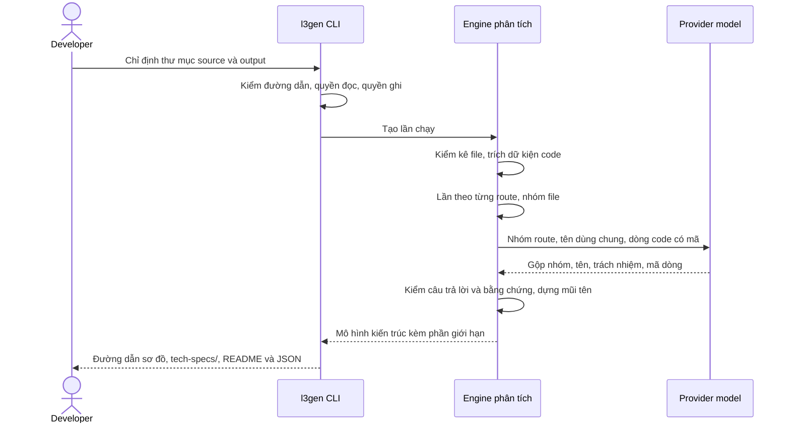
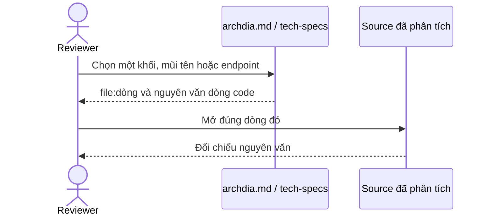

# PRD — Code → Architecture / L3 Generator

> Tạo tài liệu và sơ đồ kiến trúc ban đầu từ source, để developer và architect hiểu hệ thống và kiểm chứng từng kết luận tại mã nguồn.

**Trạng thái bản này (revision 31, 02/10/2026):** sửa theo recovery review [REVIEW-SCOPE-L3GEN-2026-003](../../evidence/reviews/REVIEW-SCOPE-L3GEN-2026-003.yaml) và quyết định của Khiêm: thư mục output phải rỗng; route khai qua `add_api_route` ghi ở phần giới hạn; luật xếp file chứa tên dùng chung.

**Revision 30 (02/10/2026):** sửa theo review Scope Gate [REVIEW-SCOPE-L3GEN-2026-002](../../evidence/reviews/REVIEW-SCOPE-L3GEN-2026-002.yaml) và quyết định của Khiêm về GOAL, KPI: chấm KPI trên từng repo kín nhỏ và vừa; KPI-009 theo đề xuất của Hoàng; OQ-L3GEN-009 đóng.

**Revision 29 (02/10/2026):** FR chia lại theo chiều dọc (FR-L3GEN-028 đến 031 thay FR-L3GEN-019 đến 027); component theo định nghĩa của quy trình mentor; model trả phí qua OpenRouter; web chuyển sang phase sau. Lý do và lời Khiêm ở [CR-L3GEN-2026-004](../../evidence/requests/CR-L3GEN-2026-004.yaml). Đoạn dưới là trạng thái của revision 24–28, giữ để tra cứu.

**Revision 24–28:** viết lại theo hướng mentor giao ngày 22/09/2026. Phân tích tĩnh trích dữ kiện code kèm vị trí. Code chia component và dựng cạnh từ lời gọi đã xác định đích. Mô hình ngôn ngữ đặt tên, mô tả, gắn nhãn, và đề xuất quan hệ mà phân tích tĩnh không thấy; code kiểm từng đề xuất với dữ kiện trước khi công bố. Đầu ra gồm sơ đồ component (mức L2) và tài liệu L3 contract. Thay đổi đụng vào ràng buộc cốt lõi của bản đã duyệt, nên **BL-r14 và approval Scope Gate ngày 18/09/2026 đã superseded**. Bản này thuộc Change Set mới [CHG-L3GEN-2026-002](../../lifecycle/change-sets/CHG-L3GEN-2026-002/change-set.yaml) và phải ký lại Scope Gate.

**Phạm vi tài liệu:** mô tả full product roadmap và đánh dấu rõ cam kết phase đầu. Phạm vi và lịch phase đầu ở mục VIII. Từ revision 29, code và kết quả đo hiện có là cơ sở viết yêu cầu khi tài liệu lệch (CR-L3GEN-2026-004); chúng không phải bằng chứng đã đạt AC. Bản này chưa approved và chưa có kết quả nghiệm thu.

# I. THÔNG TIN TÀI LIỆU

| Trường | Nội dung |
|---|---|
| Loại tính năng | Platform Feature — mini-product kỹ thuật độc lập, satellite project #6 |
| Người chịu trách nhiệm | Khiêm — đầu mối Product và người ký Scope Gate; AI hỗ trợ soạn thảo |
| Reviewers | Hoàng — reviewer nội bộ và UAT mặc định; Nguyễn Chí Thức, Đinh Thái Hà — mentor reviewer/cố vấn |
| Epics liên quan | Chưa tạo: decomposition sau Scope Gate và thiết kế |
| Nguồn | [Đề bài gốc](../../../Đề%20bài.md), mục 3.6 và yêu cầu chung; [Ghi chép cơ chế phân tích](../../../docs/ARCHITECTURE_V2_IDEA.md); [mẫu PRD mentor](../../../docs/sdlc-sources/05-prd-template.md); [Execution Guide](../../../docs/agentic-sdlc-execution-guide.md), A, B.2–B.5, C.4, D.1b–D.2; [Quy tắc mentor](../../../Quy_tac/execution-guide-working.md) |
| Change Set | [CHG-L3GEN-2026-002](../../lifecycle/change-sets/CHG-L3GEN-2026-002/change-set.yaml), thay cho CHG-L3GEN-2026-001 đã duyệt ngày 18/09/2026 |

## Nguồn yêu cầu và phần đề xuất

| Cơ sở | Nội dung và cách chốt |
|---|---|
| Đề bài mục 3.6 | Phân tích trên 1–2 stack; phát hiện module, entry point, API, business/data access, DB, external API, config/event và dependency. Tạo mô hình trung gian, component, L3 Markdown, các quan hệ và mã nguồn sơ đồ. Đề bài ghi AI chỉ bổ sung mô tả, còn quan hệ chính phải chứng minh được từ source bằng phân tích tĩnh. Bản này giữ đúng ý đó: mũi tên do code dựng từ lời gọi đã xác định đích; model chỉ gộp nhóm và đặt tên (dòng 28/09 và 02/10 ở dưới) |
| Yêu cầu người phụ trách PRD | Mô tả full product, không thu phạm vi theo base đang có. Yêu cầu này không tự xác định mọi tính năng mở rộng là bắt buộc. |
| Quyết định cách sử dụng và tích hợp | OQ-L3GEN-002 chốt hai kênh: CLI nhận thư mục local; web nhận ZIP/GitHub public. Từ revision 29 (CR-L3GEN-2026-004) đợt này chỉ có dòng lệnh; web, lịch sử và public job API sang phase sau. |
| Đề xuất kỹ thuật và chất lượng | Python/FastAPI là stack phase đầu; Java/Spring Boot thuộc phase sau. Ma trận mức hỗ trợ theo ngôn ngữ và framework, cùng ngưỡng NFR, đã chốt tại OQ-L3GEN-003/004 của CHG-L3GEN-2026-001. Tên file và schema chi tiết thuộc contract sau Scope Gate. |
| Hướng mentor, 22/09/2026 | Dùng mô hình ngôn ngữ để đề xuất quan hệ kiến trúc; code vẫn phải chứng minh bằng chứng tại source. Mục đích là mở rộng sang framework khác mà không phải viết bộ luật riêng cho từng stack. Phase đầu vẫn là Python/FastAPI. Ghi nhận tại [CR-L3GEN-2026-002](../../evidence/requests/CR-L3GEN-2026-002.yaml) theo lời Khiêm truyền đạt; chưa có văn bản gốc của mentor. Phần "model đề xuất quan hệ" đã thay bởi dòng 28/09 |
| Quyết định ngày 28/09/2026 (Khiêm, khi thử nghiệm sơ đồ) | Mũi tên do code dựng từ lời gọi đã xác định đích; model không quyết mũi tên có tồn tại hay không, vì bản cho model phân loại cạnh cho recall thấp hơn. Mục đích mở rộng sang framework khác giữ nguyên. Cách chia việc code/model ở [báo cáo sơ đồ component](../../../docs/BAO-CAO-SO-DO-COMPONENT.md), mục 2 |
| Quyết định ngày 22–23/09/2026 (đã thay: model đề xuất cạnh bởi dòng 28/09; chia component, model đọc thêm code qua công cụ và model miễn phí bởi dòng 02/10/2026) | Mô hình ngôn ngữ không đọc thẳng toàn bộ source. Phân tích tĩnh chạy trước để trích dữ kiện code kèm vị trí. Code chia component tất định theo cây thư mục, tên và lời gọi; chỉ khi repository phẳng mới giao model chia. Model đặt tên, mô tả, gắn nhãn cạnh và đề xuất cạnh bổ sung; một bước kiểm tất định giữ lại đề xuất có dữ kiện chứng minh. Model đọc thêm code qua công cụ có giới hạn. Provider và model chốt tại OQ-L3GEN-008. Cách chia việc học từ CodeBoarding, nơi để model tự chia component cho kết quả dao động mà không tốt hơn. Độ sâu của tầng tĩnh khai báo theo từng ngôn ngữ; ranh giới chi tiết thuộc ADR và L2 |
| Quyết định ngày 02/10/2026 | Theo quy tắc mentor và Đề bài 3.6, lấy code và kết quả đo hiện có làm chuẩn khi tài liệu lệch. Component gánh một trách nhiệm nghiệp vụ và sở hữu API/TBL/EVT; code lần theo route để nhóm file, model gộp nhóm và đặt tên, code kiểm. FR chia theo chiều dọc. Model bắt buộc, trả phí ít qua OpenRouter. Web sang phase sau. Ghi tại [CR-L3GEN-2026-004](../../evidence/requests/CR-L3GEN-2026-004.yaml) |

## Lịch sử thay đổi

| Version | Ngày | Người thực hiện | Mô tả |
|---|---|---|---|
| 0.1 / revision 1 | 2026-09-15 | AI hỗ trợ người phụ trách PRD | Bản đề xuất full product theo yêu cầu người dùng; không lấy code hiện tại làm scope |
| 0.2 / revision 2 | 2026-09-15 | AI hỗ trợ người phụ trách PRD | Làm rõ intake/gate còn thiếu, nguồn đề bài, người chịu trách nhiệm và tập revision khi ký; giữ nguyên scope full product |
| 0.3 / revision 3 | 2026-09-15 | AI hỗ trợ người phụ trách PRD | Đồng bộ blocker, NFR giao diện theo checklist sáng/tối; phân biệt mốc nội bộ với release; candidate r3 và cách kiểm hồ sơ |
| 0.4 / revision 4 | 2026-09-15 | AI hỗ trợ người phụ trách PRD | Gộp hướng dẫn vào một README, cập nhật liên kết và candidate r4; không đổi yêu cầu sản phẩm |
| 0.5 / revision 5 | 2026-09-15 | AI hỗ trợ người phụ trách PRD | Bỏ ví dụ repo đã thử và tên file bắt buộc; giới hạn cảnh báo ở kết quả phân tích kiến trúc; phân biệt yêu cầu gốc với đề xuất; sửa lỗi chữ ở dòng revision 4; candidate r5 |
| 0.6 / revision 6 | 2026-09-15 | AI hỗ trợ người phụ trách PRD | Dùng PRD và Change Set View làm luồng đọc chính; candidate r6; không đổi FR/AC/NFR |
| 0.7 / revision 7 | 2026-09-15 | AI hỗ trợ người phụ trách PRD | Phân biệt mốc bắt đầu với nghiệm thu đầy đủ; làm rõ phụ thuộc output/component/config/event; candidate r7; không đổi AC hoặc ngưỡng NFR |
| 0.8 / revision 8 | 2026-09-16 | Khiêm + AI hỗ trợ | Chốt ranh giới trình bày L3 (NFR-ABST-001, ADR-2026-001); chốt hai stack Python/FastAPI và Java/Spring Boot, event giới hạn Kafka; chốt lịch sử 10 lần/14 ngày và xóa thủ công; cập nhật ngưỡng tài nguyên; ràng buộc CLI và web cho cùng kết quả (NFR-DET-001, AC-L3GEN-019-05); bổ sung 6 edge case; đóng một phần OQ-003 |
| 0.9 / revision 9 | 2026-09-17 | Khiêm + AI hỗ trợ | Gộp nội dung mục I–V từ hai hướng: tên mentor và nguồn UC/Scenario; mô tả sản phẩm theo hai kênh; viết lại vấn đề, mục tiêu, giả định, ràng buộc, phụ thuộc, in/out scope; KPI thành 5 chỉ số và đánh số lại OBS theo đó; user flow gắn scenario và thêm luồng đối chiếu hai kênh |
| 1.0 / revision 10 | 2026-09-17 | Khiêm + AI hỗ trợ | Gộp mục VI–IX: DoD chia sáu nhóm và giới hạn phạm vi bàn giao ở mức pilot; thiết kế liệt kê bảy màn hình web kèm FR liên quan; timeline chuyển sang khung 4 tuần 11/09–09/10 với M0–M3 và ghi rủi ro lịch; phê duyệt thêm hàng mentor và nêu vấn đề thiếu người cho các vai ký |
| 1.1 / revision 11 | 2026-09-17 | Khiêm + AI hỗ trợ | Rà soát FR/NFR/OQ: mô tả FR-003/004/005 trung tính về ngôn ngữ và thêm AC Java cho FR-003/004/014; gỡ ngưỡng bị chép lại ở FR-017 và ba chỗ trong PRD, trỏ về NFR; thu hẹp OQ-002/004/005 theo phần đã chốt, sửa đường dẫn sai ở OQ-006; hạn OQ chuyển sang 19/09 |
| 1.2 / revision 12 | 2026-09-17 | Khiêm + AI hỗ trợ | IV.3 nhóm 17 FR theo ba use case, thêm cột Kênh và cập nhật mô tả theo hai stack; V.2 tách bảng edge case thành bảy nhóm theo SCENARIOS, tách các lỗi dòng lệnh và web vốn bị gộp thô, thêm cột Kênh; thêm AC-L3GEN-019-06 cho trường hợp source và output lồng nhau |
| 1.3 / revision 13 | 2026-09-17 | Khiêm + AI hỗ trợ | Rà lại sáu Open Question: viết lại câu hỏi cho khớp phần đã chốt thay vì chỉ thêm ghi chú ở dưới; gỡ thông tin lỗi thời về mentor, timebox và Git private; thu hẹp Blocking của OQ-004; đồng bộ bảng OQ trong PRD và thêm cột trạng thái |
| 1.4 / revision 14 | 2026-09-17 | Khiêm + AI hỗ trợ | Sửa 5 lỗi review: gỡ cỡ mẫu tự đặt ở II.4 và trỏ về OBS-001; gỡ ngưỡng 500 function chép lại ở V.2 và FR-011, trỏ về NFR-ABST-001; thêm trần số node vào AC-011-05; bổ sung ranh giới được phép khác vào AC-001-05; sửa cách kiểm AC-013-03; AC-001-03 cho phép xác nhận trước khi ghi đè |
| Revision 16 | 2026-09-17 | AI hỗ trợ theo yêu cầu rà soát | Đồng bộ Java, OQ đề xuất, KPI, vòng đời dữ liệu và candidate BL-r13; chưa có mentor approval |
| Revision 17 | 2026-09-18 | Khiêm + AI hỗ trợ | Đóng OQ-001: mentor trao quyền quyết định cho Khiêm và Hoàng; Khiêm là đầu mối Product/ký Scope Gate, Hoàng reviewer nội bộ/UAT mặc định; mentor là reviewer/cố vấn |
| Revision 18 | 2026-09-18 | Khiêm + AI hỗ trợ | Đóng OQ-002: phase đầu bốn tuần dùng Python qua CLI và web, giữ FR-013/016; chuyển Java và FR-017 đầy đủ sang phase sau; AI tiếp tục là Should |
| Revision 19 | 2026-09-18 | Khiêm + AI hỗ trợ | Đóng OQ-003: chốt ma trận supported/partial/unsupported cho Python phase đầu, YAML application config và Java roadmap; gỡ blocker khỏi FR liên quan |
| Revision 20 | 2026-09-18 | Khiêm + AI hỗ trợ | Đóng OQ-004: precision exact và component dependency 90%; chốt dataset/benchmark/ground truth; pilot ngoài nhóm không chặn phase đầu và KPI để not_evaluated nếu chưa tuyển được người |
| Revision 21 | 2026-09-18 | Khiêm + AI hỗ trợ | Đóng OQ-005: web chạy local, khóa intake GitHub/ZIP, AI mặc định tắt và chỉ dùng quota miễn phí với trần trả phí 0 đồng; chốt expiry/cleanup khi máy tắt |
| Revision 22 | 2026-09-18 | Khiêm + AI hỗ trợ | Đóng OQ-006: chấp nhận schema/tooling/impact cục bộ có công bố giới hạn cho Gate 1; giữ UID; mapping component/test hoàn tất trước Definition of Ready; chốt cách theo dõi Agent implementation |
| Revision 23 | 2026-09-18 | Khiêm + AI hỗ trợ | Chuẩn bị candidate BL-r14 sau khi đóng đủ OQ-001 đến OQ-006; chưa phải Scope Gate approval |
| Revision 24 | 2026-09-22 | Khiêm + AI hỗ trợ | Viết lại toàn bộ mục I đến IX theo hướng phân tích tĩnh trích dữ kiện rồi mô hình ngôn ngữ dựng quan hệ kiến trúc. Bỏ hai KPI pilot, thay bằng năm chỉ số tính được; bốn GOAL mới. Gộp 18 FR thành 8 và 11 NFR thành 5, đánh số lại, file cũ chuyển sang `requirements/_superseded-r23/`. Hạ tái lập xuống mức ghi nhận; model chuyển từ tùy chọn thành bắt buộc, chỉ dùng API với trần trả phí 0 đồng. Xóa use case, scenario và PRD trùng vai. Đóng OQ-007 ở mức 80%, mở OQ-008. BL-r14 và approval 18/09 superseded, phải ký lại |
| Revision 25 | 2026-09-23 | Khiêm + AI hỗ trợ | Chuyển sang Change Set mới CHG-L3GEN-2026-002 với CR-L3GEN-2026-002. Cấp key mới cho mọi yêu cầu, không dùng lại key cũ: GOAL-004 đến 007, KPI-006 đến 010, FR-019 đến 026, NFR-ABST/ACC/AI/SEC-002. Làm rõ model chỉ đề xuất, code kiểm dữ kiện chứng minh (AC-L3GEN-022-02, KPI-L3GEN-007). Đóng OQ-008: Groq, `openai/gpt-oss-120b`, gói miễn phí. Mang lại các ngưỡng đã duyệt ở BL-r14 bị rơi khi gộp NFR |
| Revision 26 | 2026-09-23 | Khiêm + AI hỗ trợ | Khiêm quyết: (1) code chia component tất định, model chỉ chia khi repository phẳng; model đặt tên, mô tả, đề xuất cạnh bổ sung (FR-022, học từ CodeBoarding); (2) model đọc thêm code qua công cụ, tối đa 6 lần mỗi phạm vi (NFR-AI-002, SEC-002); (3) L3 là contract API/TBL/EVT theo quy trình mentor: thêm FR-027, thêm AC-021-05 cho request/response model, sửa glossary; (4) đo 1 lần mỗi cấu hình (OBS-001); (5) bỏ mục tiêu "không thấp hơn bộ luật cũ" của KPI-008. Tổng 9 FR, 36 AC |
| Revision 27 | 2026-09-23 | Khiêm + AI hỗ trợ | Khiêm quyết dùng hai model chia theo việc sau khi thử 4 model: `gpt-oss-120b` đọc code, đặt tên, mô tả; `gemini-3.5-flash` đề xuất cạnh bổ sung và chia nhóm khi repository phẳng. Sửa OQ-008, NFR-AI-002, NFR-SEC-002. Không đổi FR/AC |
| Revision 28 | 2026-09-23 | Khiêm + AI hỗ trợ | Khiêm chọn theo đúng mẫu `tech-specs/` của mentor cho output L3: thư mục gốc `tech-specs/`, tên file có mã hệ thống lấy từ tên repository và `-v1`. Sửa mô tả FR-L3GEN-027 (revision 2); không đổi AC |
| Revision 29 | 2026-10-02 | Khiêm + AI hỗ trợ | Chia lại FR theo chiều dọc: FR-L3GEN-028 (sơ đồ có bằng chứng), 029 (L3 API), 030 (L3 TBL), 031 (L3 EVT); FR-019 đến 027 sang `_superseded-r28/`. Component theo quy trình mentor; code lần theo route, model gộp và đặt tên. Model trả phí qua OpenRouter (mở OQ-L3GEN-009 cho trần chi phí). Web sang phase sau. KPI-006 đo P, Pk, R theo NFR-L3GEN-ACC-002 revision 3; KPI-008 bỏ loại HTTP. Viết lại mục II–V, VII–IX |
| Revision 30 | 2026-10-02 | Khiêm + AI hỗ trợ | Sửa theo review REVIEW-SCOPE-L3GEN-2026-002 (16 finding). FR-L3GEN-028 r2 (11 AC), 029 r2 đổi tên "Tài liệu L3 API và cấu trúc component", thêm vai trò file và lời gọi HTTP ra ngoài (8 AC), 030 r2, 031 r2 bỏ chữ "theo component" khỏi tên; tổng 28 AC. Khiêm quyết: GOAL-004, GOAL-006 viết lại; KPI-006, 008 chấm trên từng repo kín nhỏ và vừa, repo lớn chỉ báo số; KPI-009 chỉ đo `exact` sai theo đáp án KPI-008 (đề xuất của Hoàng); bỏ cỡ mẫu tối thiểu; KPI-008 thêm lại HTTP; FR-L3GEN-028 chỉ nghiệm thu khi KPI-006 đạt; OQ-L3GEN-009 đóng. Sửa mâu thuẫn ở mục I, IV.1; bỏ con số trần khỏi PRD |
| Revision 31 | 2026-10-02 | Khiêm + AI hỗ trợ | Sửa theo recovery review REVIEW-SCOPE-L3GEN-2026-003 (R1–R8, phần còn lại của F3, F4, F5, F9, F12, F13, F15). FR-L3GEN-028 r3: luật xếp file chứa tên dùng chung, gửi tác vụ nền, nhãn, `result.json`, báo trước khi gửi model, output phải rỗng. FR-L3GEN-029 r3: `add_api_route` ghi ở giới hạn. KPI-007, 010 trỏ target ở II.4 thay vì chép số. Vẫn 28 AC. Khiêm quyết sửa rồi ký BL-r8, không review lại |

# II. TỔNG QUAN (EXECUTIVE SUMMARY)

## 1. Tóm tắt tính năng

L3 Generator đọc một source repository Python/FastAPI và tạo bản mô tả kiến trúc ban đầu: sơ đồ component (mức L2) và tài liệu L3 contract (API, bảng dữ liệu, sự kiện) theo từng component. Người dùng là Developer tiếp quản một codebase chưa quen và Architect/Reviewer cần đối chiếu code với tài liệu. Mỗi kết luận kèm một dòng code làm bằng chứng để người đọc tự kiểm; phần công cụ chưa đọc được hoặc chưa chắc được nói rõ thay vì bỏ trống.

Đợt này chỉ có kênh dòng lệnh: người dùng chỉ định thư mục source và thư mục output, công cụ ghi sơ đồ, tài liệu L3 và bộ dữ liệu JSON ra đĩa. Giao diện web thuộc phase sau.

**Component** theo quy trình mentor: phần của hệ thống gánh một trách nhiệm nghiệp vụ và sở hữu contract của nó. Code lần theo từng route xuống tới bảng và hệ thống ngoài để nhóm file; mô hình ngôn ngữ gộp các nhóm cùng trách nhiệm và đặt tên; code kiểm mọi đề xuất của model trước khi công bố. Sơ đồ và tài liệu L3 dùng chung một cách chia, nên mỗi thư mục `tech-specs/<component>/` là một component trong `archdia.json`.

Vì phần gộp và đặt tên đến từ model, hai lần chạy trên cùng repository có thể khác nhau ở tên và cách gộp. Mỗi lần chạy ghi lại model và phiên bản đã dùng. Cách hoạt động chi tiết, các phương án đã thử và lý do chọn thuộc ADR và L2 ở bước thiết kế.

## 2. Vấn đề cần giải quyết

Khi tiếp cận một codebase chưa quen, Developer và Architect phải đọc nhiều file, lần theo route, service, repository, dữ liệu và tích hợp bằng tay trước khi có được bức tranh tổng thể. Quá trình này tốn thời gian, phụ thuộc kinh nghiệm cá nhân và dễ tạo tài liệu nhanh lỗi thời hoặc không chỉ ra được kết luận dựa trên đoạn source nào.

Công cụ chỉ liệt kê function/class hoặc vẽ call graph quá chi tiết không trực tiếp trả lời câu hỏi ở mức kiến trúc. Ngược lại, một bản mô tả tạo bằng suy đoán mà thiếu bằng chứng có thể khiến người đọc hiểu sai hệ thống. Dự án cần mô hình đủ tổng quát để đọc nhanh, nhưng vẫn cho phép kiểm chứng và nhận biết giới hạn.

Công cụ phân tích tĩnh source để trích dữ kiện code kèm vị trí, lần theo luồng xử lý để chia component, rồi sinh sơ đồ và contract từ cùng mô hình đó. Mô hình ngôn ngữ chỉ gộp nhóm và đặt tên; mọi kết luận có dòng code làm bằng chứng và code kiểm nguyên văn. Giá trị nhắm tới là giúp người mới hiểu dự án dễ hơn, nhanh hơn. Dự án không hứa con số tiết kiệm thời gian: chưa có baseline thời gian đọc code thủ công. Phần đo được nằm ở mục II.4.

## 3. Mục tiêu kinh doanh

Bốn mục tiêu, xếp theo thứ tự: sinh ra được gì, rồi mới tới tin được tới đâu.

| Goal key | Mục tiêu | Liên kết KPI |
|---|---|---|
| GOAL-L3GEN-004 | Dựng sơ đồ component từ source hiện tại, cho người mới hình dung luồng xử lý: request vào đâu, qua component nào, tới dữ liệu và hệ thống ngoài nào | KPI-L3GEN-006 |
| GOAL-L3GEN-005 | Mọi kết luận trên sơ đồ và tài liệu đều lần ngược được về đúng đoạn source sinh ra nó, để người đọc tự kiểm chứng thay vì phải tin | KPI-L3GEN-007 |
| GOAL-L3GEN-006 | Từ cùng cách chia component, sinh tài liệu L3 contract (API, bảng, sự kiện) theo mẫu `tech-specs/` của mentor, để người mới tra contract của từng component ở một chỗ | KPI-L3GEN-008 |
| GOAL-L3GEN-007 | Nói thật về giới hạn của chính mình: tách rõ phần đọc trực tiếp từ bằng chứng, phần suy ra, và phần không kết luận được, để người đọc biết chỗ nào tin ngay và chỗ nào phải tự kiểm | KPI-L3GEN-009, KPI-L3GEN-010 |

## 4. Chỉ số thành công

`KPI-L3GEN-xxx` là mã của chỉ số nằm ngay trong PRD này. `OBS-L3GEN-xxx` là tài liệu đo lường riêng, quy định nguồn dữ liệu, cách tính và người chịu trách nhiệm. PRD không giữ bản sao công thức hoặc ngưỡng.

Cả năm chỉ số đều tính ra số được. Không chỉ số nào dựa trên cảm nhận người dùng.

| KPI key | KPI | Giải thích | Baseline | Target | Timeline | measured_by |
|---|---|---|---|---|---|---|
| KPI-L3GEN-006 | Độ đúng sơ đồ cấu trúc | P, P khắt khe và R của mũi tên giữa component, so với đáp án; kèm chấm luồng. Cách chấm ở [NFR-L3GEN-ACC-002](../../requirements/nfr/NFR-L3GEN-ACC-002.md) | Chưa đo theo định nghĩa component mới | Đạt NFR-L3GEN-ACC-002 trên từng repo kín nhỏ và vừa; repo lớn báo số | Trước nghiệm thu M3; chặn nghiệm thu FR-L3GEN-028 | [OBS-L3GEN-001](../../observability/OBS-L3GEN-001.md) |
| KPI-L3GEN-007 | Độ đúng bằng chứng | Tỷ lệ kết luận công bố có bằng chứng hợp lệ: dòng code có thật trong snapshot, nguyên văn khớp; với mũi tên, dòng đó nối đúng hai đầu. Kèm tỷ lệ mã dòng model trỏ hợp lệ. Máy chấm được toàn bộ | Chưa đo | 100% kết luận công bố, không ngoại lệ; mã dòng model trỏ đạt NFR-L3GEN-ACC-002 | Trước nghiệm thu M3 | [OBS-L3GEN-001](../../observability/OBS-L3GEN-001.md) |
| KPI-L3GEN-008 | Độ đúng dữ kiện L3 | Precision/recall riêng từng loại: route, request/response model, entity/table, config, event, thư viện và lời gọi HTTP ra ngoài | Chưa đo | Đạt NFR-L3GEN-ACC-002 trên từng repo kín nhỏ và vừa; repo lớn báo số | Trước nghiệm thu M3 | [OBS-L3GEN-001](../../observability/OBS-L3GEN-001.md) |
| KPI-L3GEN-009 | Nhãn mức chắc chắn có đúng không | Trong các dữ kiện L3 gắn nhãn `exact`, tỷ lệ sai so với đáp án của KPI-L3GEN-008. Máy chấm. Nghĩa các nhãn ở [glossary](../../domain/glossary-core.md) mục 4 | Chưa đo | Đạt ngưỡng NFR-L3GEN-ACC-002 trên từng repo kín nhỏ và vừa | Trước nghiệm thu M3 | [OBS-L3GEN-001](../../observability/OBS-L3GEN-001.md) |
| KPI-L3GEN-010 | Công cụ có tự báo phần nó không đọc được không | Trong số các chỗ công cụ không phân tích được — file lỗi cú pháp, file ngoài phạm vi hỗ trợ, quan hệ không xác định được đích — bao nhiêu phần trăm được nêu ở mục giới hạn của kết quả, thay vì bị bỏ qua im lặng | Chưa đo | 100% | Trước nghiệm thu M3 | [OBS-L3GEN-001](../../observability/OBS-L3GEN-001.md) |

Cách đo, bộ repo và đáp án của cả năm chỉ số nằm ở [OBS-L3GEN-001](../../observability/OBS-L3GEN-001.md). Mọi tỷ lệ báo kèm số đếm; mẫu số bằng 0 thì `not_evaluated`, không báo phần trăm.

# III. BỐI CẢNH VÀ PHÂN TÍCH

## 1. Đối tượng người dùng

| Persona | Bối cảnh | Khó khăn hiện tại | Nhu cầu chính |
|---|---|---|---|
| Developer tiếp quản codebase | Kỹ sư cần sửa hoặc tích hợp một repository chưa quen | Mất thời gian tìm entry point, component, API, data access và external dependency | Có bản đồ kiến trúc ban đầu và contract, truy về source |
| Architect / Reviewer | Người đánh giá cấu trúc, dependency và mức khớp giữa code với tài liệu | Tài liệu có thể đã cũ; sơ đồ thiếu bằng chứng hoặc quá chi tiết để đọc | Xem sơ đồ component, contract, giới hạn và bằng chứng |
| Platform engineer | Tích hợp kết quả kiến trúc vào catalog hoặc công cụ nội bộ | Output thiếu schema và định danh ổn định nên khó dùng lại | JSON có schema version và định danh ổn định |

## 2. Giả định

- Người dùng có quyền hợp pháp đọc repository đầu vào. Sai thì phải xem lại AC-L3GEN-028-02 và NFR-L3GEN-SEC-002.
- Repository có ứng dụng FastAPI khai route; công cụ lấy route làm điểm bắt đầu để chia component. Repository không có route thì phần lớn file vào "Chưa xếp" và được báo ở phần giới hạn (AC-L3GEN-028-09).
- Chi phí model cho một repository nằm trong trần của NFR-L3GEN-AI-002. Sai thì thu hẹp kích thước repository hỗ trợ hoặc xem lại trần qua OQ.
- Người dùng coi tài liệu sinh ra là bản đầu cần review, không phải sự thật tuyệt đối về deployment thực tế.
- Cấu trúc thư mục và manifest giúp tìm đơn vị phân tích nhưng không chứng minh ranh giới deployment.
- Đáp án nghiệm thu do subagent ngữ cảnh trống viết mù, Khiêm duyệt (OBS-L3GEN-001). Chưa có thì KPI giữ `not_run`.

## 3. Ràng buộc

- Nhóm thực hiện có hai người. Full product roadmap không đồng nghĩa toàn bộ FR/AC phải hoàn tất trong phase đầu. Lịch ở mục VIII.
- Hệ thống phải read-only với repository đầu vào: không chạy, không import, không `exec`, không sửa và không ghi ngược source.
- Phase đầu chỉ cam kết Python/FastAPI. Ngôn ngữ và framework khác chỉ được công bố là hỗ trợ khi có bộ đánh giá riêng cho nó.
- Mọi kết luận công bố phải có bằng chứng là dòng code có thật trong snapshot, được code kiểm chứ không dựa vào lời model. Không có bằng chứng thì không được xuất hiện như một kết luận.
- Nhãn chất lượng phải phản ánh đúng mức chắc chắn; không nâng `inferred` thành `exact` để kết quả trông chắc chắn hơn.
- Model chỉ dùng qua API: OpenRouter, `openai/gpt-6-luna`, trả phí trong trần mỗi lần chạy của NFR-L3GEN-AI-002 (OQ-L3GEN-009). Vượt trần hoặc lỗi thì dừng bước model và trả partial, không tự đổi model.
- Sơ đồ và L3 ở mức application/component. Chi tiết function/call chỉ dùng làm bằng chứng hoặc dữ liệu chẩn đoán, theo NFR-L3GEN-ABST-002.
- Requirements, design và evidence được quản lý trong Git. Thay đổi AC sau khi duyệt do Product quyết qua change request.
- Một PRD cho toàn hệ thống. Các đợt triển khai dùng Change Set và baseline, không tạo bản PRD phase cạnh tranh.

## 4. Phụ thuộc

| Dependency | Loại | Trách nhiệm | Trạng thái / ETA |
|---|---|---|---|
| Tầng phân tích tĩnh — kiểm kê file, cây cú pháp, import, lời gọi | Internal platform component | TEAM-L3GEN | Có cho Python |
| Pyright (scip-python) để phân giải tên | Công cụ ngoài, tùy chọn | TEAM-L3GEN | Có thì dùng; không có thì chạy bằng phần tự đọc và ghi giới hạn (NFR-L3GEN-OPS-001) |
| Provider model qua API | Bắt buộc cho bước gộp và đặt tên | TEAM-L3GEN | OpenRouter `openai/gpt-6-luna`, trả phí trong trần NFR-L3GEN-AI-002 |
| Bộ trích chi tiết contract và sinh `tech-specs/` | Internal output component | TEAM-L3GEN (Hoàng) | Có lát cắt API/TBL/EVT; contract nội bộ chưa duyệt |
| Repository và đáp án nghiệm thu đã pin snapshot | Dữ liệu nghiệm thu | Product/QA | Có bộ repo mẫu đã pin; đáp án theo định nghĩa component mới chưa có, hạn trước nghiệm thu M3 |
| Registry/PROC/tooling SDLC | Quy trình | TEAM-L3GEN | Chưa có bộ chính thức; dùng schema và tooling cục bộ theo OQ-L3GEN-006 |

# IV. YÊU CẦU TÍNH NĂNG

## 1. Trong phạm vi

**Tiếp nhận.** Dòng lệnh nhận thư mục source cục bộ và thư mục output; kiểm đường dẫn và quyền trước khi phân tích. Bỏ file test, migration, môi trường ảo và thư mục ngoài phạm vi khỏi phân tích, ghi số lượng ở phần giới hạn.

**Phân tích.** Phân tích tĩnh trích dữ kiện code kèm vị trí, không thực thi source: route và request/response model, bảng, điểm vào, lời gọi giữa file, kết nối ra ngoài và lời gọi HTTP, cấu hình, sự kiện, thư viện, vai trò của từng file trong component. Code lần theo từng route xuống tới bảng và hệ thống ngoài để nhóm file; mô hình ngôn ngữ gộp nhóm cùng trách nhiệm và đặt tên; code kiểm.

**Xuất kết quả.** Sơ đồ component có bằng chứng (FR-L3GEN-028); tài liệu L3 API, TBL, EVT theo component theo mẫu `tech-specs/` của mentor (FR-L3GEN-029 đến 031); README có cấu trúc component và lời gọi HTTP ra ngoài (FR-L3GEN-029). JSON có schema version. Sơ đồ và L3 dùng cùng cách chia: mỗi thư mục `tech-specs/` là một component trong `archdia.json`; component không sở hữu contract nào thì không có thư mục `tech-specs/`.

**Kiểm chứng.** Mỗi kết luận có bằng chứng `file:dòng` kèm nguyên văn, code kiểm khớp snapshot. Phần công cụ không đọc được hiện ở mục giới hạn, không bị bỏ qua im lặng.

## 2. Ngoài phạm vi phiên bản đầu

**Giao diện web.** Nhận ZIP hoặc URL GitHub, theo dõi lần chạy, khám phá kết quả và mở bằng chứng trên giao diện. Thuộc phase sau; mock giao diện đã có giữ làm đầu vào.

**Phạm vi phân tích.** Ngôn ngữ và framework ngoài Python/FastAPI, kể cả Java/Spring Boot. Broker ngoài Kafka và thư viện hàng đợi ngoài Celery, `BackgroundTasks`. ORM ngoài SQLAlchemy/SQLModel. Thực thi source để khám phá runtime, dynamic import và metaprogramming tổng quát. Suy luận deployment topology.

**Mức trình bày.** Sơ đồ vẽ toàn bộ function hoặc class, call graph đầy đủ mức function. Repository Knowledge Graph nói chung (đề bài mục 3.8).

**Lịch sử và tích hợp.** Danh sách nhiều lần chạy, mở lại kết quả cũ, public API theo dõi trạng thái.

**Ghi ngược và phân tích thay đổi.** Sửa code hoặc tài liệu nguồn, tạo pull request. Rà code không dùng, kết luận lỗ hổng bảo mật hoặc lỗi nghiệp vụ. Change impact, test impact, architecture drift, incremental analysis.

**Truy cập và vận hành.** Repository private và mọi cơ chế nhận hoặc lưu credential. Đăng nhập, multi-tenant, SLA production.

**Mô hình ngôn ngữ.** Model chạy cục bộ; chi phí vượt trần của NFR-L3GEN-AI-002.

Các mục trên muốn đưa vào phạm vi đều cần đề xuất phạm vi và AC riêng.

## 3. Danh sách tính năng

Các hàng sau chỉ là chỉ mục. AC đầy đủ ở file FR; PRD không giữ bản sao có thể sửa độc lập.

Bốn FR chia theo chiều dọc: mỗi FR đi từ thư mục đầu vào tới một loại đầu ra người dùng dùng được. Chúng thay chín FR của revision 28 vốn chia theo công đoạn (nhận source, trích dữ kiện, dựng component, xuất...). FR mới mang key mới, từ FR-L3GEN-028; bản cũ giữ tại `requirements/_superseded-r28/`, trạng thái deprecated.

| Biz Process | FR key | Tên tính năng | Mô tả ngắn | Priority | Milestone |
|---|---|---|---|---|---|
| Sơ đồ kiến trúc | [FR-L3GEN-028](../../requirements/fr/FR-L3GEN-028.md) | Sơ đồ kiến trúc có bằng chứng | Component, điểm vào, lời gọi giữa component theo luồng xử lý, hệ thống ngoài, cấu hình, thư viện; mỗi mục có `file:dòng` | Must Have | M1 |
| Tài liệu L3 | [FR-L3GEN-029](../../requirements/fr/FR-L3GEN-029.md) | Tài liệu L3 API và cấu trúc component | Endpoint, tham số, request/response model, status, OpenAPI 3.1; vai trò file trong component; lời gọi HTTP ra ngoài | Must Have | M1 |
| Tài liệu L3 | [FR-L3GEN-030](../../requirements/fr/FR-L3GEN-030.md) | Tài liệu L3 bảng dữ liệu | Cột, khóa, DDL theo biến thể SQL | Must Have | M2 |
| Tài liệu L3 | [FR-L3GEN-031](../../requirements/fr/FR-L3GEN-031.md) | Tài liệu L3 sự kiện và tác vụ nền | Kafka, Celery, `BackgroundTasks`; vai trò gửi/nhận | Should Have | M3 |

Tổng 28 AC. Cả bốn FR chạy trong cùng một lần chạy dòng lệnh.

**Ánh xạ từ revision 28.**

| FR cũ | Đi đâu |
|---|---|
| FR-L3GEN-019 Nhận source | Phần dòng lệnh vào AC-L3GEN-028-01, 028-02; phần ZIP/GitHub sang phase sau |
| FR-L3GEN-020 Phạm vi phân tích | Mục "Phạm vi đọc" của FR-L3GEN-028, AC-L3GEN-028-09 và NFR-L3GEN-OPS-001 (ma trận hỗ trợ) |
| FR-L3GEN-021 Trích dữ kiện | Theo loại: route và model vào FR-L3GEN-029; bảng vào 030; sự kiện vào 031; cấu hình, thư viện, kết nối ngoài vào 028; lời gọi HTTP ra ngoài vào 029 |
| FR-L3GEN-022 Dựng component | AC-L3GEN-028-03 đến 028-06, theo định nghĩa component mới |
| FR-L3GEN-023 Bằng chứng | AC-L3GEN-028-07 và AC của từng FR L3; ngưỡng ở NFR-L3GEN-ACC-002 |
| FR-L3GEN-024 Giới hạn | AC-L3GEN-028-09, 030-04, 031-03 |
| FR-L3GEN-025 Xuất | Đầu ra của từng FR; AC-L3GEN-028-11 cho JSON; AC-L3GEN-029-04, 030-05, 031-04 cho tính nhất quán |
| FR-L3GEN-026 Web | Phase sau |
| FR-L3GEN-027 L3 contract | Tách thành FR-L3GEN-029, 030, 031 |

## 4. Yêu cầu phi chức năng

Con số và ngưỡng chỉ sống trong file NFR.

| NFR key | Loại | Mô tả ngắn | Áp lên |
|---|---|---|---|
| [NFR-L3GEN-ACC-002](../../requirements/nfr/NFR-L3GEN-ACC-002.md) | Accuracy | Độ đúng dữ kiện L3 theo loại; độ đúng sơ đồ (P, Pk, R); bằng chứng 100% hợp lệ; nhãn đúng mức chắc chắn | FR-L3GEN-028 đến 031 |
| [NFR-L3GEN-ABST-002](../../requirements/nfr/NFR-L3GEN-ABST-002.md) | Abstraction level | Kết quả dừng ở mức application/component; trần số node sơ đồ | FR-L3GEN-028 đến 031 |
| [NFR-L3GEN-AI-002](../../requirements/nfr/NFR-L3GEN-AI-002.md) | AI reliability | Việc của model, đầu vào gửi đi, kiểm câu trả lời, provider, trần chi phí, truy vết | FR-L3GEN-028 |
| [NFR-L3GEN-SEC-002](../../requirements/nfr/NFR-L3GEN-SEC-002.md) | Security và Privacy | Read-only với source, dữ liệu gửi provider, che bí mật, vòng đời dữ liệu | FR-L3GEN-028 đến 031 |
| [NFR-L3GEN-OPS-001](../../requirements/nfr/NFR-L3GEN-OPS-001.md) | Operability | Thời gian và tài nguyên, lỗi một phần, ma trận hỗ trợ, thông báo lỗi | FR-L3GEN-028 đến 031 |

# V. LUỒNG NGƯỜI DÙNG (USER FLOWS)

## 1. Luồng chính

### 1.1 Chạy phân tích bằng dòng lệnh

1. Người dùng chỉ định thư mục source cục bộ và thư mục output.
2. Công cụ kiểm đường dẫn, quyền đọc và quyền ghi **trước khi** phân tích; lỗi ở bước này dừng ngay và không tạo output dở dang.
3. Engine trích dữ kiện, lần theo từng route và nhóm file. Model gộp nhóm, đặt tên kèm mã dòng; code kiểm. Model lỗi hoặc vượt trần thì giữ cách chia của code và trạng thái partial.
4. Công cụ ghi sơ đồ, tài liệu L3 và JSON từ cùng một mô hình, rồi in đường dẫn các file.

### 1.2 Kiểm chứng một kết luận

1. Reviewer tìm component, mũi tên, endpoint hoặc bảng cần hiểu.
2. Mỗi mục có `file:dòng` kèm nguyên văn; nhãn `exact`/`inferred` và lý do nếu là suy ra.
3. Reviewer mở đúng dòng trong source để tự kiểm.

## 2. Edge Cases và Error States

| Tình huống | Hành vi mong muốn | AC sở hữu |
|---|---|---|
| **Đầu vào cục bộ hỏng** — đường dẫn không tồn tại hoặc không đọc được, output không ghi được hoặc đã có file, source và output lồng nhau | Dừng trước khi phân tích, nêu nguyên nhân và cách sửa; không tạo output dở dang, không ghi vào cây source | AC-L3GEN-028-02 |
| **Repository rỗng, không có route, hoặc ngoài stack hỗ trợ** | Không trả kết quả thành công rỗng; nêu phần đã xét, phần bỏ qua và lý do | AC-L3GEN-028-09 |
| **Model lỗi, hết ngân sách, vượt trần, sai schema** | Giữ cách chia của code, tên theo đường dẫn, trạng thái partial kèm nguyên nhân | AC-L3GEN-028-08 |
| **Model trả đề xuất không hợp lệ** — nhóm dùng hai lần, mã dòng lạ | Gửi lại một lần kèm lỗi; vẫn sai thì loại phần sai kèm lý do | AC-L3GEN-028-05 |
| **Kết luận không có bằng chứng hợp lệ** | Không đưa lên sơ đồ hoặc tài liệu | AC-L3GEN-028-07, AC-L3GEN-029-01 |
| **Dòng bằng chứng chứa bí mật** — mật khẩu trong URL kết nối, khóa API | Kiểm nguyên văn trên snapshot gốc; đầu ra và payload gửi model hiện giá trị đã che, đánh dấu "đã che" | AC-L3GEN-028-07 |
| **Nhiều component hơn trần số node** | Cắt theo luật của NFR-L3GEN-ABST-002; component bị cắt vẫn có trong `archdia.json`, và có thư mục `tech-specs/` nếu sở hữu contract | AC-L3GEN-028-10 |
| **Dữ kiện biết một phần** — prefix đọc lúc chạy, tên bảng sinh lúc chạy, chưa biết biến thể SQL, chỉ thấy một bên của sự kiện | Ghi `unknown` hoặc `inferred` kèm lý do; không suy từ tên | AC-L3GEN-029-03, AC-L3GEN-030-03, AC-L3GEN-031-02 |
| **ORM, broker hoặc hàng đợi ngoài phạm vi** | Nêu ở phần giới hạn; không ghi là không tồn tại | AC-L3GEN-030-04, AC-L3GEN-031-03 |
| **Route trong file test, hoặc khai qua `add_api_route`** | Không vào tài liệu và sơ đồ; lời gọi `add_api_route` nêu ở phần giới hạn | AC-L3GEN-029-05 |
| **Lời gọi không xác định được đích, file "Chưa xếp", không có Pyright** | Đếm và nêu ở phần giới hạn; không thành mũi tên | AC-L3GEN-028-06, AC-L3GEN-028-09 |

Kết quả đúng schema và có bằng chứng hợp lệ nhưng nội dung vẫn sai không phải error state. Nó được đo bằng KPI-L3GEN-006, 008, 009, ràng buộc ở [NFR-L3GEN-ACC-002](../../requirements/nfr/NFR-L3GEN-ACC-002.md).

# VI. DEFINITION OF DONE (DoD)

Chỉ điều kiện cắt ngang nhiều FR. Điều kiện riêng của từng tính năng nằm ở AC của FR đó.

## Hồ sơ đủ để xin review phạm vi

- [x] Có mục tiêu, persona, scope in/out, FR có AC, NFR có cách kiểm, KPI có OBS và user flows.
- [x] Mọi Open Question có owner và due; không FR nào đã cam kết mà đang bị OQ mở chặn.
- [ ] Candidate baseline mới khớp hash và vượt kiểm tra cục bộ.
- [ ] Scope Gate ghi quyết định với đúng revision của PRD và của từng FR/NFR.

## Yêu cầu và độ phủ

- [ ] Mọi FR Must trong baseline được duyệt và mọi AC tương ứng pass.
- [ ] Coverage FR→AC, AC→implementation_target, AC→test, FR→NFR và KPI→OBS đều đủ.

## Chất lượng kết luận

- [ ] Mọi kết luận công bố đều có bằng chứng là dữ kiện code có thật trong snapshot, đã qua bước kiểm của code; không có bằng chứng thì không được xuất hiện. KPI-L3GEN-007 đạt target ở mục II.4.
- [ ] Phần công cụ không đọc được đều hiện ở mục giới hạn; không biến "chưa đọc được" thành "không tồn tại". KPI-L3GEN-010 đạt target ở mục II.4.
- [ ] Năm KPI ở mục II.4 đã đo trên bộ repo của OBS-L3GEN-001, hoặc ghi `not_evaluated` kèm lý do. Không dùng checklist tài liệu đã xong để suy rằng sản phẩm đã đạt.
- [ ] Kiểm chứng hệ thống không chạy, không import và không sửa source repository đầu vào.

## Kỹ thuật và bàn giao

- [ ] Thiết kế và contract được duyệt theo gate áp dụng; năm NFR đều có artifact riêng và đã qua reviewer chịu trách nhiệm.
- [ ] Code và test được review độc lập; blocking finding đã đóng hoặc có waiver hợp lệ; MR đã merge kèm test evidence.
- [ ] UAT chức năng trên build xác định đi hết luồng dòng lệnh; người nghiệm thu độc lập với người sở hữu FR/AC tương ứng.
- [ ] Có gói cài đặt và hướng dẫn chạy dòng lệnh, đủ để người ngoài nhóm tự dựng lại. Những thứ chưa chạy ghi `not_run`.

Mapping component/API/test được tạo ở bước thiết kế và planning sau Scope Gate. `implementation_target` và `validated_by` có thể để trống trong candidate Gate 1, nhưng phải hoàn tất trước Definition of Ready cho code; không tạo ID giả.

**Theo dõi Agent implementation.** Không bắt buộc lưu mọi prompt hội thoại. Mỗi task implementation phải truy được tới spec/AC, context hoặc plan, diff/MR, test evidence và nhật ký quyết định của Agent. Nếu người sửa production code để gỡ vướng, nhật ký phải ghi lý do, phạm vi file, cách kiểm và bài học cần đưa ngược vào spec, instruction hoặc test. Task chưa triển khai chỉ cần trạng thái và lý do trong task hoặc plan; không tạo evidence giả như thể đã code.

# VII. THIẾT KẾ VÀ MOCKUPS

Đợt này không có giao diện web, nên không có màn hình để thiết kế. Đầu ra cho người đọc là file Markdown và Mermaid, mô tả ở FR-L3GEN-028 và 029. Mock giao diện đã dựng ở nhánh `feat/ui-ux-mock` giữ làm đầu vào cho phase sau, chưa qua UI/UX Gate.

**Nguyên tắc trình bày.** Nhìn tổng quan trước (sơ đồ), đi sâu theo component (tài liệu L3), truy về bằng chứng tại source (`file:dòng`), và luôn thấy giới hạn của lần chạy. Sơ đồ dừng ở mức application/component theo [NFR-L3GEN-ABST-002](../../requirements/nfr/NFR-L3GEN-ABST-002.md).

# VIII. TIMELINE VÀ PHASING

Bốn mốc nội bộ, không phải bốn lần phát hành. Thời điểm cụ thể đặt lại sau khi ký Scope Gate. Mỗi mốc là một lát cắt dọc: đi hết bước 4 → 16 của quy trình rồi mới sang mốc sau.

| Mốc nội bộ | Kết quả kiểm tra tiến độ | FR liên quan |
|---|---|---|
| M0 — Chốt yêu cầu | PRD, FR/AC, NFR và user flow đủ để xin review phạm vi | Rà soát 4 FR và 5 NFR |
| M1 — Sơ đồ và L3 API | Một lần chạy dòng lệnh ra sơ đồ có bằng chứng và tài liệu API theo component | FR-L3GEN-028, FR-L3GEN-029 |
| M2 — L3 bảng dữ liệu | Thêm tài liệu TBL vào cùng lần chạy | FR-L3GEN-030 |
| M3 — L3 sự kiện và nghiệm thu | Thêm tài liệu EVT; đo năm KPI trên repo kín và nghiệm thu các FR Must | FR-L3GEN-031; nghiệm thu FR-L3GEN-028 đến 030 |
| Phase sau | Web (ZIP, GitHub, khám phá kết quả); ngôn ngữ và framework khác; broker và ORM khác; lịch sử nhiều lần chạy | Tạo baseline và change decision riêng trước khi trở thành cam kết |

**Điều kiện chuyển mốc.** M3 chỉ nghiệm thu khi KPI-L3GEN-007 và KPI-L3GEN-010 đạt target ở mục II.4; hai chỉ số này không có mức chấp nhận một phần. FR-L3GEN-028 chỉ nghiệm thu khi KPI-L3GEN-006 đạt trên từng repo kín nhỏ và vừa, đo bằng đáp án theo định nghĩa component mới (OBS-L3GEN-001).

**Rollout.** Technical pilot trong workspace tin cậy, trên tập repository đã được cấp quyền và có đáp án nghiệm thu. Bàn giao gói dòng lệnh cùng schema version. Không dùng output chưa review làm căn cứ duy nhất cho quyết định kiến trúc quan trọng. Chưa có public rollout.

# IX. PHÊ DUYỆT — Scope Gate

| Vai trò | Họ tên | Ngày review | Quyết định | Ghi chú |
|---|---|---|---|---|
| Product / người ký Scope Gate | Khiêm | Chưa ký revision 31 | Chưa ký Gate | Review BL-r6 (changes_needed, sửa ở revision 30); recovery review BL-r7 (changes_needed, sửa ở revision 31); ký trên candidate BL-r8, không review lại theo EXEC §B.17 |
| Reviewer nội bộ / UAT mặc định | Hoàng | Chưa review revision 31 | Chưa quyết định | UAT diễn ra sau triển khai; người nghiệm thu phải khác người sở hữu FR/AC tương ứng |
| Mentor reviewer/cố vấn | Nguyễn Chí Thức, Đinh Thái Hà | Theo lịch review | Không phải chữ ký bắt buộc | Đã trao quyền quyết định dự án cho Khiêm và Hoàng |

Hai mentor là reviewer và cố vấn. Nhóm hai người được tự quyết và có thể kiêm vai kỹ thuật; bảng chỉ ghi trách nhiệm thực tế, không tạo chữ ký hình thức. `ai_assisted` được khai ở frontmatter.

**Người chịu trách nhiệm cuối:** Khiêm ở Scope Gate. Hoàng là reviewer nội bộ và UAT mặc định; nếu Hoàng sở hữu một FR/AC thì Khiêm nghiệm thu phần đó.

**Baseline được duyệt:** chưa có. Candidate đang chờ ký là `BL-r8` của CHG-L3GEN-2026-002; `BL-r6`, `BL-r7` đã review, giữ làm lịch sử. BL-r14 và approval Scope Gate ngày 18/09/2026 đã superseded từ revision 24; approval cũ giữ nguyên làm lịch sử.

**Khi ký:** ghi ngay tại mục IX từng key PRD/FR/NFR và revision thực tế được duyệt, kèm quyết định, người ký và ngày ký; không chỉ ghi một BL-key. Đóng băng baseline cùng commit được review. AC đổi sau khi duyệt phải qua Product và change request.

## Open Questions

Sáu OQ của CHG-L3GEN-2026-001 đều đã closed và giữ trong Change Set đó. Ba OQ dưới đây thuộc CHG-L3GEN-2026-002.

| OQ key | Câu hỏi | Owner | Due | Blocking | Trạng thái |
|---|---|---|---|---|---|
| OQ-L3GEN-007 | Ngưỡng precision và recall cho bộ trích xuất dùng mô hình ngôn ngữ | Khiêm và Hoàng | 2026-09-22 | Đã gỡ blocker | Closed 22/09; sửa 02/10 (revision 2): ngưỡng sơ đồ, nhãn và phạm vi chấm đổi theo NFR-L3GEN-ACC-002 revision 4 |
| OQ-L3GEN-008 | Provider và model trong quota miễn phí | Khiêm | 2026-09-23 | Đã gỡ blocker | Closed 23/09; quyết định về provider đã được OQ-L3GEN-009 thay |
| OQ-L3GEN-009 | Model trả phí và trần chi phí mỗi lần chạy | Khiêm | 2026-10-03 | Đã gỡ blocker | Closed 02/10: model bắt buộc, trả phí ít, OpenRouter `openai/gpt-6-luna`; trần ghi tại NFR-L3GEN-AI-002 |

Hồ sơ OQ đầy đủ ở [CHG-L3GEN-2026-002/open-questions/](../../lifecycle/change-sets/CHG-L3GEN-2026-002/open-questions/).

## Tài liệu liên quan

- [Nguồn đề bài và attachment đã ghi nhận](../../evidence/requests/CR-L3GEN-2026-001-sources-01.yaml).
- [Yêu cầu đổi hướng dùng mô hình ngôn ngữ](../../evidence/requests/CR-L3GEN-2026-002.yaml).
- [Yêu cầu chia FR theo chiều dọc và định nghĩa component theo mentor](../../evidence/requests/CR-L3GEN-2026-004.yaml).
- [Quy trình đã ghép](../../../docs/agentic-sdlc-execution-guide.md).
- [Thuật ngữ](../../domain/glossary-core.md).
- FR/AC: từng link ở IV.3. NFR: từng link ở IV.4. Phương pháp đo: [OBS-L3GEN-001](../../observability/OBS-L3GEN-001.md).
- [ADR-2026-001](../../architecture/adr/ADR-2026-001.md) — mức trừu tượng của kết quả.
- Cách chia component theo contract, các phương án đã thử và lý do loại: viết thành ADR mới ở bước 7, chưa tồn tại.
- L1, L2 và contract nội bộ: CAP-L3GEN-007 đến 012 và CMP-L3GEN-001 đến 008 viết theo revision 28, sẽ cập nhật ở bước 6–7 sau Scope Gate.
