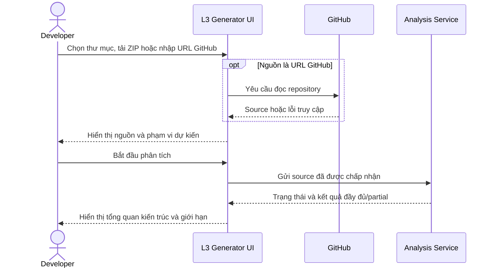
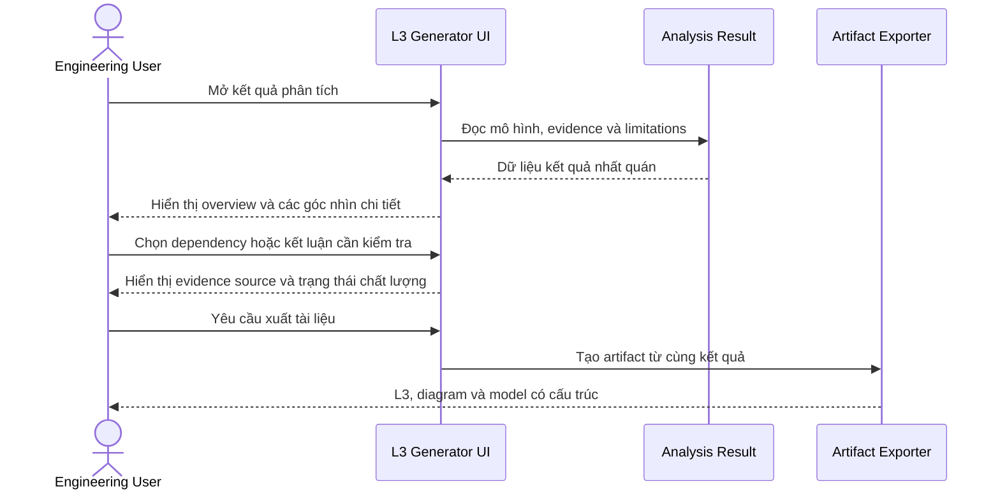

# PRD — Code → Architecture / L3 Generator

> **Biến source repository thành tài liệu kiến trúc L3 có thể đọc và kiểm chứng** — giúp
> Developer và Architect hiểu nhanh cấu trúc hệ thống mà không phải tự lần qua toàn bộ
> codebase.

# I. THÔNG TIN TÀI LIỆU

| Trường | Nội dung |
|---|---|
| **Loại tính năng** | Platform Feature |
| **Reviewers** | Nguyễn Chí Thức (Mentor), Đinh Thái Hà (Mentor); kiểm tra nội bộ: Khiêm (PIC) và Hoàng (Test) |
| **Epics liên quan** | Chưa tạo; Epic chỉ được tạo sau khi FR/AC và thiết kế đã đủ đầu vào |
| **Nguồn** | [`Đề bài.md` §3.6](../../../Đề%20bài.md), [`docs/USE_CASES.md`](../../../docs/USE_CASES.md), [`docs/ARCHITECTURE_V2_IDEA.md`](../../../docs/ARCHITECTURE_V2_IDEA.md), [`SPEC_Code_to_L3_Generator.md`](../../../SPEC_Code_to_L3_Generator.md) |

## Lịch sử thay đổi

| Version | Ngày | Người thực hiện | Mô tả thay đổi |
|---|---|---|---|
| 0.1 | 16/09/2026 | Product Owner + AI hỗ trợ | Tạo draft PRD gốc cho SYS-L3GEN theo mẫu mentor |
| 0.2 | 16/09/2026 | Product Owner + AI hỗ trợ | Chốt GitHub public-only, thêm Java và lịch sử phân tích vào MVP |
| 0.3 | 16/09/2026 | Khiêm + AI hỗ trợ | Ghi nhận nhóm hai người, mentor review và chia MVP thành FastAPI rồi Java |
| 0.4 | 16/09/2026 | Khiêm + AI hỗ trợ | Chốt mốc FastAPI/Java, Hoàng phụ trách Test và quy tắc một mentor duyệt |
| 0.5 | 16/09/2026 | Khiêm + AI hỗ trợ | Chốt giới hạn lưu lịch sử phân tích và làm rõ vai trò Kafka |
| 0.6 | 16/09/2026 | Khiêm + AI hỗ trợ | Đóng OQ giới hạn tài nguyên, Kafka, Spring Boot và xóa lịch sử; mở đường viết FR/NFR |

# II. TỔNG QUAN (EXECUTIVE SUMMARY)

## 1. Tóm tắt tính năng

Code → Architecture / L3 Generator là công cụ giúp Developer và Architect tạo bản mô
tả kiến trúc ban đầu từ source repository. Người dùng cung cấp thư mục cục bộ, file
ZIP hoặc URL GitHub, sau đó xem application, component, API, dữ liệu, tích hợp và các
quan hệ quan trọng trên giao diện. Mỗi kết luận kiến trúc phải có bằng chứng truy về
source và phải nói rõ phần chưa hỗ trợ hoặc chưa đủ dữ liệu. Kết quả có thể được xuất
thành tài liệu L3, sơ đồ và mô hình kiến trúc có cấu trúc. Hệ thống lưu lịch sử để
người dùng có thể mở lại các lần phân tích trước.

## 2. Vấn đề cần giải quyết (Problem Statement)

Khi tiếp cận một codebase chưa quen, Developer và Architect phải đọc nhiều file, lần
theo route, service, repository, dữ liệu và tích hợp bằng tay trước khi có được bức
tranh tổng thể. Quá trình này tốn thời gian, phụ thuộc kinh nghiệm cá nhân và dễ tạo
tài liệu nhanh lỗi thời hoặc không chỉ ra được kết luận dựa trên đoạn source nào.

Các công cụ chỉ liệt kê function/class hoặc vẽ call graph quá chi tiết không trực tiếp
trả lời câu hỏi ở mức L3. Ngược lại, một bản mô tả được tạo bằng suy đoán mà thiếu bằng
chứng có thể khiến người đọc hiểu sai hệ thống. Dự án cần tạo mô hình đủ tổng quát để
đọc nhanh, nhưng vẫn cho phép kiểm chứng và nhận biết giới hạn.

Hiện chưa có baseline định lượng chính thức về thời gian đọc code thủ công hoặc tỷ lệ
kết luận đúng. Đây là dữ liệu phải thu trong pilot trước khi PRD được baseline.

## 3. Mục tiêu kinh doanh (Business Goals)

| Goal key | Mục tiêu | Liên kết OKR/KPI khối |
|---|---|---|
| GOAL-L3GEN-001 | Giảm thời gian để một kỹ sư hình thành hiểu biết kiến trúc ban đầu về codebase chưa quen | Không áp dụng OKR cấp khối trong đồ án; đo bằng KPI-L3GEN-001 và KPI-L3GEN-002 |
| GOAL-L3GEN-002 | Tăng khả năng kiểm chứng tài liệu kiến trúc bằng bằng chứng trực tiếp từ source | Không áp dụng OKR cấp khối trong đồ án; đo bằng KPI-L3GEN-003 và KPI-L3GEN-004 |
| GOAL-L3GEN-003 | Giảm công sức tạo bản L3 ban đầu nhưng không đánh đổi bằng các quan hệ suy đoán | Không áp dụng OKR cấp khối trong đồ án; đo bằng KPI-L3GEN-002 và KPI-L3GEN-003 |

## 4. Chỉ số thành công (Success Metrics / KPIs)

Các target dưới đây là **đề xuất cho pilot**, chưa phải cam kết đã được duyệt. Artifact
OBS chưa được tạo nên cột `measured_by` đang để trạng thái planned; PRD chưa đủ điều
kiện qua Scope Gate cho tới khi cách đo được chốt.

`KPI-L3GEN-xxx` là mã của chỉ số nằm ngay trong PRD này, không cần file KPI riêng.
`OBS-L3GEN-xxx` là mã của tài liệu đo lường sẽ được tạo riêng sau khi KPI được duyệt;
tài liệu đó quy định nguồn dữ liệu, cách tính, tần suất đo và người chịu trách nhiệm.

| KPI key | KPI | Giải thích | Baseline | Target | Timeline | measured_by |
|---|---|---|---|---|---|---|
| KPI-L3GEN-001 | Tỷ lệ hoàn thành luồng chính không cần hướng dẫn | Tỷ lệ người dùng pilot tự cung cấp source, xem kết quả và xuất tài liệu | Chưa đo | Đề xuất ≥ 80% | Kết thúc pilot MVP | OBS-L3GEN-001 *(planned)* |
| KPI-L3GEN-002 | Thời gian tiết kiệm khi tạo hiểu biết L3 ban đầu | So sánh thời gian hoàn thành cùng một bài đọc kiến trúc có và không có công cụ | Chưa đo | Đề xuất giảm ≥ 50% trung vị | Kết thúc pilot MVP | OBS-L3GEN-002 *(planned)* |
| KPI-L3GEN-003 | Tỷ lệ kết luận L3 được reviewer xác nhận | Tỷ lệ quan hệ application/component/API/data/external được xác nhận đúng trên mẫu đã duyệt | Chưa đo | Đề xuất ≥ 90% | Kết thúc pilot MVP | OBS-L3GEN-003 *(planned)* |
| KPI-L3GEN-004 | Tỷ lệ giới hạn được công bố | Tỷ lệ file/lỗi/phần unsupported hoặc partial đã biết được thể hiện trong kết quả | Chưa đo | Đề xuất 100% trường hợp đã phát hiện | Kết thúc pilot MVP | OBS-L3GEN-004 *(planned)* |

Không công bố KPI phần trăm chất lượng khi chưa có tối thiểu 20 repository pilot và
100 quan hệ kiến trúc đã được reviewer đánh giá; trước ngưỡng đó chỉ báo cáo số lượng.

# III. BỐI CẢNH VÀ PHÂN TÍCH

## 1. Đối tượng người dùng (Target Users)

| Persona | Mô tả | Pain points hiện tại | Nhu cầu chính |
|---|---|---|---|
| Developer tiếp quản codebase | Kỹ sư cần sửa hoặc tích hợp một repository chưa quen | Mất thời gian tìm entry point, component, API, data access và external dependency | Có bản đồ kiến trúc ban đầu, xem chi tiết và truy về source |
| Architect / Reviewer | Người đánh giá cấu trúc, dependency và mức khớp giữa code với tài liệu | Tài liệu có thể cũ; sơ đồ thiếu bằng chứng hoặc quá chi tiết | Xem mô hình L3 tổng quát, coverage, limitation và evidence |

## 2. Giả định (Assumptions)

- Người dùng có quyền hợp pháp để đọc repository đầu vào; nếu sai phải xem lại
  FR-L3GEN-001 và yêu cầu bảo mật liên quan.
- Repository chứa đủ source/config để suy ra ít nhất một phần kiến trúc; nếu sai phải
  xem lại FR-L3GEN-002 và cách trình bày kết quả rỗng/partial.
- MVP có thể tạo giá trị với hai ngôn ngữ được giới hạn rõ là Python và Java; nếu phải
  hỗ trợ rộng mọi framework của hai ngôn ngữ, phải xem lại phạm vi FR-L3GEN-002.
- Quan hệ chính có thể được chứng minh bằng static analysis mà không chạy source; nếu
  cần runtime data, kết quả chỉ được ghi partial hoặc runtime-dependent.
- Người dùng chấp nhận tài liệu ban đầu cần review, không coi output là sự thật tuyệt
  đối về deployment thực tế.
- AI không cần thiết để tạo fact kiến trúc; nếu AI không khả dụng, các FR cốt lõi vẫn
  phải hoạt động.

## 3. Ràng buộc (Constraints)

- Nhóm thực hiện có 2 người là Khiêm và Hoàng, thời gian thực hiện 4 tuần.
- Hệ thống phải read-only đối với repository đầu vào: không chạy, import, `exec`, sửa
  hoặc ghi ngược source.
- MVP chỉ ưu tiên Python và Java trong các framework được chốt; hỗ trợ rộng mọi
  framework của hai ngôn ngữ không khả thi trong phạm vi hiện tại.
- Relationship kiến trúc phải dựa trên static evidence và rule tất định; AI không được
  tự tạo hoặc sửa fact.
- L3 và diagram tập trung application/component; function/call chỉ dùng làm evidence
  hoặc diagnostics.
- Giao diện là đường sử dụng chính cho người dùng tương tác. Cách gọi tự động, nếu giữ,
  không được làm luồng UI khó hiểu hơn.

## 4. Phụ thuộc (Dependencies)

| Dependency | Loại | Team chịu trách nhiệm | Trạng thái / ETA |
|---|---|---|---|
| Quyền đọc thư mục và file ZIP trên môi trường chạy UI | Platform capability | TEAM-L3GEN | Cần thiết kế/kiểm chứng |
| Truy cập repository qua URL GitHub | 3rd party integration | TEAM-L3GEN + GitHub | MVP chỉ hỗ trợ public repository; không xử lý credential private repository |
| Engine static analysis và framework rules | Internal platform component | TEAM-L3GEN | Đã có một phần, cần đối chiếu với FR/AC mới |
| Bộ sinh Markdown, Diagram-as-Code và model có cấu trúc | Internal output component | TEAM-L3GEN | Đã có một phần, cần chuẩn hóa contract |
| Cơ chế đo KPI pilot | Observability artifacts | Product + TEAM-L3GEN | Chưa tạo OBS |

# IV. YÊU CẦU TÍNH NĂNG

## 1. Trong phạm vi (In Scope)

- Nhận source từ thư mục cục bộ, file ZIP hoặc URL GitHub public.
- Phân tích Python và Java trong phạm vi framework được chốt cho MVP.
- Kiểm tra đầu vào trước khi phân tích và giải thích lỗi truy cập/định dạng.
- Phân tích source bằng static analysis, không thực thi code đầu vào.
- Phát hiện trong phạm vi stack được hỗ trợ: module/package, entry point,
  application/component, API/route, service/business, repository/data access,
  entity/table, external API và dependency quan trọng.
- Phát hiện quan hệ event trong repository đầu vào ở phạm vi Kafka: producer, consumer
  và topic. Broker khác Kafka nằm ngoài MVP và phải thể hiện limitation.
- Công bố configuration quan trọng khi adapter tương ứng đã được hỗ trợ; nếu chưa có
  phải thể hiện limitation.
- Xem tổng quan kiến trúc, application/component, API/luồng yêu cầu, dữ liệu/tích hợp
  và dependency.
- Xem kết quả chi tiết, coverage, limitation, trạng thái partial/runtime-dependent và
  evidence về source.
- Lưu tối đa 10 lần phân tích gần nhất cho mỗi repository; mỗi kết quả hết hạn sau 14
  ngày. Khi vượt 10 lần, hệ thống loại kết quả cũ nhất.
- Người dùng xóa thủ công một lần phân tích trước khi nó hết hạn.
- Xuất L3 Markdown, component/dependency diagram, Diagram-as-Code và architecture
  model có cấu trúc trong phạm vi contract được duyệt.
- Giữ kết quả nhất quán giữa giao diện và artifact xuất ra.

## 2. Ngoài phạm vi (Out of Scope)

- Hỗ trợ đầy đủ mọi ngôn ngữ, framework hoặc mọi semantics của Python.
- Resolve chính xác mọi function/method call.
- Repository Knowledge Graph đầy đủ ở mức function/class cùng query/search API.
- Chạy source, import module đầu vào hoặc suy luận deployment topology thiếu bằng chứng.
- Tự sửa source, tự tạo pull request hoặc ghi ngược tài liệu vào repository đầu vào.
- Change impact, test impact, architecture drift và incremental analysis trong MVP.
- AI tự tạo relation, edge, framework rule hoặc thay đổi dữ kiện phân tích.
- Quản trị tài khoản/phân quyền tổ chức hoàn chỉnh.
- GitHub private repository và mọi cơ chế nhận/lưu credential truy cập repository.
- Message broker khác Kafka trong repository đầu vào, ví dụ RabbitMQ, Celery hoặc SQS.
- Framework Java ngoài Spring Boot.

## 3. Danh sách tính năng (Feature List)

Đây là chỉ mục. Nội dung và AC đầy đủ nằm ở `requirements/fr/FR-L3GEN-*.md`, mỗi FR
một file.

| Biz Process | FR key | Tên tính năng | Mô tả ngắn | Priority (MoSCoW) | Milestone | Link ticket |
|---|---|---|---|---|---|---|
| Cung cấp mã nguồn | FR-L3GEN-001 | Cung cấp repository đầu vào | Chọn thư mục, tải ZIP hoặc nhập URL GitHub và nhận phản hồi kiểm tra đầu vào | Must Have | M1 | |
| Phân tích kho mã | FR-L3GEN-002 | Tạo mô hình kiến trúc từ source | Phân tích read-only và trả kết quả đầy đủ hoặc partial có giải thích | Must Have | M1 | |
| Khám phá kiến trúc | FR-L3GEN-003 | Xem, lưu và truy vết kiến trúc | Lưu/mở/xóa lịch sử; xem tổng quan, component, API, data, integration và dependency ở mức L3 | Must Have | M1 | |
| Tin cậy kết quả | FR-L3GEN-004 | Kiểm tra evidence và giới hạn | Xem source evidence, coverage, lỗi, unsupported và runtime-dependent | Must Have | M1 | |
| Sử dụng kết quả | FR-L3GEN-005 | Xuất tài liệu kiến trúc | Xuất các artifact L3 và Diagram-as-Code nhất quán | Must Have | M1 | |

## 4. Yêu cầu phi chức năng (Non-functional Requirements)

Đây là chỉ mục. Ngưỡng số sống ở `requirements/nfr/NFR-L3GEN-*.md`, không chép vào PRD.

| NFR key | Loại | Mô tả ngắn | Áp lên | Ghi chú |
|---|---|---|---|---|
| NFR-L3GEN-PERF-001 | Performance | Phân tích và hiển thị phản hồi trong thời gian phù hợp với quy mô repository được công bố | FR-L3GEN-001, FR-L3GEN-002, FR-L3GEN-003 | Ngưỡng pilot đã chốt; chưa benchmark |
| NFR-L3GEN-SEC-001 | Security | Ngăn thực thi source, truy cập ngoài phạm vi, xử lý archive không an toàn và giữ vòng đời dữ liệu lịch sử | FR-L3GEN-001, FR-L3GEN-002, FR-L3GEN-003 | Security review sở hữu |
| NFR-L3GEN-REL-001 | Reliability | Lỗi một phần không làm mất toàn bộ kết quả có thể sử dụng | FR-L3GEN-002, FR-L3GEN-004, FR-L3GEN-005 | Cần định nghĩa recovery/error contract |
| NFR-L3GEN-USA-001 | Usability | Người dùng hoàn thành luồng chính và hiểu trạng thái partial/unsupported mà không cần hướng dẫn riêng | FR-L3GEN-001, FR-L3GEN-003, FR-L3GEN-004 | Đo qua pilot usability |
| NFR-L3GEN-COMP-001 | Compatibility | Artifact xuất ra có cấu trúc và encoding nhất quán trên môi trường được hỗ trợ | FR-L3GEN-005 | Chốt format/version ở contract |

# V. LUỒNG NGƯỜI DÙNG (USER FLOWS)

## 1. Luồng chính

### 1.1 Phân tích repository mới qua giao diện

1. Developer mở màn hình phân tích và chọn một hình thức cung cấp source.
2. Hệ thống lấy source; với URL GitHub, hệ thống liên hệ GitHub và báo rõ nếu không
   truy cập được.
3. Giao diện cho Developer kiểm tra đúng nguồn và phạm vi dự kiến.
4. Developer bắt đầu phân tích.
5. Hệ thống hiển thị trạng thái trong lúc xử lý.
6. Khi hoàn thành, giao diện mở tổng quan kiến trúc; nếu kết quả partial, lý do phải
   xuất hiện cùng kết quả.

### 1.2 Xem chi tiết và xuất kết quả

1. Developer hoặc Architect mở kết quả vừa tạo hoặc kết quả đã lưu.
2. Hệ thống hiển thị overview cùng các phần application/component, API, data,
   integration và dependency.
3. Người dùng đi sâu vào một kết luận để xem evidence, coverage và limitation.
4. Người dùng yêu cầu xuất tài liệu.
5. Hệ thống tạo artifact từ cùng một analysis result để tránh lệch giữa giao diện và
   file xuất.

## 2. Edge Cases và Error States

| Tình huống | Hành vi mong muốn |
|---|---|
| Thư mục không tồn tại hoặc không đọc được | Không bắt đầu phân tích; chỉ rõ đường dẫn/quyền truy cập cần sửa |
| ZIP hỏng, sai định dạng hoặc có nội dung không an toàn | Từ chối an toàn, không giải nén ngoài vùng xử lý và giải thích nguyên nhân |
| URL GitHub sai hoặc repository không tồn tại | Báo lỗi nhập/truy cập; không hiển thị như repository rỗng |
| Repository GitHub yêu cầu quyền | Nói rõ chưa có quyền; không yêu cầu người dùng dán token vào nội dung không an toàn |
| Repository có hơn 10 lần phân tích | Loại kết quả cũ nhất và giữ tối đa 10 kết quả gần nhất |
| Kết quả lịch sử đã quá 14 ngày | Không còn cho mở lại; hệ thống tự xóa theo NFR-L3GEN-SEC-001 |
| Người dùng xóa thủ công một lần phân tích | Xác nhận trước khi xóa; xóa xong không mở lại được và không ảnh hưởng các lần phân tích khác |
| Repository đầu vào dùng broker khác Kafka | Ghi rõ chưa hỗ trợ trong limitation; không mô tả như repository không có event |
| Mất kết nối khi lấy source GitHub | Cho phép thử lại mà không tạo kết quả phân tích giả |
| Repository không có file thuộc stack hỗ trợ | Trả inventory/coverage và limitation; không khẳng định hệ thống không có kiến trúc |
| Một số file lỗi cú pháp | Tiếp tục phần an toàn, đánh dấu file lỗi và kết quả partial |
| Gặp cấu trúc phụ thuộc runtime | Dừng ở bằng chứng chắc chắn và ghi runtime-dependent |
| Chạm giới hạn tài nguyên | Trả kết quả partial/truncated cùng giới hạn đã chạm |
| Không tìm thấy component/API/data | Trả báo cáo phạm vi đã đọc và lý do; không để trang kết quả trống khó hiểu |
| Source thay đổi sau lần phân tích | Kết quả phải thể hiện snapshot/phiên bản source đã dùng để tránh evidence trỏ nhầm |
| Xuất một artifact thất bại | Giữ analysis result, báo artifact nào thất bại và cho phép thử lại |

# VI. DEFINITION OF DONE (DoD)

- [ ] Mọi FR được duyệt và không còn Open Question blocking tương ứng.
- [ ] Coverage pass: FR→AC, AC→implementation target, KPI→OBS và FR→NFR áp dụng.
- [ ] Người dùng pilot hoàn thành luồng thư mục, ZIP hoặc GitHub tới kết quả mà không
      cần người phát triển công cụ hướng dẫn trực tiếp.
- [ ] Giao diện, L3, diagram và model có cấu trúc dùng cùng một nguồn analysis result.
- [ ] Người dùng mở được lịch sử và xem đúng snapshot source, kết quả và limitation
      của lần phân tích đã chọn.
- [ ] Mọi kết luận L3 công khai có evidence hoặc được ghi rõ là partial/unknown.
- [ ] Unsupported, parse error, runtime-dependent và giới hạn tài nguyên được hiển thị
      rõ; không biến “chưa đọc được” thành “không tồn tại”.
- [ ] Kiểm chứng hệ thống không chạy hoặc sửa source repository đầu vào.
- [ ] Các NFR bảo mật, hiệu năng, độ tin cậy, khả dụng và tương thích có artifact riêng
      và đã qua reviewer chịu trách nhiệm.
- [ ] Tài liệu người dùng và thông báo lỗi của ba hình thức input đã được review.

# VII. THIẾT KẾ VÀ MOCKUPS

| Màn hình / Flow | Link Figma / Mô tả |
|---|---|
| Cung cấp mã nguồn | Một màn hình với ba lựa chọn rõ ràng: thư mục cục bộ, file ZIP, URL GitHub; có vùng báo lỗi và phạm vi nguồn |
| Trạng thái phân tích | Hiển thị giai đoạn tổng quát, trạng thái đang chạy/hoàn thành/partial/thất bại và khả năng hủy nếu được FR chốt |
| Lịch sử phân tích | Liệt kê các lần phân tích theo repository/thời gian/trạng thái và cho phép mở lại kết quả phù hợp |
| Tổng quan kiến trúc | Tóm tắt application/component, entry point, dependency diagram, coverage và limitation nổi bật |
| Kết quả chi tiết | Các góc nhìn application/component, API/flow, data/integration, dependency và evidence source |
| Xuất tài liệu | Chọn artifact được hỗ trợ, trạng thái tạo file và lỗi riêng từng artifact |
| Mock/Figma | Chưa có — cần tạo ở bước UX/UI cấp 1–3 sau Scope Gate |

# VIII. TIMELINE VÀ PHASING

| Phase | Nội dung | Target Release | Must Have features (FR keys) |
|---|---|---|---|
| Phase 0 — Requirement baseline | Chốt PRD, FR/AC, NFR và user flow | 16/09/2026 | FR-L3GEN-001 đến FR-L3GEN-005 |
| Phase 1 — MVP FastAPI | Hoàn thiện ba hình thức input public-only, phân tích FastAPI và Kafka phía Python, lịch sử, xem chi tiết/evidence và export | 26/09/2026 | FR-L3GEN-001 đến FR-L3GEN-005 trong phạm vi FastAPI |
| Phase 2 — MVP Java | Mở rộng cùng contract phân tích sang Java/Spring Boot, gồm Kafka phía Java | 30/09/2026 | FR-L3GEN-002 đến FR-L3GEN-005 trong phạm vi Java |
| Phase 3 — Sau pilot | Framework/ngôn ngữ bổ sung, broker khác Kafka và incremental analysis nếu có business case | Sau 30/09/2026; chưa chốt | Sẽ tạo FR mới hoặc bump PRD khi scope đổi |

Kafka thuộc Phase 1 và Phase 2 vì mỗi ngôn ngữ cần adapter riêng: thư viện Kafka của
Python và Java khác nhau, không dùng chung rule.

**Rollout Strategy:** chạy pilot nội bộ trên tập repository đã được cấp quyền và có
reviewer đánh giá ground truth. Chỉ mở rộng sau khi KPI pilot, lỗi bảo mật input và
các trường hợp partial đã được xem xét. Không dùng output chưa review làm căn cứ duy
nhất cho quyết định kiến trúc quan trọng.

# IX. PHÊ DUYỆT — Scope Gate

| Vai trò | Họ tên | Ngày review | Quyết định | Ghi chú |
|---|---|---|---|---|
| Product / Document PIC | Khiêm | 16/09/2026 | Draft owner | Người soạn và điều phối nội dung; không tự phê duyệt baseline |
| Test / QA | Hoàng | | Pending internal review | Kiểm tra requirement, scenario và kết quả test |
| Mentor reviewer | Nguyễn Chí Thức | | Pending mentor review | Chờ review Scope Gate |
| Mentor reviewer | Đinh Thái Hà | | Pending mentor review | Chờ review Scope Gate |

- `ai_assisted`: true
- **Người chịu trách nhiệm cuối:** Khiêm chịu trách nhiệm hoàn thiện draft; baseline chỉ
  được ghi nhận sau khi ít nhất một trong hai mentor đồng ý tại Scope Gate.
- **Baseline được duyệt:** Chưa có. Khi qua Scope Gate phải ghi `PRD-L3GEN-2609-001`
  revision được duyệt cùng revision của từng FR/NFR tương ứng; không dùng một BL key
  chung để thay danh sách artifact.

## Open Questions

| OQ key | Câu hỏi | Owner | Due | Blocking |
|---|---|---|---|---|
| OQ-L3GEN-001 | ~~MVP có hỗ trợ GitHub private không?~~ ✅ Không. MVP chỉ nhận GitHub public và không nhận/lưu credential repository. | Product Owner + Security | 16/09/2026 | — |
| OQ-L3GEN-002 | ~~MVP chỉ có Python hay thêm ngôn ngữ khác?~~ ✅ MVP gồm Python và Java; framework Java cụ thể chuyển sang OQ-L3GEN-007. | Product Owner + Tech Lead | 16/09/2026 | — |
| OQ-L3GEN-003 | Ngưỡng KPI pilot và bộ repository đánh giá nào được chấp thuận? | Product Owner + QA Lead | 23/09/2026 *(đề xuất)* | GOAL-L3GEN-001, GOAL-L3GEN-002 |
| OQ-L3GEN-004 | ~~Giới hạn ZIP/repository và thời gian phân tích là bao nhiêu?~~ ✅ Chốt ngưỡng pilot: ZIP nén 100 MB, sau giải nén 500 MB, tối đa 50.000 file và 10 phút mỗi lần phân tích. Đây là mốc để đo trong pilot, chưa phải cam kết đã benchmark. | Tech Lead + Security | 16/09/2026 | — |
| OQ-L3GEN-005 | ~~MVP có cần lưu và mở lại lịch sử analysis result không?~~ ✅ Có, lịch sử thuộc MVP. | Product Owner | 16/09/2026 | — |
| OQ-L3GEN-006 | ~~Event/queue/configuration nào bắt buộc trong MVP?~~ ✅ Kafka thuộc MVP: nhận diện producer, consumer và topic trong repository đầu vào. Kafka là công nghệ xuất hiện trong repository được phân tích, không phải hạ tầng chạy L3 Generator. Broker khác Kafka chuyển Phase 3. | Product Owner + Tech Lead | 16/09/2026 | — |
| OQ-L3GEN-007 | ~~Phạm vi Java có chốt Spring Boot không?~~ ✅ Có. Java trong MVP giới hạn ở Spring Boot. | Product Owner + Tech Lead | 16/09/2026 | — |
| OQ-L3GEN-008 | ~~Người dùng có được xóa lịch sử thủ công trước hạn không?~~ ✅ Có cả hai: người dùng xóa thủ công trước hạn, và hệ thống tự xóa khi quá 14 ngày hoặc vượt 10 lần mỗi repository. | Product Owner + Tech Lead + Security | 16/09/2026 | — |
| OQ-L3GEN-009 | ~~Scope Gate cần cả hai mentor đồng ý hay chỉ cần một mentor?~~ ✅ Chỉ cần ít nhất một trong hai mentor duyệt. | Khiêm + Mentors | 16/09/2026 | — |
---

## Tài liệu liên quan

- Use case đầy đủ ở [`docs/USE_CASES.md`](../../../docs/USE_CASES.md).
- Sơ đồ use case ở [`docs/diagrams/usecase-overview.svg`](../../../docs/diagrams/usecase-overview.svg).
- Scenario hiện có ở [`docs/SCENARIOS.md`](../../../docs/SCENARIOS.md); cần đồng bộ sau
  khi PRD/FR được duyệt.
- Kiến trúc mục tiêu ở [`docs/ARCHITECTURE_V2_IDEA.md`](../../../docs/ARCHITECTURE_V2_IDEA.md).
- FR/AC sẽ được tạo tại `requirements/fr/FR-L3GEN-*.md`, mỗi FR một file.
- NFR sẽ được tạo tại `requirements/nfr/NFR-L3GEN-<CAT>-*.md`, mỗi NFR một file.
- L1/L2 sẽ được tạo tại `architecture/` sau Scope Gate.
- Đo lường KPI sẽ được tạo tại `observability/`.
