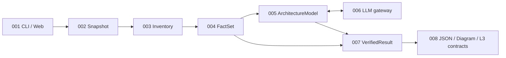

# L3 Generator — bộ contract L3 draft

**Cập nhật: 01/10/2026. Bộ tám contract vẫn là draft, chưa approved. Thuật toán chia component (D-03) vẫn mở.**

Bộ này dựa trên nguồn ở nhánh `docs/gate-2` commit `5d06f14`: PRD r28, FR-027 r3, ADR-2026-003 r2, CMP-001…008 r2, NFR-ABST-002 r2, NFR-ACC-002 r2, NFR-AI-002 r3, NFR-OPS-001 r1, NFR-SEC-002 r3. Bản 25/09 (revision 3 của các contract) dựa trên các file nguồn do người soạn L3 tự sửa (PRD r29…), chưa được duyệt; revision 4 bỏ các điểm trái nguồn trên git. Đối chiếu chi tiết: [bản đối chiếu nguồn](../../docs/L3-Generator-doi-chieu-nguon-L3.md).

Quy ước trong các contract: chỗ nào nguồn chưa nói mà contract quy định thêm thì ghi "chi tiết L3". Các chi tiết L3 và hai điểm từng chờ (DDL, hàng đợi) đã được người soạn tự review và chốt ngày 01/10/2026; chưa có review của người khác. Không có cuộc gọi LLM hoặc thực thi source repository khi soạn/kiểm bộ tài liệu này.

## 1. Đọc theo thứ tự nào?

| Thứ tự | Contract | Bạn review điều gì? |
|---|---|---|
| 1 | [API-004 — Dữ kiện và evidence](CMP-L3GEN-004/api/API-L3GEN-004-v1.md) | Trường dữ liệu, unknown, ID, vị trí source và tham chiếu |
| 2 | [API-005 — Component và cạnh](CMP-L3GEN-005/api/API-L3GEN-005-v1.md) | Membership, chia nhóm, fallback và bằng chứng nối cạnh |
| 3 | [API-007 — Cửa kiểm bằng chứng](CMP-L3GEN-007/api/API-L3GEN-007-v1.md) | Kết luận nào được công bố, lý do loại, kết quả đã kiểm |
| 4 | [API-006 — Cổng LLM](CMP-L3GEN-006/api/API-L3GEN-006-v1.md) | Các tác vụ, schema model trả, budget, scope đọc code và lỗi |
| 5 | [API-008 — Output và sinh L3](CMP-L3GEN-008/api/API-L3GEN-008-v1.md) | JSON, sơ đồ, kiểm bản xuất, API/TBL/EVT, phần thiếu theo định dạng, retry |
| 6 | [API-001 — CLI và API web](CMP-L3GEN-001/api/API-L3GEN-001-v1.md) | Run lifecycle, OpenAPI, lỗi, upload, tải kết quả/evidence |
| 7 | [API-002 — Snapshot](CMP-L3GEN-002/api/API-L3GEN-002-v1.md) | Path/hash, intake, đọc source đúng snapshot |
| 8 | [API-003 — Inventory](CMP-L3GEN-003/api/API-L3GEN-003-v1.md) | Unit/file được xét, bị loại và mức hỗ trợ |

API-001 là HTTP facade và CLI. API-002 đến API-008 là **giao diện gọi nội bộ**, không phải bảy HTTP service mới. Dùng prefix API cho interface nội bộ là quy ước draft cục bộ D-00; không tuyên bố registry tổ chức đã chấp nhận. JSON Schema của cấu trúc trao đổi nằm trong spec giao diện owner; không đổi tên JSON thành TBL. Không tạo database/event bus để có đủ thư mục TBL/EVT.



Model chỉ tạo proposal/annotation. Schema hợp lệ không đồng nghĩa có evidence hợp lệ; evidence hợp lệ theo rule cũng không thay benchmark độ đúng bằng gold độc lập.

### Đọc nhanh trạng thái bàn giao

| Phần | Đã có trong bộ L3 | Việc còn lại |
|---|---|---|
| 001/002 — CLI, HTTP, snapshot | Request/response, lifecycle, lỗi, quyền đọc và identity | Review hành vi/consumer; triển khai và kiểm môi trường thật |
| 003/004 — Inventory, facts | Schema, phạm vi, unknown, evidence, phiên bản và lỗi | Policy root/flat thuộc D-03; parser/adapter phải được triển khai và đo riêng |
| 005 — Component và quan hệ | Interface, schema membership, owner contract, provenance, binding và lỗi | **Chưa chọn cách chia component**; không đóng D-03 bằng việc pass schema |
| 006/007 — LLM và verification | Task schema, ngân sách, scope, fallback, verdict và lỗi | Review bản đồng bộ; provider capability và kiểm ngữ nghĩa cần test sản phẩm |
| 008 — Output và L3 sinh ra | JSON, kiểm bản xuất, API/TBL/EVT, phần thiếu theo định dạng, export metadata, retry | Review renderer/consumer; không dùng ví dụ thay phép đo accuracy |
| Ví dụ và kiểm tài liệu | [Luồng mẫu có membership cố định](examples/contract-walkthrough.md), kiểm schema/ref và ca âm | Không thực thi source, không gọi LLM, không phải golden dataset |

"Hoàn thiện bản L3" ở đây nghĩa là nội dung contract đủ cụ thể để review và kiểm consumer bằng fixture. Không có chữ ký, gate hoặc kết quả nghiệm thu nào được tạo thay người duyệt. UI binding tại API-001 là đầu vào contract cho bước UI cấp 4; chưa thay UIS dẫn xuất từ UXF/SCR/UID đã được duyệt.

## 2. Ranh giới các schema

| Định danh schema | Chủ sở hữu | Phiên bản payload |
|---|---|---|
| Snapshot, RangeRead, Verification, SnapshotError | API-002 | 0.1.0 qua Snapshot |
| Inventory, InventoryError | API-003 | 0.1.0 qua Inventory |
| FactSet, Fact, EvidenceRef, FieldValue, Limitation, ExtractionError | API-004 | 0.1.0 qua FactSet |
| ArchitectureModel, Component, Edge, ContractOwner | API-005 | 0.1.0 |
| ModelRequest/Response, TaskResult, Provenance, CodeRead | API-006 | 0.1.0 qua envelope |
| VerifiedResult, VerificationError | API-007 | 0.1.0 qua VerifiedResult |
| ResultBundle, ResultData, Artifact, ExportContext/RenderNotice/ExportError | API-008 | 0.1.0 |

Schema `$id` dùng miền logic `https://l3gen.local/contracts/`, không phải URL cần triển khai hoặc truy cập mạng. Validator đăng ký schema từ các khối JSON trong Markdown. Khi trích ra file, gom các `.schema.json` vào cùng thư mục sinh để relative `$ref` giải được; không sửa file trích độc lập. `v1` của key là major contract; revision tài liệu và phiên bản payload khác nhau. Bản 0.1.0 chưa là cam kết tương thích sản phẩm đã phát hành.

Mọi hình thức xuất của cùng run dùng cùng VerifiedResult. Schema không tự kiểm đầy đủ uniqueness, snapshot hash, liên kết ID, phạm vi path, loại thuộc tính, binding và permission; mỗi spec liệt kê invariant phải kiểm bằng code.

## 3. Những quyết định nhóm cần review

D-03 là **OPEN / chưa chọn phương án**. Các dòng khác là đề xuất của bản draft, cần reviewer xác nhận. Đây không phải chữ ký Product/mentor hoặc gate.

| ID review cục bộ | Đề xuất trong draft | Nguồn trên git / trạng thái |
|---|---|---|
| D-00 | Prefix API/type api-contract cho interface in-process; schema nhúng theo owner | Execution Guide; chỉ API-001 dùng OpenAPI. Chi tiết L3 |
| D-01 | Binding theo loại/chiều/đích, không chỉ evidence ở hai đầu | AC-022-02 (FR-022 r2) chỉ đòi dữ kiện hai đầu. Rule này chặt hơn, chỉ loại thêm cạnh. Chi tiết L3, chờ review |
| D-02 | Mọi artifact cùng tập component/cạnh; model tối đa 50 node do CMP-005 giữ | FR-025 r2 AC-04, CMP-005 r2 §4, CMP-008 r2 §4. Khớp nguồn |
| D-03 — OPEN | Chưa chọn thuật toán. So sánh thư mục đơn giản, code nhiều tín hiệu và code + LLM điều chỉnh có giới hạn | Schema, verifier, gateway và renderer kiểm bằng membership fixture. Xem API-005 mục 3.1 |
| D-04 | ID có cột/range và semantic key; identity trong snapshot | CMP-004 r2 chỉ đòi tất định. Chi tiết L3 |
| D-05 | Trần request vật lý gồm retry/tool; 40 toàn run, Gemini 2; token vào+ra | NFR-AI-002 r3, CMP-006 r2 ghi trần; cách đếm là chi tiết L3 |
| D-06 | Hàng đợi FIFO không giới hạn; `queued` riêng; analysis_outcome tách artifact status; loại hết kết luận vẫn `partial` | CMP-001 r2, CMP-007 r2, NFR-OPS-001 r1. Khớp nguồn. Không giới hạn số run chờ, đúng nguồn |
| D-07 | Hợp các đoạn source gửi đi không được phủ nguyên file | NFR-SEC-002 r3 "không gửi nguyên file". Chi tiết L3 |
| D-08 | Mỗi file API một khối OpenAPI; trùng method/path giữa application thì omitted có notice | FR-027 r3 AC-01. Khớp nguồn |
| D-09 | Khối máy chỉ phần đã biết; bảng biểu diễn phần thiếu cho từng định dạng (API-008 §3.2) | FR-027 r3 "Khi chưa đủ dữ kiện", CMP-008 r2 §2. Khớp nguồn. Bỏ cả bảng khỏi DDL khi thiếu trường: đã chốt khi tự review |
| D-10 | CMP-005 gán owner theo file khai báo; EVT ở từng bên gửi/nhận | ADR-2026-003 r2, CMP-005 r2, FR-027 r3. Khớp nguồn |
| D-11 | CLI flags/exit codes, không ghi đè output, prompt khóa ngoài HTTP, web loopback | FR-019, NFR-SEC-002 r3, NFR-AI-002 r3, threat model. Chi tiết L3 |
| D-12 | External nodes có ID riêng, không file membership | NFR-ABST-002 r2, FR-021/022. Chi tiết L3 |

ID D-xx chỉ là hàng review trong tài liệu này, không giả artifact OQ chuẩn tắc. Reviewer ghi quyết định/người/ngày vào nguồn quyết định thật của nhóm, nếu đổi nội dung draft thì cập nhật revision và candidate mới, không sửa baseline lịch sử. Không lấy việc có đủ tám file làm lý do bỏ qua các quyết định này.

## 4. Traceability theo AC

| AC nguồn | Spec sở hữu / phối hợp | Ca cần kiểm |
|---|---|---|
| 019-01/02/03 | 001, 002 | Local source/output, lỗi quyền, đường dẫn lồng nhau |
| 019-04/05 | 001, 002 | ZIP an toàn, GitHub public và lỗi truy cập |
| 020-01/02/03 | 003, 007, 008, 001 | Inventory giữ tới output/UI; unit/phạm vi, repo rỗng/unsupported, công bố mức hỗ trợ; không nhầm kiểm kê với parse thành công |
| 021-01/05 | 004, 008 | Route registration/prefix, request/response, unknown và xuất OpenAPI |
| 021-02 | 004, 008 | Bảng/cột/FK, tên động và DDL |
| 021-03 | 004, 008 | HTTP/config/event/library, secret và unsupported |
| 021-04 | 004, 005, 007 | Unresolved không thành cạnh |
| 022-01/03/05 | 005, 006 | Chia nhóm code/model, lỗi LLM và fallback |
| 022-02 | 005, 007 | Binding evidence, loại sai đích/chiều |
| 022-04 | 005, 008 | Model tối đa 50 node; mọi artifact cùng tập node |
| 023-01/02/03/04 | 002, 004, 007, 001 | Evidence đúng snapshot, nhãn, loại claim sai |
| 024-01/02/03/04 | 001, 003, 004, 006, 007 | File lỗi, budget, partial, không che phần thiếu |
| 025-01/02/03/04 | 008, 001 | Output/schema, không dangling, retry, mọi artifact cùng tập component/cạnh |
| 026-01/02/03 | 001, 008 | Trạng thái run, các góc nhìn, tìm/lọc, mở evidence |
| 027-01/02/03 | 004, 005, 007, 008 | API/TBL/EVT, owner do CMP-005 gán, kiểm từng trường, machine blocks partial |

Mapping này phục vụ review draft; chưa ghi vào `implementation_target`/`validated_by` của FR, chưa cấp test ID hoặc đánh dấu AC pass. NFR budgets/security/reliability có bảng hành vi tại spec liên quan; phép đo nghiệm thu vẫn do OBS quy định.

### 4.1. Mapping AC → code → test

Bảng này ghi AC nào đã có code và test trong [slice/](../../slice/README.md). Code ở `slice/l3slice/`, test ở `slice/tests/`. "Một phần" nghĩa là test chỉ phủ phần ghi trong cột cuối. Có test pass không có nghĩa AC đã nghiệm thu: gold còn `candidate`, chưa chạy held-out. Bảng chưa ghi vào `implementation_target`/`validated_by` của FR, vì đó là file nguồn.

| AC | Contract | Code | Test | Phủ tới đâu |
|---|---|---|---|---|
| 019-01 | API-001 §8 | `__main__.main` | `test_cli_exit_codes` | Ghi L3, Mermaid, SVG, JSON và in đường dẫn file ready |
| 019-02 | API-001 §8, API-008 §7 | `render._publish` | `test_output_not_overwritten` | Một phần: output không rỗng thì dừng, không ghi dở |
| 019-03 | API-001 §8 | `__main__.main` | `test_cli_exit_codes` | Source và output bao nhau thì từ chối |
| 019-04 | API-001 §2, API-002 §2 | `snapshot.take_zip`, `web._zip` | `test_intake.py`, `test_zip_admission_errors`, `test_unsafe_zip_fails_after_admission` | ZIP hỏng, thoát vùng, link, trùng tên, vượt trần |
| 019-05 | API-001 §2.1, API-002 §1 | `web.normalize_github`, `github.take_github` | `test_github_input_checks`, lớp `GitHub` (`test_l3_rest.py`) | Một phần: URL sai, 404, 403, redirect lạ, IP nội bộ, quá 120 giây — chỉ với transport giả; tắt mặc định, chờ Security review |
| 021-01 | API-004 §2 | `extract._routes`, `_Routers` | lớp `Routes` (`test_extract.py`) | `include_router`, `mount`, app factory, wrapper, hai app, prefix động |
| 021-02 | API-004 §2 | `extract._tables`, `_table_variables` | lớp `Tables`, `test_tbl_ddl_for_sqlite` | SQLAlchemy 1/2, SQLModel, `Table()` |
| 021-03 | API-004 §2 | `extract._events`, `_http_and_config`, `_libraries` | lớp `Events`, `OtherFacts` | Kafka (3 thư viện), FastStream, httpx/requests, biến môi trường, manifest |
| 021-04 | API-004 §2 | `extract._references` | `test_dynamic_import_is_unresolved_not_dropped` | Lời gọi chưa nối được ghi `unresolved`, không thành cạnh |
| 021-05 | API-004 §2 | `extract._model_fields`, `_parameters` | `test_request_and_response_models` | Body, tham số, response model |
| 022-01 | API-005 §3 | `model._components` | `test_membership_must_cover_each_file_once` | Một phần: membership fixture; D-03 chưa chọn |
| 022-02 | API-005 §4 | `annotate.apply_proposals` | `test_labels_and_proven_proposal` | Đề xuất của model chỉ được nhận khi rule tĩnh chứng minh |
| 022-03 | API-006 §4 | `gateway`, `annotate.annotate` | `test_gateway.py`, `test_gateway_failure_keeps_static_model` | Provider giả; lỗi model thì giữ mô hình tĩnh, ghi giới hạn |
| 022-04 | API-005 §3, API-008 §3 | `model._components` | `test_more_than_50_nodes_rejected` | Model quá 50 node bị từ chối |
| 022-05 | API-005 §3 | `annotate.apply_groups` | lớp `FlatGroups` | Một phần: code có, chưa nối vào pipeline vì D-03 chưa chọn |
| 023-01 | API-004, API-008 §4 | `render.render_api/tbl/evt`, `engine.evidence` | `test_api_file_has_one_valid_openapi_block_matching_table`, `test_zip_run_end_to_end` | Mỗi dòng có fact ID và evidence ID; mở evidence qua web |
| 023-02 | API-004 §2 | `extract`, `verify` | `test_facts_partial_with_reason` | confidence/completeness tách riêng, có lý do |
| 023-03 | API-007, API-001 §3 | `verify.open_evidence`, `engine.evidence` | `test_open_evidence_detects_changed_file` | File đổi sau snapshot thì từ chối |
| 023-04 | API-007 §1–2 | `verify._contract_fields`, `verify._edge_problem` | `test_value_not_in_evidence_becomes_unknown`, `test_wrong_owner_is_cleared_by_verifier`, `test_edge_without_proven_broker_rejected` | Giá trị, owner, cạnh không có bằng chứng thì không công bố |
| 024-01 | API-004 | `extract.extract` | chỉ golden (`orders-syntax-error`) | File lỗi cú pháp ghi `PARSE_FAILED`; chưa có unit test |
| 024-02 | API-001 §2.2 | `engine._cleanup_on_start`, `engine._over_budget` | `test_restart_fails_interrupted_runs`, lớp `Budgets` | Bị ngắt; trần 30 phút/2 GiB kiểm giữa các giai đoạn |
| 025-01 | API-008 §2–6 | `render.render` | `test_bundle_matches_contract_schema_and_invariants` | L3, Mermaid, SVG, JSON |
| 025-02 | API-008 §2 | `render.render` | `test_bundle_matches_contract_schema_and_invariants` | schema version, snapshot ID, không cạnh treo |
| 025-03 | API-008 §7 | `render.retry_artifact`, `engine.retry` | `test_publish.py`, `test_retry_failed_svg` | Artifact lỗi retry thành ready; file ready giữ nguyên byte |
| 025-04 | API-008 §3.1 | `render.check_diagram`, `check_svg` | `test_readme_and_diagram_share_nodes`, `test_reversed_edge_with_same_count_fails` | Cùng tập node/cạnh giữa JSON, README, Mermaid, SVG |
| 026-01 | API-001 §3, §8.1 | `engine.view`, `ui/app.js` | `test_zip_run_end_to_end`, lớp `Ui` | Trạng thái run trên UI; chưa có UXF/SCR được duyệt |
| 026-02/03 | API-001 §8.1 | `ui/app.js` | lớp `Ui` (CSP, không `innerHTML`/`localStorage`) | Một phần: các góc nhìn và tìm/lọc trên cùng bundle; test chỉ kiểm file và header, chưa kiểm thao tác trên trình duyệt |
| 027-01 | API-008 §3.2, §5 | `render.render_api` | `test_request_response_and_parameters_are_valid_openapi` | Bảng + một khối OpenAPI có body và tham số |
| 027-02 | API-008 §3.2, §6 | `render.render_tbl`, `render._ddl` | lớp `DdlCatalogue` | DDL SQLite/PostgreSQL; sqlglot parse được |
| 027-03 | API-008 §3.2, §6.2 | `render.plan_events`, `render.render_evt` | lớp `EventsFixture`, `test_kafka_producer_and_consumer_are_extracted` | File ở từng bên gửi/nhận; trùng tên `-2` |

Chưa có code: 020-01/02/03 (công bố nhiều unit và mức hỗ trợ; API-003 §1 cần review quy tắc tìm root), 024-03/04 ngoài các giới hạn đã ghi.

## 5. Kiểm tài liệu và chạy lại

[Script kiểm](../../scripts/check_l3_contracts.py) đọc trực tiếp schema nhúng, kiểm frontmatter/ULID/link, resolve `$ref` offline, validate OpenAPI và ví dụ dương/âm. Ví dụ xuyên luồng dùng source văn bản và dữ liệu viết tay, kiểm hash/range, tham chiếu và checksum JSON; chưa chạy engine. [Báo cáo](../generated/contract-checks/L3-DRAFT-CHECK.md) ghi hash file đã kiểm; đổi file cần chạy lại. Payload từng bước được sinh vào `.aide/generated/contract-checks/L3-WALKTHROUGH.json`.

```powershell
python -m venv scripts/.venv
scripts/.venv/Scripts/python.exe -m pip install -r scripts/requirements-l3-check.txt
$env:PYTHONIOENCODING='utf-8'
scripts/.venv/Scripts/python.exe scripts/check_l3_contracts.py --report
```

Chạy từ gốc repo. Script không gửi request model, không thực thi repository đầu vào, không sửa PRD/FR/NFR/L2 hoặc approval. Báo cáo là derived, không phải baseline/gate. Các dependency được pin để kiểm tài liệu; không phải dependencies của sản phẩm.

Phép kiểm hiện tại không hiện thực engine, không kiểm từng rule HTTP/event, không gọi provider thật, không chứng minh path/quota/cleanup đã an toàn và không đo accuracy. Những ca đó được liệt kê trong từng spec để chuyển thành task implementation/test. Gold P0–P2 trong checkout khác không tự trở thành đáp án đã duyệt hay schema của sản phẩm.

## 6. Bước tiếp theo

1. Hai thành viên review 004 → 005 → 007 và D-01/04 để kiểm dữ liệu lõi; **D-03 để mở**. Consumer dùng membership fixture, không chọn thuật toán thay người phụ trách.
2. Review 006 về provider/budget/source disclosure; thử capability thực tế theo scope đã được phép, không suy từ tên model trong tài liệu.
3. Review 008 về kiểm bản xuất và biểu diễn phần thiếu trước khi mở rộng renderer. Kiểm catalogue `ddl-core-v1` ở API-008: chỉ xuất tập con SQLite/PostgreSQL khi có bằng chứng dialect; phần chưa hỗ trợ có render notice.
4. Review 001 và UI cấp 4 dựa trên UX/UI cấp 1–3 đã được nhóm duyệt; không coi frontend mock ở nhánh khác là đã bind contract này.
5. Sau khi thống nhất nguồn với Khiêm, tạo candidate mới thay hai BL-r5 (xem bản đối chiếu); hoàn tất mapping/task/context/plan cho phần được triển khai.
6. Code lát cắt đầu (một route, một bảng → API/TBL) ở `slice/`, dùng membership fixture, không gọi LLM. Thuật toán thực tế chỉ nối vào sau khi D-03 có quyết định.

Kế hoạch chi tiết: [kế hoạch L3](../../docs/L3-Generator-ke-hoach-trien-khai-L3.md). Nguồn quy trình: [Execution Guide](../../docs/agentic-sdlc-execution-guide.md). Theo quy trình, Contract Gate áp dụng khi breaking; vẫn phải review contract/consumer và UI binding liên quan. Không tự kết luận không breaking khi chưa có baseline để diff.
