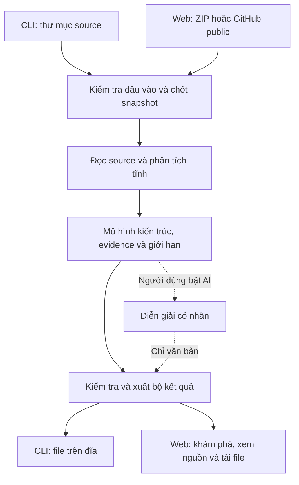
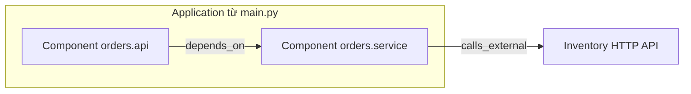
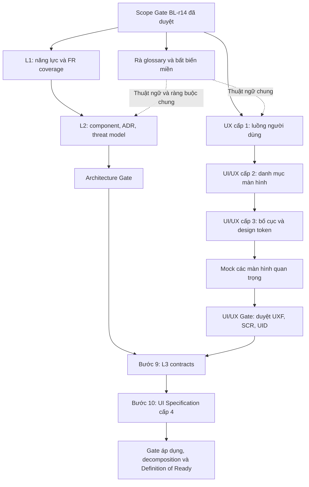

# L3 Generator — Giải thích luồng hoạt động cho thành viên và agent

> Tài liệu giải thích và hỗ trợ review, không thay thế PRD/FR/AC/NFR, không phải một quyết định kiến trúc mới và không phải báo cáo kiểm thử sản phẩm.

| Thông tin | Giá trị |
|---|---|
| Ngày đối chiếu | 18/09/2026 |
| Repository | `vinuni1/vinuni-batch-3/group-5/l3-generator` trên GitLab |
| Nhánh đã đọc | `develop` |
| Commit đã đọc | `557424e065c9b64e718b98614f71f43b607f878f` |
| Baseline phạm vi | BL-r14, khóa tại commit `1c283509c3ec1eec5e65de1005f00a8d4e3cbc91` |
| Trạng thái tài liệu này | Bản giải thích để nhóm đọc, trao đổi và chuẩn bị thiết kế/triển khai |
| Mức kiểm chứng | Đã đối chiếu tài liệu; chưa kiểm chứng engine bằng chạy chương trình |

## 1. Đọc tài liệu này như thế nào?

**L3 Generator đọc mã nguồn, tìm những kết luận kiến trúc có bằng chứng, tổng hợp thành component rồi xuất tài liệu L3, sơ đồ và JSON.** Công cụ phân tích sâu khi cần, nhưng kết quả mặc định cho người đọc dừng ở mức application/component.

Tài liệu có ba loại nội dung:

| Loại | Cách hiểu |
|---|---|
| **Yêu cầu đã chốt** | Hành vi/ràng buộc trong baseline BL-r14; triển khai phải đáp ứng trong đúng phase |
| **Phương án tham khảo** | Cách tổ chức pipeline trong SPEC và ghi chép kiến trúc; còn phải cụ thể hóa, review thiết kế |
| **Ví dụ minh họa** | Code, sơ đồ hoặc tình huống do người viết tạo để giải thích; không phải output thực tế hoặc evidence nghiệm thu |

Lộ trình đọc:

- Muốn hiểu sản phẩm: đọc mục 2–5 và ví dụ ở mục 6.
- Muốn triển khai bằng agent: đọc thêm mục 7–10 và các nguồn ở mục 13.
- Muốn review hoặc trình bày với mentor: đọc thêm checklist mục 11 và các điểm cần sửa trong slide ở mục 12.
- Muốn biết công việc thiết kế tiếp theo: đọc mục 14–20 về L1, L2, UI/UX cấp 1–3, mock và điều kiện chuyển bước.

### 1.1 Những gì đã và chưa được xác nhận

Theo hồ sơ approval trong repo, **Khiêm duyệt Scope Gate sau khi Hoàng review đồng ý** ngày 18/09/2026. Điều này chốt phạm vi/yêu cầu, không xác nhận sản phẩm đã triển khai, không thay UAT và không có nghĩa mọi thiết kế đã qua Architecture Gate. Không diễn đạt lại thành “mentor đã nghiệm thu sản phẩm”.

Ở commit đã đọc, nhánh `develop` có hồ sơ và hai script `scripts/impact.py`, `scripts/prd_package.py`; chưa có mã nguồn engine sản phẩm để lần theo từng hàm thực thi. Mục “hiện trạng code” trong SPEC là ghi chép lịch sử, không đủ chứng minh hiện trạng engine ở nhánh này.

Glossary revision 2 là bản draft sau Scope Gate. Nó giúp thống nhất thuật ngữ và cảnh báo các ý tưởng cũ không được tự mang vào phase đầu; nó không tự phê duyệt pipeline.

Nếu tài liệu này khác nguồn yêu cầu: đối chiếu baseline và quyết định thay đổi đã được duyệt. Không dùng bản giải thích hoặc SPEC cũ để tự sửa scope. Nếu hai nguồn yêu cầu còn mâu thuẫn, ghi lại chỗ mâu thuẫn và chốt qua review.

## 2. Sản phẩm làm gì, cho ai và đến mức nào?

### 2.1 Hai hệ thống cần phân biệt

- **L3 Generator** là công cụ nhóm đang phát triển: tiếp nhận source, phân tích và tạo tài liệu.
- **Repository đầu vào** là dự án được công cụ phân tích: có thể chứa API, DB, tích hợp, event và nhiều application.

Khi tài liệu nói “component của ứng dụng”, thường đang nói component trong repository đầu vào. Đây không mặc nhiên là cách chia module của chính L3 Generator.

### 2.2 Phạm vi phase đầu và phase sau

| Nội dung | Phase đầu đã chốt | Phase sau hoặc ngoài phạm vi hiện tại |
|---|---|---|
| Ngôn ngữ/stack | Python 3.10–3.12, FastAPI trong ma trận pattern hỗ trợ | Java/Spring Boot thuộc roadmap phase sau |
| CLI | Nhận thư mục local; xuất kết quả ra đĩa | Nhận Git/ZIP trực tiếp không thuộc phạm vi CLI đã chốt |
| Web | Chạy local/workspace tin cậy; nhận ZIP/GitHub public | Không mặc nhiên nhận đường dẫn tùy ý trên máy người dùng |
| Kết quả trên web | Theo dõi và khám phá lần chạy hiện tại | Public job API, lịch sử nhiều phiên, mở lại kết quả cũ, xóa từng phiên thuộc FR-017 ở phase sau |
| Dữ liệu | Pattern SQLAlchemy được nêu trong NFR-COMP | SQLModel, `mapped_column` và ORM khác chưa thuộc phase đầu |
| HTTP ra ngoài | `requests`, `httpx` trong khả năng adapter | SDK/client khác chưa có adapter |
| Event | `confluent_kafka` theo ma trận Kafka Python | Broker/SDK khác không được tự coi là đã hỗ trợ |
| Config | Cơ chế Python và YAML application config được chỉ định, trong ma trận | Không tự diễn giải mọi YAML hoặc đọc giá trị môi trường thật |
| AI | Should Have; mặc định tắt; bổ sung mô tả có nhãn | Không tạo/sửa dữ kiện, component, cạnh hoặc framework rule trong lần chạy |
| Kết quả chính | L3 Markdown, sơ đồ Mermaid, JSON, bằng chứng và giới hạn | Full function call graph không phải sơ đồ L3 mặc định |

**Lưu ý về GitLab:** nhóm dùng GitLab để quản lý dự án, nhưng đầu vào Git qua web của sản phẩm hiện chỉ chốt GitHub public HTTPS. Hai việc này độc lập.

“Supported” trong ma trận là cam kết cần triển khai và kiểm thử, không phải chứng nhận code hiện có đã hỗ trợ. Đọc pattern/version chi tiết tại [NFR-COMP][comp].

## 3. Các khái niệm cần hiểu trước

| Khái niệm | Nghĩa đơn giản | Tránh hiểu nhầm |
|---|---|---|
| Snapshot | Nội dung source cố định được dùng trong một lần phân tích | Tên branch không thay thế được digest nội dung |
| Analysis run | Một lần xử lý snapshot với cấu hình và phiên bản tool/rule xác định | Không dùng output của lần trước làm kết quả lần này |
| Analysis unit | Phần source được kiểm kê/phân tích chung | Một thư mục chưa chắc là service triển khai độc lập |
| Application | Điểm hợp thành ứng dụng có bằng chứng từ framework/config | Một repo có thể có nhiều application |
| Code fact | Dữ kiện quan sát được: import, định nghĩa, lời gọi, decorator… | Chưa mặc nhiên là kết luận kiến trúc |
| Candidate | Có tín hiệu nhưng chưa đủ bằng chứng để kết luận | Không tự đưa candidate vào graph như sự thật |
| Resolver | Xác định tên, tham chiếu hoặc lời gọi đang trỏ đến đâu | Không chọn đích chỉ vì trùng tên |
| Dataflow | Theo dõi giá trị/đối tượng được truyền qua gán, tham số, trả về… | Đây là suy luận tĩnh, không phải chạy dữ liệu thật |
| Adapter | Rule hiểu ý nghĩa của API/framework cụ thể | `get()` không luôn là HTTP, `mount()` không luôn là mount application |
| Component | Nhóm code theo trách nhiệm, có rule và bằng chứng membership | Không mặc định một class hoặc folder là một component |
| Architecture claim | Thực thể/quan hệ kiến trúc công cụ công bố | Phải có bằng chứng và nhãn phù hợp |
| Evidence | File, khoảng dòng, snapshot, rule và đường suy luận hỗ trợ kết luận | Một cạnh tổng hợp có thể cần nhiều vị trí nguồn |
| Diagnostic/limitation | Thông tin giải thích phần chưa biết, lỗi, budget hoặc phần chưa hỗ trợ | Không phải kết luận repository có lỗi nghiệp vụ |
| External library | Gói như FastAPI, SQLAlchemy, httpx | Khác hệ thống ngoài như Inventory API hoặc database |
| Dependency | Quan hệ phụ thuộc có hướng | Không tự chứng minh thứ tự chạy một request |

Thuật ngữ chi tiết: [glossary][glossary].

## 4. Luồng tổng thể và ba lớp dữ liệu

### 4.1 Góc nhìn người dùng



### 4.2 Góc nhìn bên trong engine — phương án tham khảo

```text
Inventory + Analysis Context
  → Language Frontend / AST
  → Common Semantic IR
  → Architectural Anchor Discovery
  → Targeted Resolver + Dataflow ↔ Library Type/Effect Models
  → Framework Adapters
  → Registration & Composition
  → Component Synthesis + Architecture Model
  → L3 Projection + Validation + Outputs
```

Đây là cách giải thích các trách nhiệm xử lý trong [SPEC][spec] và [ghi chép kiến trúc][architecture]. Chưa được coi là tên module, class, queue, endpoint hoặc thứ tự gọi hàm đã chốt. Một implementation có thể kết hợp hoặc lặp lại các bước, miễn bảo toàn yêu cầu và bằng chứng.

**Hai nội dung đi xuyên suốt:** evidence/diagnostics và giới hạn tài nguyên. Không chỉ thu evidence hoặc kiểm budget ở bước cuối.

### 4.3 Không gọi mọi dữ liệu là một “IAM” chung

| Lớp | Chứa gì? | Ai dùng? |
|---|---|---|
| Semantic IR | Import, definition, scope, call, assignment, return và vị trí source | Resolver và adapter |
| Evidence/diagnostic | Kết quả resolve, chuỗi suy luận, nguồn, unknown, lỗi, budget | Người kiểm chứng và công cụ chẩn đoán |
| Architecture model | Application, component, interface, data, external, event, config và quan hệ | UI, L3, diagram và bộ đọc JSON |

Đây là phân biệt về ý nghĩa dữ liệu. Nó không bắt buộc phải tạo đúng ba file JSON, ba database hoặc ba service. Contract sẽ quyết định hình thức lưu; không trộn dữ kiện kỹ thuật vào lớp kiến trúc mặc định.

## 5. Giải thích từng bước chương trình dự kiến hoạt động

### Bước 1 — Nhận yêu cầu phân tích

**Đầu vào:** thư mục local qua CLI, hoặc ZIP/GitHub public qua web; cấu hình phạm vi và chế độ AI.

**Xử lý:** ghi nhận nguồn, tùy chọn phân tích, nơi nhận kết quả và thông báo giới hạn đầu vào. Web hiển thị trạng thái của lần chạy hiện tại. CLI không cần web server.

**Đầu ra:** yêu cầu đủ thông tin để kiểm tra và lấy source.

**Điều cần giữ:** hai kênh dùng chung engine. UI không có một bộ rule riêng để “bù” quan hệ thiếu. Tắt AI không làm mất các chức năng phân tích cốt lõi.

**Liên quan:** FR-001, FR-010, FR-013, FR-016.

### Bước 2 — Kiểm tra đầu vào, lấy source và chốt snapshot

**Đầu vào:** yêu cầu từ bước 1.

**Xử lý:** kiểm đường dẫn/quyền đọc và output; với web kiểm URL, redirect, ZIP, symlink, kích thước và tài nguyên theo NFR. Nếu hợp lệ, lấy nội dung vào phạm vi xử lý và ghi digest; Git có thêm commit thực tế/ref yêu cầu.

Snapshot phải đại diện cho đúng nội dung engine phân tích. Cách bảo đảm source local không thay đổi giữa lúc đọc cần được chốt trong thiết kế; chỉ ghi một commit SHA không giải quyết được trường hợp có thay đổi chưa commit.

**Đầu ra:** source snapshot và metadata nguồn; hoặc lỗi có lý do.

**Điều cần giữ:** không import/thực thi source đầu vào, không cài dependency, không chạy Git hook/submodule, không ghi ngược source. Không lấy snapshot cũ thay thế khi tải mới thất bại. Output không được bị quét ngược thành source của cùng lần chạy.

**Liên quan:** FR-001, FR-007, FR-016; NFR-SEC/PRIV/REL.

### Bước 3 — Kiểm kê file và xác định ngữ cảnh phân tích

**Đầu vào:** snapshot và cấu hình phạm vi.

**Xử lý:** lập danh sách file ổn định; đọc manifest thuộc định dạng hỗ trợ; xác định source root, package root và các đơn vị phân tích. Ghi rõ phần phân tích được, bị loại, lỗi hoặc ngoài phạm vi.

Manifest cho biết dependency và version constraint được khai báo, không chứng minh version đang cài thực tế. Không tự cài thư viện để lấy thông tin này. Import có thể bổ sung dấu vết sử dụng, nhưng import-to-package mapping không chắc thì ghi unknown.

**Đầu ra:** inventory, coverage ban đầu và analysis context.

**Điều cần giữ:** repo phẳng, nhiều source root hoặc trộn ngôn ngữ không được bị bỏ sót âm thầm. Hai root có module cùng tên không được mặc nhiên nhập làm một. Tên `services/` không chứng minh deployment boundary.

**Liên quan:** FR-002, FR-018; NFR-COMP/TRACE.

### Bước 4 — Parse source và chuẩn hóa thành Semantic IR

**Đầu vào:** file được chọn và analysis context.

**Xử lý:** parser tạo AST; frontend thu import, definition, scope, assignment, call, parameter, return, inheritance, decorator, condition và source location. Sau đó biểu diễn chúng trong IR mà bước sau đọc được.

Đọc cú pháp `import module` không có nghĩa thực thi import đó. Tương tự, thấy biểu thức `router.get(...)` mới chỉ là thấy lời gọi và tên trong source; chưa đủ kết luận đó là API FastAPI.

**Đầu ra:** code facts trong IR, gắn file/khoảng dòng; cùng lỗi parse nếu có.

**Điều cần giữ:** lỗi một file không làm mất dữ kiện hợp lệ ở file khác. Parse thành công mọi file không đồng nghĩa hiểu được mọi hành vi.

**Liên quan:** FR-002, FR-006, FR-007, FR-009.

### Bước 5 — Tìm architectural anchors

**Đầu vào:** IR và ngữ cảnh.

**Xử lý:** tìm tín hiệu về entry point, application/router, route registration, entity, HTTP call, config, Kafka event và vai trò kiến trúc.

Anchor giúp ưu tiên những đường code cần phân tích sâu để trả lời câu hỏi kiến trúc. Ví dụ, đường từ một API handler đến data-access module có ích hơn việc cố dựng mọi lời gọi không liên quan trong toàn repo.

**Đầu ra:** danh sách ứng viên và lý do cần xét tiếp.

**Điều cần giữ:** candidate chưa phải architecture claim. Tên file `main.py` hoặc biến `app` riêng lẻ không đủ chứng minh application. Nếu giới hạn phạm vi theo anchor, phần không xét vẫn phải được công bố; không được dùng tối ưu này để bỏ AC đã cam kết.

**Trạng thái thiết kế:** anchor discovery là phương án tham khảo, không phải một FR yêu cầu tên module cụ thể.

### Bước 6 — Resolve tham chiếu và theo dõi truyền giá trị

**Đầu vào:** IR, chỉ mục tên/scope và các đường cần phân tích.

**Xử lý:** nối import/alias về đích; phân biệt biến cùng tên ở scope khác nhau; theo dõi constructor, phép gán, tham số, giá trị trả về, thuộc tính và kế thừa trong phạm vi đã hỗ trợ.

Ví dụ `from orders.service import load_order as load` khiến `load(...)` trỏ về `orders.service.load_order`, không phải một hàm bất kỳ tên `load` trong repo.

Phương án worklist: khi có fact mới, đưa phần phụ thuộc vào hàng đợi để xét lại; dừng khi không có thay đổi hoặc chạm budget. Library type/effect models có thể hỗ trợ suy kiểu/đối tượng trong vòng lặp này. Không giả định cả engine chạy đúng một lượt tuyến tính.

**Đầu ra:** đích đã resolve, hoặc `ambiguous`, `unresolved`, `runtime-dependent`; kèm nguồn và lý do.

**Điều cần giữ:** không chọn đích đầu tiên chỉ vì tên giống nhau. Chạm budget phải hiện thành giới hạn, không được báo toàn bộ đã hiểu. Lời gọi chưa resolve không được tạo cạnh component.

**Liên quan:** FR-006; NFR-ACC/REL/DET/PERF/TRACE.

**Ghi chú thiết kế cần cụ thể hóa:** tránh lưu mỗi biến/fact thành một object JSON lồng dài. Có thể giữ dữ liệu xử lý nội bộ dưới dạng các bảng gọn như `files`, `strings`, `locations`, `scopes`, `symbols`, `imports`, `calls` và `edges`; mỗi record dùng ID số để tham chiếu thay vì lặp lại đường dẫn, tên và source range. Import/symbol index tối thiểu được lập cho toàn repository; assignment, argument, return và dataflow chi tiết chỉ tạo quanh architectural anchor khi cần. AST có thể được giải phóng sau khi trích fact; JSON đầy đủ chủ yếu dành cho output, fixture hoặc debug. Đây là hướng tối ưu cần đánh giá ở thiết kế L2/L3, chưa phải schema hay quyết định lưu trữ đã chốt.

### Bước 7 — Adapter diễn giải ý nghĩa framework

**Đầu vào:** symbol/object đã nhận diện đủ và các code facts liên quan.

**Xử lý:** rule của framework chuyển cấu trúc code thành operation có ý nghĩa: khai báo endpoint, gắn router, mount application, khai báo entity, gọi hệ thống ngoài, dùng config, phát/nhận event. Những tên như `RegisterEndpoint` hoặc `AttachRouter` trong SPEC là minh họa operation, chưa là API implementation đã chốt.

| Pattern trong phạm vi | Ý nghĩa cần nhận diện |
|---|---|
| FastAPI route decorator, `include_router`, `app.mount` với target/prefix resolve tĩnh | Endpoint và quan hệ đăng ký/hợp thành |
| SQLAlchemy `Base`/`declarative_base`, `Column`, `ForeignKey`, `relationship` trực tiếp | Mô hình dữ liệu được hỗ trợ |
| `requests`/`httpx` | Lời gọi HTTP và mức độ biết đích |
| `os.getenv`, `os.environ[...]`, `BaseSettings`, config được chỉ định | Khóa cấu hình và nơi sử dụng; không đọc secret thật |
| `confluent_kafka` theo ma trận | Producer/consumer và topic |

**Đầu ra:** operation/fact theo miền kiến trúc, evidence và phần chưa biết.

**Điều cần giữ:** khớp đúng symbol và phạm vi version; rule cần case đúng và case gần giống nhưng sai. Một method `mount()` của disk manager không phải application mount. Nhắc đến entity chưa chứng minh thao tác đọc/ghi DB; `reads`/`writes` chỉ có khi có rule và evidence thao tác tương ứng.

Pattern SQLModel, `mapped_column`, `add_api_route` không được tự đưa vào phase đầu chỉ vì SPEC cũ có ví dụ. Ngoài ma trận phải hiện giới hạn.

**Liên quan:** FR-003/004/005/014/015/018; NFR-COMP/ACC.

### Bước 8 — Ghép registration và application composition

**Đầu vào:** các operation, đối tượng, điều kiện và ngữ cảnh lời gọi.

**Xử lý:** xác định router thuộc application nào, parent/child nào, ghép prefix/path và giữ điều kiện đăng ký. Giữ identity từng object để không nhập hai application cùng kiểu làm một.

Ví dụ: application gắn router với `/api`, router có `/orders`, endpoint có `/{order_id}`. Khi đủ bằng chứng, full path là `/api/orders/{order_id}`.

**Đầu ra:** cấu trúc application/router/endpoint và mức biết về việc đăng ký.

**Điều cần giữ:** một registration nằm trong `setup()` chưa chứng minh `setup()` được gọi. Có call context tĩnh cũng chưa phải xác nhận runtime. Nếu prefix động chưa giải được, giữ phần biết và nhãn partial; không tự thay bằng chuỗi rỗng.

**Liên quan:** FR-003, FR-006, FR-007.

### Bước 9 — Tổng hợp component và dependency

**Đầu vào:** facts, operation, cấu trúc application, quan hệ đã resolve và evidence.

**Xử lý:** áp rule grouping công bố để nhóm thành component; xác định membership, interface và vai trò khi đủ căn cứ. Nhiều lời gọi giữa cùng hai component có thể gộp thành một dependency, giữ toàn bộ nguồn đóng góp cần thiết.

**Đầu ra:** architecture model ở mức L3, có đường truy vết ngược xuống code.

**Điều cần giữ:** không tự coi folder/class là component hoặc service triển khai. Nếu chưa biết vai trò business/data-access, giữ nhóm trung tính/unknown. Quan hệ chưa resolve không được “nâng cấp” thành cạnh chỉ để graph đầy hơn.

Phân tích có thể dùng chi tiết hàm, nhưng sơ đồ mặc định không vẽ một node cho mỗi hàm. API, entity, config và event có thể nằm trong bảng/chi tiết component; không có nghĩa mọi dữ kiện này đều phải thành node riêng trên sơ đồ mặc định.

**Liên quan:** FR-011; NFR-ABST/ACC/TRACE.

### Bước 10 — Kiểm tra tính nhất quán và tạo giới hạn/findings

**Đầu vào:** architecture model và dữ liệu hỗ trợ.

**Xử lý:** kiểm ID, đầu mút cạnh, evidence, snapshot, nhãn, registration và phạm vi đã mất. Tạo findings tất định cho phần chưa kết luận được; không cần AI để tạo các cảnh báo này.

**Đầu ra:** mô hình đủ điều kiện xuất hoặc lỗi cần xử lý; cùng coverage, limitations và findings. Danh sách cảnh báo có thể rỗng nếu không có cảnh báo trong phạm vi đã xét.

**Điều cần giữ:** không báo “không có API” khi thực chất gặp pattern chưa hỗ trợ. Không biến giới hạn analyzer thành kết luận “code có lỗi nghiệp vụ”. Kiểm schema hợp lệ không chứng minh nội dung đúng; độ đúng cần đáp án và đánh giá độc lập.

Chưa đánh dấu run `completed` ở đây nếu artifact bắt buộc còn chưa ghi/kiểm thành công. Trạng thái cuối còn phụ thuộc bước xuất.

**Liên quan:** FR-007/008/009; NFR-REL/TRACE/ACC.

### Bước 11 — Bổ sung diễn giải AI nếu được bật

**Đầu vào:** mô hình/finding đã có, được rút gọn và lọc dữ liệu nhạy cảm.

**Xử lý:** AI viết mô tả cho ID có sẵn; output phải được kiểm schema/ID và có nhãn AI. Không cần bước này để engine tạo kết quả cốt lõi.

**Đầu ra:** văn bản mô tả tùy chọn, tách khỏi cấu trúc kiến trúc.

**Điều cần giữ:** AI không sửa fact, component, cạnh, evidence, limitation hoặc finding ID; không sinh framework rule để chạy ngay. Source snippet gửi provider không thuộc phase đầu. Key không vào output/log/evidence.

Phase đầu AI mặc định tắt và có trần chi phí trả phí 0 đồng theo NFR-AI. Thiếu key, hết quota, timeout hoặc output AI không hợp lệ phải fallback về kết quả tĩnh, có thông báo phù hợp. Các giới hạn request/retry cụ thể lấy từ NFR, không tự đặt lại ở tài liệu này.

**Liên quan:** FR-010/012; NFR-AI/PRIV/DET.

### Bước 12 — Xuất, hiển thị và kết thúc lần chạy

**Đầu vào:** mô hình, evidence, giới hạn, metadata thật và mô tả AI nếu có.

**Xử lý:** tạo L3 Markdown, Mermaid và JSON từ cùng model; kiểm cấu trúc, schema version, ID, liên kết và khả năng đọc/render. Nếu rút gọn sơ đồ, nêu phần bị ẩn và cách xem dữ liệu đầy đủ trong phạm vi đã phân tích.

**Đầu ra:** bộ artifact hợp lệ; CLI trả nơi lưu, web mở kết quả đúng lần chạy. Người dùng xem component/cạnh rồi đi xuống evidence.

**Điều cần giữ:** không tạo một engine suy luận riêng trong UI/exporter. Không báo thành công khi artifact bắt buộc thiếu. Khi lỗi, không phá output thành công trước hoặc giữ graph cũ trên UI như graph mới.

Web phase đầu có `running`, `completed`, `partial`, `failed` cho lần hiện tại. Cơ chế public job API, queue/cancel và lịch sử nhiều phiên đầy đủ thuộc FR-017 ở phase sau; không tự kéo toàn bộ FR-017 vào phase đầu vì UI cần trạng thái tạm.

Dữ liệu tạm vẫn phải được dọn theo phần NFR-PRIV áp dụng. Không có lịch sử không có nghĩa giữ source vô hạn. CLI output do người dùng quản lý. Khi source bằng chứng đã không còn, công cụ phải báo không mở được/không khớp, không trỏ sang source khác.

**Liên quan:** FR-008/009/013/016; NFR-REL/PRIV/USA/DET. FR-017 chỉ là tham chiếu ranh giới phase sau.

## 6. Ví dụ xuyên suốt: từ code đến kết quả kiến trúc

> Ví dụ do người viết tạo để giải thích kỳ vọng; chưa chạy qua engine. Không dùng làm bằng chứng rằng adapter, grouping hoặc export đã đạt. Các file Python dưới đây là mã của repository đầu vào minh họa, không phải mã triển khai L3 Generator.

### 6.1 Source đầu vào minh họa

```text
sample-repo/
├── main.py
└── orders/
    ├── __init__.py     # rỗng trong ví dụ
    ├── api.py
    └── service.py
```

`main.py`:

```python
from fastapi import FastAPI
from orders.api import router

app = FastAPI()
app.include_router(router, prefix="/api")
```

`orders/api.py`:

```python
from fastapi import APIRouter
from orders.service import load_order as load

router = APIRouter(prefix="/orders")

@router.get("/{order_id}")
def get_order(order_id: int):
    return load(order_id)
```

`orders/service.py`:

```python
import httpx

def load_order(order_id: int):
    response = httpx.get(
        "https://inventory.example/orders",
        params={"id": order_id},
    )
    return response.json()
```

Địa chỉ `.example` chỉ là tên minh họa. Analyzer không gửi request này và không chạy ba file trên.

### 6.2 Những điều từng bước cần tìm được

| Bước | Kết quả mong đợi trong ví dụ |
|---|---|
| Snapshot/inventory | Nhận đúng các file và nội dung; ghi manifest/version thiếu nếu không được cung cấp |
| Parser/IR | Ghi import, alias `load`, constructor, decorator, lời gọi và source location |
| Resolver | Nối `load` về `orders.service.load_order`; nối `router` trong `main.py` về object ở `orders/api.py` |
| Adapter | Nhận diện FastAPI application/router, route decorator, `include_router` và HTTP call thuộc phạm vi |
| Composition | Xác định route thuộc `app`, ghép `GET /api/orders/{order_id}` nếu đủ điều kiện rule/context |
| Component synthesis | Tạo nhóm theo rule đã chốt; có thể dùng module làm nhóm trung tính, nhưng không mặc định tên file quyết định vai trò |
| Dependency | Tổng hợp bằng chứng từ handler gọi `load_order`; từ HTTP call tới đích ngoài khi binding đủ rõ |
| Output | Trình bày component, API, dependency và đường đi tới evidence; ghi phần chưa biết |

Nếu version/context cần cho rule chưa xác định được, engine phải nêu giới hạn. Bảng trên là kỳ vọng có điều kiện, không được gán mọi trường là exact/full.

### 6.3 Một cách trình bày L3 có thể có

Sơ đồ này giả sử nhóm đã chọn rule grouping theo module cho ví dụ. Nó minh họa cách rút gọn, không chốt thuật toán grouping chung cho mọi repo.



API `GET /api/orders/{order_id}` có thể xuất hiện trong bảng interface của `orders.api`. Tên `orders.service` ở đây là tên module; chưa tự chứng minh đó là business service hoặc đơn vị triển khai riêng.

Chi tiết hàm có thể mở ở lớp evidence:

```text
Component dependency
  → get_order gọi load
  → import alias nối load với orders.service.load_order
  → các file và khoảng dòng tương ứng trong cùng snapshot
```

### 6.4 Những kết luận không được rút ra từ ví dụ

- Không kết luận API đã được triển khai và đang truy cập được qua mạng.
- Không kết luận Inventory API thực sự trả dữ liệu gì hoặc request chắc chắn thành công.
- Không thêm database, bảng hoặc quan hệ đọc/ghi DB: ví dụ không có bằng chứng cho chúng.
- Không coi `httpx` là hệ thống Inventory; `httpx` là thư viện, Inventory là đích tích hợp minh họa.
- Không coi dependency diagram là sequence diagram hay trace runtime.
- Không coi `service.py` là một microservice chỉ dựa vào tên.

## 7. Hiểu đúng nhãn chất lượng và trạng thái

### 7.1 Bốn câu hỏi độc lập

| Trục | Nhãn/biểu diễn | Câu hỏi được trả lời |
|---|---|---|
| Resolution | `resolved`, `ambiguous`, `unresolved`, `runtime-dependent` | Đã xác định được đích hoặc binding chưa? |
| Confidence | `exact`, `inferred` | Đọc trực tiếp hay suy theo rule tất định đã công bố? |
| Completeness | `full`, `partial` | Đã biết đủ thuộc tính/binding trong contract chưa? |
| Coverage | Danh sách/số đếm phạm vi, lỗi, phần bị bỏ qua | Đã xét những phần nào của repository? |

Ví dụ: decorator chứng minh có khai báo route, nhưng prefix lấy từ biểu thức chưa resolve. Có thể biết chắc một thuộc tính trong khi cấu trúc route còn partial. Không dùng một điểm “độ tin cậy 90%” để thay cả bốn trục nếu contract không quy định như vậy.

`inferred` không có nghĩa AI đoán; `full` không có nghĩa hiểu mọi runtime behavior. Nhãn cuối cùng của từng trường phải theo contract được chốt.

### 7.2 Trạng thái registration khác trạng thái run

| Trạng thái registration | Nghĩa |
|---|---|
| Declared | Thao tác xuất hiện trong source |
| Registered candidate | Có bằng chứng tĩnh nối quan hệ đăng ký |
| Potentially reachable | Có ngữ cảnh tĩnh cho thấy việc đăng ký có thể xảy ra |
| Runtime confirmed | Được xác nhận khi chạy; phase đầu không thực thi source để cung cấp xác nhận này |

Trạng thái toàn lần chạy trả lời câu hỏi khác:

- `running`: đang xử lý.
- `completed`: bộ kết quả bắt buộc đã được tạo/kiểm hợp lệ và không che giấu phần thiếu theo contract trạng thái.
- `partial`: có kết quả dùng được nhưng còn phạm vi/thuộc tính/quan hệ thiếu hoặc chưa giải được.
- `failed`: không tạo được bộ kết quả hợp lệ.

Một file parse lỗi, một prefix động và một artifact ghi lỗi là ba vấn đề khác nhau; không đánh đồng tất cả bằng một cờ “success”. Quy tắc tổng hợp trạng thái cần được mô tả rõ ở contract thiết kế, dựa trên FR/NFR.

## 8. Lỗi, giới hạn và cách hệ thống cần phản hồi

| Tình huống | Phản hồi cần có | Không được làm |
|---|---|---|
| Source path sai hoặc thiếu quyền | Dừng trước phân tích, báo lỗi có cách xử lý | Trả kết quả rỗng như repo không có code |
| Git URL không hợp lệ, private hoặc host ngoài phạm vi | Từ chối theo chính sách đầu vào | Nhận credential hoặc tự mở rộng host |
| ZIP traversal, symlink vượt vùng, bomb | Từ chối an toàn và xử lý dữ liệu tạm đúng phạm vi | Ghi ngoài workspace được cấp |
| Một file lỗi cú pháp | Giữ phần hợp lệ, báo file/nguyên nhân/phạm vi mất | Bỏ file âm thầm hoặc làm hỏng toàn bộ kết quả còn dùng được |
| Pattern chưa có adapter | Giữ thông tin chưa hỗ trợ và ảnh hưởng | Kết luận repo không có API/DB/event |
| Call có nhiều đích khả dĩ | Ghi ambiguous, nguồn và lý do | Chọn một đích tùy tiện để vẽ cạnh |
| Prefix/URL/topic động | Giữ phần biết, biểu thức hoặc nguồn và nhãn phù hợp | Tự điền giá trị runtime |
| Hết budget | Dừng có kiểm soát, công bố phần bị cắt | Báo kết quả đầy đủ |
| AI timeout hoặc sai schema | Giữ kết quả tĩnh, bỏ mô tả không hợp lệ và báo tình trạng | Sửa fact để khớp lời AI |
| Ghi artifact bắt buộc thất bại | Không đánh dấu hoàn tất; giữ output trước an toàn | Hiển thị bộ thiếu như thành công |
| Source evidence đổi hoặc bị dọn | Báo không khớp/không còn nguồn; dùng permalink commit hợp lệ khi có | Trỏ source mới làm bằng chứng cũ |

Các threshold về file, thời gian, RAM, budget, request và retention lấy từ NFR tương ứng. Tài liệu này không tạo thêm một bản sao ngưỡng để chỉnh độc lập.

## 9. Thành viên và agent nên dùng tài liệu này như thế nào?

### 9.1 Trước khi triển khai một phần

1. Đọc FR/AC/NFR liên quan và ranh giới phase; xác định hành vi cần đạt.
2. Đọc glossary để dùng đúng thuật ngữ; không lấy tên trong SPEC cũ làm hợp đồng mặc định.
3. Xác định input/output và phần còn cần chốt về thiết kế, schema, rule hoặc lỗi.
4. Liên kết AC với component/contract và test dự kiến. `implementation_target` và `validated_by` phải hoàn tất trước Definition of Ready theo hồ sơ approval; không tạo ID giả để lấp chỗ trống.
5. Khi chuyển sang kiểm code, ghi rõ branch/commit chứa implementation. Không lấy bản giải thích này hoặc dòng “đã có code” trong SPEC làm evidence đã chạy.

### 9.2 Khi triển khai và báo kết quả

- Giữ đường truy vết claim → evidence → snapshot xuyên suốt; không chỉ bổ sung link nguồn ở UI.
- Giữ raw facts/diagnostics khi chưa đủ điều kiện kết luận; không tự nâng unknown thành edge.
- Tách xử lý cấu trúc tất định khỏi mô tả AI.
- Kiểm case dương và case âm gần giống, nhất là alias, object identity, framework rule và grouping.
- Báo rõ đã sửa phần nào, AC nào được kiểm, lệnh/cấu hình/commit kiểm và giới hạn còn lại.
- Phân biệt `pass`, `failed`, `not_run`, `not_evaluated` theo từng loại bằng chứng; không coi test chưa chạy là pass.

Những gợi ý này phục vụ công việc theo quy trình đã có; không thêm approval gate mới. Thay đổi scope đã duyệt vẫn theo change request/baseline của dự án.

### 9.3 Những quyết định thiết kế còn phải cụ thể hóa

| Việc cần chốt | Vì sao cần? | Kết quả review cần nhìn thấy |
|---|---|---|
| Cách giữ snapshot local nhất quán | Source có thể đổi giữa lúc đọc | Quy tắc digest, phát hiện thay đổi, đường dẫn evidence |
| Contract IR/evidence/architecture | Tránh schema IAM nhập nhằng | Schema version, ID, ranh giới public/diagnostic, compatibility |
| Index, worklist và budget resolver | Tránh đoán đích hoặc không dừng | Thuật toán, phạm vi hỗ trợ, thông báo khi dừng, fixture |
| Object identity và registration context | Tránh gắn route sang nhầm application | Case hai app cùng kiểu, router chia sẻ, setup chưa gọi, prefix động |
| Adapter rules và version range | Một API giống tên có thể khác nghĩa | Rule có nguồn, pattern hỗ trợ, case đúng/sai |
| Component grouping/membership | Đây là bước chuyển từ code facts sang L3 | Rule, cách xử lý nhiều cách nhóm/code dùng chung/role unknown, evidence |
| Run status và export lỗi | Tránh graph cũ hoặc bộ output dở dang | Contract completed/partial/failed, hành vi ghi output và recovery |
| Web phase đầu và dữ liệu tạm | Cần UI hoạt động nhưng không kéo FR-017 vào scope | Luồng current run, truy evidence, cleanup và thông báo dữ liệu không còn |
| Bộ đánh giá | Graph đẹp chưa chứng minh đúng | Repo pin snapshot, ground truth, cách đo theo OBS/NFR |

Đây là danh sách vấn đề cần thiết kế, **không phải các OQ cũ được mở lại**. Hồ sơ tại commit đã đọc ghi sáu OQ đã đóng và Scope Gate đã duyệt; các quyết định triển khai tiếp theo vẫn cần được cụ thể hóa.

## 10. Đối chiếu các bước với FR

| FR | Trách nhiệm chính trong luồng | Phase |
|---|---|---|
| FR-001 | CLI nhận source/output; kiểm đầu vào local | Đầu |
| FR-002 | Đơn vị phân tích, inventory và phạm vi hỗ trợ | Đầu |
| FR-003 | API/handler, path và điều kiện đăng ký | Python đầu; Java sau |
| FR-004 | Mô hình dữ liệu | SQLAlchemy đầu; Java sau |
| FR-005 | HTTP outbound và mức độ biết đích | Python đầu; Java sau |
| FR-006 | Resolve import/call/kế thừa; giữ unknown | Đầu |
| FR-007 | Evidence, snapshot và nhãn độc lập | Đầu |
| FR-008 | L3, Mermaid, JSON và khả năng sử dụng output | Đầu |
| FR-009 | Lỗi, coverage, limitations và findings tất định | Đầu |
| FR-010 | Lõi phân tích không phụ thuộc AI | Đầu |
| FR-011 | Component model, dependency và L3 | Đầu |
| FR-012 | Diễn giải AI có nhãn, không sửa fact | Should trong phase đầu |
| FR-013 | Web khám phá lần chạy hiện tại | Đầu |
| FR-014 | Config được hỗ trợ, bảo vệ giá trị nhạy cảm | Python đầu; Java sau |
| FR-015 | Quan hệ Kafka trong phạm vi adapter | Python đầu; Java sau |
| FR-016 | Web nhận GitHub public/ZIP | Đầu |
| FR-017 | Public job API, lịch sử và quản lý nhiều phiên | Sau; không chặn nghiệm thu phase đầu |
| FR-018 | Thư viện khai báo/sử dụng và manifest evidence | Python đầu; Maven/Java sau |

AC cụ thể nằm trong [thư mục FR][fr-dir]. Không coi bảng này là bản sao thay thế AC. NFR ràng buộc nhiều bước cùng lúc; đặc biệt SEC/PRIV, DET, TRACE, REL, ACC và ABST.

## 11. Checklist review và kiểm chứng

Các ô dưới đây cố ý để trống. Đây là tiêu chí dùng khi review implementation, không phải kết quả đã đạt.

### 11.1 Đúng dữ kiện và đúng mức L3

- [ ] Import alias, relative import và tên trùng ở nhiều scope/root nối đúng đích.
- [ ] Method tên giống framework nhưng không thuộc framework không tạo operation sai.
- [ ] Hai application cùng kiểu không bị trộn route.
- [ ] Prefix/path được ghép đúng và không tự đoán giá trị động.
- [ ] Registration khai báo trong hàm chưa được gọi không bị công bố là runtime active.
- [ ] Quan hệ unresolved/ambiguous không xuất hiện như cạnh component đã xác định.
- [ ] Entity được nhắc tên nhưng không có thao tác DB không sinh reads/writes.
- [ ] Component grouping có membership, rule/evidence; role thiếu căn cứ giữ unknown.
- [ ] Dependency không bị trình bày như trace runtime chắc chắn.
- [ ] Sơ đồ mặc định đạt mức và ngưỡng trong NFR-ABST; chi tiết hàm nằm ở evidence.

### 11.2 Bằng chứng, giới hạn và khả năng tái lập

- [ ] Mọi claim truy về nguồn đúng snapshot; kết luận gộp giữ nhiều nguồn khi cần.
- [ ] Source thay đổi không bị dùng thay cho evidence cũ.
- [ ] Confidence, completeness, resolution và coverage không bị nhập làm một.
- [ ] File lỗi, pattern ngoài phạm vi và budget exceeded hiện đúng trong giới hạn.
- [ ] Cùng snapshot/config/tool/rule cho cùng dữ kiện chuẩn giữa CLI và web.
- [ ] Thay output directory hoặc mô tả AI không đổi ID/cạnh/dữ kiện chuẩn.
- [ ] Metadata như timestamp/duration giữ giá trị thật; không sửa thành hằng để test pass.

### 11.3 An toàn, giao diện và xuất kết quả

- [ ] Phân tích không thực thi/import/cài dependency của repository đầu vào.
- [ ] URL/ZIP/symlink và vùng ghi được kiểm theo NFR-SEC/PERF.
- [ ] Secret và API key không xuất hiện trong log/output/evidence/payload không được phép.
- [ ] No-AI không gọi LLM; CLI local no-AI không cần mạng. Git intake vẫn cần mạng để lấy source.
- [ ] JSON được bộ đọc độc lập đọc; Mermaid được renderer mục tiêu render.
- [ ] Lỗi ghi artifact bắt buộc không bị báo completed, không phá kết quả trước.
- [ ] UI hiển thị đúng lần chạy; trạng thái lỗi không giữ graph cũ như kết quả mới.
- [ ] Tìm/lọc/rút gọn có thông báo; người dùng vẫn đi được tới evidence.
- [ ] Dữ liệu tạm hết hạn không được phục vụ; cleanup khi chạy/khởi động theo NFR.
- [ ] AI lỗi vẫn trả kết quả tĩnh; output AI không sửa cấu trúc.

### 11.4 Bằng chứng chất lượng

- [ ] Có bộ fixture và repository pin snapshot, không chỉ một demo thuận lợi.
- [ ] Có đáp án được review độc lập và chấm đúng nhóm dữ kiện theo OBS/NFR.
- [ ] Ngưỡng và cỡ mẫu lấy từ tài liệu chuẩn; chưa đủ mẫu thì không tuyên bố đạt tỷ lệ.
- [ ] Báo riêng kiểm cấu trúc hồ sơ, kiểm sản phẩm, benchmark và UAT.
- [ ] Không công bố mức giảm thời gian hoặc hiệu quả pilot khi chưa đo.

## 12. Slide và SPEC hiện tại cần làm rõ điều gì?

Đối chiếu này áp dụng cho bản `deliverables/L3-Generator-mentor-review.html` đang có khi viết tài liệu, dựa trên BL-r13, và SPEC tham khảo ngày 16/09. Tài liệu Markdown này không tự sửa các file đó.

| Vị trí/nội dung | Nhận xét | Cách chỉnh nội dung |
|---|---|---|
| Slide luồng 5 bước | Phù hợp để giới thiệu nhưng “chuẩn hóa mô hình chung” còn dễ hiểu nhầm | Nêu IR phục vụ resolve; architecture model hình thành sau tổng hợp; evidence đi xuyên suốt |
| Slide hai stack và nghiệm thu | Có thể khiến người nghe tưởng Java cũng là cam kết phase đầu | Đánh dấu Python/FastAPI phase đầu; Java/Spring Boot roadmap |
| Slide web có lịch sử | Lệch ranh giới phase đầu mới | Giữ current run/explore/evidence/export; đưa lịch sử/public job API sang phase sau |
| Slide OQ và nhãn BL-r13 draft | Không còn phản ánh hồ sơ develop đã đọc | Ghi Scope Gate BL-r14 đã được Khiêm duyệt sau Hoàng review; thiết kế và nghiệm thu sản phẩm là bước khác |
| SPEC có SQLModel/`mapped_column`/`add_api_route` | Ý tưởng cũ không thay ma trận hiện tại | Dẫn NFR-COMP; ví dụ ngoài scope phải gắn nhãn tương lai/unsupported |
| SPEC liệt kê tên output | Dễ bị agent coi mọi tên file là bắt buộc | Nêu loại artifact bắt buộc; tên/số file/schema chi tiết thuộc contract |
| “Đã có code” trong tài liệu tham khảo | Không chứng minh khả năng hiện tại trên develop | Khi review implementation phải nêu branch/commit, test và kết quả thực tế |
| Sơ đồ dependency | Dễ bị trình bày như chuỗi request đã chạy | Ghi rõ quan hệ có bằng chứng tĩnh; runtime behavior chưa được xác nhận |

**Đánh giá:** hướng tiếp cận phù hợp đề tài ở mức mục tiêu và nguyên tắc. Chất lượng thực tế phụ thuộc mạnh vào resolve đúng đích, giữ đúng object/registration, grouping component và evidence. Sơ đồ vẽ thành công hoặc hồ sơ đủ liên kết chưa chứng minh các phần này đúng.

## 13. Nguồn để thành viên và agent đối chiếu

Các liên kết GitLab dưới đây khóa vào commit đã đọc, tránh bị đổi nghĩa khi branch tiếp tục cập nhật. Người xem cần quyền truy cập repo. Khi có baseline mới, đối chiếu thay đổi rồi cập nhật tài liệu này; không dùng nó để phủ quyết yêu cầu mới đã được duyệt.

- [README — trạng thái hồ sơ và baseline][readme].
- [PRD — mục tiêu, scope và user flows][prd].
- [Approval Scope Gate — người duyệt, commit và điều kiện][approval].
- [Glossary — thuật ngữ, bất biến và giới hạn dùng SPEC cũ][glossary].
- [Toàn bộ FR/AC][fr-dir] và [NFR][nfr-dir].
- [Ma trận stack/pattern được hỗ trợ][comp].
- [SPEC — pipeline kỹ thuật tham khảo][spec].
- [ARCHITECTURE_V2_IDEA — phân tích thiết kế tham khảo][architecture].
- [OBS-001 — phương pháp đo chất lượng kỹ thuật][obs1].
- [OBS-002 — phương pháp đánh giá trải nghiệm/pilot][obs2].
- [Execution Guide — quy trình phát triển][guide].

Trong workspace đã đối chiếu, source tài liệu nằm tại `D:\VSF\l3-generator-docs-publish`. File giải thích này nằm cùng thư mục với slide để đọc kèm; không phải artifact approval mới trong `.aide`.

## 14. Kế hoạch tiếp theo theo quy trình mentor

> Phần này là **kế hoạch thực hiện**, chưa phải bộ thiết kế L1/L2/UI đã hoàn thành hoặc được duyệt. Căn cứ: Execution Guide §B.6–B.11, §C.4, §D.2 và §E. Tên nhóm năng lực, phương án component và màn hình bên dưới là gợi ý để nhóm cụ thể hóa, không tự thay đổi baseline BL-r14.

### 14.1 Hiện nhóm đang ở đâu?

Hồ sơ đã có Scope Gate BL-r14; glossary đã được bổ sung sau gate. Ở commit đối chiếu, thư mục architecture có ADR về mức trình bày L3, chưa có bộ CAP, CMP và UXF/SCR/UID hoàn chỉnh. Công việc tiếp theo là biến yêu cầu đã chốt thành thiết kế đủ rõ để con người và agent triển khai.

Không cần viết lại một PRD mới. Nếu phát hiện thiết kế đòi đổi FR/AC hoặc scope, ghi nhận thay đổi để xử lý theo quy trình; không âm thầm đổi yêu cầu cho khớp phương án kỹ thuật.

### 14.2 Các cấp trả lời câu hỏi gì?

| Phần thiết kế | Câu hỏi đơn giản | Ví dụ đối với chính L3 Generator |
|---|---|---|
| **L1 — Capability** | Sản phẩm phải có những năng lực nào? | Tiếp nhận source, phân tích, tạo kiến trúc, kiểm chứng và xuất kết quả |
| **L2 — Component design** | Phần nào của hệ thống chịu trách nhiệm làm những việc đó, phối hợp và xử lý lỗi ra sao? | Bộ lấy snapshot trao dữ liệu cho engine; exporter đọc model; UI không tự phân tích |
| **UI/UX cấp 1 — UX Flow** | Người dùng đi những bước nào để đạt mục tiêu? | Chọn ZIP → phân tích → mở component → xem evidence → tải tài liệu |
| **UI/UX cấp 2 — Screen Inventory** | Cần những màn hình/khu vực nào để phục vụ luồng đó? | Nhập source, tổng quan kết quả, chi tiết component, vùng evidence, hộp thoại export |
| **UI/UX cấp 3 — UI Design** | Mỗi màn hình bố trí và thể hiện như thế nào? | Vị trí sơ đồ, bảng chi tiết, nhãn partial, trạng thái lỗi, màu và khoảng cách thống nhất |

**Hai chữ L3 không được dùng lẫn:**

- **L3 đầu ra sản phẩm:** sơ đồ/tài liệu component của repository được phân tích, đã giải thích ở các mục trên.
- **L3 trong quy trình phát triển:** contract kỹ thuật của chính L3 Generator, như interface/API, schema dữ liệu hoặc event khi có. Đây là bước sau L2.

Tương tự, component trong thiết kế L2 là **module/thành phần của công cụ L3 Generator**; component trong kết quả phân tích là **thành phần của repository đầu vào**. Việc có năm component triển khai không buộc mọi repo đầu vào phải sinh năm component.

### 14.3 Thứ tự thực hiện và phần có thể làm song song



L1 và UI/UX cấp 1–3 đều dựa trên FR/AC nên có thể bắt đầu ngay sau Scope Gate. Rà domain/glossary cũng có thể làm cùng thời điểm khi có khái niệm/bất biến cần làm rõ. **UI không phải đợi L2 xong mới bắt đầu.** Các luồng thiết kế vẫn cần đối chiếu thường xuyên để không đưa vào màn hình hành vi ngoài phạm vi.

L2 cần L1 cùng FR/AC/NFR. Với phần giao diện mới của dự án, quy trình yêu cầu qua UI/UX Gate trước bước 9. UI Specification cấp 4 cần contract L3 và cấp 1–3 đã duyệt; không chốt binding endpoint/field chỉ từ mock.

## 15. Việc thứ nhất — Thiết kế L1: nhóm năng lực sản phẩm

### 15.1 Cần làm gì?

Đọc từng FR rồi trả lời: “FR này phục vụ năng lực nào của sản phẩm?”. Ghi thành CAP và nối `covers` tới FR tương ứng. Theo §B.7, mỗi FR phải có ít nhất một CAP bao phủ. Dùng lại CAP nếu năng lực đã có; không tạo một CAP mới cho mỗi AC, mỗi function hoặc mỗi bước parser.

Ví dụ: “Tiếp nhận và xác định phạm vi source” là năng lực. “Dùng thư viện X để giải nén ZIP” là lựa chọn kỹ thuật ở mức thấp hơn, chưa phải tên năng lực L1 phù hợp.

### 15.2 Gợi ý nhóm năng lực để bắt đầu review

| Nhóm năng lực đề xuất | FR liên quan | Kết quả người dùng cần nhận |
|---|---|---|
| Tiếp nhận source và xác định phạm vi | FR-001, FR-002, FR-016 | Có đầu vào hợp lệ, đúng snapshot và biết phần được phân tích |
| Trích xuất dữ kiện và truy vết code | FR-003, FR-004, FR-005, FR-006, FR-014, FR-015, FR-018 | Biết API, dữ liệu, HTTP, cấu hình, event, thư viện và đích tham chiếu trong phạm vi |
| Tổng hợp kiến trúc component | FR-011 | Có mô hình L3 và dependency với căn cứ nhóm |
| Kiểm chứng kết quả và nhận biết giới hạn | FR-007, FR-009 | Biết kết luận dựa vào đâu và phần nào chưa thể kết luận |
| Khám phá và sử dụng bộ kết quả | FR-008, FR-013 | Xem/lọc/truy nguồn trên web và xuất artifact dùng lại được |
| Kiểm soát chế độ AI và bổ sung diễn giải | FR-010, FR-012 | Lõi chạy độc lập AI; mô tả tùy chọn có nhãn |
| Quản lý nhiều lần phân tích và tích hợp job API | FR-017 | Năng lực roadmap **phase sau**, chưa triển khai trong phase đầu |

Đây là một cách nhóm để không bỏ sót 18 FR, không phải bảy CAP đã được phê duyệt. Có thể gộp/chia lại khi review. FR-010 còn ràng buộc xuyên suốt các năng lực phân tích; bảng không có nghĩa chỉ một module chịu trách nhiệm no-AI. Các AC Java trong FR hiện có vẫn mang nhãn phase sau.

### 15.3 Mỗi CAP nên viết những gì?

Mẫu nội dung tối thiểu để nhóm dễ review:

1. Tên năng lực và mục đích đối với người dùng.
2. Nằm trong phase nào; Must/Should theo FR, không tự đổi ưu tiên.
3. Bao gồm những hành vi nào và ranh giới với CAP khác.
4. Danh sách FR được bao phủ, khai quan hệ `covers` trong metadata.
5. Đầu vào/kết quả ở mức năng lực; liên kết yêu cầu chất lượng liên quan.

Lưu ở `.aide/architecture/l1/CAP-L3GEN-<số>.md`. Đây là mẫu đường dẫn cho artifact tương lai, chưa cấp key/UID hoặc tạo file. Khi lập artifact thật, dùng cơ chế sinh UID và chuẩn metadata đã được nhóm chấp nhận.

**Đủ để chuyển sang L2 khi:** mọi FR đã được map, phase sau được tách rõ, không có nhóm năng lực mơ hồ hoặc trùng trách nhiệm chưa giải thích. L1 là input của L2; sơ đồ pipeline ở mục 4 không thay được bản đồ CAP → FR.

## 16. Việc thứ hai — Thiết kế L2: chia trách nhiệm kỹ thuật

### 16.1 Cần làm gì, theo thứ tự nào?

Theo §B.8, cần viết **vấn đề/ràng buộc → tiêu chí quyết định → 2–3 phương án và tradeoff**. Ghi phương án được chọn, phương án bị loại và lý do trong ADR khi có quyết định kiến trúc. Không chọn stack trước rồi viết tiêu chí để hợp thức hóa lựa chọn.

Với L3 Generator, có thể bắt đầu bằng vấn đề cụ thể: “Làm sao CLI và web dùng cùng engine, xử lý repo có giới hạn tài nguyên, giữ evidence đúng snapshot và không làm mất kết quả khi một bước lỗi?”.

Tiêu chí cần xét: đáp ứng FR/NFR; độ đơn giản cho nhóm hai người; khả năng kiểm thử; cô lập lỗi; kiểm soát CPU/RAM/thời gian; hủy/dọn tiến trình nội bộ nếu thiết kế cần; bảo vệ source; tính tái lập; công sức vận hành local. Không đưa public job API hoặc lịch sử vào tiêu chí bắt buộc của phase đầu.

### 16.2 Ví dụ ba phương án để so sánh, chưa chọn thay nhóm

| Phương án tham khảo | Lợi ích cần đánh giá | Đánh đổi cần đánh giá |
|---|---|---|
| Engine thư viện dùng chung; CLI/web gọi trong tiến trình tương ứng | Ít lớp triển khai, dễ bắt đầu, dễ dùng chung logic | Phải xử lý phân tích nặng để không làm treo UI/server; giới hạn tài nguyên và cô lập lỗi cần làm rõ |
| Engine dùng chung nhưng web chạy phân tích trong worker process local | Có ranh giới tiến trình để quản lý lỗi và tài nguyên tốt hơn nếu triển khai đúng | Cần giao tiếp tiến trình, trạng thái nội bộ và cleanup; nhiều trường hợp lỗi hơn |
| Tách engine thành dịch vụ độc lập | Ranh giới interface và triển khai riêng | Tăng phần mạng/vận hành; phải chứng minh có nhu cầu, tránh kéo scope public service vào dự án |

Không coi worker process là security sandbox tự động. Cũng không coi có trạng thái nội bộ là đã triển khai FR-017. Nếu chọn phương án đơn giản hơn, vẫn phải chỉ ra cách đáp ứng NFR thay vì bỏ qua chúng.

### 16.3 Component của công cụ có thể chia như thế nào?

Một bản nháp để thảo luận:

| Trách nhiệm kỹ thuật đề xuất | Làm gì? | Ranh giới cần giữ |
|---|---|---|
| Tiếp nhận và snapshot | Kiểm input, lấy source, lập phạm vi an toàn, digest và metadata | Không thực thi source; không tự suy kiến trúc |
| Engine phân tích | Inventory/context, IR, resolver, adapter, composition, synthesis | Tạo fact/model/evidence/limitation; không phụ thuộc UI |
| Quản lý output và dữ liệu tạm | Xuất artifact, kiểm bộ kết quả, ghi trạng thái cuối, cleanup | Không tự phân tích source; không thêm lịch sử phase sau |
| Kênh CLI và web | Nhận thao tác, gọi luồng xử lý, hiển thị/tải kết quả | Không có rule kiến trúc riêng cho từng kênh |
| Diễn giải AI tùy chọn | Gửi model tối thiểu đã lọc, kiểm văn bản trả về | Không sửa cấu trúc; không chặn lõi khi AI lỗi |

Đây chưa phải số lượng CMP bắt buộc. Review có thể tách CLI/web, gộp output hoặc chia engine theo ranh giới trách nhiệm có lý do. **Không tự tạo 12 CMP chỉ vì mục 5 có 12 bước giải thích.** Component ở L2 cũng không mặc nhiên là microservice hay tiến trình riêng.

### 16.4 Bảy mục bắt buộc của mỗi CMP, giải thích bằng ví dụ

| Mục trong CMP | Cần viết rõ | Ví dụ câu hỏi cho L3 Generator |
|---|---|---|
| Trách nhiệm | Gánh phần nào của CAP, input/output và ranh giới | Bộ xuất kết quả nhận model nào? Có được đọc source để suy thêm không? |
| Cấu trúc bên trong | Chia phần xử lý ra sao, vì sao | Resolver dùng index/worklist nào? Adapter được đăng ký và kiểm version ở đâu? |
| Sequence | Luồng chính dạng diagram-as-code và điểm gọi sang component khác | Yêu cầu đi qua kiểm input, snapshot, engine, export thế nào? |
| Failure mode | Lỗi nào có thể xảy ra, phản hồi và cách khôi phục | ZIP lỗi, parse lỗi, hết budget, ghi file thất bại ảnh hưởng run ra sao? |
| Transaction boundary | Đơn vị hoàn tất nguyên tử ở đâu | Khi nào một bộ output được công bố là hợp lệ? Nếu ghi được JSON nhưng chưa ghi Mermaid thì sao? |
| Idempotency | Gọi lại cùng thao tác có gây tác dụng phụ lặp hoặc xung đột không | Gửi lại yêu cầu có chạy lại không? Ghi lại vào cùng output xử lý thế nào? Có key thì key/phạm vi/thời hạn là gì? |
| Concurrency | Hai thao tác đồng thời tương tác ra sao | Hai run có dùng chung workspace không? Giới hạn số run thế nào? Ai được ghi một output path? |

**Transaction boundary không bắt buộc phải là transaction database.** Với filesystem, có thể đề xuất staging rồi công bố bộ kết quả khi đã kiểm đủ; cách cụ thể phải được review. Với phần chỉ đọc/biến đổi dữ liệu không có tác dụng phụ lưu trữ, ghi rõ phạm vi đó và lý do áp dụng/không áp dụng.

**Idempotency không đồng nghĩa determinism.** Hai lần phân tích cho cùng model không tự chứng minh rằng ghi file, tạo workspace hoặc gửi request AI không bị lặp. Không lấy việc cùng digest làm lý do tự thêm cache hoặc cơ chế trả lịch sử vào phase đầu.

**Concurrency phải có quyết định rõ**, kể cả chọn tuần tự hoặc từ chối khi bận trong giới hạn NFR. Không bắt buộc thiết kế distributed lock; phải nêu cách quản lý truy cập dùng chung thực tế.

### 16.5 Tài liệu cần tạo và cách review

- Một CMP cho mỗi component tại `.aide/architecture/l2/`; dùng lại và tăng revision nếu đã có.
- ADR tại `.aide/architecture/adr/` cho quyết định và tradeoff; đọc ADR hiện có trước khi viết quyết định trùng.
- Threat model tại `.aide/architecture/threat-model/` cho Git/ZIP, parser, filesystem, web local, outbound AI và dữ liệu nhạy cảm liên quan. Nó phải mô tả ranh giới tin cậy, nguy cơ và biện pháp/kiểm chứng dự kiến; chưa phải báo cáo test đã pass.
- Nếu cần bản đọc chung, tạo architecture view tại `.aide/generated/architecture-views/`, dẫn xuất từ CMP/ADR/threat model, ghi `non_normative: true`. Không tạo một bản L2 tổng hợp làm nguồn sự thật thứ hai.

**Đủ để trình Architecture Gate khi:** CAP coverage đầy đủ; có phương án/tradeoff, tiêu chí và lý do chọn; CMP đủ bảy mục; các boundary và lỗi quan trọng đã có cách xử lý; threat model phù hợp; không còn quyết định nền tảng mà người code phải tự đoán.

Người giữ vai kiến trúc/Tech Lead cần được nhóm ghi rõ theo quyết định phân vai hiện hành. Nhóm hai người có thể kiêm nhiệm theo OQ-001, nhưng việc viết tài liệu không tự cấp quyền ký. Agent hỗ trợ đề xuất và kiểm tra; không tự tạo bằng chứng con người đã duyệt.

## 17. Việc song song — UI/UX cấp 1–3

### 17.1 Cấp 1: UX Flow — người dùng đi đường nào?

**Đầu vào:** FR/AC và giới hạn phase đầu. **Đầu ra:** UXF tại `.aide/design/ux/UXF-L3GEN-<số>.md`.

Mỗi flow cần nói rõ người dùng muốn đạt gì, bắt đầu ở đâu, làm từng thao tác nào, hệ thống phản hồi gì, kết thúc khi nào. Vẽ cả đường thành công và các nhánh lỗi/phần thiếu quan trọng.

Luồng web chính đề xuất:

```text
Mở trang nhận source
  → chọn ZIP hoặc nhập GitHub public
  → xem phạm vi và chế độ AI (mặc định tắt)
  → bắt đầu phân tích
  → xem trạng thái lần hiện tại
  → mở tổng quan kết quả và giới hạn
  → chọn component hoặc cạnh
  → xem chi tiết và evidence
  → tải L3 / Mermaid / JSON
```

Các nhánh phải thiết kế: input sai; lấy repo lỗi; đang xử lý; kết quả partial; không có dữ kiện trong phạm vi đã xét; lỗi output/schema; source bằng chứng không còn/không khớp; AI không khả dụng. Không tự thêm đăng nhập, lịch sử, so sánh phiên hoặc nút hủy job public nếu chưa có scope tương ứng.

Với CLI, ghi hành trình tương ứng: chỉ định source/output → xem lỗi hoặc thông báo phạm vi → nhận đường dẫn artifact → mở file. Không cần vẽ màn hình web cho CLI hoặc tự bịa tên option trước khi CLI contract được chốt.

**Ví dụ để phân biệt:** UXF mô tả “người dùng bấm xem evidence và được đưa tới đúng snapshot”. Nó chưa chỉ định `GET /...`, HTTP status hoặc tên field JSON.

**Đủ tốt khi:** thành viên khác đọc được toàn bộ đường đi và biết hệ thống cần phản hồi gì, các hành vi truy được về FR/AC, không có bước buộc người dùng tự đoán.

### 17.2 Cấp 2: Screen Inventory — cần những màn hình nào?

**Đầu vào:** UXF và FR/AC. **Đầu ra:** SCR tại `.aide/design/ux/SCR-L3GEN-<số>.md`.

Lập danh mục màn hình/view/panel phục vụ flow. Mỗi mục có mục đích, nguồn đi vào/đi ra, dữ liệu hiển thị, hành động chính, trạng thái cần hỗ trợ và FR/AC liên quan. Một panel hoặc modal không cần bị tách thành trang riêng chỉ để tăng số màn hình.

Danh mục khởi đầu đề xuất, chưa chốt layout:

| Màn hình/khu vực | Nội dung chính | Hành động chính theo ngữ cảnh | Trạng thái cần thiết kế |
|---|---|---|---|
| Nhận source và trạng thái lần chạy | Chọn ZIP/GitHub, phạm vi, AI; sau khi gửi là tiến trình/lỗi | Bắt đầu phân tích; khi lỗi có thể đổi thành thử lại; khi xong là mở kết quả | Idle, input không hợp lệ, đang lấy source, đang phân tích, failed |
| Tổng quan kết quả | Snapshot, coverage, giới hạn, sơ đồ component và bộ lọc | Chọn component để khám phá | Completed, partial, không có dữ kiện, lỗi không đọc được output |
| Chi tiết component/quan hệ | Vai trò, interface, dependency, confidence/completeness và nguồn | Xem bằng chứng của kết luận được chọn | Có dữ liệu, thiếu thuộc tính, phần chưa resolve |
| Evidence — có thể là panel | File/range, snapshot, rule và chuỗi nguồn | Mở nguồn đúng snapshot khi khả dụng | Có nguồn, không còn nguồn, digest không khớp |
| Export — có thể là modal | Loại artifact và kết quả tải | Tải artifact đã chọn | Sẵn sàng, đang chuẩn bị, lỗi hoặc artifact không khả dụng |

Đây là hành động chính theo trạng thái, không phải yêu cầu thêm tất cả nút cùng lúc. Ví dụ đang chạy thì hành động gửi lại có thể bị vô hiệu hóa và lý do được hiển thị; không tự thêm một hành động nguy hiểm để đủ số nút.

**Đủ tốt khi:** mọi bước UXF có nơi để người dùng thao tác/nhận phản hồi; không có màn hình vô chủ hoặc chức năng ngoài phase đầu; mọi màn hình sẽ có layout ở cấp 3. Empty, loading và error phải được nghĩ tới trước khi code.

### 17.3 Cấp 3: UI Design — mỗi màn hình trông và phản hồi ra sao?

**Đầu vào:** UXF, SCR, FR/AC và NFR về khả năng sử dụng. **Đầu ra:** UID tại `.aide/design/ui/UID-L3GEN-<số>.md` cùng design token tại `.aide/design/ui/tokens/`.

Các việc cần làm:

1. Xác định bố cục cho từng màn hình/view trong SCR, kể cả những màn hình không dựng mock riêng.
2. Định nghĩa thành phần dùng lại: form source, badge trạng thái, bảng component, graph controls, evidence panel, thông báo lỗi và export dialog.
3. Định nghĩa design token: tên dùng chung cho màu, chữ, khoảng cách, bo góc, focus và trạng thái. Có giá trị sáng/tối theo yêu cầu gate; mock và implementation tham chiếu cùng bộ token.
4. Quy định một hành động chính rõ ràng ở mỗi màn hình/ngữ cảnh; phân biệt hành động phụ và điều kiện vô hiệu hóa.
5. Thiết kế loading/empty/error/partial, chữ giải thích dễ hiểu và cách thử lại khi phù hợp.
6. Kiểm điều hướng bàn phím, thứ tự focus, label, tương phản và khả năng hiểu trạng thái mà không phụ thuộc riêng vào màu.
7. Xử lý tên component, đường dẫn, URL và thông báo dài; kiểm ngôn ngữ nằm trong phạm vi đã chọn, không tự mở rộng thành sản phẩm đa ngôn ngữ.

Ví dụ: `partial` cần có nhãn “Kết quả một phần”, lời giải thích và đường tới chi tiết giới hạn. Chỉ tô một node màu vàng là chưa đủ. Bảng confidence/completeness cũng cần giữ hai cột/nhãn độc lập, không gộp thành một màu “tin cậy”.

**Đủ tốt khi:** người implement biết bố cục, component, token và phản hồi người dùng cần thấy; các trạng thái quan trọng không còn phải tự sáng tác. Endpoint và binding field vẫn để cấp 4 sau contract.

### 17.4 Dựng mock để review được bằng mắt và thao tác

Theo §B.9, mock có thể là Figma/ảnh tĩnh, HTML/CSS/JS hoặc prototype trên stack đã chọn. Dù dùng hình thức nào, mock phải theo token thật của bộ thiết kế. Với nhóm chưa chốt frontend stack, HTML/CSS/JS có thể là phương án tiện chia sẻ; đây là gợi ý, không phải quyết định bắt buộc.

Chỉ cần dựng các màn hình quyết định trải nghiệm, chẳng hạn:

- Nhập source và phản hồi input/đang xử lý.
- Tổng quan có sơ đồ và trường hợp partial.
- Chọn component/cạnh rồi xem evidence.
- Tải output và trường hợp artifact không khả dụng khi cần chứng minh luồng.

Dùng dữ liệu giả có nhãn rõ. Mock tương tác có thể dùng nút và state giả để bấm thử; không cần gọi GitHub, chạy analyzer hoặc dùng AI thật. **Viết code cho mock ở bước này không có nghĩa engine đã được triển khai hay task sản phẩm đã đủ Definition of Ready.**

Mock đặt tại `.aide/generated/ui-mocks/`, khai `group: derived`, `non_normative: true`, `derived_from` tới UXF/SCR/UID thật khi chúng tồn tại. Nếu mock khác tài liệu nguồn, UXF/SCR/UID thắng. Slide giới thiệu mentor hiện có trình bày ý tưởng dự án; nó không thay mock thao tác của sản phẩm.

## 18. Gói review và điều kiện chuyển bước

### 18.1 Đưa gì ra review?

| Gói | Nguồn cần review | Tài liệu minh họa | Điều được quyết định |
|---|---|---|---|
| Architecture Gate | CAP, từng CMP, ADR và threat model liên quan | Architecture view dẫn xuất nếu cần | Chọn phương án và chốt các revision thiết kế phù hợp phạm vi |
| UI/UX Gate | UXF, SCR, UID và token liên quan | Mock dựng từ các nguồn trên | Duyệt revision UXF/SCR/UID; mock là phương tiện kiểm, không phải nguồn được ký thay |

Gói review cần nêu commit, revision và vấn đề còn mở. Không đổi một trạng thái thành `approved` chỉ vì tài liệu đã đủ mục. Người đảm nhiệm vai Product/Design/Architect được ghi theo quyết định thực tế của nhóm; không bịa thêm người hoặc chữ ký cho đủ bảng.

### 18.2 Checklist riêng cho UI/UX Gate theo guide

- [ ] Mock dùng design token thống nhất, có khai báo nguồn và tính dẫn xuất.
- [ ] Mọi màn hình trong SCR có layout; màn hình không mock riêng kế thừa hệ thiết kế đã xác định.
- [ ] Người review đi hết luồng chính mà không cần người thiết kế chỉ từng bước.
- [ ] Hành động chính rõ; loading, empty, error và trạng thái partial của dự án đều có phản hồi phù hợp.
- [ ] Tương phản đạt ngưỡng áp dụng ở cả sáng và tối; kiểm a11y tự động có kết quả, không chỉ nhận xét bằng mắt.
- [ ] Đã xem trên thiết bị chính thật và browser mục tiêu; không chỉ dựa vào hình mô phỏng.
- [ ] Chuỗi dài/tiếng Việt trong phạm vi không làm vỡ bố cục; trạng thái không chỉ dựa vào màu.
- [ ] Luồng evidence làm rõ snapshot, nguồn thiếu hoặc không khớp; giới hạn không bị giấu khỏi người đọc.
- [ ] Không lẫn lịch sử/Java/public job API phase sau vào giao diện phase đầu.

Đây là điều kiện cần kiểm khi thực hiện kế hoạch, chưa phải kết quả kiểm đã có. Mock bấm thử đạt không thay benchmark độ đúng engine hay UAT cuối.

### 18.3 Sau L2 và UI/UX cấp 1–3 là gì?

1. Khi thiết kế liên quan đã qua các gate áp dụng, viết **L3 contracts** từ L2 + AC: interface/API, schema artifact/dữ liệu và event nếu thực sự có. Không tự tạo database hoặc event broker chỉ để có tài liệu TBL/EVT.
2. Viết **UI Specification cấp 4 — UIS** từ L3, AC và UXF/SCR/UID đã duyệt: field, validation, state, binding contract, lỗi và hành vi cụ thể. UIS cùng token là input trực tiếp cho agent implement UI; chỉ giao ảnh/mock sẽ buộc agent tự đoán phần này.
3. Thực hiện kiểm/review contract và Contract Gate khi điều kiện áp dụng, đặc biệt breaking change. UIS phải có trước khi gate contract liên quan đóng; không mặc định mọi thiết kế mới đều là breaking.
4. Tách Epic/Story/Task theo AC và thiết kế L2/L3; hoàn tất `implementation_target`, `validated_by` và context cho task. Không chuyển các tiêu đề kế hoạch trong file này thành task code “ready” khi chưa có thiết kế/contract cần thiết.
5. Kiểm Definition of Ready: agent hiểu đang xây gì, AC/NFR/invariant nào, L2 và contract nào, UI nào nếu có, code liên quan, rule, finding còn mở và cách kiểm đúng. Chỉ phần việc đã đủ điều kiện mới chuyển sang implementation sản phẩm.

## 19. Chia việc thực tế cho nhóm hai người

Đây là gợi ý phân luồng công việc, **chưa gán tên hoặc quyền ký mới cho Khiêm/Hoàng**, không tạo deadline ngoài timeline đã chốt.

| Nhịp làm việc | Luồng kiến trúc | Luồng trải nghiệm | Điểm đối chiếu chung |
|---|---|---|---|
| 1. Khởi động | Đọc baseline, rà domain và draft CAP → FR | Đọc FR/AC, draft UX Flow và nhánh lỗi | Thống nhất thuật ngữ, phase đầu và những điều chưa biết |
| 2. Cụ thể hóa | Hoàn thiện L1; viết vấn đề/tiêu chí/phương án L2 | Hoàn thiện flow; lập SCR và trạng thái từng màn hình | UI có đòi hành vi ngoài FR không? Kiến trúc có đáp ứng luồng/evidence không? |
| 3. Thiết kế | Viết CMP đủ bảy mục, ADR và threat model | Viết UID/token, layout rồi mock màn hình quan trọng | Đối chiếu partial, snapshot, lỗi input/output và cleanup |
| 4. Review chéo | Đọc luồng UI bằng góc nhìn người sử dụng và ràng buộc kỹ thuật | Đọc component/sequence bằng góc nhìn hành vi FR/AC | Ghi finding, sửa đúng nguồn và chuẩn bị gói gate |
| 5. Sau quyết định | Cụ thể hóa contract và mapping AC | Cụ thể hóa UIS cấp 4 theo contract đã rõ | Decomposition, context và Definition of Ready |

Agent có thể hỗ trợ soạn, đối chiếu coverage, tìm mâu thuẫn, tạo mock và chuẩn bị bằng chứng kiểm. Con người giữ vai đã nhận cần xem phương án và quyết định thật; văn bản do agent tạo không tự thay review của thành viên.

### Cách giao việc cho agent để tránh đi sai hướng

Có thể giao yêu cầu ngắn theo từng gói, ví dụ:

> Dựa trên baseline BL-r14 và phần kế hoạch trong tài liệu này, lập bản nháp L1 cho L3 Generator: nhóm CAP, map đủ FR bằng `covers`, ghi phase đầu/phase sau. Không đổi FR/AC và không tự ghi approved. Chỉ rõ điểm còn cần nhóm quyết định.

> Dựa trên L1 đã thống nhất, lập thiết kế L2: viết vấn đề và tiêu chí trước, so sánh 2–3 phương án, sau đó draft từng CMP đủ bảy mục, ADR và threat model liên quan. Không coi 12 bước pipeline là 12 component bắt buộc; không tự thêm public job API hoặc lịch sử.

> Dựa trên FR/AC phase đầu, lập UXF → SCR → UID/token và mock các màn hình quan trọng. Giữ GitHub public/ZIP, current run, partial và evidence đúng snapshot. Chưa bịa endpoint/field contract và chưa tự ghi UI/UX Gate đã được duyệt.

## 20. Danh sách kết quả cần có của đợt thiết kế này

Các đường dẫn sau là **đích dự kiến trong repository**, không phải file đã được tạo bởi việc bổ sung kế hoạch:

| Kết quả | Vị trí dự kiến | Cách tránh tài liệu thừa |
|---|---|---|
| CAP và FR coverage | `.aide/architecture/l1/` | Mỗi năng lực có ranh giới rõ; dùng lại CAP nếu phù hợp |
| Thiết kế từng CMP | `.aide/architecture/l2/` | Mỗi component một nguồn thiết kế; không chép toàn bộ vào một file tổng hợp khác |
| Quyết định và tradeoff | `.aide/architecture/adr/` | Chỉ viết ADR cho quyết định thực sự cần lưu; tham chiếu ADR hiện có |
| Threat model liên quan | `.aide/architecture/threat-model/` | Tập trung ranh giới và rủi ro của hệ thống này, không chép checklist chung |
| UX Flow và Screen Inventory | `.aide/design/ux/` | Một nguồn cho luồng/màn hình; tham chiếu FR/AC thay vì chép lại toàn bộ |
| UI Design và token | `.aide/design/ui/`, `.aide/design/ui/tokens/` | Dùng hệ thống chung, không đặt style riêng cho từng mock |
| Mock để review | `.aide/generated/ui-mocks/` | Là dẫn xuất; chỉ dựng màn hình quan trọng, không trở thành spec thứ hai |
| Architecture view, nếu cần | `.aide/generated/architecture-views/` | Sinh từ CMP/ADR/threat model, không giữ quyết định gốc chỉ trong view |
| Review/approval sau khi thực sự diễn ra | `.aide/evidence/reviews/`, `.aide/evidence/approvals/` | Khóa đúng revision/commit và người quyết định; không tạo bằng chứng trước sự kiện |

Không đặt file thiết kế gốc dưới `lifecycle/`; phần đó giữ Change Set, baseline và điều phối theo guide. File Markdown đang đọc là tài liệu giải thích/kế hoạch, không thay các artifact nguồn khi bắt đầu thiết kế chính thức.

**Mốc kết thúc đợt này:** nhóm đọc được năng lực cần xây, thành phần chịu trách nhiệm, luồng tương tác và hình thức giao diện; có hồ sơ review đủ để quyết định thiết kế và chuyển sang contract/UI spec cấp 4. Mốc này chưa đồng nghĩa code sản phẩm xong hoặc đã nghiệm thu.

[readme]: https://gitlab.com/vinuni1/vinuni-batch-3/group-5/l3-generator/-/blob/557424e065c9b64e718b98614f71f43b607f878f/README.md
[prd]: https://gitlab.com/vinuni1/vinuni-batch-3/group-5/l3-generator/-/blob/557424e065c9b64e718b98614f71f43b607f878f/.aide/product/prd/PRD-L3GEN-2609-001.md
[approval]: https://gitlab.com/vinuni1/vinuni-batch-3/group-5/l3-generator/-/blob/557424e065c9b64e718b98614f71f43b607f878f/.aide/evidence/approvals/APPROVAL-SCOPE-L3GEN-2026-001.yaml
[glossary]: https://gitlab.com/vinuni1/vinuni-batch-3/group-5/l3-generator/-/blob/557424e065c9b64e718b98614f71f43b607f878f/.aide/domain/glossary-core.md
[fr-dir]: https://gitlab.com/vinuni1/vinuni-batch-3/group-5/l3-generator/-/tree/557424e065c9b64e718b98614f71f43b607f878f/.aide/requirements/fr
[nfr-dir]: https://gitlab.com/vinuni1/vinuni-batch-3/group-5/l3-generator/-/tree/557424e065c9b64e718b98614f71f43b607f878f/.aide/requirements/nfr
[comp]: https://gitlab.com/vinuni1/vinuni-batch-3/group-5/l3-generator/-/blob/557424e065c9b64e718b98614f71f43b607f878f/.aide/requirements/nfr/NFR-L3GEN-COMP-001.md
[spec]: https://gitlab.com/vinuni1/vinuni-batch-3/group-5/l3-generator/-/blob/557424e065c9b64e718b98614f71f43b607f878f/SPEC_Code_to_L3_Generator.md
[architecture]: https://gitlab.com/vinuni1/vinuni-batch-3/group-5/l3-generator/-/blob/557424e065c9b64e718b98614f71f43b607f878f/docs/ARCHITECTURE_V2_IDEA.md
[obs1]: https://gitlab.com/vinuni1/vinuni-batch-3/group-5/l3-generator/-/blob/557424e065c9b64e718b98614f71f43b607f878f/.aide/observability/OBS-L3GEN-001.md
[obs2]: https://gitlab.com/vinuni1/vinuni-batch-3/group-5/l3-generator/-/blob/557424e065c9b64e718b98614f71f43b607f878f/.aide/observability/OBS-L3GEN-002.md
[guide]: https://gitlab.com/vinuni1/vinuni-batch-3/group-5/l3-generator/-/blob/557424e065c9b64e718b98614f71f43b607f878f/docs/agentic-sdlc-execution-guide.md
