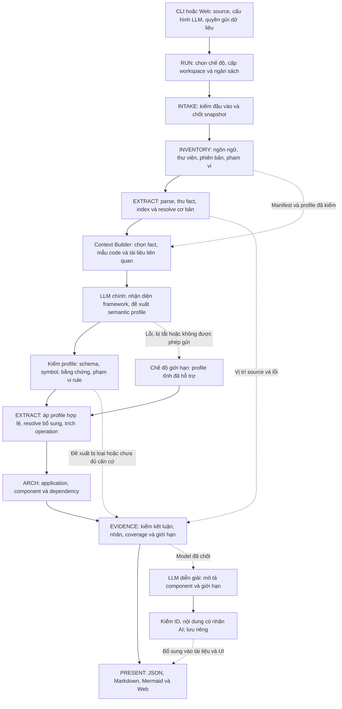

# Pipeline L3 Generator — Phân tích tĩnh kết hợp LLM trong luồng chính

> **Tài liệu gợi ý, không phải yêu cầu.** Từ 23/09/2026, nguồn đúng là
> [PRD hiện hành](.aide/product/prd/PRD-L3GEN-2609-001.md) và các FR/NFR của
> CHG-L3GEN-2026-002. Khi hai bên khác nhau, PRD thắng. Các chỗ khác đã biết:
>
> | Tài liệu này | PRD hiện hành |
> |---|---|
> | Có chế độ Static-only khi tắt hoặc lỗi LLM | Không có chế độ không AI. Model lỗi thì dừng bước dựng quan hệ, giữ dữ kiện đã trích (AC-L3GEN-022-03) |
> | LLM đề xuất "semantic profile" để đọc framework, rồi engine áp profile | Code chia component và dựng cạnh; model đặt tên, mô tả, đề xuất cạnh bổ sung; repository phẳng thì model chia (FR-L3GEN-022). Semantic profile chưa là yêu cầu |
> | LLM thứ hai viết mô tả cuối | Không có yêu cầu mô tả do AI viết |
> | Có thể gửi đoạn source nhỏ, có thể dùng model local | Gửi dữ kiện và chữ ký hàm; model đọc thêm đoạn code qua công cụ có giới hạn, không gửi nguyên file (NFR-L3GEN-SEC-002). Model local ngoài phạm vi; phase đầu dùng Groq `openai/gpt-oss-120b` |
> | Mục 9: danh sách hồ sơ cần sửa | Đã xử lý ở CHG-L3GEN-2026-002; mục 9 giữ làm lịch sử, link trỏ về bản cũ |
>
> Ý tưởng semantic profile và kiểm nhiều lớp ở mục 3 có thể dùng khi thiết kế L2/ADR ở bước 7.

Ngày cập nhật: 22/09/2026. **Bản thiết kế theo yêu cầu mới do người dùng truyền đạt từ mentor; chưa triển khai hoặc benchmark.**

**Thay đổi chính:** LLM tham gia nhận diện và diễn giải framework **trước khi dựng mô hình kiến trúc**. LLM đề xuất cách đọc các mẫu code; engine đối chiếu đề xuất với source rồi mới tạo kết luận. Phần viết mô tả ở cuối vẫn có, nhưng không còn là công việc duy nhất của LLM.

Đây là thay đổi so với PRD hiện tại: FR-010 đang yêu cầu kết quả đầy đủ không cần AI; FR-012 và NFR-AI chỉ cho AI diễn giải. Bản này thay thế phương án pipeline cũ trong cùng file và liệt kê hồ sơ cần cập nhật ở mục 9. Nó chưa tự sửa baseline hoặc ghi nhận approval của mentor.

Mục tiêu tối ưu: tăng độ phủ framework và giảm công viết adapter, đồng thời giữ bằng chứng, kiểm soát kết luận sai, thời gian và chi phí. Hiệu quả phải đo theo mục 8; chưa gọi là hỗ trợ mọi framework.

## 1. Luồng chính mới



**Có hai vai trò LLM:** nhánh chính tạo cách diễn giải framework; nhánh sau viết mô tả từ kết quả đã chốt. Nhánh diễn giải không chặn xuất kết quả cấu trúc. Nhánh chính có thể ảnh hưởng dữ kiện kiến trúc sau bước kiểm chứng, nên phải ghi lại nguồn gốc AI.

RUN quản lý mọi chặng. EVIDENCE nhận nguồn gốc xuyên suốt. CLI và web dùng cùng engine và cùng model; khác nhau ở tiếp nhận source và trình bày. Các ô mới nằm trong các component L2 được đề xuất mở rộng, không mặc định trở thành các dịch vụ triển khai riêng.

### Hai chế độ sử dụng

| Chế độ đề xuất | Hành vi |
|---|---|
| **Hybrid — chế độ chính** | Có LLM trong bước diễn giải framework. Lần đầu dùng phải cấu hình provider/model và quyền xử lý dữ liệu; có thể dùng dịch vụ bên ngoài hoặc model chạy local nếu đã kiểm tương thích |
| **Static-only — chế độ giới hạn** | Dùng parser/resolver và profile đã hỗ trợ tĩnh. Không gọi LLM; giữ phần có căn cứ, công bố rõ phần framework/pattern chưa phân tích được |

Tắt LLM không còn được hứa cho kết quả đầy đủ tương đương chế độ Hybrid trên framework mới. Nếu LLM lỗi, chỉ hạ xuống Static-only với thông báo và phạm vi mất; không âm thầm báo như đã hoàn tất Hybrid. Nếu không có phần nào phân tích được thì báo unsupported hoặc failed theo nguyên nhân.

## 2. Từng bước hoạt động

| Bước | Công việc | Đầu ra | Chủ trách nhiệm đề xuất |
|---|---|---|---|
| 0. Khởi tạo | Chọn Hybrid/Static-only, kiểm cấu hình và quyền gửi dữ liệu, cấp giới hạn tài nguyên/LLM | RunContext và workspace riêng | RUN |
| 1. Nhận source | Nhận thư mục CLI hoặc ZIP/GitHub public qua web; chặn đầu vào vượt phạm vi, không chạy source | Snapshot bất biến, digest, danh sách loại trừ | INTAKE |
| 2. Kiểm kê | Nhận diện ngôn ngữ, manifest, dependency, phiên bản có thể biết, source root và entry point candidate | Inventory cùng dấu hiệu framework; chưa suy deployment từ thư mục | INVENTORY |
| 3. Đọc code | Parse mỗi file một lần; thu import, scope, definition, decorator, call, gán, return và vị trí; resolve cơ bản | FactSet và index theo unit/module/scope | EXTRACT |
| 4. Chuẩn bị ngữ cảnh | Chọn phần liên quan đến registration, API, DB, HTTP, config, event; giữ ngữ cảnh import và nơi định nghĩa wrapper | ContextPackage giới hạn kích thước, đã lọc dữ liệu nhạy cảm | EXTRACT + bộ gọi LLM do RUN quản lý |
| 5. LLM diễn giải framework | Phân loại framework/pattern, đề xuất selector và mapping thuộc tính; nêu bằng chứng, giả định và phần chưa biết | SemanticProfileCandidate có cấu trúc | EXTRACT |
| 6. Kiểm profile | Kiểm schema, ID, vị trí, phiên bản, selector được phép, xung đột và căn cứ ngữ nghĩa | Profile hợp lệ trong run hoặc candidate bị cách ly kèm lý do | EXTRACT + EVIDENCE |
| 7. Áp dụng và phân tích sâu | Engine áp profile trên fact, mở rộng resolve ở các điểm cần thiết; LLM không tự điền đích không tìm thấy | Route, registration, data, HTTP, config, event cùng resolution/evidence | EXTRACT |
| 8. Dựng kiến trúc | Ghép đúng application/router instance, nhóm component theo bằng chứng, gộp cạnh theo loại/hướng | ArchitectureModel, provenance tĩnh/LLM và nhãn chất lượng | ARCH |
| 9. Kiểm và xuất | Đối chiếu evidence, ledger và giới hạn; kiểm schema/ID/Mermaid, ghi đủ artifact rồi công bố | JSON, Markdown, sơ đồ, metadata; trạng thái rõ | EVIDENCE + PRESENT + RUN |
| 10. Diễn giải bổ sung | LLM đọc model đã chốt, viết mô tả gắn ID; kiểm phản hồi, gắn nhãn AI và lưu riêng | Phần mô tả trên web/tài liệu, không sửa lại model | PRESENT |

Adapter/profile có thể yêu cầu thêm fact hoặc đoạn định nghĩa liên quan. Mọi yêu cầu quay về danh sách công việc có giới hạn của RUN, không mở vòng lặp “gọi LLM đến khi hài lòng”. Nếu context bị cắt hoặc thiếu tài liệu thư viện, phải ghi giới hạn.

## 3. LLM giúp thích ứng nhiều framework bằng cách nào?

### 3.1 Tách ngôn ngữ, framework và kiến trúc chung

```text
Parser theo ngôn ngữ
    → Fact trung tính framework
    → LLM + profile diễn giải framework
    → Operation chung: route / registration / data / HTTP / config / event
    → Component và dependency chung
```

Ví dụ, route của các framework khác nhau vẫn cần method, path, handler, registration context và evidence. Phần thay đổi là cách tìm các thuộc tính đó trong source.

LLM giúp tìm cách ánh xạ pattern mới vào các operation chung. Engine vẫn phải có parser và cơ chế biểu diễn phù hợp. Thêm Java hoặc JavaScript không tự đạt chỉ bằng đổi prompt; cần frontend ngôn ngữ, ngữ nghĩa scope/import và fixture tương ứng.

### 3.2 Semantic profile là gì?

Semantic profile là **bộ mô tả có cấu trúc về cách nhận diện và diễn giải một nhóm pattern**, gồm:

- Framework/library và phạm vi phiên bản áp dụng; không biết phiên bản thì khai unknown.
- Symbol hoặc mẫu registration/decorator/call cần tìm.
- Cách lấy handler, method, path, prefix, receiver, topic hoặc resource.
- Những binding cần resolver chứng minh; điều kiện áp dụng và trường hợp loại trừ.
- Fact/source refs, tài liệu tham chiếu nếu có và giả định chưa kiểm được.
- Profile ID/version và nguồn tạo: profile đã review hoặc LLM đề xuất trong run.

Profile không phải Python do LLM viết để engine thực thi. Dùng tập thao tác khai báo được giới hạn: chọn node fact, đọc argument literal, theo binding đã resolve, nối prefix đã chứng minh và liên kết evidence. Không cho profile chứa shell, exec/eval, import động hoặc truy cập mạng tùy ý.

Nếu framework cần semantics mà tập thao tác chưa biểu diễn được, giữ partial/unsupported và bổ sung năng lực engine qua thay đổi có test. Không ép mọi framework vào một mẫu để tăng số lượng hỗ trợ trên báo cáo.

### 3.3 Kiểm chứng trước khi sử dụng

| Lớp kiểm | Kiểm gì? | Kết quả khi không đạt |
|---|---|---|
| Cấu trúc | Đúng schema; operator và loại operation nằm trong danh sách cho phép; kích thước/độ sâu có giới hạn | Loại profile, ghi nguyên nhân |
| Nguồn và định danh | Fact, symbol, file/range thực sự tồn tại trong snapshot; source digest khớp | Loại phần tham chiếu giả hoặc sai phiên |
| Binding | Receiver, handler, application instance và các đích cần thiết đã resolve; không lấy tên giống nhau làm identity | Giữ unresolved/ambiguous, không tạo cạnh mặc định |
| Ngữ nghĩa | Bằng chứng cho thấy mapping có nghĩa đó: thân wrapper, registration đã hiểu hoặc tài liệu thư viện đúng phiên bản | Giữ candidate; lời khẳng định của LLM và việc file tồn tại chưa đủ |
| Nhất quán | Không mâu thuẫn profile đã kiểm, không tự nâng unknown thành exact, không trộn nhiều app | Cách ly xung đột để review, không lấy câu trả lời mới nhất làm đúng |

Profile mới có thể dùng trong run ở những pattern đã qua các kiểm tra này. Kết luận phụ thuộc cách diễn giải do LLM đề xuất phải mang provenance AI và nhãn suy luận phù hợp. Các phần chưa đủ căn cứ ở lớp candidate mặc định tắt.

**Kiểm bằng máy không chứng minh mọi diễn giải đều đúng.** Chất lượng semantic profile mới cần chấm bằng đáp án độc lập. Không dùng điểm tự tin do LLM tự chấm làm tiêu chí duyệt.

### 3.4 Ba mức trưởng thành của profile

| Mức đề xuất | Ý nghĩa | Cách dùng |
|---|---|---|
| Candidate | LLM vừa đề xuất, chưa qua kiểm đủ | Chẩn đoán và review |
| Checked for this run | Đã qua kiểm cấu trúc/binding/ngữ nghĩa có thể kiểm trên snapshot này | Cho phép trích phần đủ căn cứ, gắn nguồn AI; không tự công bố framework đã được hỗ trợ đầy đủ |
| Reviewed profile | Có phạm vi phiên bản, fixture đúng/sai và người review xác nhận | Đóng gói thành profile có phiên bản để tái sử dụng có kiểm soát |

Mặc định không tự đưa profile của một repo vào kho dùng chung. Wrapper đặc thù repo phải gắn fingerprint của phần code liên quan. Kho profile có phiên bản là cơ chế mở rộng engine; nó không đồng nghĩa lịch sử phân tích của người dùng hay cache kết quả xuyên repo.

## 4. Một ví dụ dễ hình dung

**Ví dụ thiết kế, chưa phải tính năng đã chạy:** repository tạo decorator riêng `@endpoint("/orders")` thay vì dùng trực tiếp decorator framework. Source của `endpoint` gọi một registration API đã có profile kiểm chứng.

1. Parser ghi nhận decorator, argument, import, định nghĩa wrapper và lời gọi registration bên trong.
2. Resolver xác định chính xác decorator đang dùng wrapper nào; không chọn chỉ vì cùng tên `endpoint`.
3. Context Builder gửi các fact và phần định nghĩa cần thiết theo chính sách dữ liệu.
4. LLM đề xuất: argument của decorator ánh xạ vào path; hàm được decorate ánh xạ vào handler; wrapper này chuyển tiếp tới registration API.
5. Validator đối chiếu thân wrapper, binding tham số và đích registration. Nhánh điều kiện hoặc giá trị động vẫn được giữ.
6. Engine áp mapping để tạo operation, rồi ARCH ghép với application và dựng quan hệ có evidence.
7. Nếu LLM nói wrapper là HTTP POST nhưng source/tài liệu không chứng minh được method, method giữ unknown; không tự điền POST.
8. Web thể hiện phần route đã suy ra, nhãn còn thiếu và đường bằng chứng; người dùng mở để kiểm.

Với framework hoàn toàn mới, LLM cũng đề xuất mapping nhưng engine chỉ sử dụng phần có đủ căn cứ và biểu diễn được bằng contract hiện tại. Khi không có source thư viện hoặc tài liệu đúng phiên bản, khả năng kết luận bị giới hạn. Sản phẩm không hứa “đưa repo bất kỳ đều hiểu đầy đủ”.

## 5. Dữ liệu truyền giữa các bước

Các tên dưới đây là đề xuất contract, chưa phải schema đã duyệt.

| Dữ liệu | Trường quan trọng |
|---|---|
| RunContext | Chế độ phân tích, snapshot/config digest, tool/parser/rule version, cấu hình model và ngân sách; credential chỉ nằm trong bộ nhớ |
| Inventory / ProcessingLedger | Unit, file, stack, trạng thái xử lý/loại trừ và lý do; trạng thái adapter/pattern theo phạm vi |
| FactSet | Symbol, scope, import, call, binding, vị trí source và index; không thay đổi fact gốc bằng phản hồi LLM |
| ContextPackage | Các fact/đoạn code được phép gửi, tài liệu/profile tham chiếu, ID hợp lệ, phần bị cắt, context hash và policy version |
| SemanticProfileCandidate | Framework/version, selector, mapping, điều kiện, evidence refs, giả định và nguồn tạo |
| ValidatedProfile / DecisionLog | Phần được nhận/bị loại, lý do, validator version, profile digest và giới hạn áp dụng |
| SemanticModel / ArchitectureModel | Operation, component, dependency, confidence/completeness, provenance và evidence chain |
| AIExecutionRecord | Provider/model được báo, prompt template version, input/output digest, số request/token nếu biết, lý do lỗi; không lưu key hay secret |
| ResultBundle | Model, evidence, limitations, schema version, run/export/LLM status và manifest artifact |
| AIDescription | Văn bản gắn ID đã tồn tại và nhãn AI; tách khỏi dữ kiện cấu trúc |

**Đường truy vết:** kết luận kiến trúc → operation → profile và quyết định kiểm → fact → source snapshot. Tài liệu framework hỗ trợ cách diễn giải, không thay bằng chứng rằng code của repo thực sự dùng pattern đó.

Ledger phải có trạng thái cho cả file đã đọc nhưng không tạo ra fact hữu ích. Các nhóm analyzed/excluded/unsupported/error/not_processed phải đối chiếu được với inventory. Đếm file thành công không thay thế độ phủ framework hoặc recall của route.

ID không theo thứ tự worker, số thứ tự câu trả lời LLM hay run ID. Identity dùng đối tượng nguồn và ngữ cảnh; profile/LLM provenance được ghi riêng. LLM mới có thể đổi tập kết luận, nên cùng source chưa đủ để hứa model giống nhau.

## 6. Cách chạy hiệu quả và xử lý lỗi

### 6.1 Tối ưu chỗ có lợi

| Lựa chọn | Lợi ích và ranh giới |
|---|---|
| Parse mỗi file một lần | Dùng chung fact cho nhiều loại operation; giải phóng AST khi đã thu đủ dữ liệu cần |
| Index theo unit/module/scope | Tra cứu nhanh, không nhầm symbol cùng tên; resolve cơ bản vẫn phủ yêu cầu FR-006 |
| Gửi context chọn lọc | Chọn theo registration, import, definition và dependency liên quan; không gửi cả repo hoặc gọi một request cho mỗi file |
| Bắt đầu bằng context nhỏ, mở rộng có giới hạn | LLM yêu cầu thêm ID/định nghĩa qua broker chỉ đọc; mọi lần bổ sung context tính vào ngân sách |
| Profile đã review cho mẫu quen thuộc | LLM đánh giá khoảng trống và đề xuất bổ sung; tránh học lại mapping đã kiểm. Kết quả có thể không cần thay đổi |
| Gom request theo framework/pattern/unit | Các callsite cùng pattern dùng một mapping; vẫn phân biệt application instance và điều kiện đăng ký |
| Memo trong run | Khóa theo context/profile/model/prompt/policy; có binding mới thì xét lại kết quả phụ thuộc |
| Song song có giới hạn | Parse file và request độc lập có thể song song sau khi đo; tổng RAM/token/request phải được RUN đếm, ARCH gộp theo thứ tự ổn định |

Không dùng cache response xuyên run ở bản đầu. Tái chạy phục vụ kiểm chứng dùng gói replay được quản lý như evidence; mở rộng lưu dữ liệu hoặc kho profile phải tuân thủ chính sách retention mới.

### 6.2 Lỗi và giới hạn

| Tình huống | Hành vi |
|---|---|
| Không có key/model local hoặc chưa cho phép gửi context | Báo không thể chạy Hybrid; cho dùng Static-only với phạm vi công bố |
| Provider timeout/rate limit/hết quota | Retry có trần; giữ profile/phần tĩnh hợp lệ, đánh dấu thiếu bước diễn giải cần thiết |
| LLM trả JSON hỏng hoặc operator không hỗ trợ | Loại phản hồi; không thực thi như code, không retry vô hạn |
| LLM trả symbol/evidence giả | Loại phần không hợp lệ, giữ diagnostic; không bổ sung node/cạnh để khớp câu trả lời |
| Profile mâu thuẫn hoặc thiếu ngữ nghĩa | Giữ candidate/partial, đưa vào review; không cho một LLM khác tự “bỏ phiếu” thành bằng chứng |
| Một file parse lỗi | Cách ly file, tiếp tục phần hợp lệ và công bố phạm vi mất |
| Chạm giới hạn thời gian/RAM | Dừng có lý do; chỉ dùng dữ liệu đã chốt nhất quán, không đọc bộ nhớ dở làm kết quả |
| Xuất một artifact lỗi | Giữ model và file hợp lệ để thử lại, báo lỗi export, không đánh dấu bộ kết quả hoàn tất |
| LLM diễn giải cuối lỗi | Model và artifact tĩnh vẫn sử dụng được; chỉ thiếu phần mô tả bổ sung |

Trạng thái toàn run phải phản ánh mất phạm vi, không chỉ tình trạng request. LLM trả thành công nhưng profile đều bị loại không phải Hybrid thành công. Tách trạng thái phân tích, LLM và export; định nghĩa mapping sang completed/partial/failed tại contract.

### 6.3 Tái lập khi LLM tham gia tạo cấu trúc

Không hứa hai lần gọi mới cùng model sẽ trả cùng kết quả; temperature thấp hoặc bằng 0 không phải bằng chứng tất định.

- **Phần tĩnh:** cùng snapshot/config/tool/parser cho cùng fact và index.
- **Replay:** cùng fact, profile LLM đã được chấp nhận, rule/validator version và cấu hình phải dựng lại cùng model chuẩn hóa.
- **Gọi mới:** đo mức thay đổi của profile/claim giữa các lần, giữ khác biệt để review; không tự gọi đó là lỗi renderer.
- **CLI so với web:** kiểm parity bằng cùng snapshot và gói profile/replay. Thử gọi LLM mới ở hai kênh là phép đo biến thiên riêng.
- **Dừng vì tài nguyên:** ghi checkpoint và phần chưa xét; không tuyên bố mọi lần bị cắt sẽ có cùng tập claim.

Gói replay chỉ lưu dữ liệu được phép sau khi lọc, gồm profile/quyết định/provenance cần tái dựng; không giữ raw prompt/source vô hạn. Phải cập nhật NFR-DET và PRIV trước khi áp dụng cơ chế lưu này.

### 6.4 Quyền dữ liệu và chi phí

LLM trong lõi có thể cần đoạn source nhỏ để hiểu wrapper, khác chính sách cũ chỉ gửi model. Đề xuất: profile xử lý dữ liệu do người dùng chọn, cho biết provider và loại context gửi; chỉ gửi snippet khi có quyền, loại secret trước và ghi phạm vi đã gửi bằng metadata an toàn. Với model local, vẫn kiểm policy/log/output.

Source, comment, tài liệu và phản hồi model đều là dữ liệu không tin cậy. LLM không được chạy tool trên máy hoặc điều khiển shell/network; broker chỉ trả phần source được phép theo ID. Profile dùng operator được engine giới hạn; renderer escape nội dung trước khi hiển thị.

RUN kiểm ngân sách trước mọi request/retry, giới hạn tổng request/token/thời gian và có xử lý khi không biết giá/quota. NFR hiện tại vẫn đặt trần trả phí 0 đồng; chưa có quyết định mới thì không được gọi API có thể phát sinh phí. Chọn model local hoặc quota có kiểm soát là phương án cần đo trên môi trường thật, chưa chốt nhà cung cấp trong tài liệu này.

## 7. Kế hoạch triển khai cho nhóm hai người

| Đợt | Kết quả cần có |
|---|---|
| A. Đồng bộ yêu cầu | Chốt vai trò LLM chính, dữ liệu được gửi, chế độ fallback, ngân sách và nghĩa tái lập; review thay đổi ở mục 9 |
| B. Contract + một luồng tĩnh | Snapshot → fact/index → route đơn giản → component → evidence → export; tạo fixture và đáp án trước |
| C. LLM trong luồng chính | Context Builder, bộ gọi model, schema profile, validator và profile executor; một wrapper mới đi xuyên suốt với evidence |
| D. Thử thích ứng framework | FastAPI làm mốc; chọn thêm Flask hoặc Django và pattern wrapper làm tập thử chưa có profile đặc thù. Đây là phạm vi đề xuất để chốt, chưa tuyên bố được hỗ trợ |
| E. Hoàn thiện loại dữ kiện và giao diện | DB/HTTP/config/Kafka/library theo phạm vi mới; web hiển thị provenance, trạng thái LLM, profile bị loại và giới hạn |
| F. Nghiệm thu | Chấm độ đúng/độ phủ/chi phí/độ trễ, replay, input lỗi và đối chiếu CLI/web; chỉ mở rộng khi kết quả đủ bằng chứng |

Gợi ý phân công: người thứ nhất làm fact/resolver/profile executor/ARCH; người thứ hai làm RUN/intake/context/model adapter/validator/PRESENT. Hai người cùng chốt contract và chấm đáp án độc lập; mỗi người review phần của người còn lại. Chia việc này là đề xuất, không tự đổi người ký hoặc owner trong hồ sơ.

Giữ bảy component nhưng mở rộng trách nhiệm: RUN quản lý LLM budget; EXTRACT có context/profile và semantic extraction; EVIDENCE kiểm provenance/decision; ARCH sử dụng operation đã qua kiểm; PRESENT công bố nhãn và mô tả. INVENTORY/INTAKE bổ sung metadata/policy cần thiết. Nếu trách nhiệm mới quá lớn thì xem lại ADR chia component sau khi có số đo.

## 8. Đo để chứng minh LLM thực sự giúp thích ứng

So sánh trên cùng source snapshot, phạm vi ngôn ngữ và bộ đáp án:

| Cấu hình | Câu hỏi cần trả lời |
|---|---|
| Static-only với profile đã có | Mốc độ đúng, độ phủ, thời gian và bộ nhớ |
| Hybrid trên framework đã biết | LLM có bổ sung hữu ích hay chỉ tăng độ trễ/chi phí và lỗi? |
| Hybrid trên framework/pattern chưa có profile đặc thù | Bao nhiêu operation được tìm đúng, bao nhiêu đề xuất sai, bao nhiêu trường hợp còn unknown? |
| Replay cùng profile đã chốt | CLI/web và các lần tái dựng có cùng model/evidence chuẩn hóa? |
| Nhiều lần gọi LLM mới | Kết luận nào thay đổi và thay đổi đó có làm giảm chất lượng? |

Tập thử phải tách repo/pattern dùng để xây prompt/profile khỏi tập đánh giá chưa dùng để tinh chỉnh. Có negative fixtures: tên giống route nhưng không phải route, wrapper không đăng ký gì, prefix động, giả evidence, hai app cùng kiểu và registration có điều kiện.

Đo riêng: precision/recall route/entity/HTTP/config/event; đúng thuộc tính; membership/component dependency; evidence hợp lệ và thực sự hỗ trợ kết luận; tỷ lệ profile được nhận/bị loại; thời gian từng chặng, request/token/chi phí và peak RAM. Báo riêng static-derived và LLM-assisted, không dùng trung bình để che nhóm suy luận sai.

Phép thử bắt buộc: key thiếu, JSON hỏng, quota hết, phản hồi chèn ID/operator lạ, prompt injection trong source, context bị cắt và retry không vượt trần. Schema pass không thay việc chấm ngữ nghĩa bằng người.

Phương pháp dataset hiện có tại [OBS-001](.aide/observability/OBS-L3GEN-001.md) là nền để mở rộng. Ngưỡng chất lượng của framework mới, biến thiên LLM và chi phí phải được chốt trước khi đo; chưa có số thì ghi not_run/not_evaluated. Không lấy kết quả paper khác làm chỉ số cho L3 Generator.

## 9. Những hồ sơ cần cập nhật theo yêu cầu mới

Đây là danh sách tác động để đưa vào change request; chưa chỉnh các file nguồn trong lần viết pipeline này.

| Hồ sơ | Điểm cần đổi |
|---|---|
| [PRD](.aide/product/prd/PRD-L3GEN-2609-001.md) | II.1, giả định/ràng buộc, IV về AI, scope/DoD/timeline: LLM tham gia semantic analysis; xác định tập framework mục tiêu, fallback và phụ thuộc model |
| [FR-010](.aide/requirements/_superseded-r23/fr/FR-L3GEN-010.md) | Đổi cam kết no-AI thành chế độ giới hạn công khai; không còn bắt buộc AI bật/tắt có cùng cấu trúc trên mọi framework |
| [FR-012](.aide/requirements/_superseded-r23/fr/FR-L3GEN-012.md) và FR liên quan | Tách năng lực LLM diễn giải framework trong lõi với mô tả cuối; thêm AC profile, validation, lỗi và thích ứng. Chốt cách tách/mã FR trong hồ sơ chính thức |
| FR-003/004/005/006/007/009/011/013/014/015/018 | Rà lại pattern, nguồn AI, evidence, unknown, component/role và thông báo UI; không tự coi AC cũ đã đủ cho mapping mới |
| [NFR-AI](.aide/requirements/_superseded-r23/nfr/NFR-L3GEN-AI-001.md) | Cho phép LLM đề xuất semantics dẫn tới cấu trúc qua validator; quy định request/token/chi phí và chống dữ liệu đầu vào điều khiển model |
| [NFR-DET](.aide/requirements/_superseded-r23/nfr/NFR-L3GEN-DET-001.md) | Tách phần tĩnh tất định, replay với profile cố định và biến thiên khi gọi mới |
| [NFR-PRIV](.aide/requirements/_superseded-r23/nfr/NFR-L3GEN-PRIV-001.md) / SEC | Chính sách snippet, provider/local model, prompt/response, retention/replay; kiểm bề mặt mạng LLM ngoài intake |
| NFR-COMP / ACC / TRACE / PERF / REL / USA và OBS | Ma trận framework mới, kiểm semantics, provenance, latency/chi phí LLM, fallback và cách người dùng nhận biết chất lượng |
| [Glossary](.aide/domain/glossary-core.md) | Định nghĩa lại deterministic core, AI description, inferred/provenance; rà bất biến #6/#8 đang cấm AI ảnh hưởng cấu trúc |
| L1 / L2 (đã gỡ, xem git `5ed1712`) / ADR / threat model | Bổ sung LLM vào năng lực trích xuất, điều phối, bằng chứng; review trách nhiệm và ranh giới dữ liệu mới |
| Baseline và evidence | Tạo change decision/baseline mới, giữ bằng chứng cũ; không sửa approval cũ để hợp thức hóa pipeline mới |

Giữ các nguyên tắc: source read-only; không chạy code đầu vào; mọi claim có evidence; unresolved không thành cạnh chắc chắn; kết quả mặc định ở mức component; một model dùng chung cho CLI/web. Điều chỉnh các ràng buộc AI theo quyết định mới thay vì tuyên bố pipeline này đã tương thích toàn bộ baseline cũ.

## 10. Cơ sở tham khảo

- [IRIS — LLM-Assisted Static Analysis](https://arxiv.org/abs/2405.17238) kết hợp LLM suy ra specification với phân tích tĩnh trong bài toán bảo mật. Bản này tham khảo cách chia vai trò; không dùng số đo hoặc phạm vi bảo mật của IRIS làm bằng chứng cho công cụ kiến trúc.
- [CodeQL — Customizing library models](https://codeql.github.com/docs/codeql-language-guides/customizing-library-models-for-go/) mô tả mô hình thư viện mở rộng ngữ nghĩa phân tích. Ý tưởng profile khai báo của bản này là đề xuất riêng, chưa chọn CodeQL làm engine hoặc dùng nguyên schema của họ.
- [ADR-001](.aide/architecture/adr/ADR-2026-001.md), [ADR-002](.aide/architecture/adr/ADR-2026-002.md) là cơ sở ranh giới L3 và bảy component hiện có; thay đổi liên quan LLM cần review theo mục 9.
