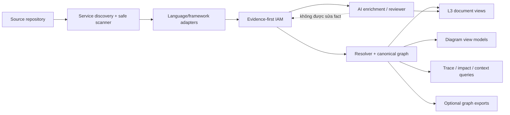

# Nghiên cứu đối thủ và định hướng cải tiến Code → Architecture / L3 Generator

> **Lỗi thời một phần từ 23/09/2026.** Tài liệu này viết cho hướng AI tắt hoặc AI chỉ viết mô tả, trên bộ yêu cầu BL-r14. Nguồn đúng hiện nay là [PRD revision 25](../.aide/product/prd/PRD-L3GEN-2609-001.md) của CHG-L3GEN-2026-002: mô hình ngôn ngữ đề xuất component và quan hệ, code kiểm dữ kiện chứng minh. Mã FR/NFR nhắc ở đây là mã cũ. Khi khác nhau, PRD thắng. Đọc file này để hiểu cơ chế phân tích tĩnh, không dùng làm yêu cầu.

> **Tài liệu khảo sát lịch sử.** Trạng thái implementation, ma trận và roadmap bên
> dưới phản ánh thời điểm khảo sát trước khi code V2 tồn tại. Các đề xuất về canonical
> function graph, trace/impact query, MCP hoặc graph database **không phải requirement
> hiện tại**. Quyết định đang có hiệu lực nằm trong PRD (xem dòng trên). Ý vẫn giữ từ
> [ARCHITECTURE_V2_IDEA.md](ARCHITECTURE_V2_IDEA.md) và
> [SPEC](../SPEC_Code_to_L3_Generator.md): phân tích function/call chỉ để làm evidence,
> còn sản phẩm chính là component-level L3.

## 1. Kết luận điều hành

Dự án đang có một bản đặc tả tốt hơn mặt bằng chung ở ba điểm: coi source tĩnh là nguồn sự thật, tách AI khỏi dữ liệu kiến trúc, và yêu cầu mọi thông tin quan trọng phải truy ngược được về `file:line`. Tuy nhiên, tại thời điểm khảo sát, repository mới có SPEC, use case, scenario và nhật ký tiến độ; chưa có package chạy được, parser, fixture, test, output mẫu hay báo cáo evaluation. Vì vậy, các năng lực hiện tại phải được gọi đúng là **năng lực đã thiết kế**, chưa phải **năng lực đã chứng minh**.[^1][^2]

Sáu repository được khảo sát không có sản phẩm nào trùng hoàn toàn với mục tiêu “sinh tài liệu L3 có bằng chứng”. Mỗi repo giải quyết một lát cắt khác nhau:

- **RepoDNA** giống một máy chụp X-quang toàn repository: có contract dữ liệu, coverage, nhiều kiểu export và UI khá hoàn chỉnh.
- **PyAnalyzer** giống kính hiển vi cho dependency Python: ít quan tâm UX, nhưng đi sâu vào points-to analysis và đánh giá thực nghiệm.
- **code2flow** là bản đồ “hàm nào gọi hàm nào”: nhỏ, dễ dùng, hữu ích để học cách cắt một graph lớn thành vùng liên quan.
- **ast-bro** là GPS cho coding agent: tối ưu việc hỏi cấu trúc, impact, call path và lấy context trong một ngân sách token cố định.
- **FalkorDB CodeGraph** biến source thành cơ sở dữ liệu đồ thị có thể truy vấn qua CLI, API và MCP.
- **GitDiagram** là máy làm “poster kiến trúc” bằng AI: trải nghiệm rất tốt, nhưng chỉ dùng file tree và README nên không thể là nguồn sự thật ở mức source.

Định vị nên theo đuổi là:

> **Evidence-first L3 generator:** sinh tài liệu kiến trúc theo từng service, mô tả API–data–external flow, và cho phép kiểm chứng từng kết luận về source; AI chỉ diễn giải dữ liệu đã được bộ phân tích xác nhận.

Không nên mở rộng số ngôn ngữ hoặc UI graph khi lõi chưa ổn định. Hướng sản phẩm được
khảo sát là **tài liệu L3 có thể kiểm chứng**, nằm giữa call graph mức thấp và sơ đồ AI
không có bằng chứng source.

Ưu tiên quan trọng nhất trong timebox 2–3 người/4–6 tuần là thu nhỏ scope để có một lát cắt hoàn chỉnh: Python + FastAPI + SQLAlchemy + HTTP outbound, chạy offline, output deterministic, có fixture và evaluation. AI Reviewer và Web UI nên ở sau lõi này. Nếu lõi chưa được đo mà đã đầu tư UI/AI, dự án sẽ trông hoàn chỉnh nhưng chưa trả lời được câu hỏi quan trọng nhất: “dòng nào trong tài liệu này đáng tin, và tại sao?”.

## 2. Phạm vi và phương pháp khảo sát

### 2.1 Các nguồn đã kiểm tra

Khảo sát không chỉ đọc trang đầu. Với từng repository, việc kiểm tra bao gồm README, tài liệu kiến trúc, schema hoặc model trung gian, resolver, CLI/API/MCP, test/evaluation và các giới hạn được ghi trong code. Các repo được cố định tại commit sau để kết quả có thể tái lập:

| Repository | Phiên bản/commit khảo sát | Trạng thái chính khi khảo sát |
|---|---|---|
| RepoDNA | `1ebc4a7`, v1.2.0 | Sản phẩm local-first có UI và nhiều export |
| PyAnalyzer | `ea143ef` | Research artifact ICSE 2024, Python-only |
| code2flow | `c2c22af`, v2.5.1 | CLI call graph ổn định, thay đổi chậm |
| ast-bro | `4fca8c9`, v4.2.0 | Toolkit Rust đang phát triển nhanh cho coding agents |
| FalkorDB CodeGraph | `2a7a52c`, v0.4.2 | Graph database + UI + CLI/MCP |
| GitDiagram | `0b71178`, v0.1.0 | Web app AI-first với pipeline validation chặt |

Các con số benchmark được ghi đúng theo artifact của tác giả, không được xem là kiểm định độc lập. Khi tài liệu và code không khớp, báo cáo ưu tiên hành vi nhìn thấy trong code và ghi rõ sự lệch đó.

### 2.2 Tiêu chí so sánh

Một đối thủ được đánh giá theo các câu hỏi thực dụng sau:

1. Nó hiểu source tới độ sâu nào: file, symbol, call, type, API, database hay runtime flow?
2. Nó phân biệt fact, inference, ambiguity và unresolved ra sao?
3. Kết quả có stable ID, schema version, evidence và coverage không?
4. Người dùng khai thác graph thế nào: tài liệu, diagram, truy vấn, impact, context hay chat?
5. Nó xử lý monorepo, nhiều ngôn ngữ, cache, scale và lỗi parse thế nào?
6. Nó có test hợp đồng, benchmark accuracy, benchmark hiệu năng và security test hay không?
7. Bài học nào phù hợp với mục tiêu L3; bài học nào sẽ làm scope trượt sang một sản phẩm khác?

## 3. Hiện trạng dự án

### 3.1 Những gì đã được thiết kế tốt

Các tài liệu hiện có đã được đọc theo vai trò sau:

| Tài liệu | Nội dung hiện có |
|---|---|
| [`Đề bài.md`](../Đề%20bài.md) | Mục tiêu chương trình, scope riêng của Code → L3 và timebox 2–3 người/4–6 tuần |
| [`SPEC_Code_to_L3_Generator.md`](../SPEC_Code_to_L3_Generator.md) | Contract, IAM, pipeline, extractor, resolver, acceptance, task breakdown và UI mở rộng |
| `PROGRESS.md` | Nhật ký tuần 1 cho thấy công việc đang ở pha requirement/thách thức kỹ thuật |
| `CLAUDE.md` | Quy tắc làm việc trong repository; không phải implementation sản phẩm |

Không có source package, `pyproject.toml`, test, fixture, README sản phẩm, `examples/` hay `EVALUATION.md` trong snapshot khảo sát.

SPEC mô tả pipeline có thứ tự rõ: scan repository → phát hiện service/stack → parse AST → extract route/entity/external call/call/import → dựng Intermediate Architecture Model (IAM) → resolve xuyên file → dựng graph → AI enrichment/review → sinh Markdown và Mermaid.[^1]

Các quyết định tốt nên giữ nguyên:

- **Không chạy hoặc import repository được phân tích.** Đây là ranh giới an toàn quan trọng.
- **IAM là nguồn sự thật.** Graph và tài liệu đều phải suy ra từ IAM, không tự phát minh thêm fact.
- **AI không được sửa fact.** AI chỉ viết mô tả hoặc finding trong schema riêng; hỏng AI vẫn phải có static output.
- **Service là đơn vị phân tích.** Manifest được dùng để chia monorepo thành service trước khi nhận diện framework.
- **Domain-aware thay vì chỉ code-aware.** Spec đã phân biệt route, DB entity/column, external HTTP call, function và module.
- **Confidence và unresolved là dữ liệu hạng nhất.** Không giấu chỗ không biết.
- **Acceptance có threshold đặt trước.** Route recall, entity recall, external-call recall và exact precision đã có mục tiêu định lượng.

Đây là nền tảng tốt để tạo khác biệt so với công cụ vẽ graph tổng quát.

### 3.2 Khoảng cách giữa đặc tả và sản phẩm

| Hạng mục | Trong tài liệu | Đã có bằng chứng chạy được trong repo |
|---|---|---|
| CLI `l3gen` | Có contract | Chưa có |
| Scanner/parser/extractor/resolver | Có thiết kế chi tiết | Chưa có source |
| IAM/graph schema | Có mô tả field | Chưa có Pydantic model/versioned artifact |
| 7 fixture + resolver cases | Có acceptance criteria | Chưa có fixture/test |
| `L3.md`, `diagram.mmd`, `graph.json` | Có template | Chưa có output mẫu |
| Precision/recall | Có threshold | Chưa có ground truth/EVALUATION |
| Web UI | Có mô tả 6 màn hình | Chưa có implementation |

Vì vậy, khi so với đối thủ, cần tránh kết luận “dự án đã hơn” chỉ vì SPEC mô tả sâu hơn. Cách nói chính xác là: **thiết kế có tiềm năng hơn ở traceability và domain L3; đối thủ đang hơn xa về mức độ hiện thực hóa**.

### 3.3 Lỗ hổng trong chính bản thiết kế

Dù SPEC đã dài và cẩn thận, năm contract còn thiếu sẽ sớm gây vấn đề:

1. **Chưa có artifact envelope/version migration.** IAM cần `schema_version`, `analyzer_version`, `source_revision`, `config_digest` và timestamp policy.
2. **Chưa định nghĩa stable ID.** Nếu node ID thay đổi giữa hai lần chạy, diff, cache, link từ finding và review lịch sử sẽ không đáng tin.
3. **Coverage chưa đủ chi tiết.** Có `RunMetrics`, nhưng chưa có bảng mỗi file/service ở trạng thái parsed/partial/unsupported/skipped/truncated cùng lý do.
4. **Resolution evidence còn mỏng.** `resolved_module` và boolean `resolved` chưa đủ để audit tại sao một edge được nối; cần resolver, rule, candidate set và evidence locations.
5. **Chưa có resource/safety budget.** Chưa giới hạn số file, byte/file, tổng byte, AST node/depth, graph node/edge, thời gian và output rendering.

Đây là những bài học RepoDNA, ast-bro và GitDiagram thể hiện rõ nhất.

## 4. Phân tích từng đối thủ

### 4.1 RepoDNA — gần nhất về triết lý “static truth”

#### Nó làm gì, nói đơn giản

RepoDNA nhận một repository, lập bản đồ file/symbol/import/call/route/model, rồi tạo một graph chuẩn hóa để nhiều màn hình và định dạng export cùng sử dụng. Nó gần với dự án này nhất ở hai ý: phân tích tĩnh, và một model trung gian làm contract giữa engine với UI.[^3][^4]

#### Pipeline thực tế

Luồng chính là ingestion → fingerprint/detect → language adapter → canonical graph → các view dẫn xuất → portable artifact → React UI. Python engine dùng AST; engine TypeScript dùng tree-sitter cho Python/JavaScript/TypeScript và Go thử nghiệm. Việc có hai engine được bù bằng golden/parity tests và một canonical contract.[^4][^8]

Schema v2 giàu hơn IAM hiện tại ở các điểm:

- Node có nhiều kind từ repository/workspace/package/file tới class/function/route/service/data model/table/external system.
- Edge phân biệt `CALLS`, `IMPORTS`, `INHERITS`, `EXPOSES_ROUTE`, `READS`, `WRITES`, `CONFIGURES`…
- Edge có trạng thái `extracted`, `resolved`, `inferred`, `ambiguous`, `unresolved`; có confidence, resolver/version, candidate và explanation.
- Evidence có path và source range, thay vì chỉ để một chuỗi nguồn ở phần trình bày.[^5]

#### Điểm mạnh đáng học

**1. Coverage là một phần của câu trả lời.** RepoDNA công bố số file parsed/partial/unsupported/ignored/skipped và trạng thái tổng thể như `FULLY_MAPPED`, `MOSTLY_MAPPED`, `PARTIAL`, `COVERAGE_LIMITED`. Người dùng có thể phân biệt “không có dependency” với “tool chưa đọc được vùng chứa dependency”.[^6]

**2. Resource limit và security được coi là product requirement.** RepoDNA có giới hạn input, AST, graph/render và phòng archive traversal, zip bomb, compression ratio bất thường. Đây là phần dự án hiện chưa mô tả.[^6]

**3. Một graph, nhiều consumer.** Cùng canonical graph được xuất JSON, CSV, Neo4j Cypher và Parquet; thứ tự ổn định, ID ổn định và export có tính deterministic. Điều này tạo đường mở sang analytics/graph database mà không làm core phụ thuộc database.[^7]

**4. Ingestion thực dụng.** Public/private GitHub, local folder trong browser, ZIP và mở lại JSON đã có. Cache theo file hash/commit giúp không phải phân tích lại mọi thứ.

**5. View phục vụ câu hỏi.** Ngoài overview còn có onboarding, important files, impact slice, cycle, centrality và community. Graph không bị xem là mục tiêu cuối cùng.

#### Điểm yếu và giới hạn

- Python resolver thực tế vẫn có fallback theo tên duy nhất toàn repo. Cách này tăng recall nhưng có thể nối nhầm một symbol trùng tên nằm ngoài phạm vi import. Hệ thống confidence giúp giảm tác hại, nhưng không biến heuristic thành fact.
- “Impact” hiện chủ yếu là lát cắt lân cận và các flow bị giới hạn độ sâu/số node; chưa phải change-impact semantic hoàn chỉnh.
- Phạm vi framework/domain không sâu bằng mục tiêu FastAPI + SQLAlchemy + outbound HTTP của dự án này, đặc biệt ở DB column/FK và tài liệu L3.
- Test contract/parity mạnh nhưng repository không công bố benchmark precision/recall thực địa tương đương PyAnalyzer. “Nhiều test pass” không trả lời “graph đúng bao nhiêu phần trăm”.
- Hai engine làm tăng chi phí giữ parity.

#### Nên lấy và không nên lấy

Nên lấy: versioned artifact, stable ID, evidence object, coverage/completeness, limits, deterministic export, unresolved candidate, cache theo file, nhiều view trên cùng graph.

Không nên lấy nguyên: global unique-name fallback gắn nhãn quá mạnh; xây hai engine từ đầu; mở rộng nhiều ngôn ngữ trước khi FastAPI evaluation đạt ngưỡng.

#### Tác động tới dự án

Nếu chỉ chọn một đối thủ để học về **contract sản phẩm**, chọn RepoDNA. Dự án có thể khác biệt bằng strict resolver và tài liệu L3 sâu hơn, nhưng trước hết phải đạt mức “artifact có thể tái lập và tự mô tả độ bao phủ” mà RepoDNA đã thể hiện.

### 4.2 PyAnalyzer — chuẩn tham khảo về độ sâu semantic và evaluation

#### Nó làm gì, nói đơn giản

PyAnalyzer không cố làm tài liệu đẹp. Nó tập trung trả lời chính xác hơn câu hỏi: “entity này phụ thuộc hoặc gọi entity nào trong Python?”, kể cả khi function/class được gán qua biến, truyền như giá trị, hoặc type annotation cung cấp manh mối.[^9]

#### Pipeline thực tế

Engine parse AST, tạo entity/reference database, phân tích statement/expression và môi trường binding, rồi có thể dựng CFG/value-flow. Resolver dùng summary, abstract heap object và worklist/fixed point để lan truyền points-to trước khi kết tinh call graph. Đây là lớp semantic sâu hơn nhiều so với thuật toán bốn bước trong bản SPEC V1 tại thời điểm khảo sát. SPEC V2 hiện không lấy full call graph làm sản phẩm chính.

Data model của PyAnalyzer cũng rộng ở cấp ngôn ngữ: Package, Module, Function, Class, Variable, Parameter, Alias, Unknown/Ambiguous Attribute; relation gồm Define, Contain, Import, Inherit, Call, Use, Set, Alias, Annotate và HasAmbiguous.

#### Điểm mạnh đáng học

**1. Points-to là trọng tâm, không phải phụ chú.** Với Python động, chỉ tra import table không giải được `x = Foo(); x.run()`, object đổi alias hoặc function được truyền qua parameter. PyAnalyzer cho thấy resolver có thể được tổ chức thành một subsystem độc lập, có state và vòng lặp hội tụ.

**2. Evaluation nhiều tầng.** Artifact công bố:

- micro-benchmark A: 45 chương trình nhỏ cho dependency deterministic;
- micro-benchmark B: 233 test thuộc 17 loại hành vi động;
- macro C: 5 dự án với call graph được curate thủ công, trung bình khoảng 10 giờ/dự án;
- macro D: 54 dự án với 8.233 dependency quan sát từ execution trace;
- efficiency set: 191 dự án, khoảng 10M SLOC.[^10]

Tính lại từ workbook macro C ở cấu hình “filter”, PyAnalyzer đạt trung bình Precision 82,4%, Recall 88,7%, F1 85,4%; PyCG là 76,8%/74,9%/75,8%. Ở macro D, recall trung bình của PyAnalyzer là 81,4%, cao hơn PyCG 60,0% trong artifact của nhóm tác giả.[^11][^12]

**3. Scale là tiêu chí nghiệm thu.** Trong bộ 191 repo, artifact báo PyAnalyzer hoàn thành 191/191, còn PyCG hoàn thành 74/191 và không vượt quá repo 26.966 SLOC; repo lớn nhất PyAnalyzer xử lý có 746.786 SLOC.[^10]

#### Điểm yếu và giới hạn

- Đây là research artifact hơn là sản phẩm: CLI và cách đóng gói còn thô, không có UI, L3, evidence UX, confidence contract hay schema migration.
- Scanner đi đệ quy qua `.py` mà không có service boundary và filter tinh tế như sản phẩm thực tế.
- Một số parse error được thay bằng AST rỗng, làm kết quả thiếu mà diagnostics không tương xứng.
- Source chỉ hỗ trợ Python và không có extractor chuyên biệt cho route, database hay external system.
- Không thấy LICENSE ở root tại commit khảo sát; có thể nghiên cứu ý tưởng/kết quả nhưng không nên sao chép code trước khi làm rõ quyền sử dụng.
- Execution trace chỉ là **những call đã quan sát**, không phải toàn bộ call có thể xảy ra. Nó là ground truth tốt cho một phần hành vi, nhưng không phải oracle hoàn chỉnh.

#### Nên lấy và không nên lấy

Nên lấy: taxonomy fixture cho dynamic behavior, resolver có points-to/summary theo giai đoạn, benchmark micro + manual macro + runtime-observed + scale, và phân tích lỗi theo pattern.

Không nên lấy nguyên: model dependency quá rộng cho MVP; packaging research; coi runtime trace là sự thật đầy đủ; bỏ qua service/framework semantics.

#### Tác động tới dự án

SPEC hiện gọi Cross-file Resolver là phần khó nhất, nhưng thuật toán vẫn mới giải tốt import trực tiếp, receiver từ assignment/annotation và inheritance giới hạn. Nên đổi roadmap resolver thành hai mức:

- **MVP strict:** import-aware, same-file, direct constructor assignment, annotations, inheritance; ambiguity được giữ lại.
- **Post-MVP semantic:** alias/return summary/parameter propagation và fixed-point points-to.

Mốc nghiệm thu MVP phải nói rõ pattern nào nằm ngoài mức strict. Không nên kéo toàn bộ PyAnalyzer vào 4–6 tuần, nhưng bộ test phải được thiết kế sao cho sau này thêm points-to mà không đổi contract.

### 4.3 code2flow — sản phẩm hẹp, bài học lớn về graph slicing

#### Nó làm gì, nói đơn giản

code2flow parse Python, JavaScript, Ruby hoặc PHP và vẽ call graph. Nó tự mô tả kết quả là một “ước lượng khá tốt”, không hứa graph hoàn hảo cho ngôn ngữ động.[^13]

#### Pipeline thực tế

Code được parse thành AST; file/class trở thành group, function thành node; engine thu thập call và biến trong scope; biến được nối tới node/group nếu có thể; call được match với biến. Nếu không match được, engine thử tìm một target cùng tên duy nhất trong graph. Ambiguous call bị bỏ và được log. Cuối cùng orphan bị trim, graph được xuất DOT/image hoặc JSON.[^14]

Model `Variable.points_to` và `Call.matches_variable` là một cách triển khai nhỏ gọn cho các trường hợp `obj = Foo(); obj.run()`, import namespace và inheritance. Tuy nhiên node/group ID được tạo bằng byte ngẫu nhiên, nên hai lần chạy cùng source có JSON ID khác nhau.[^15]

#### Điểm mạnh đáng học

- CLI rất dễ hiểu; có include/exclude function/namespace, bỏ orphan hoặc giữ lại.
- `--target-function`, `--upstream-depth` và `--downstream-depth` cắt graph quanh một function. Đây là tính năng nhỏ nhưng giải quyết đúng vấn đề “diagram toàn repo quá rối”.
- Hỗ trợ bốn ngôn ngữ với adapter tương đối gọn.
- README công khai hạn chế thay vì giấu false positive.
- Bộ fixture có khoảng 101 case dữ liệu và kiểm tra edge/node kỳ vọng; dự án tuy cũ nhưng regression surface khá rõ.

#### Điểm yếu và giới hạn

- Fallback “một target cùng tên duy nhất toàn graph” có thể nối nhầm import ngoài vào function local; README thừa nhận trực tiếp lỗi này.
- Call trùng tên, lambda/factory, renamed/passed function và dynamic call thường bị bỏ.
- Một lần chạy chỉ chọn một ngôn ngữ; không có service/monorepo multi-stack model.
- JSON không có schema version, evidence, confidence, unresolved reason hoặc coverage.
- ID ngẫu nhiên làm diff/cache/history khó tin cậy.
- Không có route/entity/external-call semantics, L3 document hay benchmark precision/recall.

#### Nên lấy và không nên lấy

Nên lấy: graph slicing quanh target, bộ filter CLI, adapter boundary, test exact edge, cách nói thẳng về dynamic-language limitations.

Không nên lấy: random ID, global-name fallback, trim orphan mặc định mà không báo coverage, hoặc coi Graphviz image là tài liệu kiến trúc.

#### Tác động tới dự án

`graph.json` của dự án nên có ngay lệnh truy vấn hoặc render như:

```text
l3gen graph --around api.orders:create_order --upstream 2 --downstream 2
l3gen trace api.orders:create_order payments.client:charge
```

Điều này tạo giá trị sử dụng ngay cả trước Web UI, đồng thời giữ diagram L3 chính gọn hơn.

### 4.4 ast-bro — graph như một công cụ điều hướng cho agent

#### Nó làm gì, nói đơn giản

ast-bro là một binary Rust giúp người và coding agent hiểu code mà không phải đọc toàn bộ file. Nó có lệnh lấy outline, public surface, dependency graph, caller/callee, call trace, impact, semantic search và “context pack” giới hạn token.[^16]

Điểm đáng chú ý không phải chỉ là số command. Từng command được thiết kế để trả lời một câu hỏi cụ thể và báo rõ khi câu trả lời bị giới hạn.

#### Pipeline thực tế

Các language adapter dùng tree-sitter qua ast-grep, đưa declaration/call/import về IR chung. File-level dependency graph và symbol-level call graph dùng chung cache. Resolver call chạy ba lượt:

1. same-file/import binding;
2. symbol table toàn project nếu chỉ có một candidate;
3. dùng transitive dependency closure để thu hẹp candidate.

Edge được gắn `Exact`, `Inferred` hoặc `Ambiguous`; ambiguous/unresolved được hiển thị thay vì bị xóa. Graph có thể được duyệt thuận/ngược, tìm shortest call path và kết hợp thành impact report.[^17][^18]

Cache `.ast-bro` lưu fingerprint theo file. Khi file thay đổi, dep graph và call graph được vá theo delta; write dùng lock cùng temp-file/rename. Tài liệu của tác giả báo warm query trên chính ast-bro giảm từ giây xuống mili-giây, nhưng đây là số tự đo trên một corpus, không phải benchmark độc lập.[^18]

#### Điểm mạnh đáng học

**1. Kết quả partial được mô tả bằng contract.** JSON phân biệt `truncated` do giới hạn hiển thị và `frontier_truncated` do traversal chạm giới hạn depth. Đây là chi tiết rất quan trọng: “đã hiện đủ các node tìm thấy” không đồng nghĩa “đã đi hết graph”.

**2. Impact là một use case hạng nhất.** `impact <symbol>` gom callees, callers, file deps, reverse deps, transitive callers và test liên quan. Người dùng không phải tự ghép bốn truy vấn.[^20]

**3. Context có ngân sách.** `context <symbol> --budget N` ưu tiên target body, direct callee, direct caller rồi mới tới transitive signature; nếu thiếu chỗ sẽ ghi `truncated` hoặc `target_omitted`. Đây là cách biến graph thành đầu vào hiệu quả cho AI mà không trao cho AI quyền quyết định fact.[^19]

**4. CLI, JSON và MCP dùng cùng implementation.** Nineteen tools được expose cho coding agents; schema như `ast-bro.context.v1`, `ast-bro.impact.v1`, `ast-bro.trace.v1` giảm drift giữa người và máy.

**5. Incremental cache có invariant parity.** Sau delta update, graph phải giống cold build trên cùng content. Đây là acceptance criterion dự án nên học, không chỉ là tối ưu hiệu năng.

**6. Evaluation search có kỷ luật.** Bộ retrieval eval pin commit và hash source span, đo cả recall/MRR lẫn chi phí ký tự phải đọc; tài liệu cảnh báo không so điểm giữa hai corpus khác nhau và không coi smoke test là evidence.[^21]

#### Điểm yếu và giới hạn

- README nói outline cho 14 ngôn ngữ; file dependency graph chỉ áp dụng một tập nhỏ hơn, và tài liệu call extraction ghi SQL/Markdown là no-op. “Hỗ trợ ngôn ngữ” phải được tách theo capability, không thể chỉ có một checkbox.
- Pass B vẫn coi một tên duy nhất toàn project là `Exact`, dù không có import/receiver evidence. Điều này không phù hợp với chuẩn exact nghiêm của dự án.
- Python không có Jedi-style receiver type inference; `obj.method()` phụ thuộc global/dependency disambiguation.
- Nó hiểu symbol/file dependency, không hiểu FastAPI route, SQLAlchemy entity, external HTTP hay L3 concern.
- Evaluation công khai tập trung search retrieval; chưa thấy benchmark precision/recall đầy đủ cho call graph của 14 adapter.
- Feature surface rất rộng; copy toàn bộ sẽ làm dự án mất trọng tâm.

#### Nên lấy và không nên lấy

Nên lấy: `truncated`/`frontier_truncated`, impact/trace/context, cache delta parity, shared implementation cho CLI/API/MCP, per-capability support matrix, test cycle/depth/ambiguity.

Không nên lấy sớm: semantic embedding search, 19 MCP tool, log squeeze và 14 language adapter. Chúng có giá trị, nhưng không quyết định MVP L3 có đúng hay không.

#### Tác động tới dự án

Sau khi graph JSON ổn định, nên bổ sung một **query layer không phụ thuộc UI**. Ba câu hỏi đầu tiên là:

- `trace`: request handler đi tới entity/external host qua chuỗi call nào?
- `impact`: route/entity nào bị ảnh hưởng nếu đổi function này?
- `context`: gom evidence và source snippet liên quan trong giới hạn ký tự/token để AI viết mô tả.

Đây là cách dùng AI tốt hơn việc gửi toàn repository: static engine chọn context có bằng chứng; AI chỉ diễn đạt context đó.

### 4.5 FalkorDB CodeGraph — graph trở thành database và API

#### Nó làm gì, nói đơn giản

CodeGraph phân tích source thành node/relationship lưu trong FalkorDB, rồi cho người dùng xem graph, search, tìm neighbors/path, hỏi chat GraphRAG hoặc để coding agent truy vấn qua CLI/MCP.[^22]

#### Pipeline thực tế

Pass đầu dùng tree-sitter để tạo File/Class/Function/Method… và edge `DEFINES`. Pass hai dùng language server qua multilspy để resolve call, inheritance, parameter và return type; graph nhận `CALLS`, `EXTENDS`, `IMPLEMENTS`, `RETURNS`, `PARAMETERS`. Python còn có resolver tree-sitter tùy chọn; mặc định vẫn dùng Jedi/LSP. Import Python có resolver cú pháp riêng.[^23][^24]

Source hiện đăng ký `.py`, `.java`, `.cs`, `.js`, `.kt`, `.kts`, trong khi README tại cùng commit chỉ công bố Python/Java/C# và nói C chưa enable. JavaScript/Kotlin có parser, nhưng dùng `NullLanguageServer`, nên khả năng resolve xuyên file yếu hơn ba ngôn ngữ được công bố. Đây là ví dụ tốt về lý do cần support matrix theo từng feature, không chỉ theo extension.[^23]

Mỗi branch có graph identity riêng. Remote repo được clone, graph code được index, git history được lưu, UI/API có thể list hoặc switch commit. MCP hiện có bảy tool: index, search, find symbol, neighbors ở symbol/file, impact và path.[^22][^25]

#### Điểm mạnh đáng học

**1. Query graph là sản phẩm thật.** Người dùng có thể chuyển từ tên symbol sang ID, đi incoming/outgoing edge, tìm call path và impact depth-bounded. Source path/line và snippet nhỏ đi kèm để agent kiểm tra mà không đọc cả file.[^25]

**2. Nhiều interface cùng một graph.** React UI, FastAPI, JSON CLI, Claude skill và MCP cùng khai thác một backend.

**3. Branch/commit là dimension hạng nhất.** Graph được namespace theo project + branch, tạo nền cho so sánh kiến trúc theo thời gian.

**4. Graph database hợp với truy vấn nhiều bước.** FalkorDB/Cypher phù hợp shortest path, reverse dependency, centrality hoặc GraphRAG khi graph đã lớn.

**5. Có hardening cho agent query.** Relation name được validate trước khi nội suy Cypher; snippet read kiểm tra path/symlink và giới hạn dòng/ký tự; impact depth được clamp.

#### Điểm yếu và giới hạn

- Backend nặng: database ngoài hoặc embedded server, language server, Python/Node và nhiều service. Với MVP tạo tài liệu offline, chi phí vận hành này chưa cần thiết.
- Mặc định Python tạo virtualenv và có thể chạy `pip`, `poetry install`; Java copy/unzip dependency source; C# có thể chạy `dotnet restore`.[^23] Nó không cố ý chạy business code, nhưng vẫn thực thi toolchain và tải dependency của target. Điều này rộng hơn trust boundary hiện tại của dự án.
- Graph dùng database node ID và chưa thấy artifact contract có stable content ID, confidence, unresolved candidate, coverage hay provenance đầy đủ.
- Search/path UX mạnh nhưng domain architecture yếu: không có route, DB table/column, outbound HTTP hoặc L3 sections.
- Tham số `incremental` trong MCP hiện chỉ được nhận để tương thích tương lai; response vẫn luôn `mode: full`. Không nên đọc cache search hoặc branch graph như incremental analyzer đã hoàn chỉnh.[^25]
- README thừa nhận một số legacy analyzer/git-history test chưa pass trên clean checkout. Documentation và source cũng đang lệch về số language enable.
- Việc cài dependency của repo mục tiêu làm tăng latency, network variability và supply-chain risk.

#### Nên lấy và không nên lấy

Nên lấy: query API, path/impact, source snippet nhỏ, branch/commit metadata, relation validation, graph database như adapter tùy chọn, MCP sau khi contract ổn định.

Không nên lấy ở MVP: bắt buộc FalkorDB, tự động install dependency, GraphRAG chat, dùng database-assigned ID làm contract, hoặc hứa incremental trước khi delta parity được test.

#### Tác động tới dự án

Nên giữ `graph.json` là portable source of truth và tạo interface `GraphStore`:

- MVP: in-memory/file-backed query;
- tùy chọn sau MVP: export/import Neo4j/FalkorDB;
- mọi backend phải trả cùng stable ID, evidence và confidence.

Cách này lấy được sức mạnh truy vấn của CodeGraph mà không biến việc sinh một file L3 thành một hệ phân tán nhỏ.

### 4.6 GitDiagram — chuẩn tham khảo về UX và validation AI

#### Nó làm gì, nói đơn giản

GitDiagram biến URL GitHub thành một architecture diagram tương tác; người dùng thậm chí có thể thay `hub` bằng `diagram` trong URL. Nó hỗ trợ repo public/private và export Mermaid hoặc PNG.[^26]

#### Pipeline thực tế

Điểm quan trọng nhất: GitDiagram **không đọc source body**. Nó lấy default branch, recursive file tree và README; model thứ nhất viết giải thích kiến trúc tối đa khoảng 650 từ; model thứ hai sinh graph AST có schema chặt. Server validate ID, group, endpoint edge và path đối chiếu file tree, thử sửa tối đa ba lần, sau đó compiler deterministic đổi graph AST thành Mermaid.[^26][^27][^28]

Graph bị giới hạn tối đa 10 group, 34 node, 48 edge; label/type/description/path cũng có giới hạn. Client lọc Mermaid source, render ở strict security mode, sanitize SVG và chỉ cho link GitHub. Pipeline còn có SSE progress, cost estimate, cancellation, quota, deadline, persistence và audit state.[^28][^29]

#### Điểm mạnh đáng học

**1. Time-to-first-value rất thấp.** URL vào, diagram ra; click node mở đúng file/directory. Đây là trải nghiệm demo xuất sắc.

**2. AI không sinh Mermaid trực tiếp.** AI sinh graph AST bị giới hạn; code deterministic mới compile Mermaid. Đây là kiến trúc đúng để giảm syntax error và injection.

**3. Validation có feedback loop.** Output sai schema/edge/group được trả lại model để sửa; path sai đơn thuần có thể bị strip tại chỗ thay vì tốn một model call mới.

**4. Untrusted text được xử lý nhiều lớp.** Normalize text, escape Mermaid, allowlist link, sanitize source/SVG, giới hạn input/output và test security riêng.

**5. Production concerns được thiết kế thật.** Streaming, cancel race, distributed lock, quota reconciliation, retry/deadline và persisted terminal state là bài học tốt nếu dự án sau này có hosted UI.

#### Điểm yếu và giới hạn

- File tree + README chỉ cho biết “có thể kiến trúc là gì”; không chứng minh function nào gọi function nào, route nào tồn tại, entity có cột gì hay host nào được gọi.
- Path validation chỉ chứng minh file tồn tại, không chứng minh mô tả gắn với file là đúng.
- Diagram là AI interpretation, không có confidence/evidence line-level, coverage, unresolved hoặc precision/recall.
- Repo thiếu README vẫn có thể vẽ từ file tree, làm semantic signal còn mỏng hơn.
- Không sinh tài liệu L3 chi tiết và không phải công cụ static analysis.
- Hạ tầng R2/Upstash/provider/rate limit phù hợp SaaS nhưng quá nặng cho CLI offline.

#### Nên lấy và không nên lấy

Nên lấy: graph AST trước Mermaid, strict schema/size bounds, deterministic compiler, retry bằng structured feedback, click-to-source, streaming/cancel/cost khi có hosted mode.

Không nên lấy: để LLM suy kiến trúc trực tiếp từ tree/README rồi gọi đó là fact; bắt đầu bằng SaaS infrastructure; dùng path tồn tại làm evidence đủ mạnh.

#### Tác động tới dự án

AI Enrichment của dự án nên nhận **IAM slice có source evidence**, không nhận raw repository tree. Diagram generation nên theo chuỗi:

```text
IAM/Graph đã xác minh → DiagramViewModel có schema → validator → Mermaid compiler
```

Thay đổi này giữ vẻ đẹp và độ bền của GitDiagram nhưng không hy sinh nguyên tắc static truth.

## 5. Ma trận so sánh tại thời điểm khảo sát

Ký hiệu: `✓` có và là phần chính; `△` có một phần/không đồng đều; `—` không phải mục tiêu hoặc chưa thấy trong artifact.

| Năng lực | Dự án hiện tại | RepoDNA | PyAnalyzer | code2flow | ast-bro | CodeGraph | GitDiagram |
|---|---:|---:|---:|---:|---:|---:|---:|
| Implementation chạy được | — | ✓ | ✓ | ✓ | ✓ | ✓ | ✓ |
| Static AST/tree-sitter | Thiết kế | ✓ | ✓ | ✓ | ✓ | ✓ | — |
| Service-aware monorepo | Thiết kế tốt | △ | — | — | △ | △ | AI suy luận |
| FastAPI route | Thiết kế | ✓/△ | — | — | — | — | AI suy luận |
| SQLAlchemy table/column/FK | Thiết kế | △ | — | — | — | — | AI suy luận |
| Outbound HTTP dependency | Thiết kế | △ | — | — | — | — | AI suy luận |
| Call graph | Thiết kế | ✓ | ✓ sâu | ✓ | ✓ | ✓ | — |
| Points-to/value flow | Mức cơ bản trong spec | △ | ✓ | △ | △ | △ | — |
| Confidence/ambiguity | Thiết kế | ✓ | Ambiguous kind | — | ✓ | — | — |
| Evidence line/range | Thiết kế | ✓ | △ | Line node | ✓ | ✓ | Path-only |
| Coverage/completeness | RunMetrics cơ bản | ✓ | Benchmark-level | — | ✓ theo query | — | Reject oversize |
| Stable/versioned artifact | Chưa đủ | ✓ | — | — | ✓ theo command | — | Graph schema nội bộ |
| Deterministic output | Mục tiêu | ✓ | △ | Không, ID random | ✓ | △ | Mermaid compiler ✓ |
| Graph slicing/trace/impact | — | △ | — | ✓ slice | ✓ | ✓ | — |
| Incremental cache | — | ✓ | — | — | ✓ | Search cache; analyzer full | Artifact cache |
| Query CLI/API/MCP | CLI sinh file | △ | — | CLI | ✓ | ✓ | Web API riêng |
| L3 document | Thiết kế ✓ | — | — | — | — | — | — |
| Polished diagram UX | Thiết kế mở rộng | ✓ | — | △ | — | ✓ | ✓ |
| Empirical accuracy eval | Thiết kế | — | ✓ mạnh | — | Search-only | — | — |
| Không cài/chạy dependency target | Mục tiêu ✓ | ✓ | ✓/△ | Parser ngoài | ✓ | Không | Không đọc source |

Điều ma trận cho thấy: không có đối thủ nào đồng thời làm tốt **domain extraction**, **line-level evidence**, **L3 narrative** và **empirical accuracy**. Đây là khoảng trống hợp lý, nhưng chỉ trở thành lợi thế khi dự án có output chạy thật và evaluation công khai.

## 6. Kiến trúc từng được đề xuất tại thời điểm khảo sát

Phần này được giữ để hiểu nguồn gốc quyết định, không phải kiến trúc hiện hành. Đặc
biệt, query `trace/impact/context` và canonical function graph đã được đưa ra ngoài
contract L3 chính. Xem pipeline hiện hành trong ARCHITECTURE_V2_IDEA.

Ba tầng sau giữ lõi nhỏ nhưng mở đường cho các bài học tốt từ đối thủ:



### 6.1 Tầng 1 — Evidence model

Mọi extractor chỉ được ghi observation có source range. Resolver tạo decision riêng, không ghi đè observation. Mọi unresolved/ambiguous/candidate phải được giữ.

Một envelope tối thiểu nên có dạng:

```json
{
  "schema_version": "iam.v1",
  "analyzer_version": "0.1.0",
  "source": {"root": ".", "revision": "<git-sha-or-content-digest>"},
  "config_digest": "sha256:...",
  "services": [],
  "coverage": {},
  "nodes": [],
  "edges": [],
  "unresolved": [],
  "run": {"limits": {}, "truncation": [], "timings_ms": {}}
}
```

Node ID nên là hash ổn định của `service_id + kind + normalized_path + qualified_name + signature discriminator`, không dựa vào database sequence hoặc random byte.

Edge cần ít nhất:

```json
{
  "id": "edge:sha256:...",
  "kind": "calls",
  "source_id": "function:...",
  "target_id": "function:...",
  "status": "resolved",
  "confidence": "exact",
  "resolver": {"name": "python_call_v1", "rule": "imported_receiver"},
  "evidence": [{"path": "api/orders.py", "start_line": 31, "end_line": 31}],
  "candidates": []
}
```

`exact` chỉ dành cho rule có bằng chứng scope/import/type trực tiếp. “Tên duy nhất toàn repo” nếu vẫn dùng phải là `inferred`, không bao giờ là `exact`.

### 6.2 Tầng 2 — Query/view model

Canonical graph không nên đồng nhất với một diagram. Cùng một graph cần sinh ít nhất bốn view:

1. **L3 component view:** service, route/controller, business service, repository/entity, external system.
2. **Request-flow view:** route → call chain → entity/external host; có thể render flowchart hoặc sequence-like diagram.
3. **Data view:** entity/table, primary/foreign key và quan hệ.
4. **Evidence/quality view:** unresolved, ambiguous, skipped service, coverage và finding.

Mỗi view có giới hạn node/edge và ghi rõ `truncated`/`frontier_truncated`. Nếu graph quá lớn, không âm thầm bỏ node.

### 6.3 Tầng 3 — Presentation và AI

Markdown, Mermaid, UI, MCP hay graph database chỉ là consumer. AI được cấp một IAM/context slice có budget; output của AI chứa reference tới ID/evidence ban đầu. Diagram nên được compile từ schema nội bộ, không yêu cầu model viết Mermaid tự do.

## 7. Các cải tiến lịch sử từng đề xuất cho SPEC

Danh sách này chưa được tự động chuyển thành requirement. Mục nào liên quan full code
graph/query API thuộc dự án Repository Knowledge Graph hoặc giai đoạn sau.

### P0 — phải có để gọi là MVP đáng tin

| Thay đổi | Vị trí nên sửa | Lý do |
|---|---|---|
| Thêm `schema_version`, analyzer/source/config identity | Mục 5 | Tái lập, migration, cache, diff |
| Định nghĩa stable node/edge ID | Mục 5.2 | Link finding, diff giữa run, export graph DB |
| Thêm `CoverageReport` theo service/file | Mục 5.3 | Phân biệt zero thật với không đọc được |
| Mở rộng `Reference` thành resolution decision | Mục 5 + 15 | Lưu rule, resolver version, evidence, candidates |
| Thêm `RunLimits` và truncation reason | Mục 4/5 | Chạy an toàn trên repo lạ/lớn |
| Byte-for-byte reproducibility test | Mục 8 | Ngăn random ID/order/timestamp phá contract |
| Security fixtures cho path/archive/symlink/oversize | Mục 8 | Chuẩn bị remote/ZIP và output Mermaid an toàn |
| Tạo implementation slice trước AI/UI | Mục 9 | Có bằng chứng end-to-end sớm |

`CoverageReport` nên tối thiểu có:

- tổng candidate file và tổng byte;
- parsed/partial/unsupported/ignored/skipped/error file;
- reason code và danh sách path cho mọi nhóm không parsed;
- capability coverage theo service: route/entity/call/import/external-call;
- graph/display truncation tách biệt;
- trạng thái tổng `FULL`, `PARTIAL`, `LIMITED`, `FAILED`.

### P1 — tạo khác biệt sản phẩm sau khi lõi đúng

1. Thêm `trace`, `impact`, `around` query trên `graph.json`.
2. Sinh bốn diagram view thay vì một dependency diagram toàn cục.
3. Thêm evidence drawer/click `file:line` ở UI; filter exact/partial/ambiguous/unresolved.
4. Tạo context pack có budget cho AI enrichment/reviewer.
5. Diff hai artifact hoặc hai commit: route/entity/external dependency added/removed/changed.
6. Export CSV/Cypher sau JSON; graph database chỉ là tùy chọn.
7. Thêm config/entrypoint/manifest/IaC observation; sau đó mới cân nhắc queue/cache/event.

### P2 — mở rộng sau khi đã đo được chất lượng

- Java/Spring adapter dùng cùng contract, ưu tiên theo yêu cầu chương trình.
- Tree-sitter adapter framework để tăng tốc multi-language structural layer.
- Points-to propagation sâu hơn cho alias/return/parameter.
- Runtime trace làm nguồn evidence thứ hai với provenance `observed_runtime`, không trộn lẫn với `static_exact`.
- MCP/API cho coding agents.
- Incremental analyzer với acceptance “delta result = cold build result”.
- Hosted mode có auth, quota, cancellation, storage và cost audit.

### Những việc chủ động chưa nên làm

- Không thêm nhiều ngôn ngữ chỉ để tăng con số support.
- Không bắt buộc graph database trước khi JSON contract ổn định.
- Không để AI suy fact từ tree/README hay fill khoảng trống unresolved.
- Không cài dependency hoặc chạy build tool của repo mục tiêu trong chế độ mặc định.
- Không ưu tiên chat/semantic search trước route/entity/external-flow accuracy.
- Không gọi `exact` cho fallback theo tên duy nhất.

## 8. Chiến lược evaluation nên nâng cấp

Acceptance hiện có một repo FastAPI thật là điểm khởi đầu tốt, nhưng chưa đủ để tránh overfit. Nên dùng bốn lớp:

### Lớp A — contract và deterministic fixture

- Fixture nhỏ cho từng syntax/rule và từng confidence.
- Golden JSON exact match.
- Chạy hai lần, bỏ timing rồi so byte-for-byte.
- Cold build và incremental build phải cho artifact giống nhau khi incremental được thêm.

### Lớp B — resolver challenge set

Tạo taxonomy lấy cảm hứng từ PyAnalyzer nhưng chỉ chọn pattern trong scope:

- import tuyệt đối/tương đối/alias;
- same name ở hai module;
- constructor assignment và annotated receiver;
- method kế thừa xuyên file, diamond/cycle;
- nested function;
- wildcard/dynamic import phải unresolved đúng;
- external library trùng tên local;
- decorator route/prefix literal và dynamic prefix.

Đo precision/recall riêng cho `exact`, `partial/inferred` và toàn bộ result. Exact precision phải là chỉ số bảo vệ niềm tin, không được bù bằng recall.

### Lớp C — 3 repository thực địa được pin commit

Không dùng chỉ một repo. Chọn ba repo FastAPI có cấu trúc khác nhau: một service nhỏ, một layered app, một monorepo hoặc app có package layout. Ground truth phải pin commit, source range và digest để không trôi theo upstream.

Hai người review độc lập route/entity/external call và một sample call edge; ghi disagreement trước khi adjudicate. Runtime trace có thể hỗ trợ tìm call đã xảy ra, nhưng phải ghi rõ là observed subset.

### Lớp D — scale và failure behavior

Tạo bảng theo số file/SLOC/byte với wall time, peak memory, parse error, truncated count. Ít nhất có một repo lớn hơn target demo nhiều lần. Test repo hỏng syntax, encoding lạ, file cực lớn, symlink, deep path và unsupported service.

EVALUATION phải mở đầu bằng một đoạn dễ hiểu, sau đó mới có số:

> “Trên ba repo đã pin commit, exact route precision là X; các lỗi còn lại tập trung ở dynamic prefix. Y% file được parse đầy đủ, Z file bị bỏ vì…”.

Cách báo cáo này hữu ích hơn một badge “100% test coverage”.

## 9. Roadmap lịch sử — không còn là kế hoạch thực thi hiện tại

Roadmap này được viết trước khi implementation V2 và trước lần reset phạm vi. Thứ tự
hiện tại nằm ở SPEC mục 13.1 và HANDOFF.

### Tuần 1 — khóa contract và đường chạy đầu tiên

- IAM v1 envelope, stable ID, evidence/resolution/coverage/limits.
- CLI skeleton `l3gen analyze` và deterministic serializer.
- 7 fixture hiện có + bổ sung ambiguity/reproducibility/security cases.
- Ground truth repo thật bắt đầu song song ngay tuần này.

**Mốc demo:** scan một fixture, xuất IAM/coverage dù extractor còn ít.

### Tuần 2 — FastAPI/SQLAlchemy/outbound HTTP vertical slice

- Service discovery/stack detection.
- Parser diagnostics không làm mất file im lặng.
- Route, entity/column/FK và HTTP call extractor.
- Output static-only chạy không API key.

**Mốc demo:** một service mẫu có route–table–external dependency với `file:line`.

### Tuần 3 — resolver và canonical graph

- Import table per file, assignment/annotation receiver, inheritance có cycle/depth guard.
- Ambiguity candidate + rule/confidence.
- Graph builder, stable ID, golden tests.
- `around`/`trace` cơ bản trên graph in-memory.

**Mốc demo:** click/trace từ route tới entity hoặc external call; unresolved không bị giấu.

### Tuần 4 — L3 và diagram views

- Template L3 lấy fact duy nhất từ IAM.
- Component, request-flow và data diagram view model.
- Mermaid compiler deterministic + escaping/validation.
- `examples/`, README quickstart và known limitations.

**Mốc demo:** cài → chạy → mở L3/diagram/output mẫu trong vài phút.

### Tuần 5 — evaluation và hardening

- Chạy ba repo pin commit, đo precision/recall/coverage/time/memory.
- Phân tích false positive/false negative theo pattern.
- Sửa rule nhưng giữ lại baseline lần đo đầu tiên.
- Test limit, encoding, syntax error, symlink/path và reproducibility.

**Mốc demo:** `EVALUATION.md` có số thật và lỗi thật.

### Tuần 6 — phần mở rộng có điều kiện

Chỉ chọn **một** trong ba nhánh, dựa trên tiến độ thực:

1. UI read-only có evidence drawer;
2. AI enrichment có context budget và schema lock;
3. artifact diff + impact query.

Không nên làm đồng thời cả ba. AI Reviewer là candidate đầu tiên bị cắt nếu static quality chưa đạt threshold; UI có thể trình bày bằng output mẫu; graph database/MCP để sau MVP.

## 10. Thứ tự quyết định tại thời điểm khảo sát

Nếu team cần chốt ngay, thứ tự nên là:

1. Chấp nhận định vị **evidence-first L3**, không phải generic code graph.
2. Khóa IAM v1/stable ID/coverage trước khi code extractor.
3. Giữ đúng một stack MVP: Python + FastAPI + SQLAlchemy + httpx/requests.
4. Đưa query `trace/around` vào core, nhưng chưa làm graph database.
5. Sinh diagram từ view-model deterministic, không từ prompt Mermaid.
6. Dành ít nhất 20–25% capacity cho fixture, ground truth, evaluation và hardening.
7. Chỉ mở UI/AI khi end-to-end static output đã đạt threshold.

Nếu thực hiện đúng thứ tự này, dự án sẽ kết hợp được phần tốt nhất của sáu đối thủ:

- contract/coverage của RepoDNA;
- độ sâu resolver và kỷ luật evaluation của PyAnalyzer;
- graph slicing của code2flow;
- trace/impact/context và incremental invariant của ast-bro;
- query/MCP/branch awareness của CodeGraph;
- UX, validation và deterministic diagram compiler của GitDiagram;

nhưng vẫn giữ một điểm khác biệt mà chưa repo nào trong nhóm làm trọn vẹn: **tài liệu L3 theo domain, có nguồn gốc và có thể audit**.

## Nguồn tham khảo

[^1]: Tài liệu dự án, [SPEC — Code → Architecture / L3 Generator](../SPEC_Code_to_L3_Generator.md), đặc biệt các mục 3, 5, 8, 9 và 15.
[^2]: Tài liệu dự án, [PRD](../.aide/product/prd/PRD-L3GEN-2609-001.md).
[^3]: RepoDNA, [README tại commit `1ebc4a7`](https://github.com/AnasBabari/RepoDNA/blob/1ebc4a739df8918cf0c9533cde781a482b35a1da/README.md).
[^4]: RepoDNA, [Architecture](https://github.com/AnasBabari/RepoDNA/blob/1ebc4a739df8918cf0c9533cde781a482b35a1da/docs/ARCHITECTURE.md).
[^5]: RepoDNA, [artifact schema v2](https://github.com/AnasBabari/RepoDNA/blob/1ebc4a739df8918cf0c9533cde781a482b35a1da/schema/repodna-v2.schema.json).
[^6]: RepoDNA, [Analysis limitations, coverage và resource limits](https://github.com/AnasBabari/RepoDNA/blob/1ebc4a739df8918cf0c9533cde781a482b35a1da/docs/analysis-limitations.md).
[^7]: RepoDNA, [Graph exports](https://github.com/AnasBabari/RepoDNA/blob/1ebc4a739df8918cf0c9533cde781a482b35a1da/docs/graph-exports.md).
[^8]: RepoDNA, [ADR: canonical contract và cross-engine parity](https://github.com/AnasBabari/RepoDNA/blob/1ebc4a739df8918cf0c9533cde781a482b35a1da/docs/adr/002-canonical-analysis-contract-and-cross-engine-parity.md).
[^9]: PyAnalyzer, [SourceCode README](https://github.com/2024icse/PyAnalyzer/blob/ea143ef8bdec2b5f8841bb600b348f0975b90349/SourceCode/Readme.md) và [source package](https://github.com/2024icse/PyAnalyzer/tree/ea143ef8bdec2b5f8841bb600b348f0975b90349/SourceCode/pyanalyzer).
[^10]: PyAnalyzer, [Appendix — benchmark construction và efficiency results](https://github.com/2024icse/PyAnalyzer/blob/ea143ef8bdec2b5f8841bb600b348f0975b90349/Appendix.md).
[^11]: PyAnalyzer, [Macro-benchmark C workbook](https://github.com/2024icse/PyAnalyzer/blob/ea143ef8bdec2b5f8841bb600b348f0975b90349/Data/RQ3/results/rq3_macro-benchmarkC_results.xlsx). Các giá trị trong báo cáo là trung bình được tính lại từ sheet “filter”.
[^12]: PyAnalyzer, [Macro-benchmark D workbook](https://github.com/2024icse/PyAnalyzer/blob/ea143ef8bdec2b5f8841bb600b348f0975b90349/Data/RQ3/results/rq3_macro-benchmarkD_results.xlsx).
[^13]: code2flow, [README tại commit `c2c22af`](https://github.com/scottrogowski/code2flow/blob/c2c22afe5e12f969cc256373bf8f4eec592dc762/README.md).
[^14]: code2flow, [engine và resolver heuristics](https://github.com/scottrogowski/code2flow/blob/c2c22afe5e12f969cc256373bf8f4eec592dc762/code2flow/engine.py).
[^15]: code2flow, [graph model và ID generation](https://github.com/scottrogowski/code2flow/blob/c2c22afe5e12f969cc256373bf8f4eec592dc762/code2flow/model.py).
[^16]: ast-bro, [README tại commit `4fca8c9`](https://github.com/aeroxy/ast-bro/blob/4fca8c9b855e8e44629585c52f8629eaabadad5a/README.md).
[^17]: ast-bro, [Architecture](https://github.com/aeroxy/ast-bro/blob/4fca8c9b855e8e44629585c52f8629eaabadad5a/wiki/architecture.md).
[^18]: ast-bro, [Call graph, resolver và incremental cache](https://github.com/aeroxy/ast-bro/blob/4fca8c9b855e8e44629585c52f8629eaabadad5a/wiki/calls.md).
[^19]: ast-bro, [Token-budgeted context](https://github.com/aeroxy/ast-bro/blob/4fca8c9b855e8e44629585c52f8629eaabadad5a/wiki/context.md).
[^20]: ast-bro, [Impact analysis](https://github.com/aeroxy/ast-bro/blob/4fca8c9b855e8e44629585c52f8629eaabadad5a/wiki/impact.md).
[^21]: ast-bro, [Retrieval evaluation methodology](https://github.com/aeroxy/ast-bro/blob/4fca8c9b855e8e44629585c52f8629eaabadad5a/tests/eval/README.md).
[^22]: FalkorDB CodeGraph, [README tại commit `2a7a52c`](https://github.com/FalkorDB/code-graph/blob/2a7a52c0abb529c93e9f571e7358e097f1b76ab3/README.md).
[^23]: FalkorDB CodeGraph, [source analyzer orchestration](https://github.com/FalkorDB/code-graph/blob/2a7a52c0abb529c93e9f571e7358e097f1b76ab3/api/analyzers/source_analyzer.py) và [Python analyzer](https://github.com/FalkorDB/code-graph/blob/2a7a52c0abb529c93e9f571e7358e097f1b76ab3/api/analyzers/python/analyzer.py).
[^24]: FalkorDB CodeGraph, [optional tree-sitter Python resolver](https://github.com/FalkorDB/code-graph/blob/2a7a52c0abb529c93e9f571e7358e097f1b76ab3/api/analyzers/python/ts_resolver.py).
[^25]: FalkorDB CodeGraph, [MCP structural tools](https://github.com/FalkorDB/code-graph/blob/2a7a52c0abb529c93e9f571e7358e097f1b76ab3/api/mcp/tools/structural.py).
[^26]: GitDiagram, [README tại commit `0b71178`](https://github.com/ahmedkhaleel2004/gitdiagram/blob/0b71178defc1f9b89b5baa016a9143dc3531f5c8/README.md).
[^27]: GitDiagram, [GitHub ingestion](https://github.com/ahmedkhaleel2004/gitdiagram/blob/0b71178defc1f9b89b5baa016a9143dc3531f5c8/src/server/generate/github.ts) và [generation prompts](https://github.com/ahmedkhaleel2004/gitdiagram/blob/0b71178defc1f9b89b5baa016a9143dc3531f5c8/src/server/generate/prompts.ts).
[^28]: GitDiagram, [graph schema](https://github.com/ahmedkhaleel2004/gitdiagram/blob/0b71178defc1f9b89b5baa016a9143dc3531f5c8/src/features/diagram/graph.ts), [validation/compiler](https://github.com/ahmedkhaleel2004/gitdiagram/blob/0b71178defc1f9b89b5baa016a9143dc3531f5c8/src/server/generate/graph.ts) và [retry planner](https://github.com/ahmedkhaleel2004/gitdiagram/blob/0b71178defc1f9b89b5baa016a9143dc3531f5c8/src/server/generate/graph-planner.ts).
[^29]: GitDiagram, [Mermaid client security](https://github.com/ahmedkhaleel2004/gitdiagram/blob/0b71178defc1f9b89b5baa016a9143dc3531f5c8/src/features/diagram/mermaid-security.ts) và [PNG export limits](https://github.com/ahmedkhaleel2004/gitdiagram/blob/0b71178defc1f9b89b5baa016a9143dc3531f5c8/src/features/diagram/export.ts).
