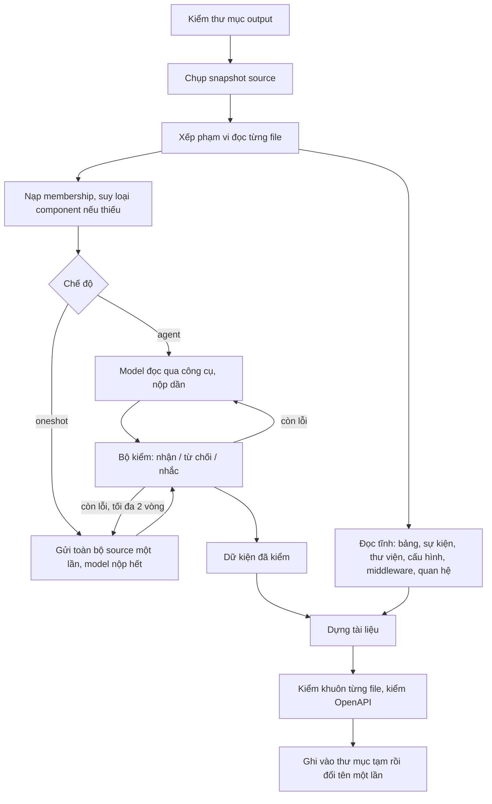

# L3 Generator — chương trình hiện tại và luồng hoạt động

Tài liệu này mô tả chương trình **đúng như code ngày 12/10/2026** (nhánh `feature/l3-fr029`, thư mục `slice/`): nó nhận gì, làm gì theo từng bước, xuất gì, chạy thế nào, đã kiểm được đến đâu. Phần sửa từ 10/10 trở đi **chưa commit**.

Khi tài liệu này khác yêu cầu chính thức (`.aide/requirements/`), yêu cầu thắng. Tài liệu cũ [L3-Generator-luong-hoat-dong.md](../L3-Generator-luong-hoat-dong.md) mô tả hướng trước 23/09, đã lỗi thời.

## 1. Chương trình làm gì

Đọc source của một repository **Python/FastAPI** và sinh **tài liệu L3** (tài liệu kỹ thuật cấp component): API, model dữ liệu, bảng CSDL, sự kiện, lời gọi ra ngoài, cấu trúc code. Mọi dòng trong tài liệu trỏ về `file:dòng` trong source làm bằng chứng.

Chương trình **không** tự chia component và **không** vẽ sơ đồ. Hai việc đó thuộc bước kiến trúc (FR-L3GEN-028); kết quả của bước đó là đầu vào ở đây.

## 2. Hai luồng trong `slice/`

| Luồng | Lệnh | Trạng thái | Cách lấy dữ kiện |
|---|---|---|---|
| **Sinh tài liệu FR-029** (luồng chính) | `python -m l3slice document`, giao diện `python -m l3slice.docweb` | Đang phát triển, dùng cho mọi phần mô tả dưới đây | Model đọc source và đề xuất dữ kiện API; code kiểm bằng chứng. Phần bảng, sự kiện, thư viện, cấu hình đọc tĩnh |
| Lát cắt cũ | `python -m l3slice analyze`, `python -m l3slice.web` | Giữ lại, không phát triển thêm | Chỉ đọc tĩnh (cây cú pháp) |

## 3. Đầu vào

| Đầu vào | Bắt buộc | Mô tả |
|---|---|---|
| Thư mục source | Có | Repository cần sinh tài liệu. Chỉ đọc, không chạy code của nó |
| `membership.json` | Có | Danh sách component do bước kiến trúc cấp. Mỗi file của source thuộc đúng một component |
| `archdia.json` | Không | Dữ liệu kiến trúc cùng snapshot, để đối chiếu tập route (AC-029-04). Hiện chỉ đọc khuôn `archdia-fixture-v1` |
| Sơ đồ Mermaid | Không | Nhúng vào README |
| Cấu hình model | Có (hoặc kịch bản offline) | `--base-url`, `--model`, `--key-env` (tên biến môi trường chứa khóa; khóa không bao giờ được ghi ra file) |
| Kịch bản offline | Thay cho model | `--script`: chạy lại các câu trả lời đã ghi, không gọi mạng. Dùng cho test và demo |

Ví dụ `membership.json`:

```json
{"components": [
  {"name": "API", "kind": "normal", "files": ["app/main.py", "app/api/items.py"]},
  {"name": "Kiểm thử", "kind": "test", "files": ["tests/test_items.py"]},
  {"name": "Khác", "kind": "other", "files": ["requirements.txt"]}]}
```

`kind` là một trong `normal`, `test`, `migration`, `other`. Thiếu `kind` thì component chỉ gồm file test hoặc migration được xếp theo phạm vi đọc, kèm ghi chú ở phần giới hạn.

## 4. Luồng hoạt động



| Bước | Việc | Code |
|---|---|---|
| 1 | Thư mục output đã có và không rỗng thì dừng ngay, trước khi tốn tiền gọi model | `docpipeline.run_documents` |
| 2 | Chụp snapshot: danh sách file, hash, nội dung. Mọi bằng chứng trỏ về snapshot này | `snapshot.py` |
| 3 | Xếp phạm vi đọc: file phân tích, manifest (`pyproject.toml`, `requirements*.txt`), hoặc loại ra (test, migration, thư mục môi trường như `venv`, `.git`) theo FR-028 | `source_tools.classify` |
| 4 | Nạp membership; kiểm mỗi file đúng một component; suy `kind` khi thiếu | `docpipeline.load_components` |
| 5 | Model đọc source và đề xuất dữ kiện (mục 5) | `docagent.run_agent`, `run_oneshot` |
| 6 | Bộ kiểm nhận từng mục có bằng chứng đúng, từ chối mục sai (kèm lý do và dòng source), và nhắc những dòng trông giống route hay lời gọi HTTP mà chưa có mục nào | `docfacts.Claims` |
| 7 | Sổ đọc: ghi dòng nào đã gửi cho model. Model chỉ được dẫn dòng đã gửi. Còn dòng chưa đọc thì không cho kết thúc | `source_tools.SourceTools` |
| 8 | Đọc tĩnh các phần không phải API: bảng CSDL, sự kiện và tác vụ nền, thư viện, khóa cấu hình, middleware, quan hệ giữa component | `docstatic.py`, `extract.py` |
| 9 | Chuyển mục đã kiểm thành dữ kiện có nhãn (chắc chắn / suy luận / chưa rõ) | `docfacts.build_facts` |
| 10 | Dựng file: API (bảng + khối OpenAPI), TBL, EVT, README, `TAI-LIEU.md`, `result.json` | `render.py`, `tailieu.py`, `docpipeline.plan_documents` |
| 11 | Kiểm khuôn từng file (bảng và khối máy cùng nội dung; OpenAPI hợp lệ). File không đạt thì không ghi, đánh `FORMAT_INVALID` | `render.check_doc`, `openapi_problem` |
| 12 | Ghi tất cả vào thư mục tạm rồi đổi tên một lần, nên không bao giờ có output dở dang. Đường dẫn quá dài với Windows thì dừng | `render._publish` |

## 5. Hai chế độ gọi model

| | `--mode agent` (mặc định) | `--mode oneshot` |
|---|---|---|
| Cách làm | Model gọi công cụ `list_files`, `read_file` (≤200 dòng/lần), `search_text`, `submit_findings`, `finish`; nộp dần từng phần | Request đầu chứa toàn bộ source có số dòng; model chỉ trả lời bằng `submit_findings`. Sau đó tối đa 2 vòng sửa, mỗi vòng chỉ gửi mục bị từ chối kèm dòng source của mục đó |
| Hợp với | Repo lớn | Repo nhỏ, vừa (source dưới `--max-context-chars`, mặc định 400.000 ký tự) |
| Số request | Nhiều (Teamhide, gpt-4.1-mini: 67 request, vẫn chưa đọc hết) | 1–3 |
| Chi phí đo được (Teamhide) | 0,218 USD, chưa xong (gpt-4.1-mini) | gpt-4.1-mini 0,024–0,033 USD nhưng 0/5 route qua bộ kiểm; gpt-5 ~0,17–0,19 USD, 4/5 route |
| Tiến độ | — | `--checkpoint file.json`: lưu sau mỗi request; chạy lại thì làm tiếp, mục đã lưu được kiểm lại |

Giao diện `docweb` hiện chỉ chạy chế độ agent.

## 6. Ai làm phần nào

Nguyên tắc (ADR-2026-006): model **đề xuất** mọi dữ kiện API, code **kiểm bằng chứng**; code không tự tạo mục API. Phần không phải API được đọc tĩnh (quyết định 11/10/2026, chưa duyệt).

| Dữ kiện | Ai đề xuất | Kiểm thế nào |
|---|---|---|
| Route: method, path đầy đủ, prefix, tham số, body, response, status, dependency, auth | Model | Dòng dẫn phải đã gửi cho model; literal phải có ở dòng đó; chuỗi prefix đúng thứ tự đăng ký; auth phải dẫn dòng có `Depends`/`Security`/lớp của `fastapi.security` |
| Lỗi trả về của route | Model | Lệnh `raise` tới được từ handler (≤3 lời gọi); mã lỗi ở dòng ném (HTTPException), hoặc `code = N` / `super().__init__(status_code=N)` trong lớp lỗi, và có `exception_handler` dùng thuộc tính đó |
| Model request/response, trường | Model | Tên trường ở dòng khai báo; kiểu, bắt buộc, null so với khai báo; không quyết được thì nhãn suy luận |
| Lời gọi HTTP ra ngoài (httpx, requests, aiohttp) | Model | Dòng có lời gọi đúng thư viện và method; URL là đối số URL |
| Vai trò file (Điểm vào, Route, Model bảng, Hạ tầng, Truy cập dữ liệu, Schema API, Cấu hình, Service, Khác) | Model | Dòng dẫn có dấu hiệu của vai trò; Service phải có đường gọi thật từ route tới dữ liệu |
| Mô tả endpoint, tags, deprecated, ví dụ | Model | Mô tả ghi nhãn "AI viết"; tags/deprecated/ví dụ phải có literal ở dòng dẫn |
| Bảng CSDL (SQLAlchemy, SQLModel, `Table(...)`) | Đọc tĩnh | — |
| Sự kiện: Kafka, FastStream, Celery, `BackgroundTasks` | Đọc tĩnh | Chỉ nối bên gửi với bên nhận khi cùng broker và cùng tác vụ |
| Thư viện, khóa cấu hình, middleware, xử lý lỗi toàn cục, quan hệ component | Đọc tĩnh | Giá trị có dấu hiệu bí mật bị che |

## 7. Đầu ra

```text
<output>/
  TAI-LIEU.md        file đọc chính cho người
  README.md          mục lục contract, cấu trúc component, lời gọi HTTP, giới hạn
  result.json        toàn bộ dữ kiện, bằng chứng, độ phủ đọc, chi phí từng request
  manifest.json      danh sách file và trạng thái
  tech-specs/<COMPONENT>/
    api/API-<SYS>-<CMP>-v1.md           bảng route + khối OpenAPI 3.1
    schema/TBL-<SYS>-<CMP>.md           bảng CSDL + khối DDL (khi biết dialect)
    events/EVT-<SYS>-<CMP>-<topic>.md   sự kiện, bên liên quan
```

Cấu trúc `tech-specs/` theo mẫu của mentor. `TAI-LIEU.md` (cách A, người dùng chọn 11/10) gom mọi thứ cho người đọc, gồm 11 mục:

1. Danh sách endpoint
2. Chi tiết từng endpoint (tham số, body, trả về, lỗi, dependency, auth, đường gọi tới dữ liệu)
3. Model dữ liệu
4. Bảng CSDL (bảng tổng quan, lớp model, cột, ràng buộc)
5. Sự kiện và tác vụ nền
6. Cấu trúc code (vai trò từng file, quan hệ giữa component)
7. Gọi HTTP ra ngoài
8. Thư viện
9. Cấu hình
10. Middleware và xử lý lỗi toàn cục
11. Chưa biết và giới hạn

Nhãn trong tài liệu:
- **chắc chắn:** đọc thẳng từ dòng code;
- **suy luận:** theo mặc định có tài liệu của framework, có tên quy tắc; trong bảng CSDL đánh dấu `*`;
- **chưa rõ:** kèm lý do;
- **AI viết:** câu chữ do model viết, không phải dữ kiện đã kiểm.

Lần chạy chưa xong vẫn xuất phần đã có, ghi `partial` và lý do.

## 8. Cách chạy

```powershell
python -m pip install -r slice/requirements.txt          # openapi-spec-validator
$env:PYTHONPATH = "slice"

# Chạy với model (khóa nằm trong biến môi trường OPENAI_API_KEY)
python -m l3slice document --source <repo> --output <thư mục mới> --membership <membership.json> `
  --base-url https://api.openai.com/v1 --model gpt-5-2025-08-07 --key-env OPENAI_API_KEY `
  --mode oneshot --max-output-tokens 12000 --checkpoint ck.json --json

# Chạy offline bằng kịch bản đã ghi (không tốn tiền)
python -m l3slice document --source slice/tests/fixtures/fr029_e2e --output <thư mục mới> `
  --membership slice/tests/fixtures/fr029_e2e.membership.json --script <kịch bản.json> --mode oneshot

# Giao diện cục bộ (http://127.0.0.1:8001/)
python -m l3slice.docweb --workdir <thư mục làm việc> --script slice/demo/fr029.script.json `
  --source slice/tests/fixtures/fr029_e2e --membership slice/tests/fixtures/fr029_e2e.membership.json
```

Exit code của `document`:

| Code | Ý nghĩa |
|---|---|
| 0 | Xong đủ |
| 3 | Có output nhưng chưa đủ (partial, thiếu đối chiếu…) |
| 2 | Đầu vào sai |
| 4 | Lỗi khi xuất |
| 130 | Người dùng dừng |

Kiểm và đo:

| Lệnh | Việc |
|---|---|
| `python -m unittest discover -s slice/tests` | Bộ test (521 test; 520 qua, lỗi `test_gateway` có từ trước) |
| `python slice/tools/fr029_checkaudit.py --out <dir>` | Đo bộ kiểm trên 37 bộ gold: nhận sai, loại sai |
| `python slice/tools/fr029_score.py --result <result.json> --gold <gold.json>` | Chấm một lần chạy với gold |

## 9. Module trong code

| File | Việc | Dòng |
|---|---|---|
| `__main__.py` | Lệnh dòng lệnh `document`, `analyze`, `retry` | 251 |
| `docpipeline.py` | Luồng FR-029 từ đầu tới cuối; TBL/EVT; đường gọi endpoint | 424 |
| `docagent.py` | Prompt, provider (OpenAI-compatible, Responses), vòng agent, chế độ oneshot, checkpoint, trần chi phí | 778 |
| `source_tools.py` | Công cụ đọc cho model, phạm vi đọc, sổ đọc, che bí mật | 228 |
| `docfacts.py` | Bộ kiểm (`Claims`) và chuyển thành dữ kiện | 2.707 |
| `astscan.py`, `pyindex.py` | Đọc cây cú pháp, phân giải tên | 707, 582 |
| `docstatic.py`, `extract.py` | Đọc tĩnh bảng, sự kiện, thư viện, cấu hình, middleware, quan hệ | 162, 1.753 |
| `render.py` | Dựng và kiểm file API/TBL/EVT/README, ghi output | 1.318 |
| `tailieu.py` | Dựng `TAI-LIEU.md` | 477 |
| `docweb.py`, `docui/` | Giao diện cục bộ cho luồng FR-029 | 219 |
| `snapshot.py` | Snapshot thư mục hoặc ZIP | 175 |
| Còn lại (`engine.py`, `web.py`, `model.py`, `verify.py`, `annotate.py`, `gateway.py`, `github.py`, `ui/`) | Lát cắt cũ | — |

## 10. Đã kiểm được đến đâu

"Đóng vai" nghĩa là agent Claude đóng vai model (không tốn tiền API). Cách này kiểm được pipeline và bộ kiểm, **không** đo được model thật.

| Phép thử | Kết quả | Ngày |
|---|---|---|
| Bộ kiểm trên 37 bộ gold | 0 nhận sai, 0 loại sai | 12/10 |
| Trường model trên gold | 0/348 bị từ chối nhầm | 12/10 |
| Đường gọi Service trên gold | 1/16 bị từ chối nhầm (hàm truyền làm tham số) | 12/10 |
| tdd-docker, đóng vai | Route 6/6, model 4/4, vai trò 9/9 so với gold | 12/10 |
| Teamhide, đóng vai | Route 5/5, cấu hình 13/13, thư viện 20/20, bảng 9/9 cột so với gold | 12/10 |
| orderflow (repo chưa dùng), đóng vai + giám khảo độc lập | Route 23/23, model 9/9 so với gold; giám khảo 202/213 mục đúng, dễ dùng 3/5 (trước khi sửa) | 12/10 |
| Bảng CSDL, 4 repo | Bảng 32/32; cột, khóa chính, khóa ngoại 341/341; giám khảo vòng 2: 285/287 cột | 12/10 |
| Model thật gpt-5, Teamhide, oneshot | 4/5 route, 0,168 USD (prompt v4; bản v6 hiện tại chưa chạy thật) | 11/10 |

Chi tiết:
- [FR029-danh-gia-heldout-orderflow-20261012.md](FR029-danh-gia-heldout-orderflow-20261012.md)
- [FR030-kiem-csdl-20261012.md](FR030-kiem-csdl-20261012.md)
- [ket-qua-chay/roleplay-20261012/](../ket-qua-chay/roleplay-20261012/README.md)

## 11. Giới hạn đã biết

- **Chưa đo lại bằng model thật** sau các thay đổi 11–12/10. Repo lớn (như kibo) chưa có chế độ chia gói; chế độ agent cho repo lớn tốn vài USD mỗi lần.
- **Đầu vào kiến trúc** (membership thật, `archdia.json`, sơ đồ) phụ thuộc FR-028. Membership gộp nhiều service thành một component làm mất quan hệ giữa service. Đối chiếu kiến trúc (AC-04) luôn "chưa đánh giá".
- **Sự kiện qua bus tự viết** (Redis pub/sub) chỉ được cảnh báo, chưa đọc bên gửi/nhận.
- **Dialect SQL** chỉ nhận khi có `create_all(engine)` với URL literal, nên phần lớn repo thật không có khối DDL.
- **Chưa có:** ràng buộc trường Pydantic (`ge`, `le`, độ dài), enum, dạng thân lỗi. Gateway chuyển tiếp request bị ghi "không có tham số".
- **Không đọc:** file ngoài Python và manifest (`docker-compose.yml`, `.env.example`, `README` của repo).
- **Spec chưa cập nhật:** `TAI-LIEU.md`, phần đọc tĩnh, lỗi trả về, tags/mô tả/ví dụ chưa được ghi vào FR-029/030/031 và ADR. Đã mở câu hỏi OQ-L3GEN-019 đến 022 (12/10), chờ người quyết.

## 12. Tài liệu liên quan

- Yêu cầu: `.aide/requirements/fr/FR-L3GEN-028.md` … `031.md`; quyết định: `.aide/architecture/adr/ADR-2026-006.md`.
- Tiến độ và việc tiếp theo: [HANDOFF.md](HANDOFF.md).
- Đầu vào/đầu ra và các phương án: [FR029-dau-vao-dau-ra-20261011.md](FR029-dau-vao-dau-ra-20261011.md).
- Hướng dẫn chạy code: [slice/README.md](../slice/README.md).
- Hướng dẫn demo: [HUONG-DAN-DEMO.md](HUONG-DAN-DEMO.md).
- Hồ sơ quy trình đợt 11–12/10: `.aide/evidence/requests/CR-L3GEN-2026-009.yaml`, `.aide/evidence/diaries/DIARY-CR-L3GEN-2026-009.md`, các task `TASK-L3GEN-029-10` … `13`, `030-1`, `031-1`.
