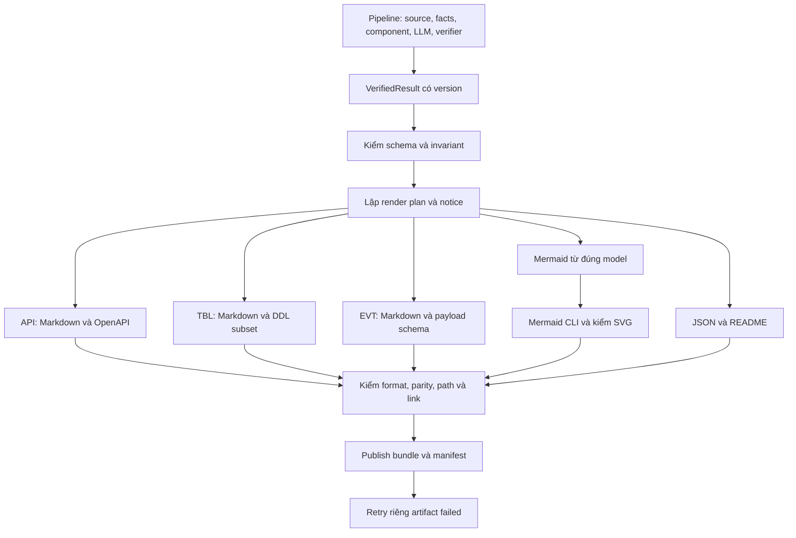

# Kế hoạch hoàn thiện code sinh tài liệu L3

Ngày nghiên cứu: **01/10/2026**. Trạng thái: **kế hoạch triển khai đề xuất**, chưa phải approval, kết quả benchmark hoặc cam kết thời hạn.

Đọc file này để biết phần code còn lại làm theo thứ tự nào, học gì từ các repo khác và kiểm thế nào mới được tính là hoàn thành. [Kế hoạch thiết kế L3](L3-Generator-ke-hoach-trien-khai-L3.md) tiếp tục giải thích các chặng thiết kế A–F; file này cụ thể hóa **công việc triển khai sau lát cắt đầu**, không tạo bộ yêu cầu cạnh tranh.

## 1. Phạm vi và mốc được kiểm

- Checkout: `D:/VSF/l3-generator-l3`, nhánh `docs/l3-align-gate2`, HEAD `5d06f14`. Code `slice/` và contract revision 4 đang là thay đổi local chưa commit tại thời điểm kiểm. Không coi HEAD trên GitLab đã chứa các file này.
- Nguồn thiết kế: [mục lục tám contract](../.aide/tech-specs/README.md), PRD r28, FR-025 r2, FR-027 r3 và L2 tương ứng trên nhánh này. Các quyết định tự review chưa phải review của người khác.
- Pipeline tham chiếu: nhánh `feature/quote-evidence`, commit `a14d32c755daa6d6bfb365e49fcfdf2c0b60115b`. `graph.json` của thí nghiệm không tự trở thành `VerifiedResult` hợp lệ.
- **D-03 vẫn mở.** Không chọn thuật toán chia component trong kế hoạch này. Renderer nhận membership đã có; fixture membership chỉ phục vụ phát triển/kiểm giao diện.
- Phần chính: CMP-008 và phần đầu vào/kiểm chứng cần thiết từ CMP-004/005/007. Web, hàng đợi, intake GitHub/ZIP và gateway LLM là phụ thuộc tích hợp của sản phẩm, không gộp tất cả vào nhiệm vụ renderer.
- Hệ thống vẫn có LLM theo thiết kế. **Bộ xuất không gọi LLM để điền trường còn thiếu hoặc khi retry**; nó dùng kết quả đã được pipeline kiểm.

### 1.1. Bằng chứng đã có

Đã chạy lại ngày 01/10 trong checkout này:

| Phép kiểm | Kết quả quan sát | Giới hạn |
|---|---|---|
| `python -m unittest discover -s slice/tests -v` | 27/27 test đạt | Fixture nhỏ; event được gán dữ kiện bằng tay; không phải accuracy trên repo thật |
| `python scripts/check_l3_contracts.py` | 8 contract, 7 JSON Schema, OpenAPI 3.1.1; 136 schema refs, 69 local links; 20 ca dương và 31 ca âm qua kiểm | Không chạy analyzer/LLM thật, full binding semantics, UI hoặc gate |

Interpreter thực dùng để tái sử dụng dependency có sẵn: `D:/VSF/l3-generator-gate2/scripts/.venv/Scripts/python.exe`; cwd vẫn là checkout `l3-generator-l3`. Một máy mới cần môi trường riêng theo `scripts/requirements-l3-check.txt`, không phụ thuộc đường dẫn máy này. Script kiểm được chạy **không có `--report`**, nên lần này không tạo báo cáo dẫn xuất mới.

Mốc byte của các file chính đã đọc (SHA-256; để phân biệt thay đổi local với HEAD):

| File | SHA-256 |
|---|---|
| `slice/l3slice/render.py` | `c73fb57d470ef02478548d0762f089443e989209816a3fbe031f09c046c5894e` |
| `slice/l3slice/extract.py` | `55711dd3dfe46d5aafe57518af46fb7875c61d4890fd757867fdf9aef14a2248` |
| `slice/l3slice/verify.py` | `6bbb4f8a5a7d816e686a6d30b2ef070c526c6602c68dba4756ae9dca2d0978f8` |
| `slice/tests/test_slice.py` | `1a3c41294150ca28f6ee22d4240eb272d922649f593d9d032e26f1dd818d1856` |

### 1.2. Đã có code và còn thiếu gì

| Phần | Đã có | Phần còn lại đáng kể |
|---|---|---|
| API | Bảng endpoint, OpenAPI subset với method/path/status, notice khi thiếu | Resolver import/alias, `include_router`, model/parameters/auth, association body–media type–status; identity nhiều lần đăng ký |
| TBL | Bảng cột, DDL subset, owner, unknown | Binding đúng model–database, kiểu có tham số, schema/table identity, constraint ngoài phạm vi, kiểm PostgreSQL/escaping |
| EVT | File ở từng bên gửi/nhận; payload schema; kiểm binding mẫu | Bộ trích event thật và nối dữ kiện từ pipeline; kiểm nhiều broker, payload conflict |
| JSON/README/Mermaid | Schema, manifest/hash, mục lục, giới hạn | Runtime validation đầy đủ, kiểm parity theo ID/loại/chiều, liên kết evidence hữu dụng |
| SVG | Artifact cố định `failed` | Runner Mermaid, kiểm đầu ra, timeout, cô lập mạng và tích hợp artifact |
| Publish/retry | Ghi staging rồi đổi tên; từ chối output không rỗng | Quyền sở hữu staging, cách ly lỗi từng artifact, retry, crash consistency và giao diện facade |
| Tích hợp | Lát cắt chạy local với membership JSON | `VerifiedResult` từ pipeline thật, capability/version được ghi nhận, chạy trên repo thật |

Ước lượng 55% trong trao đổi trước là cách chia nhóm chức năng để hình dung, **không dùng làm baseline tiến độ**. Theo dõi task và điều kiện hoàn thành bên dưới; số test pass không phải phần trăm sản phẩm hoàn thiện.

## 2. Nghiên cứu tám nguồn và quyết định áp dụng

Đã đọc README, các file triển khai và test liên quan liệt kê dưới đây tại commit đã pin. Đây là đọc sâu **phần liên quan đến sinh tài liệu**, không phải audit toàn bộ tám repository. Chưa cài/chạy các công cụ bên ngoài trong lượt nghiên cứu này; test của họ được đọc, không được báo như đã chạy trên máy nhóm.

### S1. CodeBoarding — tách analysis khỏi renderer

- Mốc: `eea883fed36a67d7fc286b7b1ffb25c21f366696`; giấy phép GitHub nhận diện MIT.
- Đọc [rendering.py](https://github.com/CodeBoarding/CodeBoarding/blob/eea883fed36a67d7fc286b7b1ffb25c21f366696/output_generators/rendering.py), [markdown.py](https://github.com/CodeBoarding/CodeBoarding/blob/eea883fed36a67d7fc286b7b1ffb25c21f366696/output_generators/markdown.py), [test_rendering.py](https://github.com/CodeBoarding/CodeBoarding/blob/eea883fed36a67d7fc286b7b1ffb25c21f366696/tests/output_generators/test_rendering.py).
- Quan sát: đọc analysis có sẵn; chọn writer theo định dạng; kiểm tên file trùng trước ghi; staging; manifest ghi những file renderer quản lý; test bảo vệ file không thuộc renderer.
- **Áp dụng:** một đầu vào cố định, render plan trước khi ghi, quản lý artifact bằng manifest, kiểm collision trên Windows.
- **Không bê nguyên:** phép roll-up/gộp cạnh theo cấp và xóa file cũ khi render lại. Nguồn hiện tại của nhóm yêu cầu cùng tập node/cạnh; retry giữ nguyên file ready. Thứ tự replace trong repo này không tự chứng minh transaction/crash safety mà nhóm cần.

### S2. CodeWiki — tài liệu chi tiết trước, tổng quan sau

- Mốc: `8a19a91e135fa68390adff5464c0cc21d400e11f`; MIT.
- Đọc [documentation_generator.py](https://github.com/FSoft-AI4Code/CodeWiki/blob/8a19a91e135fa68390adff5464c0cc21d400e11f/codewiki/src/be/documentation_generator.py), [test_overview_structure.py](https://github.com/FSoft-AI4Code/CodeWiki/blob/8a19a91e135fa68390adff5464c0cc21d400e11f/tests/test_overview_structure.py), [test_updater_write_guard.py](https://github.com/FSoft-AI4Code/CodeWiki/blob/8a19a91e135fa68390adff5464c0cc21d400e11f/tests/test_updater_write_guard.py).
- Quan sát: xử lý module từ lá lên tổng quan, kiểm file còn thiếu, dùng đường dẫn tài liệu con để giảm nội dung lặp trong context; test giới hạn vùng agent được ghi.
- **Áp dụng:** render tài liệu chi tiết theo plan, README dẫn tới đúng artifact, kiểm toàn bộ đầu ra dự kiến. Tài liệu dài vẫn có mục lục ngắn dễ đọc.
- **Không bê nguyên:** agent tự viết/sửa trang, tự thêm module hoặc tái dùng file chỉ vì file đã tồn tại. Nhóm cần hash input/version khớp và không cho renderer thay kiến trúc.

### S3. DeepWiki-Open — lifecycle và liên kết source

- Mốc: `d92819a9c9f3b99416e3580ff235fc9d3adf8b89`; MIT.
- Đọc [wiki schema](https://github.com/AsyncFuncAI/deepwiki-open/blob/d92819a9c9f3b99416e3580ff235fc9d3adf8b89/api/schemas/wiki.py), [tasks.py](https://github.com/AsyncFuncAI/deepwiki-open/blob/d92819a9c9f3b99416e3580ff235fc9d3adf8b89/api/services/wiki/tasks.py), [content.py](https://github.com/AsyncFuncAI/deepwiki-open/blob/d92819a9c9f3b99416e3580ff235fc9d3adf8b89/api/services/wiki/content.py), [test citation](https://github.com/AsyncFuncAI/deepwiki-open/blob/d92819a9c9f3b99416e3580ff235fc9d3adf8b89/tests/backend/services/test_wiki_content.py).
- Quan sát: trạng thái task và trang, retry theo trang, chuyển citation thành link theo GitHub/GitLab/Bitbucket, xử lý ký tự trong label.
- **Áp dụng:** lỗi có vị trí cụ thể; link đúng host và range; progress do facade quản lý.
- **Không bê nguyên:** regex tạo được URL chưa chứng minh source tồn tại/đúng; basename có thể trùng. Link của nhóm phải xuất phát từ evidence ID và snapshot đã kiểm, pin commit thay vì branch di động. Retry render không được gọi lại LLM như retry sinh wiki.

### S4. RepoDoc — chia pipeline thành các bước

- Mốc: `306becd0f143211c0dde2bdbd480578356280e28`.
- Đọc [README](https://github.com/SYSUSELab/RepoDoc/blob/306becd0f143211c0dde2bdbd480578356280e28/README.md), [generator.py](https://github.com/SYSUSELab/RepoDoc/blob/306becd0f143211c0dde2bdbd480578356280e28/repodoc/pipeline/generator.py), [pyproject.toml](https://github.com/SYSUSELab/RepoDoc/blob/306becd0f143211c0dde2bdbd480578356280e28/pyproject.toml).
- Quan sát: tách analyze/cluster/docs/update; lưu metadata và danh sách file. Nhánh vẽ sơ đồ giới hạn danh sách component/dependency, có fallback diagram; wrapper bắt lỗi từng bước.
- **Áp dụng:** các bước có đầu vào/đầu ra rõ, lưu version và kết quả từng bước.
- **Không bê nguyên:** cắt graph, dùng fallback làm mất quan hệ, hoặc suy thành công từ việc pipeline không ném exception. Phần mã đã đọc có log success cuối luồng sau các wrapper có thể trả lỗi; nhóm phải dựa trên manifest thực tế.
- GitHub API trả `license: null` ở lần kiểm; chưa xác định quyền sao chép. Chỉ tham khảo phương pháp, không đưa source RepoDoc vào sản phẩm trong kế hoạch này.

### S5. Mermaid CLI — ứng viên dùng trực tiếp cho SVG

- Mốc: `f416ac5c6e42edd3a8be6d512c1008520d0c2f97`; MIT.
- Đọc [README](https://github.com/mermaid-js/mermaid-cli/blob/f416ac5c6e42edd3a8be6d512c1008520d0c2f97/README.md), [src/index.js](https://github.com/mermaid-js/mermaid-cli/blob/f416ac5c6e42edd3a8be6d512c1008520d0c2f97/src/index.js), [test.js](https://github.com/mermaid-js/mermaid-cli/blob/f416ac5c6e42edd3a8be6d512c1008520d0c2f97/src-test/test.js), [package.json](https://github.com/mermaid-js/mermaid-cli/blob/f416ac5c6e42edd3a8be6d512c1008520d0c2f97/package.json).
- Quan sát: chuyển `.mmd` thành SVG/PNG/PDF, dùng Puppeteer/browser, có test input sai và nhiều định dạng. Package tại commit ghi `12.0.0`, Node `>=22.13.0`; đây không phải xác nhận release npm này đã được thử.
- **Áp dụng:** thử CLI qua adapter do nhóm kiểm soát, pin package/browser/font/config sau thử nghiệm. Runtime không tải package động.
- **Không mặc định:** engine renderer là sandbox hoàn chỉnh, có cùng byte SVG giữa mọi máy, hoặc cấu hình từ repo đầu vào đáng tin. Các điều này cần test riêng tại G6.

### S6. OpenAPI Generator — học cấu trúc template, chưa đưa runtime vào sản phẩm

- Mốc: `ea65d43d9bd997867a536b09799195810b7d88a4`; Apache-2.0. Tree API trả truncated; chỉ kết luận trên những file tải trực tiếp, không tuyên bố đã kiểm toàn repo.
- Đọc [MarkdownDocumentationCodegen.java](https://github.com/OpenAPITools/openapi-generator/blob/ea65d43d9bd997867a536b09799195810b7d88a4/modules/openapi-generator/src/main/java/org/openapitools/codegen/languages/MarkdownDocumentationCodegen.java), [api.mustache](https://github.com/OpenAPITools/openapi-generator/blob/ea65d43d9bd997867a536b09799195810b7d88a4/modules/openapi-generator/src/main/resources/markdown-documentation/api.mustache), [sample test](https://github.com/OpenAPITools/openapi-generator/blob/ea65d43d9bd997867a536b09799195810b7d88a4/modules/openapi-generator/src/test/java/org/openapitools/codegen/markdown/MarkdownSampleGeneratorTest.java).
- Quan sát: tách trang API/model/index; generator Markdown đánh dấu BETA trong mã đã đọc. Template mặc định diễn giải thiếu auth thành `No authorization required`, thiếu return type thành `null (empty response body)`.
- **Áp dụng:** bố cục endpoint/parameter/response và cách tổ chức writer.
- **Không dùng nguyên template:** thiếu bằng chứng trong sản phẩm không có nghĩa không auth/không body. Tiếp tục renderer Python với FieldValue và notice; generator ngoài chỉ có thể là công cụ so sánh định dạng trên spec đầy đủ, không là oracle correctness.

### S7. AsyncAPI Generator — schema trước, template sau

- Mốc: `a1f05260d53f0703bc45aff6ec4fadacc1dd7eed`; Apache-2.0.
- Đọc [generator.js](https://github.com/asyncapi/generator/blob/a1f05260d53f0703bc45aff6ec4fadacc1dd7eed/apps/generator/lib/generator.js), [parser.js](https://github.com/asyncapi/generator/blob/a1f05260d53f0703bc45aff6ec4fadacc1dd7eed/apps/generator/lib/parser.js), [parser.test.js](https://github.com/asyncapi/generator/blob/a1f05260d53f0703bc45aff6ec4fadacc1dd7eed/apps/generator/test/parser.test.js).
- Quan sát: parse/diagnostics, tương thích phiên bản parser/template, hooks và ghi file. Resolver có kiểm đường dẫn thoát base và symlink trong trường hợp URL được ánh xạ vào folder.
- **Áp dụng:** kiểm payload schema trước render, test resolver không đọc ngoài vùng, version rõ ràng.
- **Chưa tích hợp runtime:** EVT hiện là Markdown + JSON Schema, không phải AsyncAPI document đầy đủ. Không thêm AsyncAPI chỉ để dùng thư viện; nếu cần sau này, làm adapter riêng và đánh giá mất/đổi semantics send/receive. Không chạy template/hook lấy từ repository đầu vào.

### S8. tbls — cách trình bày bảng và kiểm escape

- Mốc: `aa7e7326b3555205148c20cd4702ccdacf9af7c4`; MIT.
- Đọc [schema.go](https://github.com/k1LoW/tbls/blob/aa7e7326b3555205148c20cd4702ccdacf9af7c4/schema/schema.go), [md.go](https://github.com/k1LoW/tbls/blob/aa7e7326b3555205148c20cd4702ccdacf9af7c4/output/md/md.go), [table template](https://github.com/k1LoW/tbls/blob/aa7e7326b3555205148c20cd4702ccdacf9af7c4/output/md/templates/table.md.tmpl), [pipe-escape test](https://github.com/k1LoW/tbls/blob/aa7e7326b3555205148c20cd4702ccdacf9af7c4/output/md/md_pipe_escape_test.go).
- Quan sát: tách schema khỏi formatter, bảng cột/constraint/quan hệ, test dấu `|` làm vỡ số ô Markdown.
- **Áp dụng:** presenter riêng cho TBL, escape mọi ô, dẫn chiếu bảng liên quan khi có fact hợp lệ.
- **Không bê nguyên:** kết nối DB để suy schema hoặc chạy source/migration. Nhóm đọc source tĩnh; DDL là subset có nhãn, không được chứng nhận tái tạo DB. Các mục default/index/trigger của tbls không tự thành scope của nhóm.

**Quyết định dependency:** thử dùng trực tiếp Mermaid CLI; các nguồn khác chủ yếu học cách tổ chức và test. Giữ renderer hiện có, không thay toàn bộ bằng wiki generator. Nếu sau này sao chép mã/template MIT/Apache, lưu nguồn commit, license/notice tương ứng; hiện chưa sao chép mã của họ.

## 3. Kiến trúc triển khai được đề xuất



1. `VerifiedResult` là dữ liệu bất biến; renderer không đọc lại source để suy dữ kiện, không đổi membership/owner/cạnh.
2. `RenderPlan` là cấu trúc nội bộ đề xuất: danh sách artifact/đường dẫn/owner/fact IDs/phụ thuộc/notice và phiên bản. Không thêm trường vào contract công khai chỉ để tiện code.
3. Mỗi writer trả nội dung cùng coverage map theo fact/field ID. Bộ kiểm so bảng và khối máy từ map, không chỉ đếm dòng hoặc tìm substring.
4. Notice biểu diễn được tính trước publish và đóng băng với `result.json`; lỗi vận hành vào `artifact.error`. README không ghi một bản trạng thái artifact có thể lỗi thời sau retry; trạng thái tải thực tế lấy từ manifest.
5. Một run chỉ có một thao tác ghi, do CMP-001 điều phối. Không tạo scheduler thứ hai trong renderer.
6. Ranh giới hiện hành: cùng tập component/cạnh ở các artifact; >50 node bị từ chối, không cắt/roll-up. Mỗi API file một khối OpenAPI; route trùng method/path thì giữ bảng và omit operation có notice. Mở rộng khác cần đổi nguồn trước.

### Cấu trúc code dự kiến — tách dần khi sửa chức năng

```text
slice/l3slice/
  render.py                 # giữ facade cũ, ủy quyền cho các module bên dưới
  rendering/
    plan.py                 # artifact plan, slug, dependencies, notices
    api.py                  # endpoint tables + OpenAPI subset
    tables.py               # TBL + DDL catalogue
    events.py               # EVT + payload schema
    overview.py             # README, evidence references
    diagrams.py             # Mermaid deterministic
    svg.py                  # runner có giới hạn + kiểm SVG
    validation.py           # schema, format, parity, links
    publish.py              # staging, manifest, retry transaction
  adapters/
    verified_result.py      # adapter đầu vào đã thỏa contract, không bịa facts
  extract.py / verify.py    # mở rộng theo phần được giao, không nhân đôi engine
slice/tests/
  test_slice.py             # giữ smoke test xuyên luồng hiện tại
  test_api.py / test_tables.py / test_events.py
  test_publish.py / test_svg.py / test_parity.py / test_input_contract.py
  fixtures/                 # thêm ca đúng phạm vi, membership đánh dấu fixture
```

Các đường dẫn mới là **đề xuất sẽ tạo**, không phải code đã tồn tại. Chưa đổi package sang một backend khác cho tới khi thống nhất nơi tích hợp; facade hiện tại giúp giữ 27 test làm regression.

## 4. Các chặng code còn lại

G0–G8 là mã task của kế hoạch này, không phải mã gate/FR mới. Mỗi chặng đi đến output và test có thể review; không đợi trích hết mọi framework mới bắt đầu renderer.

### G0 — Ghi nhận phạm vi và baseline chạy lại được

**Việc làm**

- Chụp trạng thái local bằng commit dành riêng cho công việc được chọn khi có yêu cầu commit; không `git add .` hoặc lẫn file không thuộc đợt bàn giao.
- Tách trong checklist: code đã có, contract đã viết, test đã chạy, và nghiệm thu chưa chạy. Giữ decision D-03 mở.
- Đồng bộ ghi chú cũ trong kế hoạch thiết kế: đoạn nói chỉ có JSON fixture đã lỗi thời so với `slice/`; phần nói owner còn chờ không phản ánh revision 4. Chỉ sửa ghi chú trạng thái, không sửa approval lịch sử.
- Tạo hướng dẫn bootstrap môi trường riêng và lệnh test, ghi Python/dependency version. Không mặc định parser hiện tại đọc được mọi phiên bản Python.

**File:** `slice/README.md`, kế hoạch thiết kế, test manifest môi trường dự kiến. **Xong khi:** máy khác dựng lại được 27 test hiện có; snapshot tài liệu/code được ghi rõ. Số test này chỉ là mốc hồi quy.

### G1 — Khóa giao diện bàn giao và sửa kiểm dữ kiện trước khi mở rộng

**Phối hợp:** người làm renderer đề xuất; người làm pipeline cung cấp và xác nhận input. Đây là thống nhất interface, không giao toàn bộ pipeline cho người viết tài liệu.

1. Lập mapping theo trường `graph.json`/output engine → `VerifiedResult`: identity, facts, evidence, owner, node/cạnh, verdict, limitations, versions. Thiếu facts route/table/event phải được trích thêm; không tạo fact/evidence/accepted decision giả để đủ schema.
2. Chọn một bộ input từ source đã pin làm ca tích hợp đầu tiên. Nếu mới có membership fixture, ghi rõ đó là fixture; chưa gọi là pipeline tích hợp hoàn tất.
3. Kiểm ở runtime trước render: schema version, uniqueness, snapshot, FK giữa fact/model/evidence/owner, kind của thuộc tính, giới hạn model. Thiếu field bắt buộc là lỗi contract, không tự đổi thành `unknown`.
4. Nâng verifier: tìm một literal trong đoạn code chỉ là kiểm sơ bộ. Giá trị `status`, kiểu/cờ cột, broker/action/payload và owner phải gắn đúng AST node/rule, loại và field tương ứng. Có chữ `200` trong comment không chứng minh response `200`.
5. Bộ trích hiện nhận `FastAPI`, `Column`, `create_engine` theo tên cuối; cần resolve import/alias và shadowing trong pattern được hỗ trợ. Dialect không được gán cho mọi bảng chỉ vì snapshot có duy nhất một `create_engine`; phải có binding được chứng minh hoặc để unknown.
6. Body association còn thiếu trong API-004: đề xuất các binding request/response liên kết model ID, media type, status và evidence/rule. Kiểu cụ thể phải đưa vào spec trước khi dùng; không gán toàn bộ response models cho mọi status. Auth tương tự: biết có dependency chưa đủ để tạo security scheme.
7. Chốt nguồn provenance của giá trị suy theo rule/default. Nếu schema chưa biểu diễn được thì sửa draft/version và consumer cùng lúc; không hạ chuẩn kiểm để vượt schema.

**File:** API-004/005/007/008 khi cần, `adapters/verified_result.py`, `verify.py`, resolver của pipeline hoặc `extract.py` theo phân công. **Nguồn học:** S1, S3, S7. **AC:** 021, 023, 025-02, 027.

**Xong khi:** fixture hợp lệ qua runtime checks; input sai bị từ chối trước I/O; cùng literal ở sai vị trí không được accepted; có một input thật đối chiếu được từ pipeline hoặc ghi chặng còn blocked. Các writer vẫn được phát triển bằng fixture khi input thật chưa có.

### G2 — Tách bộ xuất và làm chặt parity, path, evidence

1. Tách `render.py` từng phần, giữ API gọi cũ; lập plan toàn bộ path trước khi ghi. Kiểm collision không phân biệt hoa/thường, tên reserved Windows, Unicode, độ dài và dấu phân cách.
2. Có coverage map cho từng fact/field: đã trình bày, omitted có lý do, hoặc chưa có owner được liệt kê trong README/JSON. Không đánh dấu xong chỉ vì fact ID xuất hiện trong chuỗi.
3. Kiểm tập ID và cạnh `(source, target, relation_type)`; count bằng nhau vẫn có thể sai đích/đảo cạnh. Mermaid dùng token từ ID, không dùng tên hiển thị làm identity.
4. README gồm phạm vi hỗ trợ, danh sách contract, fact chưa gán owner, unknown và notice; không trộn limitation upstream với lỗi render.
5. Evidence có `path:range`, snapshot/hash và ID. Chỉ tạo link web khi có repo URL + commit + path phù hợp snapshot; ZIP/local không bịa GitHub link hoặc URL máy tác giả. Hash gốc không bị thay bằng hash đoạn đã redacted.
6. Escape riêng cho Markdown cell, code fence, HTML, Mermaid label và path. Test `|`, backtick/fence, newline, quote, Unicode và HTML/script.

**File:** `rendering/plan.py`, `overview.py`, `validation.py`, `diagrams.py`; facade `render.py`. **Nguồn:** S1, S2, S3, S8. **AC:** 023-01, 025-02/04, 027.

**Xong khi:** đầu ra cũ vẫn hợp lệ; sửa cố ý một cạnh/owner/field làm phép kiểm thất bại; file ẩn ngoài plan và đường dẫn thoát vùng đều bị từ chối. Parser/validator offline không theo remote `$ref`.

### G3 — API đầy đủ hơn, đi theo một request cụ thể

1. Làm một luồng FastAPI `include_router` có import và prefix tĩnh → registration fact → owner → bảng API/OpenAPI. Identity gồm application và từng lần đăng ký, không chỉ handler hay method/path.
2. Thêm path/query/header/cookie parameters trong pattern đã chốt. Body không nhét vào enum vị trí parameter hiện hành; dùng body binding của G1.
3. Trích request/response models với kiểu cơ bản, nested/ref trong registry, required/nullable khác nhau. Cú pháp/validation động ngoài adapter giữ partial.
4. Dùng mapping model–media type–status có evidence để sinh `content`; không mặc định JSON hay `200`. Default framework chỉ áp khi rule/version được công bố và kiểm được.
5. Một file API vẫn một khối OpenAPI theo r4. Cùng method/path từ hai application: giữ cả dòng, omit cả operation xung đột kèm notice; không tự thêm server/prefix giả.
6. Giá trị thiếu auth không được trở thành `security: []` hay câu “không cần xác thực”. Model/type chưa biết không thành response null.

**File:** resolver/extractor, `rendering/api.py`, schema fixture và test API. **Nguồn:** S6, nhưng không dùng mặc định template. **AC:** 021-01/05, 027-01.

**Xong khi:** một route có body thực trích từ source tới khối OpenAPI được validator 3.1 kiểm; test mount hai lần, alias, prefix động, optional/nullable, response nhiều status và trùng path. Bảng phải chứa registration context/parameters hoặc phần mô tả tương ứng, không chỉ khối máy.

### G4 — TBL/DDL theo catalogue, không dựng database của repo

1. Chứng minh model thuộc engine/database nào; không suy từ vị trí gần nhau. Ghi rõ thiếu database/schema identity và constraint ngoài khả năng đọc.
2. Hoàn thiện `ddl-core-v1`: SQLite/PostgreSQL và kiểu tham số đã có trong API-008. `String(n)`/`Numeric(p,s)` giữ tham số nếu rule chứng minh; không đổi về kiểu khác rồi báo đầy đủ.
3. Kiểm PK/FK/nullable và target identity; giữ unknown khác false/not_applicable. `schema.table.column`, compound key hoặc construct ngoài catalogue phải có lý do rõ, không cắt chuỗi để đoán.
4. Không thêm DEFAULT/index/trigger thành yêu cầu mới. Bảng thiếu dữ kiện bắt buộc hoặc constraint không biểu diễn được giữ bảng mô tả, bỏ cả bảng khỏi DDL và có notice theo r4.
5. Escape identifier theo dialect, test quote/control và tên trùng; cột giữ thứ tự mang nghĩa. Không import SQLAlchemy model, mở DB của người dùng hoặc chạy DDL source.
6. Kiểm DDL bằng parser phù hợp dialect trong test; đánh giá dependency trước pin. Parser chỉ kiểm cú pháp, parity vẫn so cấu trúc và facts; không dùng “parse được” để chứng minh đúng DB.

**File:** extractor, `rendering/tables.py`, `test_tables.py`. **Nguồn:** S8. **AC:** 021-02, 027-02.

**Xong khi:** bộ fixture hai dialect kiểm đúng type/PK/FK/unknown; biến một kiểu/FK trong output thành sai phải bị phát hiện; missing table được tính là thiếu, không chỉ kiểm bảng đã ghép được.

### G5 — EVT với dữ kiện thật, không chỉ event fixture

1. Chốt client Kafka/pattern nằm trong ma trận hỗ trợ; triển khai hoặc nhận adapter tương ứng từ pipeline. Không cam kết mọi thư viện Kafka.
2. Trích call site gửi/nhận, topic, broker/config binding, namespace/serialization context và payload schema trong phạm vi. Giá trị động/secret được unknown/redacted đúng contract.
3. Dùng contract owner từ CMP-005; chỉ công bố bên còn lại khi CMP-007 chấp nhận liên kết. Trùng topic nhưng khác broker/thiếu binding không ghép.
4. Giữ file ở từng bên gửi/nhận; chỉ thấy bên nhận vẫn có tài liệu. Trong cùng owner, chỉ gom các fact có đủ channel identity giống nhau. Payload conflict giữ riêng theo fact và có cảnh báo.
5. Sinh JSON Schema 2020-12; required/nullable/additionalProperties chỉ khi có chứng cứ. Không tạo event example giả để trang trông đầy đủ.

**File:** adapter event ở pipeline/extractor, `verify.py`, `rendering/events.py`, test nguồn thật nhỏ. **Nguồn:** S7. **AC:** 021-03, 023-04, 027-03.

**Xong khi:** ít nhất một mẫu source publish/consume được trích tự động tới EVT; test receiver-only, khác broker, topic động, payload conflict và schema sai. Không dùng test event soạn tay để đóng task extractor.

### G6 — Thay SVG failed bằng renderer thật

1. Thử Mermaid CLI trên Windows và môi trường CI dự kiến; ghi package/browser/Node/font/config. Chỉ pin phiên bản sau khi chạy được; không cài `latest` mỗi lần người dùng phân tích.
2. Runner nhận `.mmd` đã sinh và config của ứng dụng; không nhận lệnh shell, config/init directive/CSS/icon URL từ repository. Gọi process bằng argument list, không ghép chuỗi shell từ label/path.
3. Hạn thời gian và tài nguyên nằm trong ngân sách run còn lại; chốt con số tại task tích hợp theo NFR, không tự tăng ngân sách. Timeout phải dừng cả process browser con.
4. Kiểm cô lập request mạng: chỉ tài nguyên render đã đóng gói được dùng; fixture cố chèn URL không tạo request ra ngoài. SVG kiểm XML/allowlist, bỏ hoặc từ chối script/event handler/link ngoài trước công bố; không coi `securityLevel` là đủ mọi kiểm.
5. Hash/bytes tính trên SVG cuối cùng sau xử lý. Nếu bản SVG đã sanitize không giữ parity cần thiết thì failed, không công bố hình thiếu node như thành công.
6. Test deterministic cùng version/cấu hình trên môi trường pin. Giữ byte của artifact ready khi retry; không hứa SVG byte-identical giữa mọi OS/browser/font nếu chưa chứng minh.

**File:** `rendering/svg.py`, manifest môi trường renderer dự kiến, `test_svg.py`. **Nguồn:** S5. **AC:** 025-01/03/04, SEC-002.

**Xong khi:** có SVG thật đọc được, đủ node/cạnh; input Mermaid sai, binary thiếu, timeout và output không hợp lệ chỉ làm SVG failed với lỗi đúng. JSON/Markdown hợp lệ vẫn xuất được. Không chỉ mock lệnh thành công.

### G7 — Publish an toàn, lỗi một file không phá cả bộ, retry đúng run

1. Thay tên staging đoán trước `<output>.staging` bằng staging riêng có ownership; code hiện xóa staging có sẵn cần sửa trước khi dùng rộng. Không xóa thư mục của người dùng chỉ vì trùng hậu tố.
2. Trước ghi/xóa/move, kiểm path tuyệt đối vẫn ở output root được cấp, không symlink/junction thoát vùng. Vùng staging cùng filesystem để commit bằng rename; cleanup chỉ đụng vùng do run tạo.
3. Phân biệt lỗi input/parity/JSON nền tảng làm hỏng cả bộ với lỗi định dạng/I/O riêng từng artifact. Lập manifest có cả artifact failed; không ghi “ready” trước khi byte/hash được xác nhận.
4. Retry target failed: xác nhận input/version/dependency/expiry → kiểm hash file ready → render target vào staging riêng → kiểm lần nữa → install target → thay manifest sau cùng.
5. `result.json`, slug map, notice, snapshot, renderer/template version và mọi file ready giữ nguyên. Không gọi analyzer/LLM, lấy source mới, gia hạn run hoặc đổi error semantic thành một fact mới.
6. Facade giữ single writer; retry trùng được điều phối tại CMP-001. Renderer nhận quyền run/deadline/expiry, không tạo queue/retention riêng. Web expiry 24 giờ theo contract; CLI output do người dùng giữ.
7. Fault injection ở từng điểm commit: trước install, sau install trước manifest, replace manifest thất bại, hết đĩa, permission, shutdown, expiry giữa retry. Reader chỉ phục vụ đúng manifest đã pin; file lẻ chưa được manifest công nhận không được tải.

**File:** `rendering/publish.py`, facade integration seam, tests publish/retry. **Nguồn:** S1/S3 để tham khảo; transaction nhóm phải kiểm riêng. **AC:** 025-03, REL/SEC và API-008 §7.

**Xong khi:** một SVG lỗi được retry thành ready; SHA-256 mọi artifact ready cũ và `result.json` không đổi; crash không công bố bộ nửa vời; output/staging ngoài quyền không bị sửa. Fake clock/facade phục vụ unit test chưa thay test HTTP tích hợp.

### G8 — Tích hợp thực tế và bàn giao đúng mức đã chứng minh

1. Chạy một repository thật đã pin commit trong phạm vi hỗ trợ, dùng đầu vào từ pipeline; lưu mapping đầu vào và artifact. LLM upstream có chạy hay không phải ghi đúng; renderer không tự gọi bù.
2. Người review kiểm từng API/TBL/EVT của lát cắt chọn trước: đúng owner, field, source range, notice và khối máy. Không chọn riêng trang đẹp sau khi chạy.
3. Mở rộng tới một repo cấu trúc khác và một repo có partial/unsupported rõ; chọn từ danh mục dữ liệu đã thống nhất hoặc thêm candidate có lý do. Đây là kiểm tích hợp; không tự biến ba repo thành bộ nghiệm thu độ đúng nếu OBS/gold chưa thỏa.
4. Kiểm entrypoint sản phẩm thực tế gọi renderer, tải artifact và lỗi/hết hạn. Nếu facade chưa sẵn sàng, báo “renderer integration ready”, không báo web hoàn thiện.
5. Tạo hướng dẫn chạy trên máy sạch, dependency lock, input/output sample đã làm sạch, lệnh tái lập và report: commit + local diff/hash nếu có, môi trường, command, exit code, log, artifact checksum, test outcome và lỗi còn mở.
6. Trạng thái `passed`, `failed`, `not_run`, `blocked` tách riêng. Không ghi tỷ lệ accuracy hoặc nghiệm thu full NFR từ fixture/test cấu trúc. Phần đánh giá chất lượng dùng OBS và quy trình gold riêng.

**File:** `slice/README.md`, test integration, báo cáo dự kiến dưới `docs/l3-export-evidence/<run-id>/` nếu phù hợp quy ước repo. Không commit source khách hàng, key, dependency cache, browser binary hay bộ output lớn không cần review.

**Xong khi:** thành viên khác tái lập được bộ tài liệu trên input đã pin và hiểu giới hạn; các lỗi chặn bên dưới đã đóng; phạm vi chưa chạy được công bố rõ. Đây mới là căn cứ báo mức hoàn thiện.

## 5. Thứ tự, phụ thuộc và thời gian

| Chặng | Ngày công tập trung ước lượng | Phụ thuộc chính |
|---|---:|---|
| G0 | 0,5–1 | Code/contract hiện tại |
| G1 | 1–2 | Input pipeline, quyết định schema/field provenance |
| G2 | 1–2 | G1 contract đủ rõ; có thể dùng fixture |
| G3 | 2–4 | G1/G2 và adapter FastAPI |
| G4 | 1,5–3 | G1/G2 và model–database binding |
| G5 | 1,5–3 | G1/G2, Kafka pattern được chốt |
| G6 | 1–2 | G2; runtime Mermaid có thể dựng được |
| G7 | 2–3 | G2; G6 cung cấp artifact retry thật; facade seam |
| G8 | 2–4 | Các phần đã cam kết, pipeline/facade thực tế |
| **Tổng** | **12,5–24 ngày công** | Chưa tính chờ input/review hoặc mở rộng framework |

Đây là ước lượng triển khai đề xuất cho một người, độ bất định cao; cập nhật sau G1 và ca repo thật đầu tiên. Không lấy khung 5–9,5 ngày soạn spec của kế hoạch cũ làm thời gian code. Không hứa hoàn thành toàn bộ trước deadline cũ nếu capacity không đủ.

**Nhịp làm:** G0 → G1 → G2 → một phần G3 tạo API từ source thật → G6 để có SVG → G7 để retry → G4/G5 mở rộng → G8. Có thể làm mẫu renderer độc lập khi đang chờ upstream; không dùng thời gian chờ để tự quyết D-03.

Nếu timebox ngắn, bàn giao sớm **technical slice**: một route có body + một bảng có evidence, SVG, manifest và retry trên một input thật. Event chưa trích xong phải ghi chưa xong; không âm thầm bỏ FR-027-03 khỏi cam kết cuối.

## 6. Ai làm phần nào và tránh nhân đôi pipeline

| Công việc | Trong phần sinh tài liệu | Phụ thuộc cần phối hợp |
|---|---|---|
| Plan/writer/format/parity/manifest/retry | Người triển khai L3 làm trực tiếp | CMP-001 cấp run context/lock/expiry |
| Trích route/model/table/event | Có thể làm adapter nhỏ để thử luồng | Thống nhất với pipeline để chỉ có một nguồn facts chuẩn |
| Owner và kiểm field/binding | L3 ghi yêu cầu đầu vào, có test đối chiếu | CMP-005/007 tạo và kiểm; renderer không tự gán lại |
| Component và LLM | Renderer chỉ dùng output đã kiểm | D-03, provider/budget và model pipeline do phần kiến trúc/pipeline xử lý |
| Web download/evidence viewer | Cung cấp artifact/error contract | Facade/UI tích hợp; không coi mock consumer là UI đã chạy |

Không cần chờ hoàn thiện toàn bộ sản phẩm mới code renderer. Tuy nhiên chỉ được gọi tích hợp xong khi upstream thực sự cấp đủ contract, không chỉ có câu “sau này sẽ chuyển đổi”.

## 7. Ma trận test tối thiểu cho phần còn lại

| Nhóm | Ca bắt buộc | Loại kiểm |
|---|---|---|
| Input | Sai version/snapshot, duplicate ID, dangling reference, owner sai, field thiếu khác unknown | Runtime negative test |
| API | Alias/shadowing; mount hai lần; prefix động; hai app cùng path; body nhiều status; auth thiếu | Source → facts → output + schema/parity |
| TBL | Hai engine; kiểu tham số; FK không rõ namespace; compound key; identifier có quote/pipe | Source → facts, parser DDL, parity |
| EVT | Source gửi/nhận thật; topic trùng khác broker; receiver-only; payload conflict/unknown | Adapter + verifier + renderer |
| Evidence | Literal đúng nhưng sai node/field; comment chứa giá trị; path/hash/range sai | Semantic rule test, không chỉ substring |
| Diagram | 0/1/50/51 node; cạnh đảo hướng/cùng count; tên trùng, Unicode, input phá cú pháp | Model parity + render SVG thật |
| File | Tên reserved/traversal/collision, output/staging không thuộc run, không có quyền ghi | Filesystem integration trong thư mục test cô lập |
| Retry | Dependency failed, version thiếu, ready không render lại, expiry, crash từng bước | Fault injection + immutable hashes |
| Link/format | Hai file cùng basename, commit khác snapshot, pipe/fence/HTML, remote ref | Offline validation + xem mẫu Markdown/SVG |
| Sản phẩm | Input pipeline thật, máy sạch, chạy offline bộ xuất, không gọi LLM khi retry | Integration và kiểm thao tác người dùng |

Đầu ra kỳ vọng được review từ contract/source, không tự lấy output hiện tại làm đáp án rồi khóa snapshot test. Snapshot/golden-file ở đây kiểm hồi quy định dạng, không thay golden dataset đánh giá architecture.

## 8. Điều kiện bàn giao và những lỗi không được bỏ qua

**Được gọi là bộ sinh tài liệu hoàn thiện trong phạm vi đã chốt khi:**

- Có đủ loại artifact áp dụng cho input; không tạo file giả khi repo không có loại dữ kiện đó. Artifact bắt buộc lỗi được công bố, không báo completed giả.
- API/TBL/EVT đều có ca từ dữ kiện trích tự động; EVT bằng tay không đủ nghiệm thu end-to-end.
- Khối máy hợp lệ và cùng nghĩa với bảng trong phạm vi đã công bố; omission/unknown có lý do và coverage.
- Fact, owner, evidence, snapshot và phiên bản nhất quán; cùng tập node/cạnh theo nguồn hiện hành.
- SVG có renderer thật; retry giữ nguyên input và artifact ready; filesystem và download theo đúng vùng/quyền/expiry.
- Có bằng chứng integration trên source thật, hướng dẫn tái lập và checklist FR/AC cụ thể. Kết quả NFR/accuracy chỉ công bố khi phép đo tương ứng đủ điều kiện.

**Lỗi chặn bàn giao:** bịa body/status/auth/DDL; ghép event chỉ vì tên topic; cho literal/comment làm bằng chứng ngữ nghĩa; mất contract không notice; render đổi membership/cạnh; ghi hoặc xóa ngoài vùng; retry thay facts; schema pass nhưng link/fact không tồn tại; báo tính năng chưa chạy là passed.

## 9. Chia thay đổi để thành viên review được

Các nhóm MR đề xuất, không phải nhánh đã tạo:

1. Baseline + input checks + adversarial fixtures (G0/G1).
2. Render plan, module writers, parity và link/path tests (G2).
3. FastAPI/body association xuyên luồng (G3), kèm thay đổi spec nếu có.
4. TBL/catalogue/binding tests (G4).
5. Event extraction tới EVT (G5).
6. SVG runner và integration tests (G6).
7. Publish/retry/fault injection (G7).
8. Input thật, báo cáo giới hạn, bootstrap và bàn giao (G8).

Mỗi MR gồm vấn đề, phạm vi, FR/AC liên quan, before/after bằng input nhỏ, lệnh test thực chạy và hạn chế. Không trộn lại các quyết định đã duyệt hoặc source của tám repo tham khảo vào cùng MR. Thay đổi contract có consumer phụ thuộc phải đi cùng migration/example; không đánh dấu task done chỉ vì đã viết kế hoạch.

## 10. Trạng thái sau lượt nghiên cứu này

- [x] Đọc phần renderer/schema/test liên quan của tám nguồn tại commit cụ thể.
- [x] Đối chiếu source local và chạy lại 27 test slice, bộ kiểm contract.
- [x] Lập kế hoạch G0–G8, mapping file/AC, test, dependency và effort.
- [ ] Chạy thử Mermaid CLI trong môi trường nhóm và chọn version.
- [ ] Triển khai các task còn lại.
- [ ] Chạy pipeline thật, review chéo, đo NFR và nghiệm thu.

Lượt này chỉ tạo kế hoạch và liên kết đọc; không cài thêm runtime, không gọi LLM, không thay component algorithm, không commit/push và không tuyên bố đã hoàn thành phần code còn lại.
