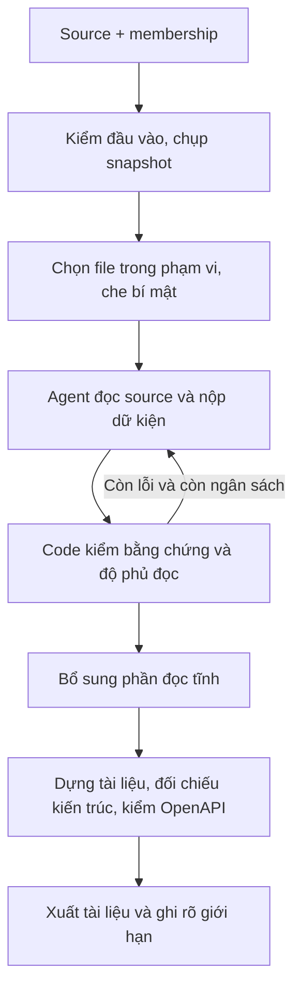

# L3 Generator: luồng hoạt động và cấu hình

Bản đọc nhanh ngày **12/10/2026**, tổng hợp từ [HANDOFF.md](HANDOFF.md) và đối chiếu code tại máy. Đây là tài liệu riêng; không thay đổi nội dung bàn giao gốc.

## 1. Dự án làm gì?

Đọc repository **Python/FastAPI** rồi sinh tài liệu kỹ thuật: API, tham số, model, bảng CSDL, sự kiện, HTTP ra ngoài và vai trò file. **`TAI-LIEU.md` là file chính để người dùng đọc.**

Chương trình nhận danh sách component và sơ đồ từ bước kiến trúc FR-028. Phần sinh tài liệu không tự chia component hoặc dựng sơ đồ mới.

| Đầu vào | Đầu ra |
|---|---|
| Thư mục source + membership JSON | `TAI-LIEU.md`, `README.md` |
| Model thật hoặc script offline | API/TBL/EVT trong `tech-specs/`, khi có dữ kiện |
| Tùy chọn: `archdia.json`, sơ đồ Mermaid | `result.json`, `manifest.json`: dữ kiện, bằng chứng, trạng thái |

## 2. Luồng xử lý



| Bước | Làm gì | Module trong `slice/l3slice/` |
|---|---|---|
| 1 | Kiểm source/output; tạo bản chụp nội dung; kiểm mỗi file thuộc đúng một component | `docpipeline.py`, `snapshot.py` |
| 2 | Chọn file được đọc; che giá trị giống bí mật nhưng giữ số dòng | `source_tools.py` |
| 3 | Model đọc, nộp route/model/HTTP/vai trò file kèm `file:dòng` | `docagent.py` |
| 4 | Kiểm từng mục; trả lỗi để model sửa; theo dõi dòng chưa đọc hoặc bị cắt | `docfacts.py`, `source_tools.py` |
| 5 | Đọc thêm bảng, sự kiện, thư viện, cấu hình và quan hệ | `docstatic.py`, `extract.py` |
| 6 | Dựng tài liệu, kiểm định dạng, ghi file hợp lệ; phần thiếu có thông báo | `docpipeline.py`, `render.py`, `tailieu.py` |

**Phân biệt vai trò:** API, model request/response, HTTP ra ngoài và vai trò file do agent đề xuất. Bảng CSDL, sự kiện, thư viện, cấu hình, middleware và quan hệ component hiện được code đọc tĩnh. Phần bổ sung đọc tĩnh đã có code nhưng quyết định còn chờ OQ-L3GEN-019.

“Đọc đủ” là đủ **file trong phạm vi**: Python và manifest được chọn. Không phải đọc mọi file vật lý như README, Docker Compose hay `.env`. Pipeline không chạy mã nguồn của repo.

## 3. Các cách chạy

| Cách | Cơ chế | Dùng khi |
|---|---|---|
| `document --mode agent` | Model đọc qua công cụ, nộp từng phần, sửa rồi gọi `finish` | Cần đọc từng phần; source lớn hơn mức oneshot |
| `document --mode oneshot` | Request đầu chứa toàn bộ source trong phạm vi; mặc định tối đa 2 vòng sửa tiếp theo | Source vừa giới hạn ngữ cảnh |
| `document --script ...` | Phát lại câu trả lời ghi sẵn; bộ kiểm và xuất tài liệu chạy thật | Demo/test offline, không gọi model |
| `l3slice.docweb` | Web cho cùng pipeline tài liệu, cổng `8001` | Thao tác bằng giao diện; xem trạng thái đang sửa ở mục 8 |
| `analyze` / `l3slice.web` | Luồng cũ qua `engine.py`, web cổng `8000` | Giữ để đối chiếu; khác luồng tài liệu hiện tại |

`oneshot` **không có nghĩa chỉ gọi API một lần**. Source quá lớn sẽ báo `SOURCE_TOO_LARGE`; hiện chưa tự chia gói. Script demo có sẵn chỉ dùng với fixture đi kèm và chế độ `agent`.

## 4. Cấu hình CLI: đầu vào và model

| Tham số | Mặc định / yêu cầu | Ý nghĩa |
|---|---|---|
| `--source` | Bắt buộc | Thư mục repo cần đọc, không phải URL Git |
| `--membership` | Bắt buộc | JSON gán file vào component; phủ mỗi file trong snapshot đúng một lần |
| `--output` | Bắt buộc | Thư mục mới/rỗng; source và output không được bao nhau |
| `--name` | Tên thư mục source | Tên dự án trong tài liệu |
| `--archdia` | Không cấp | JSON kiến trúc cùng snapshot; hiện hỗ trợ `archdia-fixture-v1` |
| `--diagram` | Không cấp | File sơ đồ Mermaid có sẵn để nhúng README |
| `--script` | Không cấp | Script công cụ offline, thay cho model thật |
| `--base-url` | Cần khi dùng model | URL gốc API; provider nối thêm `/chat/completions` |
| `--model` | Cần khi dùng model | Tên model, chương trình không tự chọn |
| `--key-env` | Cần khi dùng model | Tên biến môi trường chứa khóa, không phải giá trị khóa |
| `--mode` | `agent` | Chọn `agent` hoặc `oneshot` |
| `--reasoning-effort` | Không gửi | `low`, `medium`, `high`, nếu model/provider hỗ trợ |
| `--checkpoint` | Không cấp | File lưu tiến độ cho oneshot |
| `--json` | Tắt | In kết quả CLI dạng JSON ra stdout |

Chọn script hoặc bộ ba `base-url + model + key-env`. Web từ chối nếu cấp đồng thời; CLI hiện ưu tiên script. Luồng này lấy khóa từ biến môi trường, **không tự nạp `.env`**. Code có `ResponsesProvider`, nhưng CLI/web hiện dùng `OpenAICompatProvider`, chưa có cờ chọn Responses.

Membership có `components`, mỗi phần tử gồm `name`, `files`, tùy chọn `id`, `kind`. `files` dùng đường dẫn tương đối với source, dấu `/`. `kind` nhận `normal`, `test`, `migration`, `other`; nếu thiếu, code suy test/migration khi đủ điều kiện, còn lại normal. File test/manifest trong snapshot vẫn phải được gán component. `snapshot_id` tùy chọn nhưng nếu cấp phải khớp source.

## 5. Cấu hình ngân sách và giới hạn

| Tham số | Mặc định | Chỉnh ở đâu? | Tác dụng |
|---|---:|---|---|
| `--max-turns` | `200` | CLI và web | Giới hạn lượt agent; oneshot dùng số vòng sửa thay vì trần này |
| `--max-tokens` | `2.000.000` | CLI và web | Tổng token vào + ra theo usage do provider báo |
| `--max-context-chars` | `400.000` | CLI | Agent rút gọn lịch sử cũ; oneshot từ chối source ước lượng quá lớn |
| `--max-output-tokens` | Không đặt | CLI và web | Trần token trả lời mỗi request |
| `--max-seconds` | `1.800` giây | Web; CLI dùng mặc định trong code | Giới hạn vòng model, không tính toàn bộ snapshot/render |

Trần token/thời gian được kiểm **giữa các lượt**, không cắt request đang chạy. Số token có thể vượt sau một câu trả lời; nếu provider không báo usage thì số đo không đầy đủ. Giới hạn ký tự không tương đương giới hạn token của model.

Các cấu hình nội bộ trong `docagent.py`, chưa có cờ CLI/web tương ứng:

| Cấu hình | Mặc định | Ý nghĩa |
|---|---:|---|
| `Budget.max_repair_rounds` | `2` | Oneshot: số vòng sửa sau lần đầu |
| `Budget.max_finish_attempts` | `4` | Số lần agent xin kết thúc khi còn thiếu/lỗi trước khi dừng partial |
| `Budget.retries` | `3` | Số lần thử lại thêm ở vòng agent; provider còn retry nội bộ |
| `Budget.max_request_tokens` | `None` | Giới hạn ước lượng token/request cho agent |
| `Budget.chars_per_token` | `3.2` | Hệ số ước lượng ký tự/token |
| `Budget.max_turn_read_chars` | `None` | Giới hạn ký tự đọc trong một lượt agent |
| `Budget.max_cost_usd` | `None` | Dừng trước lượt tiếp theo khi chi phí đã cộng chạm trần; cần bảng giá |
| Provider `prices` | `None` | Giá/triệu token input, cached input, output; không tự tra giá |
| Provider `tokens_per_minute` | `None` | Giãn nhịp theo token/phút |
| Provider `timeout` | `120` giây | Timeout HTTP |
| Provider `WAITS / NET_RETRIES / MAX_WAIT_S` | `8 / 3 / 90` giây | Số lần thử lại rate limit/mạng và trần mỗi lần chờ |

**CLI/web mặc định chưa tính hoặc giới hạn USD.** `cost_usd = 0` khi không cấp `prices` không chứng minh lượt chạy miễn phí. Retry có thể làm số request thực nhiều hơn số lượt.

Reader trong `source_tools.py`: tối đa **200 dòng/lần đọc**, **400 ký tự/dòng**, **100 file/trang**, **30 kết quả tìm kiếm/lần**. Dòng bị cắt phải ghi vào coverage. Snapshot hiện loại `venv/` vô điều kiện; đây là giới hạn còn mở dù reader có luật thư mục được đọc khi import code dự án.

## 6. Cấu hình web và checkpoint

| Cấu hình | Giá trị / cách dùng |
|---|---|
| `--workdir` | Bắt buộc khi mở server; chứa thư mục riêng cho từng run; nằm ngoài cây source |
| `--port` | Mặc định `8001`, chỉ bind `127.0.0.1` |
| `--source`, `--membership` lúc mở server | Tùy chọn, chỉ điền sẵn biểu mẫu |
| Các đường dẫn trong biểu mẫu | Đường dẫn tuyệt đối trên máy chạy server |
| Model và ngân sách | Cấu hình lúc mở server; không nhập API key trong trình duyệt |
| `mode` trong request | Backend mặc định agent; model thật nhận agent/oneshot, offline chỉ agent; không có cờ server `--mode` |
| Checkpoint web oneshot | `<workdir>/<run_id>.checkpoint.json`; UI chưa có chức năng mở lại checkpoint cũ |

Web chỉ chạy một job tại một thời điểm. Lịch sử UI nằm trong bộ nhớ phiên server; tài liệu trên đĩa vẫn còn sau khi tắt. Chưa có cancel/resume job qua UI hoặc đầu vào ZIP/GitHub ở luồng này.

Checkpoint CLI chỉ dùng cho oneshot. Đặt file ngoài source/output, tạo sẵn thư mục cha. Code tái dùng khi snapshot và phiên bản prompt khớp; dữ kiện lưu được kiểm lại. Hiện chưa kiểm khớp model/provider/membership, nên chỉ dùng lại với cùng cấu hình và cùng nguồn. Output khi chạy lại vẫn phải mới/rỗng. Request chưa kịp lưu có thể phải gọi lại, có phí.

## 7. Chạy thử và đọc kết quả

Chạy PowerShell từ gốc dự án; lệnh dưới chỉ demo offline:

```powershell
cd D:\VSF\l3-generator-l3
if (!(Test-Path scripts/.venv/Scripts/python.exe)) { python -m venv scripts/.venv }
scripts/.venv/Scripts/python.exe -m pip install -r slice/requirements.txt
$env:PYTHONPATH = 'slice'
$env:PYTHONIOENCODING = 'utf-8'
$demoOutput = Join-Path $env:TEMP ('l3-demo-' + [guid]::NewGuid().ToString('N'))
scripts/.venv/Scripts/python.exe -m l3slice document `
  --source slice/tests/fixtures/fr029_e2e `
  --membership slice/tests/fixtures/fr029_e2e.membership.json `
  --script slice/demo/fr029.script.json --output $demoOutput --json
```

Đọc `$demoOutput/TAI-LIEU.md`. `slice/requirements.txt` ghim `openapi-spec-validator==0.7.2`; thiếu thư viện có thể làm file API bị chặn `FORMAT_INVALID`.

Với model thật: thay `--script` bằng `--base-url <URL> --model <tên> --key-env <tên-biến-chứa-khóa>`, có thể thêm `--mode oneshot --checkpoint <file.json>`. Source được gửi tới provider đã chọn; cần thống nhất ngân sách trước khi chạy.

| Trạng thái | Cách hiểu |
|---|---|
| Agent `completed` | Đạt điều kiện kết thúc của bộ kiểm hiện tại |
| Coverage `complete` | Đủ dòng thuộc phạm vi đọc, không còn dòng bị cắt theo sổ đọc |
| Parity `passed / failed / not_evaluated` | Khớp / lệch / chưa đối chiếu được kiến trúc |
| Artifact `ready / failed` | File dựng được / bị chặn; không chứng minh mọi nội dung đều đúng |
| Web `finished` | Đã xuất kết quả, vẫn cần xem các trạng thái trên |
| CLI `0` | Agent hoàn tất, coverage đủ, artifact ready và parity không failed; parity vẫn có thể not_evaluated |
| CLI `3` | Có output nhưng chưa thỏa các điều kiện trên |
| CLI `2 / 4 / 130` | Lỗi đầu vào / lỗi xuất nội bộ / người dùng ngắt |

Vì vậy **“đã xuất xong” chưa đồng nghĩa đạt đủ nghiệm thu FR-029**. Thiếu archdia/sơ đồ phải đọc giới hạn; không được tự coi đối chiếu kiến trúc đã đạt.

## 8. Hiện trạng và việc tiếp theo

- Prompt hiện tại: **agent v17, oneshot v6**; HANDOFF ghi chưa đo lại bằng model thật. Kết quả offline chỉ chứng minh luồng xử lý.
- Số test **520/521** là số được ghi trong HANDOFF trước các sửa UI đang dở, không phải phép đo mới của bản tóm tắt này. Lỗi cũ: `test_gateway.test_unknown_ids_are_dropped`.
- **UI chưa đồng bộ:** JavaScript gọi ID `mode`, `mode-help`, `raw-toggle` nhưng HTML chưa có. Gán sự kiện cho `raw-toggle` có thể làm script dừng trước khởi tạo. Backend có oneshot chưa có nghĩa giao diện đã dùng được.
- Ưu tiên tiếp: hoàn tất UI và test → chốt OQ-019 đến 022 → kiểm với dữ liệu kiến trúc thực → đo model thật theo ngân sách được thống nhất.
- Git tại thời điểm đọc: nhánh `feature/l3-fr029`, HEAD `feb0030`; có sửa code chưa commit. Lần push 12/10 trong HANDOFF bị 403 do group chỉ đọc; phiên này không push lại.

**Kiểm chứng khi viết:** đọc code, chạy `document --help` và `docweb --help`, đối chiếu ID JS/HTML. Không sửa code sản phẩm, không chạy lại toàn suite hoặc gọi model. Hướng dẫn demo cũ cần đối chiếu các lưu ý UI trên trước khi sử dụng.
