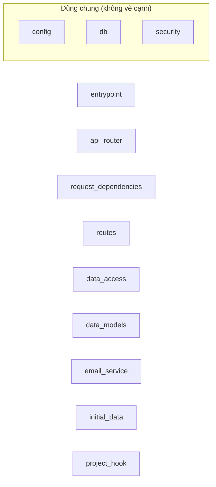

# Sơ đồ component — full-stack-fastapi-template-cb740b6

Trạng thái: **partial**. Tên, vai trò, nhãn là suy luận của AI; mỗi phát biểu có trích dẫn đã được code kiểm khớp nguyên văn với source.

- File trong phạm vi: 16; component: 12; cạnh: 0; hệ thống ngoài: 0.
- Trích dẫn AI trả: 0; hợp lệ: 0; bị loại: 0.
- Token Groq: 1924 (3 request mới, 0 lấy từ cache).

## Component

| ID | Tên | Vai trò | Trích dẫn | Số file |
|---|---|---|---|---:|
| C1 | entrypoint | _chưa có trích dẫn hợp lệ_ | — | 1 |
| C2 | api_router | _chưa có trích dẫn hợp lệ_ | — | 1 |
| C3 | request_dependencies | _chưa có trích dẫn hợp lệ_ | — | 1 |
| C4 | routes | _chưa có trích dẫn hợp lệ_ | — | 5 |
| C5 | data_access | _chưa có trích dẫn hợp lệ_ | — | 1 |
| C6 | data_models | _chưa có trích dẫn hợp lệ_ | — | 1 |
| C7 | email_service | _chưa có trích dẫn hợp lệ_ | — | 1 |
| C8 | initial_data | _chưa có trích dẫn hợp lệ_ | — | 1 |
| C9 | config (dùng chung) | _chưa có trích dẫn hợp lệ_ | — | 1 |
| C10 | db (dùng chung) | _chưa có trích dẫn hợp lệ_ | — | 1 |
| C11 | security (dùng chung) | _chưa có trích dẫn hợp lệ_ | — | 1 |
| C12 | project_hook | _chưa có trích dẫn hợp lệ_ | — | 1 |

## Cạnh

| Từ | Tới | Nhãn | Trích dẫn |
|---|---|---|---|

## Giới hạn

- Cạnh giữa component chỉ lấy từ import đã phân giải; lời gọi động, HTTP nội bộ, queue theo tên chưa thấy được.
- Trích dẫn khớp chứng minh dòng code tồn tại, không chứng minh câu mô tả đúng nghĩa; cần người review.
- describe-1 failed for C1,C2,C3,C4,C5,C6,C7,C8,C9,C10,C11,C12: describe-1: Groq HTTP 400: Failed to generate JSON. Please adjust your prompt. See 'failed_generation' for more details.
