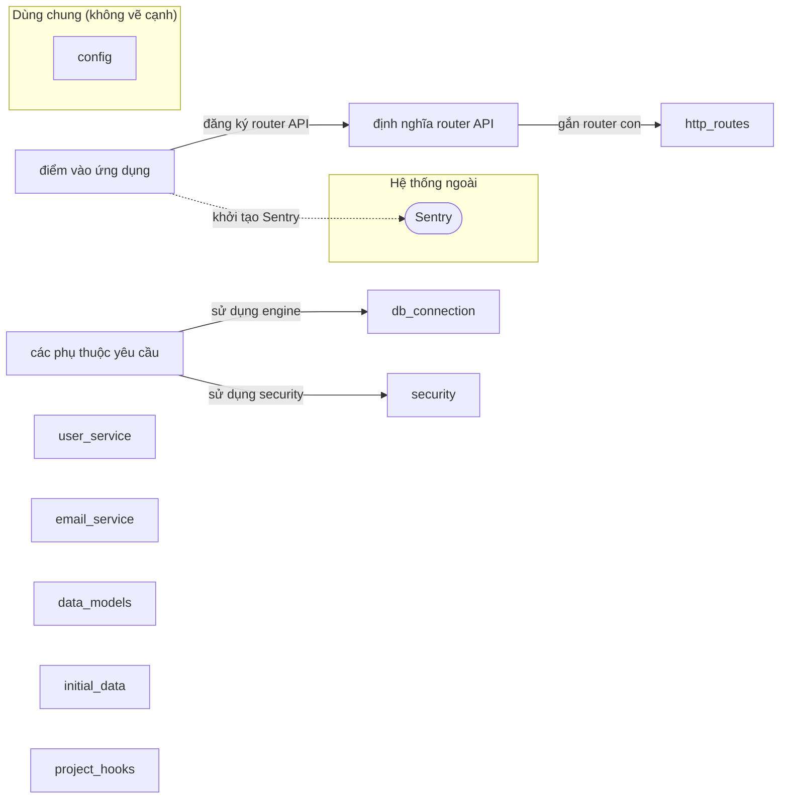

# Sơ đồ component — full-stack-fastapi-template-cb740b6

Trạng thái: **complete**. Tên, vai trò, nhãn là suy luận của AI; mỗi phát biểu có trích dẫn đã được code kiểm khớp nguyên văn với source.

- File trong phạm vi: 16; component: 12; cạnh: 4; hệ thống ngoài: 1.
- Trích dẫn AI trả: 8; hợp lệ: 8; bị loại: 0.
- Token Groq: 2484 (2 request mới, 0 lấy từ cache).

## Component

| ID | Tên | Vai trò | Trích dẫn | Số file |
|---|---|---|---|---:|
| C1 | điểm vào ứng dụng | Khởi tạo FastAPI, middleware, router và Sentry. | `backend/app/main.py:19` `sentry_sdk.init(dsn=str(settings.SENTRY_DSN), enable_tracing=True)` | 1 |
| C2 | định nghĩa router API | Tạo router chính và gắn các router con. | `backend/app/api/main.py:6` `api_router = APIRouter()` | 1 |
| C3 | các phụ thuộc yêu cầu | Cung cấp phụ thuộc cho các endpoint, bao gồm DB session và bảo mật. | `backend/app/api/deps.py:16` `reusable_oauth2 = OAuth2PasswordBearer(` | 1 |
| C4 | http_routes | _chưa có trích dẫn hợp lệ_ | — | 5 |
| C5 | user_service | _chưa có trích dẫn hợp lệ_ | — | 1 |
| C6 | email_service | _chưa có trích dẫn hợp lệ_ | — | 1 |
| C7 | data_models | _chưa có trích dẫn hợp lệ_ | — | 1 |
| C8 | initial_data | _chưa có trích dẫn hợp lệ_ | — | 1 |
| C9 | config (dùng chung) | _chưa có trích dẫn hợp lệ_ | — | 1 |
| C10 | db_connection | _chưa có trích dẫn hợp lệ_ | — | 1 |
| C11 | security | _chưa có trích dẫn hợp lệ_ | — | 1 |
| C12 | project_hooks | _chưa có trích dẫn hợp lệ_ | — | 1 |

## Cạnh

| Từ | Tới | Nhãn | Trích dẫn |
|---|---|---|---|
| điểm vào ứng dụng | định nghĩa router API | đăng ký router API | `backend/app/main.py:35` `app.include_router(api_router, prefix=settings.API_V1_STR)` |
| định nghĩa router API | http_routes | gắn router con | `backend/app/api/main.py:7` `api_router.include_router(login.router)` |
| các phụ thuộc yêu cầu | db_connection | sử dụng engine | `backend/app/api/deps.py:22` `with Session(engine) as session:` |
| các phụ thuộc yêu cầu | security | sử dụng security | `backend/app/api/deps.py:33` `token, settings.SECRET_KEY, algorithms=[security.ALGORITHM]` |
| điểm vào ứng dụng | Sentry (monitoring) | khởi tạo Sentry | `backend/app/main.py:19` `sentry_sdk.init(dsn=str(settings.SENTRY_DSN), enable_tracing=True)` |

## Giới hạn

- Cạnh giữa component chỉ lấy từ import đã phân giải; lời gọi động, HTTP nội bộ, queue theo tên chưa thấy được.
- Trích dẫn khớp chứng minh dòng code tồn tại, không chứng minh câu mô tả đúng nghĩa; cần người review.
