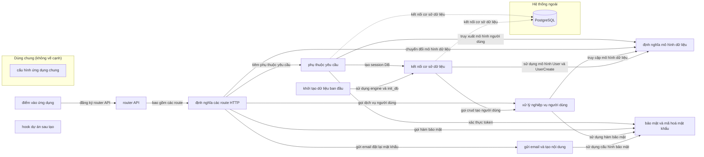

# Sơ đồ component — full-stack-fastapi-template-cb740b6

Trạng thái: **partial**. Tên, vai trò, nhãn là suy luận của AI; mỗi phát biểu có trích dẫn đã được code kiểm khớp nguyên văn với source.

- File trong phạm vi: 16; component: 12; cạnh: 16; hệ thống ngoài: 1.
- Trích dẫn AI trả: 30; hợp lệ: 30; bị loại: 0.
- Token Groq: 22412 (5 request mới, 1 lấy từ cache).

## Component

| ID | Tên | Vai trò | Trích dẫn | Số file |
|---|---|---|---|---:|
| C1 | điểm vào ứng dụng | Khởi tạo FastAPI, cấu hình Sentry và gắn router API | `backend/app/main.py:21` `app = FastAPI(` | 1 |
| C2 | router API | Định nghĩa router chính và gắn các router con | `backend/app/api/main.py:6` `api_router = APIRouter()` | 1 |
| C3 | phụ thuộc yêu cầu | Cung cấp các phụ thuộc cho request như DB session, xác thực và mô hình dữ liệu | `backend/app/api/deps.py:16` `reusable_oauth2 = OAuth2PasswordBearer(` | 1 |
| C4 | định nghĩa các route HTTP | Định nghĩa các router và endpoint cho API. | `backend/app/api/routes/items.py:10` `router = APIRouter(prefix="/items", tags=["items"])` | 5 |
| C5 | xử lý nghiệp vụ người dùng | Cung cấp các hàm CRUD cho thực thể người dùng. | `backend/app/crud.py:10` `def create_user(*, session: Session, user_create: UserCreate) -> User:` | 1 |
| C6 | gửi email và tạo nội dung | Xây dựng cấu trúc dữ liệu email và cấu hình SMTP. | `backend/app/utils.py:19` `@dataclass` | 1 |
| C7 | định nghĩa mô hình dữ liệu | Định nghĩa các lớp mô hình người dùng cho SQLModel. | `backend/app/models.py:14` `class UserBase(SQLModel):` | 1 |
| C8 | khởi tạo dữ liệu ban đầu | Thực thi hàm init_db để khởi tạo dữ liệu bằng Session. | `backend/app/initial_data.py:13` `init_db(session)` | 1 |
| C9 | cấu hình ứng dụng chung (dùng chung) | Khai báo lớp Settings để tải cấu hình môi trường. | `backend/app/core/config.py:15` `class Settings(BaseSettings):` | 1 |
| C10 | kết nối cơ sở dữ liệu | Tạo engine kết nối DB và thực hiện các thao tác CRUD người dùng. | `backend/app/core/db.py:7` `engine = create_engine(str(settings.DATABASE_URL), pool_pre_ping=True)` | 1 |
| C11 | bảo mật và mã hoá mật khẩu | Khởi tạo đối tượng PasswordHash để mã hoá mật khẩu. | `backend/app/core/security.py:11` `password_hash = PasswordHash(` | 1 |
| C12 | hook dự án sau tạo | Định nghĩa biến path sử dụng lớp Path. | `hooks/post_gen_project.py:4` `path: Path` | 1 |

## Cạnh

| Từ | Tới | Nhãn | Trích dẫn |
|---|---|---|---|
| điểm vào ứng dụng | router API | đăng ký router API | `backend/app/main.py:35` `app.include_router(api_router, prefix=settings.API_V1_STR)` |
| router API | định nghĩa các route HTTP | bao gồm các route | `backend/app/api/main.py:7` `api_router.include_router(login.router)` |
| phụ thuộc yêu cầu | kết nối cơ sở dữ liệu | tạo session DB | `backend/app/api/deps.py:22` `with Session(engine) as session:` |
| phụ thuộc yêu cầu | bảo mật và mã hoá mật khẩu | xác thực token | `backend/app/api/deps.py:33` `token, settings.SECRET_KEY, algorithms=[security.ALGORITHM]` |
| phụ thuộc yêu cầu | định nghĩa mô hình dữ liệu | truy xuất mô hình người dùng | `backend/app/api/deps.py:41` `user = session.get(User, token_data.sub)` |
| định nghĩa các route HTTP | bảo mật và mã hoá mật khẩu | gọi hàm bảo mật | `backend/app/api/routes/login.py:39` `access_token=security.create_access_token(` |
| định nghĩa các route HTTP | phụ thuộc yêu cầu | tiêm phụ thuộc yêu cầu | `backend/app/api/routes/login.py:102` `dependencies=[Depends(get_current_active_superuser)],` |
| định nghĩa các route HTTP | xử lý nghiệp vụ người dùng | gọi dịch vụ người dùng | `backend/app/api/routes/login.py:30` `user = crud.authenticate(` |
| định nghĩa các route HTTP | gửi email và tạo nội dung | gửi email đặt lại mật khẩu | `backend/app/api/routes/login.py:63` `password_reset_token = generate_password_reset_token(email=email)` |
| định nghĩa các route HTTP | định nghĩa mô hình dữ liệu | chuyển đổi mô hình dữ liệu | `backend/app/api/routes/items.py:44` `items_public = [ItemPublic.model_validate(item) for item in items]` |
| xử lý nghiệp vụ người dùng | bảo mật và mã hoá mật khẩu | sử dụng hàm bảo mật | `backend/app/crud.py:12` `user_create, update={"hashed_password": get_password_hash(user_create.password)}` |
| xử lý nghiệp vụ người dùng | định nghĩa mô hình dữ liệu | truy cập mô hình dữ liệu | `backend/app/crud.py:11` `db_obj = User.model_validate(` |
| gửi email và tạo nội dung | bảo mật và mã hoá mật khẩu | sử dụng cấu hình bảo mật | `backend/app/utils.py:113` `algorithm=security.ALGORITHM,` |
| khởi tạo dữ liệu ban đầu | kết nối cơ sở dữ liệu | sử dụng engine và init_db | `backend/app/initial_data.py:13` `init_db(session)` |
| kết nối cơ sở dữ liệu | xử lý nghiệp vụ người dùng | gọi crud tạo người dùng | `backend/app/core/db.py:33` `user = crud.create_user(session=session, user_create=user_in)` |
| kết nối cơ sở dữ liệu | định nghĩa mô hình dữ liệu | sử dụng mô hình User và UserCreate | `backend/app/core/db.py:28` `user_in = UserCreate(` |
| phụ thuộc yêu cầu | PostgreSQL (database) | kết nối cơ sở dữ liệu | `backend/app/api/deps.py:22` `with Session(engine) as session:` |
| kết nối cơ sở dữ liệu | PostgreSQL (database) | kết nối cơ sở dữ liệu | `backend/app/core/db.py:7` `engine = create_engine(str(settings.DATABASE_URL), pool_pre_ping=True)` |

## Giới hạn

- Cạnh giữa component chỉ lấy từ import đã phân giải; lời gọi động, HTTP nội bộ, queue theo tên chưa thấy được.
- Trích dẫn khớp chứng minh dòng code tồn tại, không chứng minh câu mô tả đúng nghĩa; cần người review.
- describe-1 failed for C1,C2,C3,C4,C5,C6: describe-1: Groq HTTP 400: Failed to generate JSON. Please adjust your prompt. See 'failed_generation' for more details.
