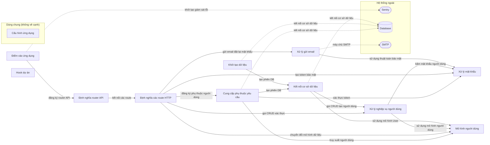

# Sơ đồ component — full-stack-fastapi-template-cb740b6

Trạng thái: **complete**. Tên, vai trò, nhãn là suy luận của AI; mỗi phát biểu có trích dẫn đã được code kiểm khớp nguyên văn với source.

- File trong phạm vi: 16; component: 12; cạnh: 16; hệ thống ngoài: 3.
- Trích dẫn AI trả: 33; hợp lệ: 33; bị loại: 0.
- Token Groq: 11625 (4 request mới, 1 lấy từ cache).

## Component

| ID | Tên | Vai trò | Trích dẫn | Số file |
|---|---|---|---|---:|
| C1 | Điểm vào ứng dụng | Khởi tạo FastAPI, cấu hình middleware và tích hợp Sentry | `backend/app/main.py:19` `sentry_sdk.init(dsn=str(settings.SENTRY_DSN), enable_tracing=True)` | 1 |
| C2 | Định nghĩa router API | Khai báo router và gắn các router con | `backend/app/api/main.py:6` `api_router = APIRouter()` | 1 |
| C3 | Cung cấp phụ thuộc yêu cầu | Cung cấp các phụ thuộc cho các endpoint, bao gồm DB và bảo mật | `backend/app/api/deps.py:16` `reusable_oauth2 = OAuth2PasswordBearer(` | 1 |
| C4 | Định nghĩa các route HTTP | Định nghĩa các router và endpoint cho API | `backend/app/api/routes/items.py:10` `router = APIRouter(prefix="/items", tags=["items"])` | 5 |
| C5 | Xử lý nghiệp vụ người dùng | Cung cấp các hàm CRUD cho người dùng | `backend/app/crud.py:10` `def create_user(*, session: Session, user_create: UserCreate) -> User:` | 1 |
| C6 | Xử lý gửi email | Tạo và gửi email qua SMTP | `backend/app/utils.py:47` `smtp_options = {"host": settings.SMTP_HOST, "port": settings.SMTP_PORT}` | 1 |
| C7 | Mô hình người dùng | Định nghĩa các mô hình dữ liệu người dùng | `backend/app/models.py:14` `class UserBase(SQLModel):` | 1 |
| C8 | Khởi tạo dữ liệu | Thực thi khởi tạo dữ liệu và kết nối DB | `backend/app/initial_data.py:13` `init_db(session)` | 1 |
| C9 | Cấu hình ứng dụng (dùng chung) | Định nghĩa cấu hình và khởi tạo đối tượng Settings | `backend/app/core/config.py:15` `class Settings(BaseSettings):` | 1 |
| C10 | Kết nối cơ sở dữ liệu | Tạo engine kết nối tới cơ sở dữ liệu | `backend/app/core/db.py:7` `engine = create_engine(str(settings.DATABASE_URL), pool_pre_ping=True)` | 1 |
| C11 | Xử lý mật khẩu | Khởi tạo hàm băm mật khẩu | `backend/app/core/security.py:11` `password_hash = PasswordHash(` | 1 |
| C12 | Hook dự án | Thiết lập đường dẫn dự án sau khi tạo | `hooks/post_gen_project.py:4` `path: Path` | 1 |

## Cạnh

| Từ | Tới | Nhãn | Trích dẫn |
|---|---|---|---|
| Điểm vào ứng dụng | Định nghĩa router API | đăng ký router API | `backend/app/main.py:35` `app.include_router(api_router, prefix=settings.API_V1_STR)` |
| Định nghĩa router API | Định nghĩa các route HTTP | kết nối các route | `backend/app/api/main.py:7` `api_router.include_router(login.router)` |
| Cung cấp phụ thuộc yêu cầu | Kết nối cơ sở dữ liệu | tạo phiên DB | `backend/app/api/deps.py:22` `with Session(engine) as session:` |
| Cung cấp phụ thuộc yêu cầu | Xử lý mật khẩu | xác thực token | `backend/app/api/deps.py:33` `token, settings.SECRET_KEY, algorithms=[security.ALGORITHM]` |
| Cung cấp phụ thuộc yêu cầu | Mô hình người dùng | truy xuất người dùng | `backend/app/api/deps.py:41` `user = session.get(User, token_data.sub)` |
| Định nghĩa các route HTTP | Xử lý mật khẩu | tạo token bảo mật | `backend/app/api/routes/login.py:39` `access_token=security.create_access_token(` |
| Định nghĩa các route HTTP | Cung cấp phụ thuộc yêu cầu | đăng ký phụ thuộc người dùng | `backend/app/api/routes/login.py:102` `dependencies=[Depends(get_current_active_superuser)],` |
| Định nghĩa các route HTTP | Xử lý nghiệp vụ người dùng | gọi CRUD xác thực | `backend/app/api/routes/login.py:30` `user = crud.authenticate(` |
| Định nghĩa các route HTTP | Xử lý gửi email | gửi email đặt lại mật khẩu | `backend/app/api/routes/login.py:64` `email_data = generate_reset_password_email(` |
| Định nghĩa các route HTTP | Mô hình người dùng | chuyển đổi mô hình dữ liệu | `backend/app/api/routes/items.py:44` `items_public = [ItemPublic.model_validate(item) for item in items]` |
| Xử lý nghiệp vụ người dùng | Xử lý mật khẩu | băm mật khẩu người dùng | `backend/app/crud.py:12` `user_create, update={"hashed_password": get_password_hash(user_create.password)}` |
| Xử lý nghiệp vụ người dùng | Mô hình người dùng | sử dụng mô hình người dùng | `backend/app/crud.py:11` `db_obj = User.model_validate(` |
| Xử lý gửi email | Xử lý mật khẩu | sử dụng thuật toán bảo mật | `backend/app/utils.py:113` `algorithm=security.ALGORITHM,` |
| Khởi tạo dữ liệu | Kết nối cơ sở dữ liệu | tạo phiên DB | `backend/app/initial_data.py:12` `with Session(engine) as session:` |
| Kết nối cơ sở dữ liệu | Xử lý nghiệp vụ người dùng | gọi CRUD tạo người dùng | `backend/app/core/db.py:33` `user = crud.create_user(session=session, user_create=user_in)` |
| Kết nối cơ sở dữ liệu | Mô hình người dùng | sử dụng mô hình User | `backend/app/core/db.py:28` `user_in = UserCreate(` |
| Điểm vào ứng dụng | Sentry (monitoring) | khởi tạo giám sát lỗi | `backend/app/main.py:19` `sentry_sdk.init(dsn=str(settings.SENTRY_DSN), enable_tracing=True)` |
| Cung cấp phụ thuộc yêu cầu | Database (database) | kết nối cơ sở dữ liệu | `backend/app/api/deps.py:22` `with Session(engine) as session:` |
| Khởi tạo dữ liệu | Database (database) | kết nối cơ sở dữ liệu | `backend/app/initial_data.py:12` `with Session(engine) as session:` |
| Kết nối cơ sở dữ liệu | Database (database) | kết nối cơ sở dữ liệu | `backend/app/core/db.py:7` `engine = create_engine(str(settings.DATABASE_URL), pool_pre_ping=True)` |
| Xử lý gửi email | SMTP (email) | máy chủ SMTP | `backend/app/utils.py:47` `smtp_options = {"host": settings.SMTP_HOST, "port": settings.SMTP_PORT}` |

## Giới hạn

- Cạnh giữa component chỉ lấy từ import đã phân giải; lời gọi động, HTTP nội bộ, queue theo tên chưa thấy được.
- Trích dẫn khớp chứng minh dòng code tồn tại, không chứng minh câu mô tả đúng nghĩa; cần người review.
