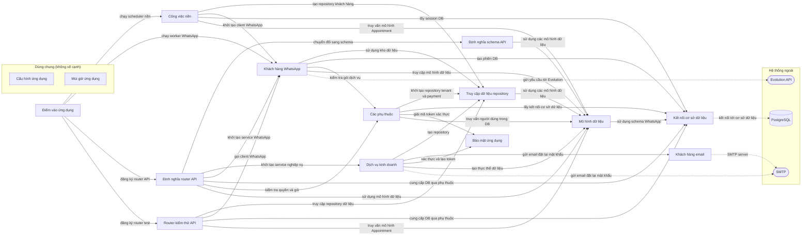

# Sơ đồ component — kibo-backend-89eb3bb

Trạng thái: **complete**. Tên, vai trò, nhãn là suy luận của AI; mỗi phát biểu có trích dẫn đã được code kiểm khớp nguyên văn với source.

- File trong phạm vi: 124; component: 15; cạnh: 33; hệ thống ngoài: 3.
- Trích dẫn AI trả: 52; hợp lệ: 52; bị loại: 0.
- Token Groq: 27763 (7 request mới, 0 lấy từ cache).

## Component

| ID | Tên | Vai trò | Trích dẫn | Số file |
|---|---|---|---|---:|
| C1 | Điểm vào ứng dụng | Khởi tạo FastAPI, đăng ký middleware và router. | `app/main.py:50` `app = FastAPI(title=settings.APP_NAME, lifespan=lifespan)` | 1 |
| C2 | Định nghĩa router API | Xây dựng các router cho các tài nguyên và kết nối tới service, schema và DB. | `app/api/v1/appointments/router.py:22` `router = APIRouter(prefix="/appointments", tags=["appointments"])` | 19 |
| C3 | Router kiểm thử API | Cung cấp các endpoint để kiểm tra thủ công các luồng nghiệp vụ. | `app/api/v1/test.py:21` `router = APIRouter(prefix="/test", tags=["test"])` | 1 |
| C4 | Cấu hình ứng dụng (dùng chung) | Tải biến môi trường và cung cấp cấu hình được cache. | `app/core/config.py:7` `load_dotenv()` | 1 |
| C5 | Múi giờ ứng dụng (dùng chung) | Định nghĩa hằng số múi giờ Bogota. | `app/core/timezone.py:6` `BOGOTA_TZ = "America/Bogota"` | 1 |
| C6 | Các phụ thuộc | Khởi tạo các repository, kết nối DB và xác thực token. | `app/core/dependencies.py:110` `db: Session = Depends(get_db)` | 1 |
| C7 | Khách hàng email | Gửi email qua SMTP | `app/core/email.py:29` `with smtplib.SMTP(settings.SMTP_HOST, settings.SMTP_PORT, timeout=20) as server:` | 1 |
| C8 | Bảo mật ứng dụng | Cấu hình hàm băm mật khẩu và tải cài đặt | `app/core/security.py:9` `password_hash = PasswordHash.recommended()` | 1 |
| C9 | Mô hình dữ liệu | Định nghĩa các mô hình ORM và enum | `app/models/appointments/appointment.py:14` `class AppointmentStatus(str, Enum):` | 25 |
| C10 | Truy cập dữ liệu repository | Thực hiện các thao tác CRUD qua repository | `app/repositories/appointments/appointment_repository.py:32` `class AppointmentRepository:` | 24 |
| C11 | Định nghĩa schema API | Mô tả cấu trúc dữ liệu đầu vào/đầu ra API | `app/schemas/appointments/appointment.py:9` `class AppointmentCreate(BaseModel):` | 19 |
| C12 | Dịch vụ kinh doanh | Cung cấp các dịch vụ nghiệp vụ cho ứng dụng. | `app/services/appointments/appointment_service.py:18` `class AppointmentService:` | 17 |
| C13 | Công việc nền | Quản lý và thực thi các công việc nền định kỳ. | `app/services/scheduler/reminder_scheduler.py:22` `class ReminderScheduler:` | 2 |
| C14 | Khách hàng WhatsApp | cung cấp dịch vụ gửi và nhận tin WhatsApp | `app/services/whatsapp/outbox_service.py:23` `class WhatsAppOutboxService:` | 8 |
| C15 | Kết nối cơ sở dữ liệu | tạo engine và session cho SQLAlchemy | `app/db/session.py:10` `engine = create_engine(settings.DATABASE_URL, future=True, pool_pre_ping=True)` | 3 |

## Cạnh

| Từ | Tới | Nhãn | Trích dẫn |
|---|---|---|---|
| Điểm vào ứng dụng | Công việc nền | chạy scheduler nền | `app/main.py:37` `scheduler_task = asyncio.create_task(run_scheduler_lifecycle(scheduler_stop_event))` |
| Điểm vào ứng dụng | Khách hàng WhatsApp | chạy worker WhatsApp | `app/main.py:34` `worker_task = asyncio.create_task(run_outbox_worker(worker_stop_event))` |
| Điểm vào ứng dụng | Định nghĩa router API | đăng ký router API | `app/main.py:60` `app.include_router(auth_router, prefix=settings.API_V1_PREFIX)` |
| Điểm vào ứng dụng | Router kiểm thử API | đăng ký router test | `app/main.py:70` `app.include_router(test_router, prefix=settings.API_V1_PREFIX)` |
| Định nghĩa router API | Định nghĩa schema API | chuyển đổi sang schema | `app/api/v1/appointments/router.py:44` `return AppointmentResponse.model_validate(entity)` |
| Định nghĩa router API | Dịch vụ kinh doanh | khởi tạo service nghiệp vụ | `app/api/v1/appointments/router.py:31` `service = AppointmentService(db)` |
| Định nghĩa router API | Khách hàng WhatsApp | khởi tạo service WhatsApp | `app/api/v1/whatsapp/router.py:297` `service = WhatsAppOutboxService(db)` |
| Định nghĩa router API | Kết nối cơ sở dữ liệu | cung cấp DB qua phụ thuộc | `app/api/v1/appointments/router.py:28` `db: Annotated[Session, Depends(get_db)],` |
| Định nghĩa router API | Các phụ thuộc | kiểm tra quyền và gói | `app/api/v1/tenant/router.py:52` `if payload.message_templates is not None and not has_min_plan_tier(tenant.plan_tier, PlanT` |
| Định nghĩa router API | Mô hình dữ liệu | sử dụng mô hình dữ liệu | `app/api/v1/appointments/router.py:29` `current_user: Annotated[User, Depends(get_current_tenant_user)],` |
| Router kiểm thử API | Truy cập dữ liệu repository | truy cập repository dữ liệu | `app/api/v1/test.py:51` `tenant_repo = TenantRepository(db)` |
| Router kiểm thử API | Khách hàng WhatsApp | gọi client WhatsApp | `app/api/v1/test.py:54` `evolution_client = EvolutionClient()` |
| Router kiểm thử API | Kết nối cơ sở dữ liệu | cung cấp DB qua phụ thuộc | `app/api/v1/test.py:27` `db: Annotated[Session, Depends(get_db)],` |
| Router kiểm thử API | Mô hình dữ liệu | truy vấn mô hình Appointment | `app/api/v1/test.py:57` `appointment = db.query(Appointment).filter(Appointment.id == appointment_id).first()` |
| Các phụ thuộc | Truy cập dữ liệu repository | khởi tạo repository tenant và payment | `app/core/dependencies.py:32` `tenant_repo = TenantRepository(db)` |
| Các phụ thuộc | Kết nối cơ sở dữ liệu | lấy kết nối cơ sở dữ liệu | `app/core/dependencies.py:110` `db: Session = Depends(get_db)` |
| Các phụ thuộc | Bảo mật ứng dụng | giải mã token xác thực | `app/core/dependencies.py:66` `payload = decode_token(token)` |
| Các phụ thuộc | Mô hình dữ liệu | truy vấn người dùng trong DB | `app/core/dependencies.py:151` `user = db.query(User).filter(User.id == user_id, User.tenant_id == tenant_id, User.is_acti` |
| Mô hình dữ liệu | Kết nối cơ sở dữ liệu | sử dụng schema WhatsApp | `app/models/conversation_contexts/conversation_context.py:18` `{"schema": WHATSAPP_SCHEMA},` |
| Truy cập dữ liệu repository | Mô hình dữ liệu | sử dụng các mô hình dữ liệu | `app/repositories/appointments/appointment_repository.py:48` `entity = Appointment(` |
| Định nghĩa schema API | Mô hình dữ liệu | sử dụng các mô hình dữ liệu | `app/schemas/tenant/tenant.py:14` `plan_tier: PlanTier = PlanTier.STARTER` |
| Dịch vụ kinh doanh | Truy cập dữ liệu repository | tạo repository | `app/services/appointments/appointment_service.py:20` `self.appointment_repo = AppointmentRepository(db)` |
| Dịch vụ kinh doanh | Khách hàng email | gửi email đặt lại mật khẩu | `app/services/auth/auth_service.py:200` `send_password_reset_email(normalized_email, reset_link)` |
| Dịch vụ kinh doanh | Bảo mật ứng dụng | xác thực và tạo token | `app/services/auth/auth_service.py:48` `password_hash = get_password_hash(password)` |
| Dịch vụ kinh doanh | Mô hình dữ liệu | tạo thực thể dữ liệu | `app/services/auth/auth_service.py:50` `tenant = Tenant(` |
| Công việc nền | Truy cập dữ liệu repository | tạo repository khách hàng | `app/services/scheduler/reminder_scheduler.py:49` `client_repo = ClientRepository(db)` |
| Công việc nền | Khách hàng WhatsApp | khởi tạo client WhatsApp | `app/services/scheduler/reminder_scheduler.py:27` `self.evolution_client = EvolutionClient()` |
| Công việc nền | Kết nối cơ sở dữ liệu | lấy session DB | `app/services/scheduler/worker.py:25` `db_sessionmaker = get_db_sessionmaker()` |
| Công việc nền | Mô hình dữ liệu | truy vấn mô hình Appointment | `app/services/scheduler/reminder_scheduler.py:76` `query = query.filter(Appointment.reminder_24h_sent.is_(False))` |
| Khách hàng WhatsApp | Truy cập dữ liệu repository | sử dụng kho dữ liệu | `app/services/whatsapp/connection_service.py:82` `self.tenant_repo = TenantRepository(db)` |
| Khách hàng WhatsApp | Kết nối cơ sở dữ liệu | tạo phiên DB | `app/services/whatsapp/worker.py:18` `db = SessionLocal()` |
| Khách hàng WhatsApp | Các phụ thuộc | kiểm tra gói dịch vụ | `app/services/whatsapp/outbox_service.py:49` `if not has_min_plan_tier(tenant.plan_tier, PlanTier.PRO):` |
| Khách hàng WhatsApp | Mô hình dữ liệu | truy cập mô hình dữ liệu | `app/services/whatsapp/variable_resolver.py:84` `if item.is_active and item.role in {UserRole.OWNER, UserRole.STAFF}` |
| Khách hàng email | SMTP (email) | SMTP server | `app/core/email.py:29` `with smtplib.SMTP(settings.SMTP_HOST, settings.SMTP_PORT, timeout=20) as server:` |
| Dịch vụ kinh doanh | SMTP (email) | gửi email đặt lại mật khẩu | `app/services/auth/auth_service.py:200` `send_password_reset_email(normalized_email, reset_link)` |
| Khách hàng WhatsApp | Evolution API (http_api) | gửi yêu cầu tới Evolution | `app/services/whatsapp/evolution_client.py:35` `return httpx.AsyncClient(base_url=base_url.rstrip("/"), headers=headers, timeout=20.0)` |
| Kết nối cơ sở dữ liệu | PostgreSQL (database) | kết nối tới cơ sở dữ liệu | `app/db/session.py:10` `engine = create_engine(settings.DATABASE_URL, future=True, pool_pre_ping=True)` |

## Giới hạn

- Cạnh giữa component chỉ lấy từ import đã phân giải; lời gọi động, HTTP nội bộ, queue theo tên chưa thấy được.
- Trích dẫn khớp chứng minh dòng code tồn tại, không chứng minh câu mô tả đúng nghĩa; cần người review.
