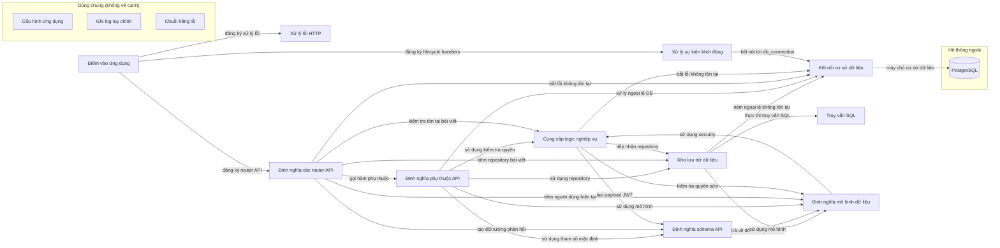

# Sơ đồ component — fastapi-realworld-diagram

Trạng thái: **partial**. Tên, vai trò, nhãn là suy luận của AI; mỗi phát biểu có trích dẫn đã được code kiểm khớp nguyên văn với source.

- File trong phạm vi: 54; component: 14; cạnh: 24; hệ thống ngoài: 1.
- Trích dẫn AI trả: 39; hợp lệ: 39; bị loại: 0.
- Token Groq: 19549 (6 request mới, 0 lấy từ cache).

## Component

| ID | Tên | Vai trò | Trích dẫn | Số file |
|---|---|---|---|---:|
| C1 | Điểm vào ứng dụng | Khởi tạo ứng dụng FastAPI và đăng ký các handler, router và lifecycle. | `app/main.py:45` `app = get_application()` | 1 |
| C2 | Cấu hình ứng dụng (dùng chung) | Định nghĩa các lớp cấu hình môi trường và cài đặt mặc định. | `app/core/settings/app.py:12` `class AppSettings(BaseAppSettings):` | 6 |
| C3 | Ghi log tùy chỉnh (dùng chung) | Cung cấp handler để chuyển log sang hệ thống logging chuẩn. | `app/core/logging.py:8` `class InterceptHandler(logging.Handler):` | 1 |
| C4 | Kết nối cơ sở dữ liệu | Thiết lập pool kết nối PostgreSQL cho FastAPI. | `app/db/events.py:11` `app.state.pool = await asyncpg.create_pool(` | 2 |
| C5 | Truy vấn SQL | Tải và khởi tạo các truy vấn SQL từ thư mục sql. | `app/db/queries/queries.py:5` `queries = aiosql.from_path(pathlib.Path(__file__).parent / "sql", "asyncpg")` | 2 |
| C6 | Kho lưu trữ dữ liệu | Cung cấp các repository để truy cập và thao tác dữ liệu qua các truy vấn. | `app/db/repositories/articles.py:28` `class ArticlesRepository(BaseRepository):` | 6 |
| C7 | Định nghĩa mô hình dữ liệu | Các lớp mô hình mô tả thực thể và hành vi dữ liệu. | `app/models/domain/articles.py:8` `class Article(IDModelMixin, DateTimeModelMixin, RWModel):` | 6 |
| C8 | Định nghĩa schema API | Các lớp schema xác định cấu trúc dữ liệu trả về và nhận vào API. | `app/models/schemas/articles.py:12` `class ArticleForResponse(RWSchema, Article):` | 7 |
| C9 | Định nghĩa phụ thuộc API | Các hàm và lớp phụ thuộc cung cấp các đối tượng dùng trong các endpoint. | `app/api/dependencies/articles.py:21` `def get_articles_filters(` | 5 |
| C10 | Xử lý lỗi HTTP | Xác định phản hồi khi có ngoại lệ HTTP | `app/api/errors/http_error.py:6` `async def http_error_handler(_: Request, exc: HTTPException) -> JSONResponse:` | 2 |
| C11 | Định nghĩa các router API | Đăng ký các router và phụ thuộc cho các endpoint | `app/api/routes/api.py:6` `router = APIRouter()` | 9 |
| C12 | Cung cấp logic nghiệp vụ | Thực hiện các kiểm tra và xử lý nghiệp vụ cho bài viết và người dùng | `app/services/articles.py:9` `async def check_article_exists(articles_repo: ArticlesRepository, slug: str) -> bool:` | 5 |
| C13 | Chuỗi hằng lỗi (dùng chung) | cung cấp các hằng chuỗi thông báo lỗi cho ứng dụng | `app/resources/strings.py:3` `USER_DOES_NOT_EXIST_ERROR = "user does not exist"` | 1 |
| C14 | Xử lý sự kiện khởi động | định nghĩa handler khởi động và dừng ứng dụng để mở/đóng kết nối DB | `app/core/events.py:15` `await connect_to_db(app, settings)` | 1 |

## Cạnh

| Từ | Tới | Nhãn | Trích dẫn |
|---|---|---|---|
| Điểm vào ứng dụng | Xử lý lỗi HTTP | đăng ký xử lý lỗi | `app/main.py:37` `application.add_exception_handler(HTTPException, http_error_handler)` |
| Điểm vào ứng dụng | Định nghĩa các router API | đăng ký router API | `app/main.py:40` `application.include_router(api_router, prefix=settings.api_prefix)` |
| Điểm vào ứng dụng | Xử lý sự kiện khởi động | đăng ký lifecycle handlers | `app/main.py:30` `create_start_app_handler(application, settings),` |
| Kho lưu trữ dữ liệu | Kết nối cơ sở dữ liệu | ném ngoại lệ không tồn tại | `app/db/repositories/articles.py:252` `raise EntityDoesNotExist("article with slug {0} does not exist".format(slug))` |
| Kho lưu trữ dữ liệu | Truy vấn SQL | thực thi truy vấn SQL | `app/db/repositories/articles.py:45` `article_row = await queries.create_new_article(` |
| Kho lưu trữ dữ liệu | Định nghĩa mô hình dữ liệu | trả về đối tượng mô hình | `app/db/repositories/articles.py:302` `return Article(` |
| Định nghĩa mô hình dữ liệu | Cung cấp logic nghiệp vụ | sử dụng security | `app/models/domain/users.py:20` `return security.verify_password(self.salt + password, self.hashed_password)` |
| Định nghĩa schema API | Định nghĩa mô hình dữ liệu | sử dụng mô hình | `app/models/schemas/comments.py:8` `comments: List[Comment]` |
| Định nghĩa phụ thuộc API | Cung cấp logic nghiệp vụ | sử dụng kiểm tra quyền | `app/api/dependencies/articles.py:55` `if not check_user_can_modify_article(current_article, user):` |
| Định nghĩa phụ thuộc API | Kết nối cơ sở dữ liệu | xử lý ngoại lệ DB | `app/api/dependencies/articles.py:44` `except EntityDoesNotExist:` |
| Định nghĩa phụ thuộc API | Kho lưu trữ dữ liệu | sử dụng repository | `app/api/dependencies/articles.py:40` `articles_repo: ArticlesRepository = Depends(get_repository(ArticlesRepository))` |
| Định nghĩa phụ thuộc API | Định nghĩa mô hình dữ liệu | sử dụng mô hình | `app/api/dependencies/articles.py:39` `user: Optional[User] = Depends(get_current_user_authorizer(required=False))` |
| Định nghĩa phụ thuộc API | Định nghĩa schema API | sử dụng tham số mặc định | `app/api/dependencies/articles.py:25` `limit: int = Query(DEFAULT_ARTICLES_LIMIT, ge=1),` |
| Định nghĩa các router API | Cung cấp logic nghiệp vụ | kiểm tra tồn tại bài viết | `app/api/routes/articles/articles_resource.py:65` `if await check_article_exists(articles_repo, slug):` |
| Định nghĩa các router API | Kết nối cơ sở dữ liệu | bắt lỗi không tồn tại | `app/api/routes/authentication.py:35` `except EntityDoesNotExist as existence_error:` |
| Định nghĩa các router API | Kho lưu trữ dữ liệu | tiêm repository bài viết | `app/api/routes/articles/articles_common.py:31` `articles_repo: ArticlesRepository = Depends(get_repository(ArticlesRepository)),` |
| Định nghĩa các router API | Định nghĩa mô hình dữ liệu | tiêm người dùng hiện tại | `app/api/routes/articles/articles_common.py:30` `user: User = Depends(get_current_user_authorizer()),` |
| Định nghĩa các router API | Định nghĩa schema API | tạo đối tượng phản hồi | `app/api/routes/articles/articles_common.py:39` `ArticleForResponse(**article.dict()) for article in articles` |
| Định nghĩa các router API | Định nghĩa phụ thuộc API | gọi hàm phụ thuộc | `app/api/routes/articles/articles_common.py:30` `user: User = Depends(get_current_user_authorizer()),` |
| Cung cấp logic nghiệp vụ | Kết nối cơ sở dữ liệu | bắt lỗi không tồn tại | `app/services/articles.py:12` `except EntityDoesNotExist:` |
| Cung cấp logic nghiệp vụ | Kho lưu trữ dữ liệu | tiếp nhận repository | `app/services/articles.py:9` `async def check_article_exists(articles_repo: ArticlesRepository, slug: str) -> bool:` |
| Cung cấp logic nghiệp vụ | Định nghĩa mô hình dữ liệu | kiểm tra quyền sửa | `app/services/articles.py:22` `def check_user_can_modify_article(article: Article, user: User) -> bool:` |
| Cung cấp logic nghiệp vụ | Định nghĩa schema API | tạo payload JWT | `app/services/jwt.py:23` `to_encode.update(JWTMeta(exp=expire, sub=JWT_SUBJECT).dict())` |
| Xử lý sự kiện khởi động | Kết nối cơ sở dữ liệu | kết nối tới db_connection | `app/core/events.py:15` `await connect_to_db(app, settings)` |
| Kết nối cơ sở dữ liệu | PostgreSQL (database) | máy chủ cơ sở dữ liệu | `app/db/events.py:12` `str(settings.database_url),` |

## Giới hạn

- Cạnh giữa component chỉ lấy từ import đã phân giải; lời gọi động, HTTP nội bộ, queue theo tên chưa thấy được.
- Trích dẫn khớp chứng minh dòng code tồn tại, không chứng minh câu mô tả đúng nghĩa; cần người review.
- 1 files not grouped by AI; grouped by directory
