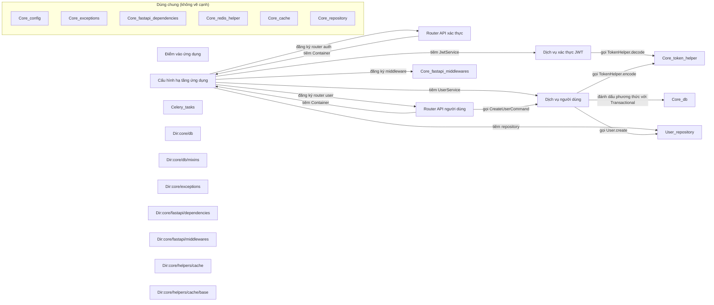

# Sơ đồ component — teamhide_fastapi-boilerplate-df4e6d4

Trạng thái: **partial**. Tên, vai trò, nhãn là suy luận của AI; mỗi phát biểu có trích dẫn đã được code kiểm khớp nguyên văn với source.

- File trong phạm vi: 54; component: 24; cạnh vẽ: 13; cạnh ẩn: 23; hệ thống ngoài: 0.
- Trích dẫn AI trả: 20; hợp lệ: 20; bị loại: 4.
- Thời gian: tổng 204.0 s = phân tích cục bộ 0.35 s + AI 203.7 s (model chạy 20.7 s, chờ giới hạn tốc độ 183.0 s).
- Token Groq: 14307 (3 request mới, 0 lấy từ cache).

## Component

| ID | Tên | Vai trò | Trích dẫn | Số file |
|---|---|---|---|---:|
| C1 | Điểm vào ứng dụng | Khởi chạy ứng dụng FastAPI qua lệnh CLI | `main.py:24` `uvicorn.run(` | 1 |
| C2 | Cấu hình hạ tầng ứng dụng | Cung cấp container DI và khởi tạo FastAPI app | `app/container.py:10` `class Container(DeclarativeContainer):` | 2 |
| C3 | Router API xác thực | Định nghĩa các endpoint xác thực và phụ thuộc vào JwtUseCase | `app/auth/adapter/input/api/__init__.py:5` `router = APIRouter()` | 4 |
| C4 | Dịch vụ xác thực JWT | cung cấp các chức năng JWT cho ứng dụng | `app/auth/application/service/jwt.py:11` `class JwtService(JwtUseCase):` | 4 |
| C5 | Router API người dùng | định nghĩa các endpoint cho người dùng | `app/user/adapter/input/api/__init__.py:5` `router = APIRouter()` | 4 |
| C6 | Dịch vụ người dùng | cung cấp các nghiệp vụ người dùng như tạo và lấy danh sách | `app/user/application/service/user.py:16` `class UserService(UserUseCase):` | 6 |
| C7 | User_repository | _chưa có trích dẫn hợp lệ_ | — | 5 |
| C8 | Celery_tasks | _chưa có trích dẫn hợp lệ_ | — | 1 |
| C9 | Core_config (dùng chung) | _chưa có trích dẫn hợp lệ_ | — | 1 |
| C10 | Core_db | _chưa có trích dẫn hợp lệ_ | — | 3 |
| C11 | Core_exceptions (dùng chung) | _chưa có trích dẫn hợp lệ_ | — | 1 |
| C12 | Core_fastapi_dependencies (dùng chung) | _chưa có trích dẫn hợp lệ_ | — | 2 |
| C13 | Core_fastapi_middlewares | _chưa có trích dẫn hợp lệ_ | — | 3 |
| C14 | Core_redis_helper (dùng chung) | _chưa có trích dẫn hợp lệ_ | — | 1 |
| C15 | Core_token_helper | _chưa có trích dẫn hợp lệ_ | — | 1 |
| C16 | Core_cache (dùng chung) | _chưa có trích dẫn hợp lệ_ | — | 6 |
| C17 | Core_repository (dùng chung) | _chưa có trích dẫn hợp lệ_ | — | 2 |
| C18 | Dir:core/db | _chưa có trích dẫn hợp lệ_ | — | 1 |
| C19 | Dir:core/db/mixins | _chưa có trích dẫn hợp lệ_ | — | 1 |
| C20 | Dir:core/exceptions | _chưa có trích dẫn hợp lệ_ | — | 1 |
| C21 | Dir:core/fastapi/dependencies | _chưa có trích dẫn hợp lệ_ | — | 1 |
| C22 | Dir:core/fastapi/middlewares | _chưa có trích dẫn hợp lệ_ | — | 1 |
| C23 | Dir:core/helpers/cache | _chưa có trích dẫn hợp lệ_ | — | 1 |
| C24 | Dir:core/helpers/cache/base | _chưa có trích dẫn hợp lệ_ | — | 1 |

## Cạnh được vẽ

Phía nguồn: dòng AI trích, code kiểm. Phía đích: nơi định nghĩa tên được dùng, do code tìm từ import.

| Từ | Tới | Loại | Nhãn | Trích dẫn phía nguồn | Phía đích |
|---|---|---|---|---|---|
| Cấu hình hạ tầng ứng dụng | Core_fastapi_middlewares | register | đăng ký middleware | `app/server.py:63` `backend=AuthBackend(),` | `core/fastapi/middlewares/authentication.py:16`, `core/fastapi/middlewares/authentication.py:49` |
| Cấu hình hạ tầng ứng dụng | Router API xác thực | register | đăng ký router auth | `app/server.py:24` `auth_router.container = container` | `app/auth/adapter/input/api/__init__.py:5` |
| Cấu hình hạ tầng ứng dụng | Dịch vụ xác thực JWT | inject | tiêm JwtService | `app/container.py:17` `jwt_service = Factory(JwtService)` | `app/auth/application/service/jwt.py:11` |
| Cấu hình hạ tầng ứng dụng | Router API người dùng | register | đăng ký router user | `app/server.py:23` `user_router.container = container` | `app/user/adapter/input/api/__init__.py:5` |
| Cấu hình hạ tầng ứng dụng | Dịch vụ người dùng | inject | tiêm UserService | `app/container.py:15` `user_service = Factory(UserService, repository=user_repo_adapter)` | `app/user/application/service/user.py:16` |
| Cấu hình hạ tầng ứng dụng | User_repository | inject | tiêm repository | `app/container.py:13` `user_repo = Singleton(UserSQLAlchemyRepo)` | `app/user/adapter/output/persistence/repository_adapter.py:5`, `app/user/adapter/output/persistence/sqlalchemy/user.py:8` |
| Router API xác thực | Cấu hình hạ tầng ứng dụng | inject | tiêm Container | `app/auth/adapter/input/api/v1/auth.py:10` `from app.container import Container` | `app/container.py:10` |
| Dịch vụ xác thực JWT | Core_token_helper | call | gọi TokenHelper.decode | `app/auth/application/service/jwt.py:14` `TokenHelper.decode(token=token)` | `core/helpers/token.py:21`, `core/helpers/token.py:9` |
| Router API người dùng | Cấu hình hạ tầng ứng dụng | inject | tiêm Container | `app/user/adapter/input/api/v1/user.py:4` `from app.container import Container` | `app/container.py:10` |
| Router API người dùng | Dịch vụ người dùng | call | gọi CreateUserCommand | `app/user/adapter/input/api/v1/user.py:38` `command = CreateUserCommand(**request.model_dump())` | `app/user/application/dto/__init__.py:17`, `app/user/application/dto/__init__.py:4` |
| Dịch vụ người dùng | Core_db | call | đánh dấu phương thức với Transactional | `app/user/application/service/user.py:28` `@Transactional()` | `core/db/transactional.py:6` |
| Dịch vụ người dùng | Core_token_helper | call | gọi TokenHelper.encode | `app/user/application/service/user.py:64` `token=TokenHelper.encode(payload={"user_id": user.id}),` | `core/helpers/token.py:21` |
| Dịch vụ người dùng | User_repository | call | gọi User.create | `app/user/application/service/user.py:40` `user = User.create(` | `app/user/adapter/output/persistence/repository_adapter.py:5`, `app/user/domain/entity/user.py:10` |

## Cạnh có trong code nhưng không vẽ

| Từ | Tới | Lý do | Trích dẫn |
|---|---|---|---|
| Điểm vào ứng dụng | Core_config | shared support is drawn without edges (SPEC) | — |
| Core_db | Core_config | shared support is drawn without edges (SPEC) | — |
| Core_fastapi_dependencies | Core_exceptions | shared support is drawn without edges (SPEC) | — |
| Core_fastapi_dependencies | Cấu hình hạ tầng ứng dụng | shared support is drawn without edges (SPEC) | — |
| Core_fastapi_dependencies | Dịch vụ người dùng | shared support is drawn without edges (SPEC) | — |
| Core_fastapi_middlewares | Core_db | no classification with a valid quote | — |
| Core_fastapi_middlewares | Core_config | shared support is drawn without edges (SPEC) | — |
| Core_redis_helper | Core_config | shared support is drawn without edges (SPEC) | — |
| Core_token_helper | Core_exceptions | shared support is drawn without edges (SPEC) | — |
| Core_token_helper | Core_config | shared support is drawn without edges (SPEC) | — |
| Core_cache | Core_redis_helper | shared support is drawn without edges (SPEC) | — |
| Core_repository | Core_db | shared support is drawn without edges (SPEC) | — |
| Cấu hình hạ tầng ứng dụng | Core_exceptions | shared support is drawn without edges (SPEC) | — |
| Cấu hình hạ tầng ứng dụng | Core_fastapi_dependencies | shared support is drawn without edges (SPEC) | — |
| Cấu hình hạ tầng ứng dụng | Core_cache | shared support is drawn without edges (SPEC) | — |
| Cấu hình hạ tầng ứng dụng | Core_config | shared support is drawn without edges (SPEC) | — |
| Router API xác thực | Dịch vụ xác thực JWT | only type use | `app/auth/adapter/input/api/v1/auth.py:9` `from app.auth.domain.usecase.jwt import JwtUseCase` |
| Dịch vụ xác thực JWT | Core_exceptions | shared support is drawn without edges (SPEC) | — |
| Router API người dùng | Core_fastapi_dependencies | shared support is drawn without edges (SPEC) | — |
| Dịch vụ người dùng | Core_exceptions | shared support is drawn without edges (SPEC) | — |
| User_repository | Core_db | no classification with a valid quote | — |
| User_repository | Dir:core/db/mixins | no classification with a valid quote | — |
| Celery_tasks | Core_config | shared support is drawn without edges (SPEC) | — |

## Bị loại vì trích dẫn không khớp

- C4 edge E33: not an open candidate edge of this component
- C5 edge E36: not an open candidate edge of this component
- C5 edge E36: not an open candidate edge of this component
- C6 edge E40: not an open candidate edge of this component

## Giới hạn

- Cạnh giữa component chỉ lấy từ import đã phân giải; lời gọi động, HTTP nội bộ, queue theo tên chưa thấy được.
- Trích dẫn khớp chứng minh dòng code tồn tại, không chứng minh câu mô tả đúng nghĩa; cần người review.
- 7 files not grouped by AI; grouped by directory
- describe-3 failed for C7,C8,C9: <urlopen error [Errno 11001] getaddrinfo failed>
- describe-4 failed for C10,C11,C12: <urlopen error [Errno 11001] getaddrinfo failed>
- describe-5 failed for C13,C14,C15: <urlopen error [Errno 11001] getaddrinfo failed>
- describe-6 failed for C16,C17,C18: <urlopen error [Errno 11001] getaddrinfo failed>
- describe-7 failed for C19,C20,C21: <urlopen error [Errno 11001] getaddrinfo failed>
- describe-8 failed for C22,C23,C24: <urlopen error [Errno 11001] getaddrinfo failed>
- retry-1 failed for C7,C8: <urlopen error [Errno 11001] getaddrinfo failed>
- retry-2 failed for C9,C10: <urlopen error [Errno 11001] getaddrinfo failed>
- retry-3 failed for C11,C12: <urlopen error [Errno 11001] getaddrinfo failed>
- retry-4 failed for C13,C14: <urlopen error [Errno 11001] getaddrinfo failed>
- retry-5 failed for C15,C16: <urlopen error [Errno 11001] getaddrinfo failed>
- retry-6 failed for C17,C18: <urlopen error [Errno 11001] getaddrinfo failed>
- retry-7 failed for C19,C20: <urlopen error [Errno 11001] getaddrinfo failed>
- retry-8 failed for C21,C22: <urlopen error [Errno 11001] getaddrinfo failed>
- retry-9 failed for C23,C24: <urlopen error [Errno 11001] getaddrinfo failed>
- not described after retry: C7,C8,C9,C10,C11,C12,C13,C14,C15,C16,C17,C18,C19,C20,C21,C22,C23,C24
- 3 candidate edges without a valid classification
