# Sơ đồ component — fastapi-boilerplate

Trạng thái: **partial**. Tên, vai trò, nhãn là suy luận của AI; mỗi phát biểu có trích dẫn đã được code kiểm khớp nguyên văn với source.

- File trong phạm vi: 99; component: 50; cạnh vẽ: 77; cạnh ẩn: 31; hệ thống ngoài: 4.
- Trích dẫn AI trả: 133; hợp lệ: 130; bị loại: 8.
- Thời gian: tổng 0.2 s = phân tích cục bộ 0.21 s + AI 0.0 s (model chạy 0 s, chờ giới hạn tốc độ 0.0 s).
- Token Groq: 0 (0 request mới, 18 lấy từ cache).

```mermaid
flowchart LR
  C1["Factory ứng dụng FastAPI"]
  C2["Định nghĩa phụ thuộc hạ tầng"]
  C3["Middleware cache và bảo mật"]
  C4["Redis client"]
  C5["Router xác thực"]
  C6["Auth dependencies"]
  C7["Cài đặt xác thực"]
  C8["Cốt lõi bộ nhớ đệm"]
  C9["Backend cache"]
  C12["Phiên làm việc DB"]
  C13["Định nghĩa mô hình dữ liệu"]
  C15["Kiểm tra bảo mật môi trường"]
  C16["Worker xử lý taskiq"]
  C17["Cấu hình broker taskiq"]
  C18["Phụ thuộc taskiq"]
  C19["Đăng ký task"]
  C20["Điểm vào API"]
  C21["Giao diện admin"]
  C22["Giao diện admin"]
  C23["Router API"]
  C24["Router API v1"]
  C25["Module quản lý API Key"]
  C28["Module giới hạn tần suất"]
  C29["Module cấp bậc"]
  C30["Module người dùng"]
  C31["Ứng dụng CLI"]
  C32["Lệnh deploy CLI"]
  C33["Lệnh môi trường CLI"]
  C34["Tính năng CLI"]
  C35["Triển khai tính năng CLI"]
  C36["Thư viện CLI"]
  C37["Cơ sở hạ tầng"]
  C38["Cơ sở hạ tầng xác thực"]
  C39["Kiểm tra Memcached"]
  C40["Định nghĩa xuất khẩu backend"]
  C41["Xuất khẩu cấu hình"]
  C42["Khởi tạo database service"]
  C43["Cấu hình logging"]
  C44["Bảo mật production"]
  C45["Cung cấp broker taskiq"]
  C46["Đăng ký mô-đun API keys"]
  C47["Cung cấp CRUD và model cho API keys"]
  C48["Module giới hạn tốc độ"]
  C49["Module cấp độ"]
  C50["Module người dùng"]
  subgraph shared["Dùng chung (không vẽ cạnh)"]
    C10["Cài đặt cấu hình"]
    C11["Enum cấu hình"]
    C14["Cấu hình hệ thống ghi log"]
    C26["Thư viện chung"]
    C27["Tiện ích chung"]
  end
  subgraph external["Hệ thống ngoài"]
    X1[("Redis")]
    X2[("Memcached")]
    X3[("Database")]
    X4[/"RabbitMQ"/]
  end
  C1 -->|"khởi tạo và đóng DB"| C12
  C1 -->|"đăng ký middleware"| C3
  C1 -->|"đóng kết nối Redis"| C4
  C1 -->|"tiêm phụ thuộc auth"| C6
  C1 -->|"khởi tạo auth"| C7
  C1 -->|"khởi tạo và đóng cache"| C8
  C16 -->|"đọc broker mặc định"| C17
  C16 -->|"gọi hàm giải phóng engine"| C18
  C18 -->|"gọi hàm tạo engine"| C12
  C2 -->|"tiêm session DB"| C12
  C2 -->|"tiêm phụ thuộc auth"| C6
  C20 -->|"tạo ứng dụng FastAPI"| C1
  C20 -->|"kiểm tra bảo mật production"| C15
  C20 -->|"khởi tạo giao diện admin"| C21
  C20 -->|"cung cấp router API"| C23
  C21 -->|"lấy engine DB"| C12
  C21 -->|"đăng ký view admin"| C22
  C22 -->|"tạo session DB"| C12
  C22 -->|"kế thừa DataclassModelMixin"| C21
  C22 -->|"gọi CRUD tier"| C29
  C22 -->|"khởi tạo UserService"| C30
  C22 -->|"xác thực mật khẩu"| C7
  C23 -->|"đăng ký router v1"| C24
  C23 -->|"đọc cấu hình auth"| C7
  C24 -->|"đăng ký router api-keys"| C25
  C24 -->|"đăng ký router rate-limits"| C28
  C24 -->|"đăng ký router tiers"| C29
  C24 -->|"đăng ký router users"| C30
  C24 -->|"đăng ký router auth"| C5
  C24 -->|"sử dụng phụ thuộc api_rate_limit_dependency"| C7
  C25 -->|"kế thừa lớp Base"| C12
  C25 -->|"kế thừa TimestampMixin"| C13
  C25 -->|"tiêm phụ thuộc AsyncSessionDep và CurrentUserDep"| C2
  C28 -->|"kế thừa Base"| C12
  C28 -->|"kế thừa mixin"| C13
  C28 -->|"tiêm phụ thuộc DB"| C2
  C28 -->|"gọi CRUD tiers"| C29
  C29 -->|"kế thừa Base"| C12
  C29 -->|"kế thừa mixin"| C13
  C29 -->|"tiêm phụ thuộc DB"| C2
  C29 -->|"dùng crud_rate_limits"| C28
  C29 -->|"dùng User, crud_users"| C30
  C30 -->|"kế thừa Base"| C12
  C30 -->|"kế thừa mixin"| C13
  C30 -->|"tiêm phụ thuộc"| C2
  C30 -->|"sử dụng lớp"| C28
  C30 -->|"gọi hàm"| C29
  C30 -->|"sử dụng kiểu"| C38
  C30 -->|"gọi hàm xác thực"| C7
  C31 -->|"đăng ký lệnh"| C32
  C31 -->|"đăng ký lệnh"| C33
  C31 -->|"kiểm tra kiểu"| C34
  C32 -->|"gọi hàm tính năng"| C34
  C32 -->|"gọi hàm thư viện"| C36
  C33 -->|"gọi hàm thông báo"| C36
  C34 -->|"gọi plugin để đăng ký"| C31
  C34 -->|"tạo đối tượng DeployFeature"| C35
  C34 -->|"gọi hàm và khởi tạo đối tượng"| C36
  C35 -->|"kế thừa và sử dụng kiểu"| C34
  C35 -->|"sử dụng kiểu ProjectContext"| C36
  C42 -->|"gọi hàm engine"| C12
  C5 -->|"tiêm phụ thuộc AsyncSessionDep và OAuth2FormDep"| C2
  C5 -->|"gọi crud_users"| C30
  C5 -->|"tiêm phụ thuộc get_current_principal và get_optional_principal"| C6
  C5 -->|"gọi crud_auth và session_transport"| C7
  C6 -->|"tiêm async_session"| C12
  C6 -->|"gọi crud_users"| C30
  C6 -->|"tiêm auth"| C7
  C7 -->|"cung cấp session DB"| C12
  C7 -->|"gọi CRUD giới hạn"| C28
  C7 -->|"sử dụng mô hình người dùng"| C30
  C7 -->|"cung cấp chính sách mật khẩu"| C38
  C7 -->|"cung cấp client Redis cho rate limiter"| C4
  C8 -->|"kiểm tra cài đặt cache"| C39
  C8 -->|"đóng kết nối Redis cache"| C4
  C8 -->|"dùng MemcachedPatternMatchingNotSupportedError, MemcachedBackend"| C9
  C9 -->|"kế thừa lớp cơ sở cache"| C8
  C4 -.->|"kết nối Redis"| X1
  C9 -.->|"client Redis"| X1
  C17 -.->|"kết nối Redis"| X1
  C9 -.->|"client Memcached"| X2
  C12 -.->|"Database server"| X3
  C17 -.->|"kết nối RabbitMQ"| X4
```

## Component

| ID | Tên | Vai trò | Trích dẫn | Số file |
|---|---|---|---|---:|
| C1 | Factory ứng dụng FastAPI | Tạo và cấu hình ứng dụng FastAPI, khởi tạo DB, cache, middleware, auth và tài liệu. | `backend/src/infrastructure/app_factory.py:35` `logger = logging.getLogger(__name__)` | 1 |
| C2 | Định nghĩa phụ thuộc hạ tầng | Định nghĩa các phụ thuộc cho DB và xác thực dùng Depends. | `backend/src/infrastructure/dependencies.py:11` `AsyncSessionDep = Annotated[AsyncSession, Depends(async_session)]` | 1 |
| C3 | Middleware cache và bảo mật | Định nghĩa middleware cho cache và bảo mật. | `backend/src/infrastructure/middleware.py:11` `class ClientCacheMiddleware(BaseHTTPMiddleware):` | 1 |
| C4 | Redis client | Tạo các client Redis để dùng làm cache và bộ giới hạn tốc độ. | `backend/src/infrastructure/redis.py:7` `settings = get_settings()` | 1 |
| C5 | Router xác thực | Định nghĩa các endpoint API cho xác thực người dùng. | `backend/src/infrastructure/auth/routes.py:18` `router = APIRouter(tags=["Authentication"])` | 1 |
| C6 | Auth dependencies | Cung cấp các phụ thuộc FastAPI để lấy principal và người dùng hiện tại. | `backend/src/infrastructure/auth/dependencies.py:22` `async def get_current_principal(` | 1 |
| C7 | Cài đặt xác thực | Thiết lập các thành phần xác thực và phụ thuộc | `backend/src/infrastructure/auth/setup.py:81` `auth = CRUDAuth(` | 1 |
| C8 | Cốt lõi bộ nhớ đệm | Quản lý khởi tạo và cấu hình các backend cache | `backend/src/infrastructure/cache/initialize.py:9` `if MEMCACHED_INSTALLED:` | 6 |
| C9 | Backend cache | Định nghĩa các backend cho cache như Redis và Memcached | `backend/src/infrastructure/cache/backends/redis.py:41` `class RedisBackend(CacheBackend):` | 2 |
| C10 | Cài đặt cấu hình (dùng chung) | Định nghĩa các lớp cấu hình môi trường, cơ sở dữ liệu, cache, rate limiter và CORS. | `backend/src/infrastructure/config/settings.py:35` `class EnvironmentOption(StrEnum):` | 1 |
| C11 | Enum cấu hình (dùng chung) | Định nghĩa các enum cho backend cache, session, rate limiter, broker, log level và format. | `backend/src/infrastructure/config/enums.py:6` `class CacheBackend(StrEnum):` | 1 |
| C12 | Phiên làm việc DB | Khởi tạo engine bất đồng bộ cho cơ sở dữ liệu dựa trên URL cấu hình. | `backend/src/infrastructure/database/session.py:28` `return create_async_engine(settings.DATABASE_URL, **options)` | 2 |
| C13 | Định nghĩa mô hình dữ liệu | Định nghĩa các mixin và mô hình ORM cho cơ sở dữ liệu. | `backend/src/infrastructure/database/models.py:10` `class UUIDMixin(MappedAsDataclass):` | 1 |
| C14 | Cấu hình hệ thống ghi log (dùng chung) | Cung cấp các lớp bộ lọc, định dạng và xử lý log. | `backend/src/infrastructure/logging/formatters.py:20` `class SimpleFormatter(logging.Formatter):` | 4 |
| C15 | Kiểm tra bảo mật môi trường | Thực hiện xác thực và kiểm tra bảo mật trong môi trường production. | `backend/src/infrastructure/security/production_validator.py:16` `class ProductionSecurityError(Exception):` | 1 |
| C16 | Worker xử lý taskiq | Cài đặt vòng đời broker cho worker taskiq | `backend/src/infrastructure/taskiq/worker.py:7` `configure_broker_lifecycle(default_broker)` | 2 |
| C17 | Cấu hình broker taskiq | Định nghĩa broker mặc định cho Redis và RabbitMQ | `backend/src/infrastructure/taskiq/brokers.py:52` `default_broker = create_default_broker()` | 1 |
| C18 | Phụ thuộc taskiq | Xây dựng engine async và session cho taskiq | `backend/src/infrastructure/taskiq/deps.py:20` `_engine = build_engine(poolclass=NullPool)` | 1 |
| C19 | Đăng ký task | Định nghĩa lớp TaskRegistry và tạo một thể hiện toàn cục. | `backend/src/infrastructure/taskiq/registry.py:11` `class TaskRegistry:` | 1 |
| C20 | Điểm vào API | Khởi tạo ứng dụng FastAPI, cấu hình bảo mật, admin và router. | `backend/src/interfaces/main.py:28` `app = create_application(` | 1 |
| C21 | Giao diện admin | Tạo admin interface, khởi tạo engine DB và đăng ký các view admin. | `backend/src/interfaces/admin/initialize.py:29` `engine=get_engine()` | 3 |
| C22 | Giao diện admin | Định nghĩa các lớp admin cho Tier và User, và quản lý phiên DB. | `backend/src/interfaces/admin/views/tiers.py:14` `class TierAdmin(DataclassModelMixin, ModelView, model=Tier):` | 3 |
| C23 | Router API | Tạo router chính và gắn router v1 và auth vào. | `backend/src/interfaces/api/__init__.py:6` `router = APIRouter()` | 1 |
| C24 | Router API v1 | Định nghĩa router phiên bản 1 và gắn các router module con. | `backend/src/interfaces/api/v1/__init__.py:11` `router = APIRouter(prefix="/v1")` | 1 |
| C25 | Module quản lý API Key | Cung cấp CRUD, dịch vụ và router cho quản lý API Key. | `backend/src/modules/api_keys/routes.py:17` `router = APIRouter(tags=["API Keys"])` | 7 |
| C26 | Thư viện chung (dùng chung) | Định nghĩa hằng số, ngoại lệ và schema chung cho các mô-đun. | `backend/src/modules/common/constants.py:29` `GENERIC_ERROR_MESSAGE = "Something went wrong. Please try again."` | 3 |
| C27 | Tiện ích chung (dùng chung) | Cung cấp hàm logger và middleware xử lý lỗi chung. | `backend/src/modules/common/utils/logger.py:15` `def get_logger(name: str, level: int ¦ None = None) -> logging.Logger ¦ logging.LoggerAdap` | 2 |
| C28 | Module giới hạn tần suất | Cung cấp CRUD và API cho cấu hình giới hạn tần suất truy cập | `backend/src/modules/rate_limit/routes.py:13` `router = APIRouter(tags=["Rate Limits"])` | 6 |
| C29 | Module cấp bậc | Quản lý cấp bậc người dùng và liên kết với rate limit | `backend/src/modules/tier/routes.py:10` `router = APIRouter(tags=["Tiers"])` | 6 |
| C30 | Module người dùng | Quản lý các thao tác CRUD và dịch vụ người dùng. | `backend/src/modules/user/crud.py:5` `crud_users: FastCRUD = FastCRUD(User)` | 8 |
| C31 | Ứng dụng CLI | Khởi tạo ứng dụng Typer và gắn các sub‑command. | `cli/src/cli/app.py:16` `app = typer.Typer(` | 2 |
| C32 | Lệnh deploy CLI | Định nghĩa lệnh CLI để tạo artefacts triển khai. | `cli/src/cli/commands/deploy.py:20` `app = typer.Typer(no_args_is_help=True, help="Generate deployment artifacts.")` | 1 |
| C33 | Lệnh môi trường CLI | Định nghĩa các lệnh CLI để kiểm tra và chuẩn bị môi trường runtime. | `cli/src/cli/commands/env.py:32` `app = typer.Typer(no_args_is_help=True, help="Inspect and prepare the runtime environment.` | 1 |
| C34 | Tính năng CLI | Quản lý và cài đặt các tính năng cho CLI. | `cli/src/cli/features/registry.py:31` `for name, feature in _plugins.discover_feature_plugins().items():` | 4 |
| C35 | Triển khai tính năng CLI | Định nghĩa tính năng triển khai dự án cho CLI. | `cli/src/cli/features/_builtins/deploy/feature.py:27` `class DeployFeature(Feature):` | 1 |
| C36 | Thư viện CLI | cung cấp các hàm hỗ trợ CLI như xác nhận ghi đè và render template | `cli/src/cli/lib/prompts.py:16` `return typer.confirm(f"{path} already exists. Overwrite?", default=False)` | 3 |
| C37 | Cơ sở hạ tầng | khai báo các thành phần công khai của package hạ tầng | `backend/src/infrastructure/__init__.py:6` `__all__ = [` | 1 |
| C38 | Cơ sở hạ tầng xác thực | cung cấp các exception HTTP cho auth và cấu hình chính sách mật khẩu | `backend/src/infrastructure/auth/password_policy.py:7` `password_policy = PasswordPolicy(` | 3 |
| C39 | Kiểm tra Memcached | Xác định xem thư viện Memcached (aiomcache) có được cài đặt hay không. | `backend/src/infrastructure/cache/__init__.py:7` `MEMCACHED_INSTALLED = find_spec("aiomcache") is not None` | 1 |
| C40 | Định nghĩa xuất khẩu backend | Mở rộng danh sách __all__ để xuất khẩu các backend cache. | `backend/src/infrastructure/cache/backends/__init__.py:32` `__all__.append("***")` | 1 |
| C41 | Xuất khẩu cấu hình | Khai báo các thành phần công khai và nhập các enum cấu hình. | `backend/src/infrastructure/config/__init__.py:4` `__all__ = [` | 1 |
| C42 | Khởi tạo database service | Cung cấp các hàm khởi tạo và quản lý kết nối cơ sở dữ liệu | `backend/src/infrastructure/database/__init__.py:21` `return get_engine()` | 1 |
| C43 | Cấu hình logging | Định nghĩa các đối tượng logging được xuất khẩu | `backend/src/infrastructure/logging/__init__.py:30` `__all__ = [` | 1 |
| C44 | Bảo mật production | Xuất khẩu các lớp và hàm kiểm tra bảo mật sản xuất | `backend/src/infrastructure/security/__init__.py:5` `__all__ = ["ProductionSecurityValidator", "ProductionSecurityError", "validate_production_` | 1 |
| C45 | Cung cấp broker taskiq | Xuất khẩu broker mặc định cho TaskIQ | `backend/src/infrastructure/taskiq/__init__.py:3` `from .brokers import default_broker` | 1 |
| C46 | Đăng ký mô-đun API keys | Xuất khẩu các model APIKey và quyền liên quan | `backend/src/modules/__init__.py:3` `from .api_keys.models import APIKey, KeyPermission, KeyUsage` | 1 |
| C47 | Cung cấp CRUD và model cho API keys | Xuất khẩu các hàm CRUD và model liên quan tới API keys | `backend/src/modules/api_keys/__init__.py:15` `from .crud import crud_api_keys, crud_key_permissions, crud_key_usage` | 1 |
| C48 | Module giới hạn tốc độ | Xác định các thành phần công khai của module. | `backend/src/modules/rate_limit/__init__.py:11` `__all__ = [` | 1 |
| C49 | Module cấp độ | Xác định các thành phần công khai của module. | `backend/src/modules/tier/__init__.py:15` `__all__ = [` | 1 |
| C50 | Module người dùng | Xác định các thành phần công khai của module. | `backend/src/modules/user/__init__.py:19` `__all__ = [` | 1 |

## Cạnh được vẽ

Cạnh được vẽ theo quy tắc: mọi quan hệ import giữa hai khối, trừ khối dùng chung. Phía nguồn: dòng trích (AI chọn, code kiểm; thiếu thì code lấy dòng dùng import). Phía đích: nơi định nghĩa tên được dùng.

| Từ | Tới | Loại (AI ghi chú) | Nhãn | Trích dẫn phía nguồn | Phía đích |
|---|---|---|---|---|---|
| Factory ứng dụng FastAPI | Phiên làm việc DB | call | khởi tạo và đóng DB | `backend/src/infrastructure/app_factory.py:61` `await create_tables()` | `backend/src/infrastructure/database/initialize.py:6`, `backend/src/infrastructure/database/session.py:148` |
| Factory ứng dụng FastAPI | Middleware cache và bảo mật | register | đăng ký middleware | `backend/src/infrastructure/app_factory.py:279` `application.add_middleware(ClientCacheMiddleware, max_age=client_cache_max_age)` | `backend/src/infrastructure/middleware.py:11`, `backend/src/infrastructure/middleware.py:31` |
| Factory ứng dụng FastAPI | Redis client | call | đóng kết nối Redis | `backend/src/infrastructure/app_factory.py:68` `teardown.push_async_callback(rate_limiter_redis_client.aclose)` | `backend/src/infrastructure/redis.py:22`, `backend/src/infrastructure/redis.py:31` |
| Factory ứng dụng FastAPI | Auth dependencies | inject | tiêm phụ thuộc auth | `backend/src/infrastructure/app_factory.py:253` `docs_dependency = docs_production_dependency if docs_production_dependency is not None els` | `backend/src/infrastructure/auth/dependencies.py:81` |
| Factory ứng dụng FastAPI | Cài đặt xác thực | call | khởi tạo auth | `backend/src/infrastructure/app_factory.py:74` `await auth.initialize()` | `backend/src/infrastructure/auth/setup.py:81` |
| Factory ứng dụng FastAPI | Cốt lõi bộ nhớ đệm | call | khởi tạo và đóng cache | `backend/src/infrastructure/app_factory.py:64` `await initialize_cache()` | `backend/src/infrastructure/cache/initialize.py:56`, `backend/src/infrastructure/cache/initialize.py:16` |
| Worker xử lý taskiq | Cấu hình broker taskiq | data | đọc broker mặc định | `backend/src/infrastructure/taskiq/worker.py:7` `configure_broker_lifecycle(default_broker)` | `backend/src/infrastructure/taskiq/brokers.py:52` |
| Worker xử lý taskiq | Phụ thuộc taskiq | call | gọi hàm giải phóng engine | `backend/src/infrastructure/taskiq/app.py:31` `await dispose_taskiq_engine()` | `backend/src/infrastructure/taskiq/deps.py:34` |
| Phụ thuộc taskiq | Phiên làm việc DB | call | gọi hàm tạo engine | `backend/src/infrastructure/taskiq/deps.py:20` `_engine = build_engine(poolclass=NullPool)` | `backend/src/infrastructure/database/session.py:14` |
| Định nghĩa phụ thuộc hạ tầng | Phiên làm việc DB | inject | tiêm session DB | `backend/src/infrastructure/dependencies.py:11` `AsyncSessionDep = Annotated[AsyncSession, Depends(async_session)]` | `backend/src/infrastructure/database/session.py:112` |
| Định nghĩa phụ thuộc hạ tầng | Auth dependencies | inject | tiêm phụ thuộc auth | `backend/src/infrastructure/dependencies.py:14` `CurrentUserDep = Annotated[dict[str, Any], Depends(get_current_user)]` | `backend/src/infrastructure/auth/dependencies.py:81`, `backend/src/infrastructure/auth/dependencies.py:44` |
| Điểm vào API | Factory ứng dụng FastAPI | call | tạo ứng dụng FastAPI | `backend/src/interfaces/main.py:28` `app = create_application(` | `backend/src/infrastructure/app_factory.py:83`, `backend/src/infrastructure/app_factory.py:44` |
| Điểm vào API | Kiểm tra bảo mật môi trường | call | kiểm tra bảo mật production | `backend/src/interfaces/main.py:20` `validate_production_security(settings)` | `backend/src/infrastructure/security/production_validator.py:753` |
| Điểm vào API | Giao diện admin | call | khởi tạo giao diện admin | `backend/src/interfaces/main.py:68` `create_admin_interface(app)` | `backend/src/interfaces/admin/initialize.py:11` |
| Điểm vào API | Router API | inject | cung cấp router API | `backend/src/interfaces/main.py:29` `router=router,` | `backend/src/interfaces/api/__init__.py:6` |
| Giao diện admin | Phiên làm việc DB | call | lấy engine DB | `backend/src/interfaces/admin/initialize.py:29` `engine=get_engine()` | `backend/src/infrastructure/database/session.py:31` |
| Giao diện admin | Giao diện admin | call | đăng ký view admin | `backend/src/interfaces/admin/initialize.py:34` `register_admin_views(admin)` | `backend/src/interfaces/admin/views/__init__.py:15` |
| Giao diện admin | Phiên làm việc DB | call | tạo session DB | `backend/src/interfaces/admin/views/tiers.py:50` `async with local_session() as db:` | `backend/src/infrastructure/database/session.py:49` |
| Giao diện admin | Giao diện admin | type | kế thừa DataclassModelMixin | `backend/src/interfaces/admin/views/tiers.py:14` `class TierAdmin(DataclassModelMixin, ModelView, model=Tier):` | `backend/src/interfaces/admin/mixins.py:8` |
| Giao diện admin | Module cấp bậc | call | gọi CRUD tier | `backend/src/interfaces/admin/views/tiers.py:33` `form_create_rules = list(TierCreate.model_fields.keys())` | `backend/src/modules/tier/crud.py:5`, `backend/src/modules/tier/models.py:13` |
| Giao diện admin | Module người dùng | call | khởi tạo UserService | `backend/src/interfaces/admin/views/users.py:71` `user_service = UserService()` | `backend/src/modules/user/enums.py:6`, `backend/src/modules/user/models.py:15` |
| Giao diện admin | Cài đặt xác thực | call | xác thực mật khẩu | `backend/src/interfaces/admin/views/users.py:52` `await auth.validate_password(data["hashed_password"])` | `backend/src/infrastructure/auth/setup.py:81` |
| Router API | Router API v1 | register | đăng ký router v1 | `backend/src/interfaces/api/__init__.py:7` `router.include_router(v1_router, prefix="/api")` | `backend/src/interfaces/api/v1/__init__.py:11` |
| Router API | Cài đặt xác thực | data | đọc cấu hình auth | `backend/src/interfaces/api/__init__.py:9` `if auth.oauth is not None:` | `backend/src/infrastructure/auth/setup.py:81` |
| Router API v1 | Module quản lý API Key | register | đăng ký router api-keys | `backend/src/interfaces/api/v1/__init__.py:16` `router.include_router(api_keys_router, prefix="/api-keys", dependencies=rate_limit_depende` | `backend/src/modules/api_keys/routes.py:17` |
| Router API v1 | Module giới hạn tần suất | register | đăng ký router rate-limits | `backend/src/interfaces/api/v1/__init__.py:14` `router.include_router(rate_limits_router, prefix="/rate-limits", dependencies=rate_limit_d` | `backend/src/modules/rate_limit/routes.py:13` |
| Router API v1 | Module cấp bậc | register | đăng ký router tiers | `backend/src/interfaces/api/v1/__init__.py:13` `router.include_router(tiers_router, prefix="/tiers", dependencies=rate_limit_dependencies)` | `backend/src/modules/tier/routes.py:10` |
| Router API v1 | Module người dùng | register | đăng ký router users | `backend/src/interfaces/api/v1/__init__.py:12` `router.include_router(users_router, prefix="/users", dependencies=rate_limit_dependencies)` | `backend/src/modules/user/routes.py:20` |
| Router API v1 | Router xác thực | register | đăng ký router auth | `backend/src/interfaces/api/v1/__init__.py:15` `router.include_router(auth_router, prefix="/auth")` | `backend/src/infrastructure/auth/routes.py:18` |
| Router API v1 | Cài đặt xác thực | data | sử dụng phụ thuộc api_rate_limit_dependency | `backend/src/interfaces/api/v1/__init__.py:10` `rate_limit_dependencies = [Depends(api_rate_limit_dependency)]` | `backend/src/infrastructure/auth/setup.py:137` |
| Module quản lý API Key | Phiên làm việc DB | type | kế thừa lớp Base | `backend/src/modules/api_keys/models.py:19` `class APIKey(Base, TimestampMixin):` | `backend/src/infrastructure/database/session.py:71` |
| Module quản lý API Key | Định nghĩa mô hình dữ liệu | type | kế thừa TimestampMixin | `backend/src/modules/api_keys/models.py:19` `class APIKey(Base, TimestampMixin):` | `backend/src/infrastructure/database/models.py:57` |
| Module quản lý API Key | Định nghĩa phụ thuộc hạ tầng | inject | tiêm phụ thuộc AsyncSessionDep và CurrentUserDep | `backend/src/modules/api_keys/routes.py:47` `current_user: CurrentUserDep,` | `backend/src/infrastructure/dependencies.py:11` |
| Module giới hạn tần suất | Phiên làm việc DB | type | kế thừa Base | `backend/src/modules/rate_limit/models.py:8` `class RateLimit(Base, TimestampMixin, SoftDeleteMixin):` | `backend/src/infrastructure/database/session.py:71` |
| Module giới hạn tần suất | Định nghĩa mô hình dữ liệu | type | kế thừa mixin | `backend/src/modules/rate_limit/models.py:8` `class RateLimit(Base, TimestampMixin, SoftDeleteMixin):` | `backend/src/infrastructure/database/models.py:114`, `backend/src/infrastructure/database/models.py:57` |
| Module giới hạn tần suất | Định nghĩa phụ thuộc hạ tầng | inject | tiêm phụ thuộc DB | `backend/src/modules/rate_limit/routes.py:39` `db: AsyncSessionDep,` | `backend/src/infrastructure/dependencies.py:11` |
| Module giới hạn tần suất | Module cấp bậc | call | gọi CRUD tiers | `backend/src/modules/rate_limit/service.py:31` `tier_exists = await crud_tiers.exists(db=db, id=tier_id)` | `backend/src/modules/tier/crud.py:5` |
| Module cấp bậc | Phiên làm việc DB | type | kế thừa Base | `backend/src/modules/tier/models.py:13` `class Tier(Base, TimestampMixin, SoftDeleteMixin):` | `backend/src/infrastructure/database/session.py:71` |
| Module cấp bậc | Định nghĩa mô hình dữ liệu | type | kế thừa mixin | `backend/src/modules/tier/models.py:13` `class Tier(Base, TimestampMixin, SoftDeleteMixin):` | `backend/src/infrastructure/database/models.py:114`, `backend/src/infrastructure/database/models.py:57` |
| Module cấp bậc | Định nghĩa phụ thuộc hạ tầng | inject | tiêm phụ thuộc DB | `backend/src/modules/tier/routes.py:20` `db: AsyncSessionDep,` | `backend/src/infrastructure/dependencies.py:11` |
| Module cấp bậc | Module giới hạn tần suất | — | dùng crud_rate_limits | `backend/src/modules/tier/service.py:98` `if await crud_rate_limits.exists(db=db, tier_id=tier["id"]):` | `backend/src/modules/rate_limit/crud.py:5` |
| Module cấp bậc | Module người dùng | — | dùng User, crud_users | `backend/src/modules/tier/service.py:93` `if await crud_users.exists(db=db, tier_id=tier["id"]):` | `backend/src/modules/user/crud.py:5` |
| Module người dùng | Phiên làm việc DB | type | kế thừa Base | `backend/src/modules/user/models.py:15` `class User(Base, TimestampMixin, SoftDeleteMixin):` | `backend/src/infrastructure/database/session.py:71` |
| Module người dùng | Định nghĩa mô hình dữ liệu | type | kế thừa mixin | `backend/src/modules/user/models.py:15` `class User(Base, TimestampMixin, SoftDeleteMixin):` | `backend/src/infrastructure/database/models.py:114`, `backend/src/infrastructure/database/models.py:57` |
| Module người dùng | Định nghĩa phụ thuộc hạ tầng | inject | tiêm phụ thuộc | `backend/src/modules/user/routes.py:48` `db: AsyncSessionDep,` | `backend/src/infrastructure/dependencies.py:11` |
| Module người dùng | Module giới hạn tần suất | type | sử dụng lớp | `backend/src/modules/user/service.py:569` `model=RateLimit,` | `backend/src/modules/rate_limit/models.py:8`, `backend/src/modules/rate_limit/schemas.py:43` |
| Module người dùng | Module cấp bậc | call | gọi hàm | `backend/src/modules/user/service.py:513` `tier_exists = await crud_tiers.exists(db=db, id=tier_update.tier_id)` | `backend/src/modules/tier/crud.py:5`, `backend/src/modules/tier/models.py:13` |
| Module người dùng | Cơ sở hạ tầng xác thực | type | sử dụng kiểu | `backend/src/modules/user/schemas.py:85` `password: password_policy.body_field() # type: ignore[valid-type]` | `backend/src/infrastructure/auth/password_policy.py:7` |
| Module người dùng | Cài đặt xác thực | call | gọi hàm xác thực | `backend/src/modules/user/service.py:81` `await auth.validate_password(user.password, source="register")` | `backend/src/infrastructure/auth/setup.py:81` |
| Ứng dụng CLI | Lệnh deploy CLI | register | đăng ký lệnh | `cli/src/cli/app.py:25` `app.add_typer(_deploy_cmd.app, name="deploy", help="Generate deployment artifacts (Dockerf` | `cli/src/cli/commands/deploy.py:20` |
| Ứng dụng CLI | Lệnh môi trường CLI | register | đăng ký lệnh | `cli/src/cli/app.py:26` `app.add_typer(_env_cmd.app, name="env", help="Inspect and prepare the runtime environment.` | `cli/src/cli/commands/env.py:32` |
| Ứng dụng CLI | Tính năng CLI | type | kiểm tra kiểu | `cli/src/cli/plugins.py:75` `candidate = loaded() if callable(loaded) and not isinstance(loaded, Feature) else loaded` | `cli/src/cli/features/base.py:86` |
| Lệnh deploy CLI | Tính năng CLI | call | gọi hàm tính năng | `cli/src/cli/commands/deploy.py:50` `feature = get_feature("deploy")` | `cli/src/cli/features/installer.py:27`, `cli/src/cli/features/registry.py:43` |
| Lệnh deploy CLI | Thư viện CLI | call | gọi hàm thư viện | `cli/src/cli/commands/deploy.py:49` `project = discover_project(output_dir)` | `cli/src/cli/lib/project.py:35`, `cli/src/cli/lib/prompts.py:31` |
| Lệnh môi trường CLI | Thư viện CLI | call | gọi hàm thông báo | `cli/src/cli/commands/env.py:81` `success("No issues found. Configuration would pass production validation.")` | `cli/src/cli/lib/prompts.py:31`, `cli/src/cli/lib/prompts.py:19` |
| Tính năng CLI | Ứng dụng CLI | call | gọi plugin để đăng ký | `cli/src/cli/features/registry.py:31` `for name, feature in _plugins.discover_feature_plugins().items():` | `cli/src/cli/plugins.py:94` |
| Tính năng CLI | Triển khai tính năng CLI | call | tạo đối tượng DeployFeature | `cli/src/cli/features/registry.py:20` `"deploy": DeployFeature(),` | `cli/src/cli/features/_builtins/deploy/feature.py:27` |
| Tính năng CLI | Thư viện CLI | call | gọi hàm và khởi tạo đối tượng | `cli/src/cli/features/installer.py:47` `renderer = Renderer(plan.templates_root)` | `cli/src/cli/lib/project.py:16`, `cli/src/cli/lib/prompts.py:12` |
| Triển khai tính năng CLI | Tính năng CLI | type | kế thừa và sử dụng kiểu | `cli/src/cli/features/_builtins/deploy/feature.py:27` `class DeployFeature(Feature):` | `cli/src/cli/features/base.py:86`, `cli/src/cli/features/base.py:21` |
| Triển khai tính năng CLI | Thư viện CLI | type | sử dụng kiểu ProjectContext | `cli/src/cli/features/_builtins/deploy/feature.py:35` `def plan(self, params: dict[str, Any], project: ProjectContext) -> FeaturePlan:` | `cli/src/cli/lib/project.py:16` |
| Khởi tạo database service | Phiên làm việc DB | call | gọi hàm engine | `backend/src/infrastructure/database/__init__.py:21` `return get_engine()` | `backend/src/infrastructure/database/session.py:31` |
| Router xác thực | Định nghĩa phụ thuộc hạ tầng | inject | tiêm phụ thuộc AsyncSessionDep và OAuth2FormDep | `backend/src/infrastructure/auth/routes.py:52` `form_data: OAuth2FormDep,` | `backend/src/infrastructure/dependencies.py:11` |
| Router xác thực | Module người dùng | call | gọi crud_users | `backend/src/infrastructure/auth/routes.py:203` `user = await crud_users.get(db=db, id=principal.user_id, is_deleted=False)` | `backend/src/modules/user/crud.py:5` |
| Router xác thực | Auth dependencies | inject | tiêm phụ thuộc get_current_principal và get_optional_principal | `backend/src/infrastructure/auth/routes.py:96` `principal: Annotated[Principal, Depends(get_current_principal)],` | `backend/src/infrastructure/auth/dependencies.py:22`, `backend/src/infrastructure/auth/dependencies.py:34` |
| Router xác thực | Cài đặt xác thực | call | gọi crud_auth và session_transport | `backend/src/infrastructure/auth/routes.py:66` `user = await crud_auth.authenticate_password(db, form_data.username, form_data.password, r` | `backend/src/infrastructure/auth/setup.py:81`, `backend/src/infrastructure/auth/setup.py:79` |
| Auth dependencies | Phiên làm việc DB | inject | tiêm async_session | `backend/src/infrastructure/auth/dependencies.py:46` `db: Annotated[AsyncSession, Depends(async_session)],` | `backend/src/infrastructure/database/session.py:112` |
| Auth dependencies | Module người dùng | call | gọi crud_users | `backend/src/infrastructure/auth/dependencies.py:62` `user = await crud_users.get(db=db, id=principal.user_id, is_deleted=False)` | `backend/src/modules/user/crud.py:5` |
| Auth dependencies | Cài đặt xác thực | inject | tiêm auth | `backend/src/infrastructure/auth/dependencies.py:23` `principal: Annotated[Principal, Depends(auth.current_user())],` | `backend/src/infrastructure/auth/setup.py:81` |
| Cài đặt xác thực | Phiên làm việc DB | inject | cung cấp session DB | `backend/src/infrastructure/auth/setup.py:82` `session=async_session,` | `backend/src/infrastructure/database/session.py:112` |
| Cài đặt xác thực | Module giới hạn tần suất | call | gọi CRUD giới hạn | `backend/src/infrastructure/auth/setup.py:128` `configured = await crud_rate_limits.get(` | `backend/src/modules/rate_limit/crud.py:5`, `backend/src/modules/rate_limit/schemas.py:36` |
| Cài đặt xác thực | Module người dùng | type | sử dụng mô hình người dùng | `backend/src/infrastructure/auth/setup.py:83` `user_model=User,` | `backend/src/modules/user/constants.py:3`, `backend/src/modules/user/models.py:15` |
| Cài đặt xác thực | Cơ sở hạ tầng xác thực | inject | cung cấp chính sách mật khẩu | `backend/src/infrastructure/auth/setup.py:89` `password_policy=password_policy,` | `backend/src/infrastructure/auth/password_policy.py:7` |
| Cài đặt xác thực | Redis client | inject | cung cấp client Redis cho rate limiter | `backend/src/infrastructure/auth/setup.py:41` `return redis_rate_limiter(client=rate_limiter_redis_client)` | `backend/src/infrastructure/redis.py:31` |
| Cốt lõi bộ nhớ đệm | Kiểm tra Memcached | constant | kiểm tra cài đặt cache | `backend/src/infrastructure/cache/initialize.py:9` `if MEMCACHED_INSTALLED:` | `backend/src/infrastructure/cache/__init__.py:7` |
| Cốt lõi bộ nhớ đệm | Redis client | call | đóng kết nối Redis cache | `backend/src/infrastructure/cache/initialize.py:72` `await cache_redis_client.aclose()` | `backend/src/infrastructure/redis.py:22` |
| Cốt lõi bộ nhớ đệm | Backend cache | — | dùng MemcachedPatternMatchingNotSupportedError, MemcachedBackend | `backend/src/infrastructure/cache/initialize.py:31` `memcached_settings = MemcachedSettings(` | `backend/src/infrastructure/cache/backends/memcached.py:21`, `backend/src/infrastructure/cache/backends/memcached.py:49` |
| Backend cache | Cốt lõi bộ nhớ đệm | type | kế thừa lớp cơ sở cache | `backend/src/infrastructure/cache/backends/memcached.py:21` `class PatternMatchingNotSupportedError(CacheException):` | `backend/src/infrastructure/cache/base.py:5`, `backend/src/infrastructure/cache/exceptions.py:1` |
| Redis client | Redis (cache) | kết nối ngoài | kết nối Redis | `backend/src/infrastructure/redis.py:11` `return Redis(` | — |
| Backend cache | Redis (cache) | kết nối ngoài | client Redis | `backend/src/infrastructure/cache/backends/redis.py:51` `self.client = client or Redis(` | — |
| Cấu hình broker taskiq | Redis (cache) | kết nối ngoài | kết nối Redis | `backend/src/infrastructure/taskiq/brokers.py:36` `broker = ListQueueBroker(url=redis_url, queue_name="default").with_result_backend(` | — |
| Backend cache | Memcached (cache) | kết nối ngoài | client Memcached | `backend/src/infrastructure/cache/backends/memcached.py:59` `self.client = aiomcache.Client(` | — |
| Phiên làm việc DB | Database (database) | kết nối ngoài | Database server | `backend/src/infrastructure/database/session.py:28` `return create_async_engine(settings.DATABASE_URL, **options)` | — |
| Cấu hình broker taskiq | RabbitMQ (queue) | kết nối ngoài | kết nối RabbitMQ | `backend/src/infrastructure/taskiq/brokers.py:47` `broker = AioPikaBroker(url=rabbitmq_url, queue_name="default")` | — |

## Cạnh có trong code nhưng không vẽ

| Từ | Tới | Lý do | Trích dẫn |
|---|---|---|---|
| Factory ứng dụng FastAPI | Cài đặt cấu hình | shared support is drawn without edges (SPEC) | — |
| Factory ứng dụng FastAPI | Tiện ích chung | shared support is drawn without edges (SPEC) | — |
| Cài đặt cấu hình | Enum cấu hình | shared support is drawn without edges (SPEC) | — |
| Phiên làm việc DB | Cài đặt cấu hình | shared support is drawn without edges (SPEC) | — |
| Cấu hình hệ thống ghi log | Cài đặt cấu hình | shared support is drawn without edges (SPEC) | — |
| Cấu hình hệ thống ghi log | Enum cấu hình | shared support is drawn without edges (SPEC) | — |
| Kiểm tra bảo mật môi trường | Cài đặt cấu hình | shared support is drawn without edges (SPEC) | — |
| Kiểm tra bảo mật môi trường | Cấu hình hệ thống ghi log | shared support is drawn without edges (SPEC) | — |
| Cấu hình broker taskiq | Cài đặt cấu hình | shared support is drawn without edges (SPEC) | — |
| Cấu hình broker taskiq | Enum cấu hình | shared support is drawn without edges (SPEC) | — |
| Điểm vào API | Cài đặt cấu hình | shared support is drawn without edges (SPEC) | — |
| Giao diện admin | Cài đặt cấu hình | shared support is drawn without edges (SPEC) | — |
| Module quản lý API Key | Cấu hình hệ thống ghi log | shared support is drawn without edges (SPEC) | — |
| Module quản lý API Key | Thư viện chung | shared support is drawn without edges (SPEC) | — |
| Thư viện chung | Cơ sở hạ tầng xác thực | shared support is drawn without edges (SPEC) | — |
| Tiện ích chung | Cấu hình hệ thống ghi log | shared support is drawn without edges (SPEC) | — |
| Tiện ích chung | Thư viện chung | shared support is drawn without edges (SPEC) | — |
| Tiện ích chung | Cơ sở hạ tầng xác thực | shared support is drawn without edges (SPEC) | — |
| Module giới hạn tần suất | Thư viện chung | shared support is drawn without edges (SPEC) | — |
| Module cấp bậc | Thư viện chung | shared support is drawn without edges (SPEC) | — |
| Module người dùng | Cấu hình hệ thống ghi log | shared support is drawn without edges (SPEC) | — |
| Module người dùng | Thư viện chung | shared support is drawn without edges (SPEC) | — |
| Cơ sở hạ tầng xác thực | Cài đặt cấu hình | shared support is drawn without edges (SPEC) | — |
| Redis client | Cài đặt cấu hình | shared support is drawn without edges (SPEC) | — |
| Router xác thực | Cấu hình hệ thống ghi log | shared support is drawn without edges (SPEC) | — |
| Cài đặt xác thực | Cài đặt cấu hình | shared support is drawn without edges (SPEC) | — |
| Cài đặt xác thực | Enum cấu hình | shared support is drawn without edges (SPEC) | — |
| Cốt lõi bộ nhớ đệm | Cài đặt cấu hình | shared support is drawn without edges (SPEC) | — |
| Cốt lõi bộ nhớ đệm | Enum cấu hình | shared support is drawn without edges (SPEC) | — |
| Cốt lõi bộ nhớ đệm | Cấu hình hệ thống ghi log | shared support is drawn without edges (SPEC) | — |
| Backend cache | Cài đặt cấu hình | shared support is drawn without edges (SPEC) | — |

## Bị loại vì trích dẫn không khớp

- C8 edge E127: text not on that line
- C29 edge E61: text not on that line
- C29 edge E62: text not on that line
- C41 edge none: not an open candidate edge of this component
- C45 edge none: not an open candidate edge of this component
- C46 edge none: not an open candidate edge of this component
- C47 edge none: not an open candidate edge of this component
- C47 edge none: not an open candidate edge of this component

## Giới hạn

- Cạnh giữa component chỉ lấy từ import đã phân giải; lời gọi động, HTTP nội bộ, queue theo tên chưa thấy được.
- Trích dẫn khớp chứng minh dòng code tồn tại, không chứng minh câu mô tả đúng nghĩa; cần người review.
- 16 files not grouped by AI; grouped by directory
- 3 drawn edges have no valid AI label; code label used
