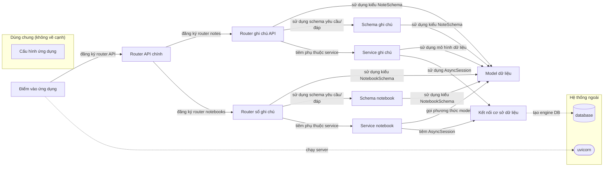

# Sơ đồ component — rhoboro_async-fastapi-sqlalchemy-6c08827

Trạng thái: **complete**. Tên, vai trò, nhãn là suy luận của AI; mỗi phát biểu có trích dẫn đã được code kiểm khớp nguyên văn với source.

- File trong phạm vi: 15; component: 11; cạnh vẽ: 15; cạnh ẩn: 1; hệ thống ngoài: 2.
- Trích dẫn AI trả: 28; hợp lệ: 28; bị loại: 0.
- Thời gian: tổng 0.0 s = phân tích cục bộ 0.02 s + AI 0.0 s (model chạy 0 s, chờ giới hạn tốc độ 0.0 s).
- Token Groq: 0 (0 request mới, 5 lấy từ cache).

## Component

| ID | Tên | Vai trò | Trích dẫn | Số file |
|---|---|---|---|---:|
| C1 | Cấu hình ứng dụng (dùng chung) | Định nghĩa lớp Settings và khởi tạo cấu hình | `app/settings.py:7` `class Settings(BaseSettings):` | 1 |
| C2 | Điểm vào ứng dụng | Khởi tạo FastAPI, đăng ký router và chạy server | `app/main.py:6` `app = FastAPI(title="async-fastapi-sqlalchemy")` | 1 |
| C3 | Kết nối cơ sở dữ liệu | Tạo engine bất đồng bộ và session maker cho SQLAlchemy | `app/db.py:12` `async_engine = create_async_engine(` | 1 |
| C4 | Router API chính | Định nghĩa router API và gắn các router con cho notes và notebooks. | `app/api/main.py:6` `router = APIRouter()` | 1 |
| C5 | Schema notebook | Định nghĩa các schema Pydantic cho notebook. | `app/api/notebooks/schema.py:6` `class CreateNotebookRequest(BaseModel):` | 1 |
| C6 | Service notebook | Cung cấp các use case cho notebook, tương tác với DB và model. | `app/api/notebooks/use_cases.py:9` `class CreateNotebook:` | 1 |
| C7 | Router sổ ghi chú | Định nghĩa các endpoint API cho sổ ghi chú. | `app/api/notebooks/views.py:15` `router = APIRouter(prefix="/notebooks")` | 1 |
| C8 | Schema ghi chú | Định nghĩa các schema dữ liệu cho ghi chú. | `app/api/notes/schema.py:6` `class CreateNoteRequest(BaseModel):` | 1 |
| C9 | Service ghi chú | Cung cấp các use case cho thao tác ghi chú. | `app/api/notes/use_cases.py:9` `class CreateNote:` | 1 |
| C10 | Router ghi chú API | Định nghĩa các endpoint API cho ghi chú. | `app/api/notes/views.py:15` `router = APIRouter(prefix="/notes")` | 1 |
| C11 | Model dữ liệu | Định nghĩa các lớp ORM và schema cho cơ sở dữ liệu. | `app/models/notes.py:16` `class Note(Base):` | 5 |

## Cạnh được vẽ

Cạnh được vẽ theo quy tắc: mọi quan hệ import giữa hai khối, trừ khối dùng chung. Phía nguồn: dòng trích (AI chọn, code kiểm; thiếu thì code lấy dòng dùng import). Phía đích: nơi định nghĩa tên được dùng.

| Từ | Tới | Loại (AI ghi chú) | Nhãn | Trích dẫn phía nguồn | Phía đích |
|---|---|---|---|---|---|
| Router ghi chú API | Model dữ liệu | type | sử dụng kiểu NoteSchema | `app/api/notes/views.py:23` `) -> NoteSchema:` | `app/models/schema.py:4` |
| Router ghi chú API | Schema ghi chú | type | sử dụng schema yêu cầu/đáp | `app/api/notes/views.py:18` `@router.post("", response_model=CreateNoteResponse)` | `app/api/notes/schema.py:6`, `app/api/notes/schema.py:12` |
| Router ghi chú API | Service ghi chú | inject | tiêm phụ thuộc service | `app/api/notes/views.py:22` `use_case: CreateNote = Depends(CreateNote),` | `app/api/notes/use_cases.py:9`, `app/api/notes/use_cases.py:67` |
| Điểm vào ứng dụng | Router API chính | call | đăng ký router API | `app/main.py:8` `app.include_router(api_router, prefix="/api")` | `app/api/main.py:6` |
| Router API chính | Router ghi chú API | register | đăng ký router notes | `app/api/main.py:7` `router.include_router(notes_router)` | `app/api/notes/views.py:15` |
| Router API chính | Router sổ ghi chú | register | đăng ký router notebooks | `app/api/main.py:8` `router.include_router(notebooks_router)` | `app/api/notebooks/views.py:15` |
| Schema notebook | Model dữ liệu | type | sử dụng kiểu NotebookSchema | `app/api/notebooks/schema.py:20` `notebooks: list[NotebookSchema]` | `app/models/schema.py:14` |
| Service notebook | Model dữ liệu | call | gọi phương thức model | `app/api/notebooks/use_cases.py:15` `exist_notes = [n async for n in Note.read_by_ids(session, note_ids=notes)]` | `app/models/notes.py:16`, `app/models/notebooks.py:15` |
| Service notebook | Kết nối cơ sở dữ liệu | inject | tiêm AsyncSession | `app/api/notebooks/use_cases.py:10` `def __init__(self, session: AsyncSession) -> None:` | `app/db.py:12` |
| Router sổ ghi chú | Model dữ liệu | type | sử dụng kiểu NotebookSchema | `app/api/notebooks/views.py:23` `) -> NotebookSchema:` | `app/models/schema.py:14` |
| Router sổ ghi chú | Schema notebook | type | sử dụng schema yêu cầu/đáp | `app/api/notebooks/views.py:18` `@router.post("", response_model=CreateNotebookResponse)` | `app/api/notebooks/schema.py:6`, `app/api/notebooks/schema.py:11` |
| Router sổ ghi chú | Service notebook | inject | tiêm phụ thuộc service | `app/api/notebooks/views.py:22` `use_case: CreateNotebook = Depends(CreateNotebook),` | `app/api/notebooks/use_cases.py:9`, `app/api/notebooks/use_cases.py:62` |
| Schema ghi chú | Model dữ liệu | type | sử dụng kiểu NoteSchema | `app/api/notes/schema.py:21` `notes: list[NoteSchema]` | `app/models/schema.py:4` |
| Service ghi chú | Model dữ liệu | type | sử dụng mô hình dữ liệu | `app/api/notes/use_cases.py:15` `notebook = await Notebook.read_by_id(session, notebook_id)` | `app/models/notes.py:16`, `app/models/notebooks.py:15` |
| Service ghi chú | Kết nối cơ sở dữ liệu | type | sử dụng AsyncSession | `app/api/notes/use_cases.py:10` `def __init__(self, session: AsyncSession) -> None:` | `app/db.py:12` |
| Điểm vào ứng dụng | uvicorn (other) | kết nối ngoài | chạy server | `app/main.py:19` `uvicorn.run(app, host="0.0.0.0", port=8000)` | — |
| Kết nối cơ sở dữ liệu | database (database) | kết nối ngoài | tạo engine DB | `app/db.py:12` `async_engine = create_async_engine(` | — |

## Cạnh có trong code nhưng không vẽ

| Từ | Tới | Lý do | Trích dẫn |
|---|---|---|---|
| Kết nối cơ sở dữ liệu | Cấu hình ứng dụng | shared support is drawn without edges (SPEC) | — |

## Giới hạn

- Cạnh giữa component chỉ lấy từ import đã phân giải; lời gọi động, HTTP nội bộ, queue theo tên chưa thấy được.
- Trích dẫn khớp chứng minh dòng code tồn tại, không chứng minh câu mô tả đúng nghĩa; cần người review.
