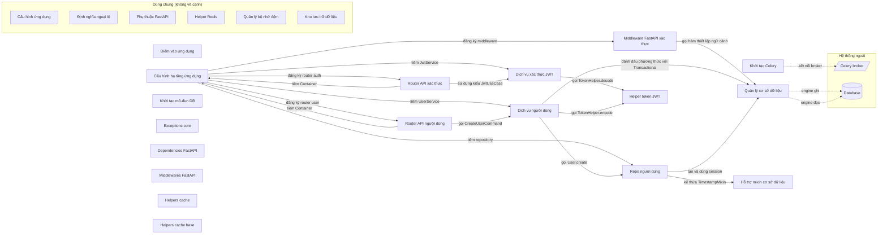

# Sơ đồ component — teamhide_fastapi-boilerplate-df4e6d4

Trạng thái: **partial**. Tên, vai trò, nhãn là suy luận của AI; mỗi phát biểu có trích dẫn đã được code kiểm khớp nguyên văn với source.

- File trong phạm vi: 54; component: 24; cạnh vẽ: 17; cạnh ẩn: 19; hệ thống ngoài: 2.
- Trích dẫn AI trả: 44; hợp lệ: 43; bị loại: 5.
- Thời gian: tổng 0.1 s = phân tích cục bộ 0.06 s + AI 0.0 s (model chạy 0 s, chờ giới hạn tốc độ 0.0 s).
- Token Groq: 0 (0 request mới, 10 lấy từ cache).

## Component

| ID | Tên | Vai trò | Trích dẫn | Số file |
|---|---|---|---|---:|
| C1 | Điểm vào ứng dụng | Khởi chạy ứng dụng FastAPI qua lệnh CLI | `main.py:24` `uvicorn.run(` | 1 |
| C2 | Cấu hình hạ tầng ứng dụng | Cung cấp container DI và khởi tạo FastAPI app | `app/container.py:10` `class Container(DeclarativeContainer):` | 2 |
| C3 | Router API xác thực | Định nghĩa các endpoint xác thực và phụ thuộc vào JwtUseCase | `app/auth/adapter/input/api/__init__.py:5` `router = APIRouter()` | 4 |
| C4 | Dịch vụ xác thực JWT | cung cấp các chức năng JWT cho ứng dụng | `app/auth/application/service/jwt.py:11` `class JwtService(JwtUseCase):` | 4 |
| C5 | Router API người dùng | định nghĩa các endpoint cho người dùng | `app/user/adapter/input/api/__init__.py:5` `router = APIRouter()` | 4 |
| C6 | Dịch vụ người dùng | cung cấp các nghiệp vụ người dùng như tạo và lấy danh sách | `app/user/application/service/user.py:16` `class UserService(UserUseCase):` | 6 |
| C7 | Repo người dùng | Quản lý lưu trữ và truy xuất thực thể người dùng | `app/user/adapter/output/persistence/sqlalchemy/user.py:8` `class UserSQLAlchemyRepo(UserRepo):` | 5 |
| C8 | Khởi tạo Celery | Cấu hình và khởi tạo Celery app cho các task | `celery_task/__init__.py:5` `celery_app = Celery(` | 1 |
| C9 | Cấu hình ứng dụng (dùng chung) | Định nghĩa các lớp cấu hình cho môi trường khác nhau | `core/config.py:6` `class Config(BaseSettings):` | 1 |
| C10 | Quản lý cơ sở dữ liệu | Quản lý kết nối và phiên làm việc với cơ sở dữ liệu bất đồng bộ. | `core/db/session.py:38` `EngineType.WRITER: create_async_engine(config.WRITER_DB_URL, pool_recycle=3600)` | 3 |
| C11 | Định nghĩa ngoại lệ (dùng chung) | Định nghĩa lớp ngoại lệ cơ bản cho toàn bộ dự án. | `core/exceptions/base.py:1` `class CustomException(Exception):` | 1 |
| C12 | Phụ thuộc FastAPI (dùng chung) | Cung cấp các phụ thuộc FastAPI như logging và kiểm soát quyền truy cập. | `core/fastapi/dependencies/logging.py:4` `class Logging:` | 2 |
| C13 | Middleware FastAPI xác thực | Xác thực và ghi log cho các yêu cầu FastAPI | `core/fastapi/middlewares/authentication.py:36` `payload = jwt.decode(` | 3 |
| C14 | Helper Redis (dùng chung) | Tạo client Redis để kết nối tới Redis server | `core/helpers/redis.py:5` `redis_client = redis.from_url(url=f"redis://{config.REDIS_HOST}", decode_responses=True)` | 1 |
| C15 | Helper token JWT | Cung cấp lớp hỗ trợ mã hoá và giải mã JWT | `core/helpers/token.py:24` `token = jwt.encode(` | 1 |
| C16 | Quản lý bộ nhớ đệm (dùng chung) | Cung cấp lớp quản lý và backend cho bộ nhớ đệm. | `core/helpers/cache/cache_manager.py:7` `class CacheManager:` | 6 |
| C17 | Kho lưu trữ dữ liệu (dùng chung) | Định nghĩa lớp cơ sở cho các repository dữ liệu. | `core/repository/base.py:11` `class BaseRepo(Generic[ModelType]):` | 2 |
| C18 | Khởi tạo mô-đun DB | Xác định các export của mô-đun cơ sở dữ liệu. | `core/db/__init__.py:4` `__all__ = [` | 1 |
| C19 | Hỗ trợ mixin cơ sở dữ liệu | _chưa có trích dẫn hợp lệ_ | — | 1 |
| C20 | Exceptions core | định nghĩa các ngoại lệ chung cho dự án | `core/exceptions/__init__.py:4` `__all__ = [` | 1 |
| C21 | Dependencies FastAPI | cung cấp các phụ thuộc dùng chung cho FastAPI | `core/fastapi/dependencies/__init__.py:9` `__all__ = [` | 1 |
| C22 | Middlewares FastAPI | Định nghĩa danh sách các middleware được xuất khẩu | `core/fastapi/middlewares/__init__.py:5` `__all__ = [` | 1 |
| C23 | Helpers cache | Định nghĩa danh sách các helper cache được xuất khẩu | `core/helpers/cache/__init__.py:6` `__all__ = [` | 1 |
| C24 | Helpers cache base | Định nghĩa danh sách các helper cache cơ bản được xuất khẩu | `core/helpers/cache/base/__init__.py:4` `__all__ = [` | 1 |

## Cạnh được vẽ

Cạnh được vẽ theo quy tắc: mọi quan hệ import giữa hai khối, trừ khối dùng chung. Phía nguồn: dòng trích (AI chọn, code kiểm; thiếu thì code lấy dòng dùng import). Phía đích: nơi định nghĩa tên được dùng.

| Từ | Tới | Loại (AI ghi chú) | Nhãn | Trích dẫn phía nguồn | Phía đích |
|---|---|---|---|---|---|
| Middleware FastAPI xác thực | Quản lý cơ sở dữ liệu | call | gọi hàm thiết lập ngữ cảnh | `core/fastapi/middlewares/sqlalchemy.py:14` `context = set_session_context(session_id=session_id)` | `core/db/session.py:24`, `core/db/session.py:28` |
| Cấu hình hạ tầng ứng dụng | Middleware FastAPI xác thực | register | đăng ký middleware | `app/server.py:63` `backend=AuthBackend(),` | `core/fastapi/middlewares/authentication.py:16`, `core/fastapi/middlewares/authentication.py:49` |
| Cấu hình hạ tầng ứng dụng | Router API xác thực | register | đăng ký router auth | `app/server.py:24` `auth_router.container = container` | `app/auth/adapter/input/api/__init__.py:5` |
| Cấu hình hạ tầng ứng dụng | Dịch vụ xác thực JWT | inject | tiêm JwtService | `app/container.py:17` `jwt_service = Factory(JwtService)` | `app/auth/application/service/jwt.py:11` |
| Cấu hình hạ tầng ứng dụng | Router API người dùng | register | đăng ký router user | `app/server.py:23` `user_router.container = container` | `app/user/adapter/input/api/__init__.py:5` |
| Cấu hình hạ tầng ứng dụng | Dịch vụ người dùng | inject | tiêm UserService | `app/container.py:15` `user_service = Factory(UserService, repository=user_repo_adapter)` | `app/user/application/service/user.py:16` |
| Cấu hình hạ tầng ứng dụng | Repo người dùng | inject | tiêm repository | `app/container.py:13` `user_repo = Singleton(UserSQLAlchemyRepo)` | `app/user/adapter/output/persistence/repository_adapter.py:5`, `app/user/adapter/output/persistence/sqlalchemy/user.py:8` |
| Router API xác thực | Cấu hình hạ tầng ứng dụng | inject | tiêm Container | `app/auth/adapter/input/api/v1/auth.py:10` `from app.container import Container` | `app/container.py:10` |
| Router API xác thực | Dịch vụ xác thực JWT | type | sử dụng kiểu JwtUseCase | `app/auth/adapter/input/api/v1/auth.py:9` `from app.auth.domain.usecase.jwt import JwtUseCase` | `app/auth/domain/usecase/jwt.py:6` |
| Dịch vụ xác thực JWT | Helper token JWT | call | gọi TokenHelper.decode | `app/auth/application/service/jwt.py:14` `TokenHelper.decode(token=token)` | `core/helpers/token.py:21`, `core/helpers/token.py:9` |
| Router API người dùng | Cấu hình hạ tầng ứng dụng | inject | tiêm Container | `app/user/adapter/input/api/v1/user.py:4` `from app.container import Container` | `app/container.py:10` |
| Router API người dùng | Dịch vụ người dùng | call | gọi CreateUserCommand | `app/user/adapter/input/api/v1/user.py:38` `command = CreateUserCommand(**request.model_dump())` | `app/user/application/dto/__init__.py:17`, `app/user/application/dto/__init__.py:4` |
| Dịch vụ người dùng | Quản lý cơ sở dữ liệu | call | đánh dấu phương thức với Transactional | `app/user/application/service/user.py:28` `@Transactional()` | `core/db/transactional.py:6` |
| Dịch vụ người dùng | Helper token JWT | call | gọi TokenHelper.encode | `app/user/application/service/user.py:64` `token=TokenHelper.encode(payload={"user_id": user.id}),` | `core/helpers/token.py:21` |
| Dịch vụ người dùng | Repo người dùng | call | gọi User.create | `app/user/application/service/user.py:40` `user = User.create(` | `app/user/adapter/output/persistence/repository_adapter.py:5`, `app/user/domain/entity/user.py:10` |
| Repo người dùng | Quản lý cơ sở dữ liệu | call | tạo và dùng session | `app/user/adapter/output/persistence/sqlalchemy/user.py:24` `async with session_factory() as read_session:` | `core/db/session.py:56`, `core/db/session.py:67` |
| Repo người dùng | Hỗ trợ mixin cơ sở dữ liệu | type | kế thừa TimestampMixin | `app/user/domain/entity/user.py:10` `class User(Base, TimestampMixin):` | `core/db/mixins/__init__.py:1` |
| Khởi tạo Celery | Celery broker (queue) | kết nối ngoài | kết nối broker | `celery_task/__init__.py:8` `broker=config.CELERY_BROKER_URL,` | — |
| Quản lý cơ sở dữ liệu | Database (database) | kết nối ngoài | engine ghi | `core/db/session.py:38` `EngineType.WRITER: create_async_engine(config.WRITER_DB_URL, pool_recycle=3600)` | — |
| Quản lý cơ sở dữ liệu | Database (database) | kết nối ngoài | engine đọc | `core/db/session.py:39` `EngineType.READER: create_async_engine(config.READER_DB_URL, pool_recycle=3600)` | — |

## Cạnh có trong code nhưng không vẽ

| Từ | Tới | Lý do | Trích dẫn |
|---|---|---|---|
| Điểm vào ứng dụng | Cấu hình ứng dụng | shared support is drawn without edges (SPEC) | — |
| Quản lý cơ sở dữ liệu | Cấu hình ứng dụng | shared support is drawn without edges (SPEC) | — |
| Phụ thuộc FastAPI | Định nghĩa ngoại lệ | shared support is drawn without edges (SPEC) | — |
| Phụ thuộc FastAPI | Cấu hình hạ tầng ứng dụng | shared support is drawn without edges (SPEC) | — |
| Phụ thuộc FastAPI | Dịch vụ người dùng | shared support is drawn without edges (SPEC) | — |
| Middleware FastAPI xác thực | Cấu hình ứng dụng | shared support is drawn without edges (SPEC) | — |
| Helper Redis | Cấu hình ứng dụng | shared support is drawn without edges (SPEC) | — |
| Helper token JWT | Định nghĩa ngoại lệ | shared support is drawn without edges (SPEC) | — |
| Helper token JWT | Cấu hình ứng dụng | shared support is drawn without edges (SPEC) | — |
| Quản lý bộ nhớ đệm | Helper Redis | shared support is drawn without edges (SPEC) | — |
| Kho lưu trữ dữ liệu | Quản lý cơ sở dữ liệu | shared support is drawn without edges (SPEC) | — |
| Cấu hình hạ tầng ứng dụng | Định nghĩa ngoại lệ | shared support is drawn without edges (SPEC) | — |
| Cấu hình hạ tầng ứng dụng | Phụ thuộc FastAPI | shared support is drawn without edges (SPEC) | — |
| Cấu hình hạ tầng ứng dụng | Quản lý bộ nhớ đệm | shared support is drawn without edges (SPEC) | — |
| Cấu hình hạ tầng ứng dụng | Cấu hình ứng dụng | shared support is drawn without edges (SPEC) | — |
| Dịch vụ xác thực JWT | Định nghĩa ngoại lệ | shared support is drawn without edges (SPEC) | — |
| Router API người dùng | Phụ thuộc FastAPI | shared support is drawn without edges (SPEC) | — |
| Dịch vụ người dùng | Định nghĩa ngoại lệ | shared support is drawn without edges (SPEC) | — |
| Khởi tạo Celery | Cấu hình ứng dụng | shared support is drawn without edges (SPEC) | — |

## Bị loại vì trích dẫn không khớp

- C4 edge E33: not an open candidate edge of this component
- C5 edge E36: not an open candidate edge of this component
- C5 edge E36: not an open candidate edge of this component
- C6 edge E40: not an open candidate edge of this component
- C19 role: quote too short

## Giới hạn

- Cạnh giữa component chỉ lấy từ import đã phân giải; lời gọi động, HTTP nội bộ, queue theo tên chưa thấy được.
- Trích dẫn khớp chứng minh dòng code tồn tại, không chứng minh câu mô tả đúng nghĩa; cần người review.
- 7 files not grouped by AI; grouped by directory
