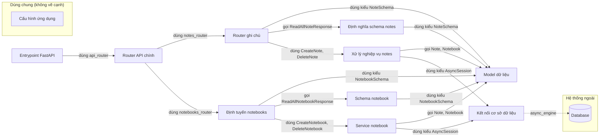

# Sơ đồ component — rhoboro_async-fastapi-sqlalchemy-6c08827

Trạng thái: **complete**. Tên, vai trò, hệ thống ngoài là suy luận của AI; mỗi phát biểu có trích dẫn đã được code kiểm khớp nguyên văn với source. Cạnh do code vẽ.

- File trong phạm vi: 15; component: 11; cạnh vẽ: 15; cạnh ẩn: 1; hệ thống ngoài: 1.
- Trích dẫn AI trả: 12; hợp lệ: 12; bị loại: 0.
- Thời gian: tổng 68.4 s = phân tích cục bộ 0.03 s + AI 68.4 s (model chạy 9.3 s, chờ giới hạn tốc độ 59.1 s).
- Token Groq: 7283 (4 request mới, 1 lấy từ cache).

## Component

| ID | Tên | Vai trò | Trích dẫn | Số file |
|---|---|---|---|---:|
| C1 | Cấu hình ứng dụng (dùng chung) | Định nghĩa các thiết lập cấu hình cho ứng dụng. | `app/settings.py:7` `class Settings(BaseSettings):` | 1 |
| C2 | Entrypoint FastAPI | Khởi tạo FastAPI và chạy server. | `app/main.py:6` `app = FastAPI(title="async-fastapi-sqlalchemy")` | 1 |
| C3 | Kết nối cơ sở dữ liệu | Tạo engine bất đồng bộ để kết nối DB. | `app/db.py:12` `async_engine = create_async_engine(` | 1 |
| C4 | Router API chính | Định nghĩa router và gắn các router con cho notes và notebooks. | `app/api/main.py:6` `router = APIRouter()` | 1 |
| C5 | Schema notebook | Định nghĩa các mô hình dữ liệu cho notebook. | `app/api/notebooks/schema.py:6` `class CreateNotebookRequest(BaseModel):` | 1 |
| C6 | Service notebook | Cung cấp các use case xử lý notebook như tạo, đọc, cập nhật, xóa. | `app/api/notebooks/use_cases.py:9` `class CreateNotebook:` | 1 |
| C7 | Định tuyến notebooks | Định nghĩa các endpoint API cho notebooks | `app/api/notebooks/views.py:15` `router = APIRouter(prefix="/notebooks")` | 1 |
| C8 | Định nghĩa schema notes | Mô tả các mô hình dữ liệu cho notes | `app/api/notes/schema.py:6` `class CreateNoteRequest(BaseModel):` | 1 |
| C9 | Xử lý nghiệp vụ notes | Cài đặt các use case cho notes | `app/api/notes/use_cases.py:9` `class CreateNote:` | 1 |
| C10 | Router ghi chú | Định nghĩa các endpoint API cho ghi chú | `app/api/notes/views.py:15` `router = APIRouter(prefix="/notes")` | 1 |
| C11 | Model dữ liệu | Định nghĩa các lớp ORM và schema cho notebook và note | `app/models/notebooks.py:15` `class Notebook(Base):` | 5 |

## Cạnh được vẽ

Cạnh do code vẽ theo quy tắc: mọi quan hệ import giữa hai khối, trừ khối dùng chung. Nhãn và trích dẫn do code lấy từ dòng dùng import; phía đích là nơi định nghĩa tên được dùng.

| Từ | Tới | Nhãn | Trích dẫn phía nguồn | Phía đích |
|---|---|---|---|---|
| Router ghi chú | Model dữ liệu | dùng kiểu NoteSchema | `app/api/notes/views.py:23` `) -> NoteSchema:` | `app/models/schema.py:4` |
| Router ghi chú | Định nghĩa schema notes | gọi ReadAllNoteResponse | `app/api/notes/views.py:32` `return ReadAllNoteResponse(notes=[note async for note in use_case.execute()])` | `app/api/notes/schema.py:6`, `app/api/notes/schema.py:12` |
| Router ghi chú | Xử lý nghiệp vụ notes | dùng CreateNote, DeleteNote | `app/api/notes/views.py:22` `use_case: CreateNote = Depends(CreateNote),` | `app/api/notes/use_cases.py:9`, `app/api/notes/use_cases.py:67` |
| Entrypoint FastAPI | Router API chính | dùng api_router | `app/main.py:8` `app.include_router(api_router, prefix="/api")` | `app/api/main.py:6` |
| Router API chính | Router ghi chú | dùng notes_router | `app/api/main.py:7` `router.include_router(notes_router)` | `app/api/notes/views.py:15` |
| Router API chính | Định tuyến notebooks | dùng notebooks_router | `app/api/main.py:8` `router.include_router(notebooks_router)` | `app/api/notebooks/views.py:15` |
| Schema notebook | Model dữ liệu | dùng kiểu NotebookSchema | `app/api/notebooks/schema.py:20` `notebooks: list[NotebookSchema]` | `app/models/schema.py:14` |
| Service notebook | Model dữ liệu | gọi Note, Notebook | `app/api/notebooks/use_cases.py:15` `exist_notes = [n async for n in Note.read_by_ids(session, note_ids=notes)]` | `app/models/notes.py:16`, `app/models/notebooks.py:15` |
| Service notebook | Kết nối cơ sở dữ liệu | dùng kiểu AsyncSession | `app/api/notebooks/use_cases.py:10` `def __init__(self, session: AsyncSession) -> None:` | `app/db.py:12` |
| Định tuyến notebooks | Model dữ liệu | dùng kiểu NotebookSchema | `app/api/notebooks/views.py:23` `) -> NotebookSchema:` | `app/models/schema.py:14` |
| Định tuyến notebooks | Schema notebook | gọi ReadAllNotebookResponse | `app/api/notebooks/views.py:31` `return ReadAllNotebookResponse(notebooks=[nb async for nb in use_case.execute()])` | `app/api/notebooks/schema.py:6`, `app/api/notebooks/schema.py:11` |
| Định tuyến notebooks | Service notebook | dùng CreateNotebook, DeleteNotebook | `app/api/notebooks/views.py:22` `use_case: CreateNotebook = Depends(CreateNotebook),` | `app/api/notebooks/use_cases.py:9`, `app/api/notebooks/use_cases.py:62` |
| Định nghĩa schema notes | Model dữ liệu | dùng kiểu NoteSchema | `app/api/notes/schema.py:21` `notes: list[NoteSchema]` | `app/models/schema.py:4` |
| Xử lý nghiệp vụ notes | Model dữ liệu | gọi Note, Notebook | `app/api/notes/use_cases.py:15` `notebook = await Notebook.read_by_id(session, notebook_id)` | `app/models/notes.py:16`, `app/models/notebooks.py:15` |
| Xử lý nghiệp vụ notes | Kết nối cơ sở dữ liệu | dùng kiểu AsyncSession | `app/api/notes/use_cases.py:10` `def __init__(self, session: AsyncSession) -> None:` | `app/db.py:12` |
| Kết nối cơ sở dữ liệu | Database (database) | async_engine (AI) | `app/db.py:12` `async_engine = create_async_engine(` | — |

## Cạnh có trong code nhưng không vẽ

| Từ | Tới | Lý do | Trích dẫn |
|---|---|---|---|
| Kết nối cơ sở dữ liệu | Cấu hình ứng dụng | shared support is drawn without edges (SPEC) | — |

## Giới hạn

- Cạnh giữa component chỉ lấy từ import đã phân giải; lời gọi động, HTTP nội bộ, queue theo tên chưa thấy được.
- Trích dẫn khớp chứng minh dòng code tồn tại, không chứng minh câu mô tả đúng nghĩa; cần người review.
