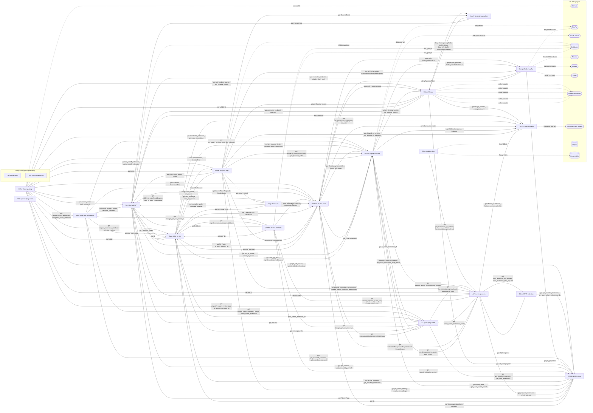

# Sơ đồ component — lnbits_lnbits-958e4da

Trạng thái: **partial**. Tên, vai trò, hệ thống ngoài là suy luận của AI; mỗi phát biểu có trích dẫn đã được code kiểm khớp nguyên văn với source. Cạnh do code vẽ.

- File trong phạm vi: 170; component: 21; cạnh vẽ: 97; cạnh ẩn: 34; hệ thống ngoài: 11.
- Trích dẫn AI trả: 41; hợp lệ: 40; bị loại: 1.
- Thời gian: tổng 531.7 s = phân tích cục bộ 1.3 s + AI 530.4 s (model chạy 46.8 s, chờ giới hạn tốc độ 483.6 s).
- Token Groq: 33452 (10 request mới, 0 lấy từ cache).

## Component

| ID | Tên | Vai trò | Trích dẫn | Số file |
|---|---|---|---|---:|
| C1 | Điểm vào ứng dụng | Khởi tạo và cấu hình FastAPI cho ứng dụng | `lnbits/__main__.py:3` `app = create_app()` | 6 |
| C3 | Máy chủ HTTP | Chạy server và thiết lập middleware | `lnbits/server.py:58` `config = uvicorn.Config(` | 2 |
| C4 | Quản lý tác vụ nền | Quản lý hàng đợi và cơ sở dữ liệu cho các tác vụ | `lnbits/core/db.py:4` `db = Database("database")` | 7 |
| C5 | Mô hình dữ liệu core | Định nghĩa các schema dữ liệu dùng trong ứng dụng. | `lnbits/core/models/assets.py:10` `class AssetInfo(BaseModel):` | 15 |
| C6 | CRUD dữ liệu core | Thực hiện các thao tác tạo, đọc, cập nhật, xóa trên cơ sở dữ liệu. | `lnbits/core/crud/tinyurl.py:30` `"SELECT * FROM tiny_url WHERE url = :url",` | 11 |
| C7 | Dịch vụ nghiệp vụ core | Cung cấp các chức năng nghiệp vụ như thanh toán fiat và gửi email thông báo. | `lnbits/core/services/fiat_providers.py:133` `async with httpx.AsyncClient(base_url=settings.paypal_api_endpoint) as client:` | 16 |
| C8 | Router API giao diện | Định nghĩa các router cho các endpoint API của hệ thống. | `lnbits/core/views/admin_api.py:31` `admin_router = APIRouter(tags=["Admin UI"], prefix="/admin")` | 19 |
| C9 | API mở rộng wasm | Cung cấp các lớp và hàm hỗ trợ API cho các extension wasm. | `lnbits/core/wasm_ext/api/host.py:71` `class ExtensionHostAPI:` | 10 |
| C10 | Client HTTP mở rộng | Thực hiện các yêu cầu HTTP tới các extension wasm từ phía client. | `lnbits/core/wasm_ext/client/extensions.py:59` `async with httpx.AsyncClient(` | 3 |
| C11 | Định tuyến mở rộng wasm | Định nghĩa các route cho phần mở rộng WebAssembly. | `lnbits/core/wasm_ext/routes/register.py:21` `def register_wasm_extension(app: FastAPI, ext_id: str) -> WasmExtension:` | 7 |
| C12 | Cung cấp dịch vụ fiat | Xây dựng các lớp tích hợp với các nhà cung cấp thanh toán fiat. | `lnbits/fiat/paypal.py:75` `self.client = httpx.AsyncClient(base_url=self.endpoint, headers=self.headers)` | 6 |
| C13 | Khách hàng nút blockchain | Cung cấp các lớp client để giao tiếp với các node Lightning. | `lnbits/nodes/lndrest.py:60` `class LndRestNode(Node):` | 4 |
| C14 | Khách hàng ví | Cung cấp các lớp để tương tác với các ví tiền điện tử. | `lnbits/wallets/alby.py:23` `class AlbyWallet(Wallet):` | 36 |
| C17 | Cài đặt cấu hình (dùng chung) | Định nghĩa các mô hình cấu hình cho ứng dụng LNbits. | `lnbits/settings.py:36` `class LNbitsSettings(BaseModel):` | 1 |
| C18 | Trình trang trí API | Cung cấp các decorator và scheme xác thực cho API. | `lnbits/decorators.py:39` `oauth2_scheme = OAuth2PasswordBearer(` | 4 |
| C19 | Tiện ích chia sẻ chung (dùng chung) | Cung cấp các lớp và hàm tiện ích chung cho dự án. | `lnbits/utils/logger.py:91` `class Formatter:` | 4 |
| C20 | Tiện ích không chia sẻ | Cung cấp các tiện ích riêng cho Electrum, tỷ giá và Nostr. | `lnbits/utils/electrum.py:38` `class ElectrumError(Exception):` | 3 |
| C21 | Công cụ dòng lệnh | Cung cấp các script CLI hỗ trợ công cụ và chuyển đổi dữ liệu. | `tools/conv.py:38` `consq = sqlite3.connect(sqdb)` | 6 |
| C22 | Khởi tạo mở rộng wasm | Xác định các thành phần công khai của mô-đun wasm_ext. | `lnbits/core/wasm_ext/__init__.py:13` `__all__ = [` | 1 |
| C23 | Quản lý lưu trữ mở rộng | Thực hiện CRUD cho dữ liệu mở rộng bằng kết nối Database động. | `lnbits/core/wasm_ext/storage/crud.py:35` `async with Database(f"ext_{ext_id}").connect() as conn:` | 2 |
| C24 | Xử lý mở rộng wasm | Cung cấp cấu hình, tải và thực thi các thành phần wasm cho extension. | `lnbits/core/wasm_ext/wasm/component.py:19` `config = Config()` | 7 |

## Cạnh được vẽ

Cạnh do code vẽ theo quy tắc: mọi quan hệ import giữa hai khối, trừ khối dùng chung. Nhãn và trích dẫn do code lấy từ dòng dùng import; phía đích là nơi định nghĩa tên được dùng.

| Từ | Tới | Nhãn | Trích dẫn phía nguồn | Phía đích |
|---|---|---|---|---|
| Điểm vào ứng dụng | Định tuyến mở rộng wasm | gọi register_wasm_extension, unregister_wasm_extension | `lnbits/app.py:461` `register_wasm_extension(app, ext_id)` | `lnbits/core/wasm_ext/routes/register.py:21`, `lnbits/core/wasm_ext/routes/register.py:43` |
| Điểm vào ứng dụng | Khách hàng ví | gọi get_funding_source, set_funding_source | `lnbits/app.py:108` `set_funding_source()` | `lnbits/wallets/__init__.py:47`, `lnbits/wallets/__init__.py:38` |
| Điểm vào ứng dụng | Trình trang trí API | gọi version_parse, path_segments | `lnbits/app.py:363` `ext_releases, key=lambda r: version_parse(r.version), reverse=True` | `lnbits/helpers.py:235`, `lnbits/helpers.py:335` |
| Điểm vào ứng dụng | Xử lý mở rộng wasm | gọi dispatch_wasm_invoice_paid, is_wasm_extension_dir | `lnbits/app.py:318` `if not ext_dir.is_dir() or not is_wasm_extension_dir(ext_dir):` | `lnbits/core/wasm_ext/wasm/events.py:18`, `lnbits/core/wasm_ext/wasm/loader.py:35` |
| Điểm vào ứng dụng | Máy chủ HTTP | gọi add_first_install_middleware, add_ip_block_middleware | `lnbits/app.py:211` `add_first_install_middleware(app)` | `lnbits/middleware.py:113`, `lnbits/middleware.py:92` |
| Điểm vào ứng dụng | Quản lý tác vụ nền | gọi migrate_extension_database, init_core_routers | `lnbits/app.py:97` `core_app_extra.register_new_ratelimiter()` | `lnbits/core/helpers.py:24`, `lnbits/core/tasks.py:21` |
| Điểm vào ứng dụng | Mô hình dữ liệu core | gọi Extension, ExtensionMeta | `lnbits/app.py:323` `ext_info = InstallableExtension.from_wasm_ext_dir(ext_id)` | `lnbits/core/models/notifications.py:8`, `lnbits/core/models/extensions.py:259` |
| Điểm vào ứng dụng | CRUD dữ liệu core | gọi get_db_version, get_installed_extensions | `lnbits/app.py:312` `installed_extensions = await get_installed_extensions()` | `lnbits/core/crud/db_versions.py:7`, `lnbits/core/crud/extensions.py:118` |
| Điểm vào ứng dụng | Dịch vụ nghiệp vụ core | gọi deactivate_extension, get_valid_extensions | `lnbits/app.py:96` `await check_admin_settings()` | `lnbits/core/services/extensions.py:665`, `lnbits/core/services/extensions.py:742` |
| Điểm vào ứng dụng | Router API giao diện | gọi api_install_extension, api_uninstall_extension | `lnbits/commands.py:713` `await api_install_extension(data)` | `lnbits/core/views/extension_api.py:102`, `lnbits/core/views/extension_api.py:683` |
| Client HTTP mở rộng | CRUD dữ liệu core | gọi get_installed_extension, get_user_active_extensions_ids | `lnbits/core/wasm_ext/client/extensions.py:152` `extension = await get_installed_extension(target_extension_id)` | `lnbits/core/crud/extensions.py:107`, `lnbits/core/crud/extensions.py:178` |
| Client HTTP mở rộng | API mở rộng wasm | gọi HttpResponse | `lnbits/core/wasm_ext/client/extensions.py:74` `return HttpResponse(` | `lnbits/core/wasm_ext/api/models.py:293`, `lnbits/core/wasm_ext/api/models.py:287` |
| Định tuyến mở rộng wasm | Trình trang trí API | gọi check_account_exists, template_renderer | `lnbits/core/wasm_ext/routes/security.py:24` `response = template_renderer().TemplateResponse(` | `lnbits/decorators.py:228`, `lnbits/decorators.py:278` |
| Định tuyến mở rộng wasm | Quản lý lưu trữ mở rộng | gọi storage_get_row_owner_id | `lnbits/core/wasm_ext/routes/api.py:178` `owner_id = await storage_get_row_owner_id(` | `lnbits/core/wasm_ext/storage/crud.py:55` |
| Định tuyến mở rộng wasm | Xử lý mở rộng wasm | gọi invoke_wasm_extension_export, warm_wasm_extension | `lnbits/core/wasm_ext/routes/api.py:96` `return await invoke_wasm_extension_export(` | `lnbits/core/wasm_ext/wasm/config.py:58`, `lnbits/core/wasm_ext/wasm/invoke.py:24` |
| Định tuyến mở rộng wasm | Quản lý tác vụ nền | gọi core_app_extra | `lnbits/core/wasm_ext/routes/register.py:24` `core_app_extra.wasm_extension_registry.require_available(loaded)` | `lnbits/core/db.py:5` |
| Định tuyến mở rộng wasm | Mô hình dữ liệu core | dùng kiểu Account | `lnbits/core/wasm_ext/routes/api.py:85` `account: Account ¦ None = None,` | `lnbits/core/models/users.py:183` |
| Định tuyến mở rộng wasm | CRUD dữ liệu core | gọi get_installed_extension, get_user_from_account | `lnbits/core/wasm_ext/routes/ui.py:119` `user = await get_user_from_account(account)` | `lnbits/core/crud/extensions.py:107`, `lnbits/core/crud/users.py:234` |
| Định tuyến mở rộng wasm | Dịch vụ nghiệp vụ core | gọi get_wasm_runtime_limits_for_extension | `lnbits/core/wasm_ext/routes/api.py:89` `limits = await get_wasm_runtime_limits_for_extension(extension.id)` | `lnbits/core/services/extensions.py:163` |
| Cung cấp dịch vụ fiat | Trình trang trí API | gọi normalize_endpoint, urlsafe_short_hash | `lnbits/fiat/paypal.py:69` `self.endpoint = normalize_endpoint(settings.paypal_api_endpoint)` | `lnbits/helpers.py:345`, `lnbits/helpers.py:43` |
| Cung cấp dịch vụ fiat | Mô hình dữ liệu core | dùng PaymentFilters | `lnbits/fiat/square.py:565` `"external_id", [subscription_id], PaymentFilters` | `lnbits/core/models/payments.py:169` |
| Cung cấp dịch vụ fiat | CRUD dữ liệu core | gọi get_payments | `lnbits/fiat/square.py:560` `payments = await get_payments(` | `lnbits/core/crud/payments.py:188` |
| Khách hàng nút blockchain | Khách hàng ví | dùng kiểu Wallet, CoreLightningWallet | `lnbits/nodes/base.py:160` `def __init__(self, wallet: Wallet):` | `lnbits/wallets/base.py:119`, `lnbits/wallets/corelightning.py:50` |
| Khách hàng nút blockchain | Trình trang trí API | gọi Filters, Page | `lnbits/nodes/cln.py:331` `return Page(data=results, total=count)` | `lnbits/db.py:449`, `lnbits/db.py:529` |
| Khách hàng ví | Điểm vào ứng dụng | gọi bolt11_lib | `lnbits/wallets/blink.py:276` `invoice = bolt11_lib.decode(bolt11)` | `lnbits/exceptions.py:22`, `lnbits/bolt11.py:1` |
| Khách hàng ví | Khách hàng nút blockchain | dùng CoreLightningNode, LndRestNode | `lnbits/wallets/corelightning.py:53` `__node_cls__ = CoreLightningNode` | `lnbits/nodes/base.py:158`, `lnbits/nodes/cln.py:61` |
| Khách hàng ví | Trình trang trí API | gọi normalize_endpoint, sha256s | `lnbits/wallets/alby.py:32` `self.endpoint = normalize_endpoint(settings.alby_api_endpoint)` | `lnbits/helpers.py:345`, `lnbits/helpers.py:388` |
| Khách hàng ví | Tiện ích không chia sẻ | gọi decrypt_content, encrypt_content | `lnbits/wallets/nwc.py:850` `tx = json_dumps(data)` | `lnbits/utils/nostr.py:54`, `lnbits/utils/nostr.py:21` |
| Khách hàng ví | CRUD dữ liệu core | gọi set_settings_field | `lnbits/wallets/boltz.py:425` `await set_settings_field("boltz_mnemonic", mnemonic)` | `lnbits/core/crud/settings.py:117` |
| Trình trang trí API | Tiện ích không chia sẻ | gọi currencies | `lnbits/helpers.py:80` `t.env.globals["CURRENCIES"] = list(currencies.keys())` | `lnbits/utils/exchange_rates.py:11` |
| Trình trang trí API | Quản lý tác vụ nền | gọi db | `lnbits/decorators.py:123` `async with db.connect() as conn:` | `lnbits/core/db.py:4` |
| Trình trang trí API | Mô hình dữ liệu core | gọi AccessTokenPayload, SimpleStatus | `lnbits/decorators.py:136` `return WalletTypeInfo(key_type, wallet)` | `lnbits/core/models/users.py:378`, `lnbits/core/models/users.py:183` |
| Trình trang trí API | CRUD dữ liệu core | gọi get_account, get_account_by_email | `lnbits/decorators.py:124` `wallet = await get_wallet_for_key(key_value, conn=conn)` | `lnbits/core/crud/users.py:119`, `lnbits/core/crud/users.py:188` |
| Công cụ dòng lệnh | API mở rộng wasm | gọi get_extension_api_method, list_extension_api_methods | `tools/codegen/extension_sdk_typescript.py:67` `return list_extension_api_methods(api_cls)` | `lnbits/core/wasm_ext/api/models.py:22`, `lnbits/core/wasm_ext/api/host.py:71` |
| Quản lý lưu trữ mở rộng | Trình trang trí API | gọi Database | `lnbits/core/wasm_ext/storage/crud.py:35` `async with Database(f"ext_{ext_id}").connect() as conn:` | `lnbits/db.py:45`, `lnbits/db.py:58` |
| Quản lý lưu trữ mở rộng | Quản lý tác vụ nền | gọi core_db | `lnbits/core/wasm_ext/storage/crud.py:719` `async with core_db.connect() as conn:` | `lnbits/core/db.py:4` |
| Quản lý lưu trữ mở rộng | Mô hình dữ liệu core | dùng kiểu DbVersion, InstallableExtension | `lnbits/core/wasm_ext/storage/crud.py:254` `ext: InstallableExtension,` | `lnbits/core/models/misc.py:86`, `lnbits/core/models/extensions.py:516` |
| Quản lý lưu trữ mở rộng | CRUD dữ liệu core | gọi update_migration_version | `lnbits/core/wasm_ext/storage/crud.py:717` `await update_migration_version(db, ext_id, version)` | `lnbits/core/crud/db_versions.py:21` |
| Xử lý mở rộng wasm | Trình trang trí API | gọi sha256s | `lnbits/core/wasm_ext/wasm/events.py:31` `wallet_owner_id = sha256s(wallet.user)` | `lnbits/helpers.py:388` |
| Xử lý mở rộng wasm | Quản lý lưu trữ mở rộng | gọi storage_get_row_owner_id | `lnbits/core/wasm_ext/wasm/events.py:181` `owner_id = await storage_get_row_owner_id(extension.id, source_table, source_id)` | `lnbits/core/wasm_ext/storage/crud.py:55` |
| Xử lý mở rộng wasm | Quản lý tác vụ nền | gọi core_app_extra | `lnbits/core/wasm_ext/wasm/events.py:22` `extension = core_app_extra.wasm_extension_registry.get(extension_id)` | `lnbits/core/db.py:5` |
| Xử lý mở rộng wasm | Mô hình dữ liệu core | gọi ExtensionWalletPaymentsWatchGrant | `lnbits/core/wasm_ext/wasm/events.py:145` `grant = ExtensionWalletPaymentsWatchGrant.parse_obj(grant_data)` | `lnbits/core/models/extensions.py:94`, `lnbits/core/models/extensions.py:188` |
| Xử lý mở rộng wasm | CRUD dữ liệu core | gọi get_installed_extension, get_user_extensions | `lnbits/core/wasm_ext/wasm/events.py:90` `return await get_wallet(wallet_id)` | `lnbits/core/crud/extensions.py:107`, `lnbits/core/crud/extensions.py:155` |
| Xử lý mở rộng wasm | Dịch vụ nghiệp vụ core | gọi finish_wasm_invocation, get_wasm_invocation_stop_reason | `lnbits/core/wasm_ext/wasm/invoke.py:56` `limits = resolve_wasm_runtime_limits(installed_extension)` | `lnbits/core/services/extensions.py:415`, `lnbits/core/services/extensions.py:409` |
| Xử lý mở rộng wasm | API mở rộng wasm | gọi list_extension_api_methods, ExtensionAPIHost | `lnbits/core/wasm_ext/wasm/host.py:22` `for method in list_extension_api_methods():` | `lnbits/core/wasm_ext/api/models.py:41`, `lnbits/core/wasm_ext/api/registry.py:70` |
| Máy chủ HTTP | Trình trang trí API | gọi normalize_path, template_renderer | `lnbits/middleware.py:77` `content=template_renderer()` | `lnbits/helpers.py:340`, `lnbits/helpers.py:60` |
| Máy chủ HTTP | Quản lý tác vụ nền | gọi core_app_extra | `lnbits/middleware.py:202` `core_app_extra.register_new_ratelimiter()` | `lnbits/core/db.py:5` |
| Máy chủ HTTP | Mô hình dữ liệu core | gọi AuditEntry | `lnbits/middleware.py:159` `data = AuditEntry(` | `lnbits/core/models/audit.py:11` |
| Quản lý tác vụ nền | Điểm vào ứng dụng | gọi bolt11 | `lnbits/core/migrations.py:218` `invoice = bolt11.decode(payment_request)` | `lnbits/bolt11.py:1` |
| Quản lý tác vụ nền | Trình trang trí API | gọi Database, Filters | `lnbits/core/db.py:4` `db = Database("database")` | `lnbits/db.py:292`, `lnbits/db.py:45` |
| Quản lý tác vụ nền | Tiện ích không chia sẻ | gọi btc_price_from_aggregator, btc_rates | `lnbits/core/tasks.py:69` `price = await btc_price_from_aggregator(currency)` | `lnbits/utils/exchange_rates.py:292`, `lnbits/utils/exchange_rates.py:238` |
| Quản lý tác vụ nền | Quản lý lưu trữ mở rộng | gọi migrate_wasm_extension_database | `lnbits/core/helpers.py:28` `await migrate_wasm_extension_database(ext, current_version)` | `lnbits/core/wasm_ext/storage/crud.py:253` |
| Quản lý tác vụ nền | Xử lý mở rộng wasm | gọi is_wasm_extension_id | `lnbits/core/helpers.py:27` `if is_wasm_extension_id(ext.id):` | `lnbits/core/wasm_ext/wasm/loader.py:29` |
| Quản lý tác vụ nền | Mô hình dữ liệu core | gọi CoreAppExtra, DbVersion | `lnbits/core/db.py:5` `core_app_extra: CoreAppExtra = CoreAppExtra()` | `lnbits/core/models/misc.py:14`, `lnbits/core/models/misc.py:86` |
| Quản lý tác vụ nền | CRUD dữ liệu core | gọi get_db_versions, get_installed_extensions | `lnbits/core/helpers.py:66` `await update_migration_version(db, db_name, version)` | `lnbits/core/crud/db_versions.py:17`, `lnbits/core/crud/extensions.py:118` |
| Quản lý tác vụ nền | Dịch vụ nghiệp vụ core | gọi get_balance_delta, enqueue_admin_notification | `lnbits/core/tasks.py:42` `status = await get_balance_delta()` | `lnbits/core/services/funding_source.py:20`, `lnbits/core/services/notifications.py:40` |
| Quản lý tác vụ nền | Router API giao diện | dùng admin_router, api_router | `lnbits/core/__init__.py:32` `app.include_router(generic_router)` | `lnbits/core/views/admin_api.py:31`, `lnbits/core/views/api.py:35` |
| Mô hình dữ liệu core | Cung cấp dịch vụ fiat | dùng kiểu FiatPaymentStatus | `lnbits/core/models/payments.py:162` `async def check_fiat_status(self) -> FiatPaymentStatus:` | `lnbits/fiat/base.py:57` |
| Mô hình dữ liệu core | Khách hàng ví | dùng kiểu PaymentStatus | `lnbits/core/models/payments.py:155` `async def check_status(self) -> PaymentStatus:` | `lnbits/wallets/base.py:81` |
| Mô hình dữ liệu core | Trình trang trí API | gọi file_hash, is_lnbits_version_ok | `lnbits/core/models/extensions.py:57` `return is_lnbits_version_ok(self.min_lnbits_version, self.max_lnbits_version)` | `lnbits/db.py:449`, `lnbits/helpers.py:300` |
| Mô hình dữ liệu core | Tiện ích không chia sẻ | gọi allowed_currencies | `lnbits/core/models/payments.py:308` `if v != "sat" and v not in allowed_currencies():` | `lnbits/utils/exchange_rates.py:180` |
| Mô hình dữ liệu core | Quản lý tác vụ nền | gọi task_manager | `lnbits/core/models/extensions.py:959` `task_manager.create_task(` | `lnbits/task_manager.py:555` |
| Mô hình dữ liệu core | Dịch vụ nghiệp vụ core | gọi check_payment_status, check_fiat_status | `lnbits/core/models/payments.py:159` `return await check_payment_status(self)` | `lnbits/core/services/payments.py:705`, `lnbits/core/services/fiat_providers.py:40` |
| CRUD dữ liệu core | Trình trang trí API | gọi Filters, Page | `lnbits/core/crud/assets.py:90` `filters = filters or Filters()` | `lnbits/db.py:134`, `lnbits/db.py:529` |
| CRUD dữ liệu core | Quản lý tác vụ nền | gọi db | `lnbits/core/crud/assets.py:72` `await db.update("assets", asset)` | `lnbits/core/db.py:4` |
| CRUD dữ liệu core | Mô hình dữ liệu core | gọi WasmInvocationStats, Payment | `lnbits/core/crud/extensions.py:292` `return WasmInvocationStats()` | `lnbits/core/models/assets.py:20`, `lnbits/core/models/assets.py:30` |
| Dịch vụ nghiệp vụ core | Điểm vào ứng dụng | ném PaymentError, InvoiceError | `lnbits/core/services/payments.py:79` `raise PaymentError("Only incoming payments allowed.", status="failed")` | `lnbits/exceptions.py:16`, `lnbits/exceptions.py:22` |
| Dịch vụ nghiệp vụ core | Cung cấp dịch vụ fiat | gọi get_fiat_provider, FiatPaymentFailedStatus | `lnbits/core/services/fiat_providers.py:42` `return FiatPaymentPendingStatus()` | `lnbits/fiat/__init__.py:26`, `lnbits/fiat/base.py:137` |
| Dịch vụ nghiệp vụ core | Khách hàng ví | gọi get_funding_source, set_funding_source | `lnbits/core/services/funding_source.py:13` `funding_source = get_funding_source()` | `lnbits/wallets/__init__.py:47`, `lnbits/wallets/__init__.py:38` |
| Dịch vụ nghiệp vụ core | Trình trang trí API | gọi dict_to_model, camel_to_snake | `lnbits/core/services/extensions_builder.py:149` `return dict_to_model(json.load(f), ExtensionRelease)` | `lnbits/db.py:134`, `lnbits/db.py:711` |
| Dịch vụ nghiệp vụ core | Tiện ích không chia sẻ | gọi AddressResponse, Balance | `lnbits/core/services/blockexplorer.py:24` `return ElectrumClient(` | `lnbits/utils/electrum.py:110`, `lnbits/utils/electrum.py:206` |
| Dịch vụ nghiệp vụ core | Xử lý mở rộng wasm | gọi is_wasm_extension_id | `lnbits/core/services/extensions.py:666` `if is_wasm_extension_id(ext_id):` | `lnbits/core/wasm_ext/wasm/loader.py:29` |
| Dịch vụ nghiệp vụ core | Quản lý tác vụ nền | gọi core_app_extra, migrate_extension_database | `lnbits/core/services/extensions.py:227` `await migrate_extension_database(ext_info, db_version)` | `lnbits/task_manager.py:25`, `lnbits/core/db.py:5` |
| Dịch vụ nghiệp vụ core | Mô hình dữ liệu core | gọi Asset, Extension | `lnbits/core/services/assets.py:86` `asset = Asset(` | `lnbits/core/models/assets.py:20`, `lnbits/core/models/extensions.py:259` |
| Dịch vụ nghiệp vụ core | CRUD dữ liệu core | gọi create_asset, get_user_assets_count | `lnbits/core/services/assets.py:60` `user_assets_count = await get_user_assets_count(user_id)` | `lnbits/core/crud/assets.py:6`, `lnbits/core/crud/assets.py:102` |
| Dịch vụ nghiệp vụ core | API mở rộng wasm | gọi validate_wasm_extension_permissions | `lnbits/core/services/extensions.py:214` `ext_info.permissions = validate_wasm_extension_permissions(` | `lnbits/core/wasm_ext/api/permissions.py:54` |
| Router API giao diện | Điểm vào ứng dụng | gọi bolt11 | `lnbits/core/views/payment_api.py:391` `invoice_obj = bolt11.decode(invoice)` | `lnbits/bolt11.py:1`, `lnbits/exceptions.py:16` |
| Router API giao diện | Cung cấp dịch vụ fiat | gọi get_fiat_provider, FiatSubscriptionPaymentOptions | `lnbits/core/views/callback_api.py:201` `amount=StripeWallet.minor_units_to_amount(amount_paid, currency),` | `lnbits/fiat/__init__.py:26`, `lnbits/fiat/base.py:81` |
| Router API giao diện | Khách hàng nút blockchain | gọi ChannelPoint | `lnbits/core/views/node_api.py:240` `ChannelPoint(funding_txid=funding_txid, output_index=output_index)` | `lnbits/nodes/base.py:37`, `lnbits/nodes/base.py:158` |
| Router API giao diện | Khách hàng ví | gọi get_funding_source | `lnbits/core/views/api.py:60` `funding_source = get_funding_source()` | `lnbits/wallets/__init__.py:47`, `lnbits/wallets/base.py:33` |
| Router API giao diện | Trình trang trí API | gọi check_user_exists, Filters | `lnbits/core/views/asset_api.py:46` `filters: Filters = Depends(parse_filters(AssetFilters)),` | `lnbits/decorators.py:390`, `lnbits/decorators.py:408` |
| Router API giao diện | Tiện ích không chia sẻ | gọi allowed_currencies, fiat_amount_as_satoshis | `lnbits/core/views/api.py:98` `rate, price = await get_fiat_rate_and_price_satoshis(currency)` | `lnbits/utils/exchange_rates.py:180`, `lnbits/utils/exchange_rates.py:344` |
| Router API giao diện | Máy chủ HTTP | gọi server_restart | `lnbits/core/views/admin_api.py:124` `server_restart.set()` | `lnbits/server.py:13` |
| Router API giao diện | Quản lý tác vụ nền | gọi task_manager, core_app_extra | `lnbits/core/views/admin_api.py:53` `return task_manager.get_public_tasks()` | `lnbits/task_manager.py:25`, `lnbits/task_manager.py:555` |
| Router API giao diện | Mô hình dữ liệu core | gọi Account, SimpleStatus | `lnbits/core/views/asset_api.py:177` `return SimpleStatus(success=True, message="Asset deleted successfully.")` | `lnbits/core/models/notifications.py:8`, `lnbits/core/models/users.py:183` |
| Router API giao diện | CRUD dữ liệu core | gọi get_admin_settings, reset_core_settings | `lnbits/core/views/admin_api.py:74` `admin_settings = await get_admin_settings(account.is_super_user)` | `lnbits/core/crud/settings.py:34`, `lnbits/core/crud/settings.py:78` |
| Router API giao diện | Dịch vụ nghiệp vụ core | gọi enqueue_admin_notification, get_balance_delta | `lnbits/core/views/admin_api.py:42` `return await get_balance_delta()` | `lnbits/core/services/notifications.py:40`, `lnbits/core/services/funding_source.py:20` |
| Router API giao diện | API mở rộng wasm | gọi validate_extension_permissions, validate_wasm_extension_permissions | `lnbits/core/views/extension_api.py:519` `extension_permissions = validate_extension_permissions(` | `lnbits/core/wasm_ext/api/permissions.py:28`, `lnbits/core/wasm_ext/api/permissions.py:54` |
| API mở rộng wasm | Điểm vào ứng dụng | gọi bolt11 | `lnbits/core/wasm_ext/api/utils.py:432` `return bolt11.decode(payment_request)` | `lnbits/exceptions.py:16`, `lnbits/bolt11.py:1` |
| API mở rộng wasm | Client HTTP mở rộng | gọi send_extension_api_request, send_extension_http_request | `lnbits/core/wasm_ext/api/host.py:652` `return await send_extension_http_request(` | `lnbits/core/wasm_ext/client/extensions.py:32`, `lnbits/core/wasm_ext/client/http.py:31` |
| API mở rộng wasm | Trình trang trí API | gọi sha256s | `lnbits/core/wasm_ext/api/host.py:89` `self.owner_id = sha256s(user_id) if user_id else owner_id` | `lnbits/helpers.py:388` |
| API mở rộng wasm | Tiện ích không chia sẻ | gọi allowed_currencies, fiat_amount_as_satoshis | `lnbits/core/wasm_ext/api/utils.py:115` `return CurrencyListResponse(currencies=allowed_currencies())` | `lnbits/utils/exchange_rates.py:180`, `lnbits/utils/exchange_rates.py:344` |
| API mở rộng wasm | Quản lý lưu trữ mở rộng | gọi storage_append_public_row, storage_count_rows | `lnbits/core/wasm_ext/api/host.py:111` `row = await storage_get_row(` | `lnbits/core/wasm_ext/storage/crud.py:19`, `lnbits/core/wasm_ext/storage/crud.py:114` |
| API mở rộng wasm | Xử lý mở rộng wasm | gọi parse_wasm_extension_config | `lnbits/core/wasm_ext/api/permissions.py:66` `config = parse_wasm_extension_config(ext_info.id, extension_config)` | `lnbits/core/wasm_ext/wasm/config.py:72`, `lnbits/core/wasm_ext/wasm/config.py:93` |
| API mở rộng wasm | Mô hình dữ liệu core | gọi ExtensionBackgroundPaymentGrant, CreateInvoice | `lnbits/core/wasm_ext/api/background_payments.py:84` `grant = ExtensionBackgroundPaymentGrant.parse_obj(grant_data)` | `lnbits/core/models/extensions.py:160`, `lnbits/core/models/extensions.py:165` |
| API mở rộng wasm | CRUD dữ liệu core | gọi get_user_extension, check_internal | `lnbits/core/wasm_ext/api/background_payments.py:58` `user_extension = await get_user_extension(wallet.user, extension_id)` | `lnbits/core/crud/extensions.py:142`, `lnbits/core/crud/payments.py:557` |
| API mở rộng wasm | Dịch vụ nghiệp vụ core | gọi create_payment_request, pay_invoice | `lnbits/core/wasm_ext/api/host.py:350` `payment = await create_payment_request(` | `lnbits/core/services/payments.py:143`, `lnbits/core/services/payments.py:66` |
| Điểm vào ứng dụng | GitHub (http_api) | License file (AI) | `lnbits/app.py:176` `"url": "https://raw.githubusercontent.com/lnbits/lnbits/main/LICENSE",` | — |
| Dịch vụ nghiệp vụ core | PayPal (http_api) | PayPal API (AI) | `lnbits/core/services/fiat_providers.py:133` `async with httpx.AsyncClient(base_url=settings.paypal_api_endpoint) as client:` | — |
| Cung cấp dịch vụ fiat | PayPal (http_api) | PayPal API client (AI) | `lnbits/fiat/paypal.py:75` `self.client = httpx.AsyncClient(base_url=self.endpoint, headers=self.headers)` | — |
| Dịch vụ nghiệp vụ core | SMTP Server (email) | SMTP email server (AI) | `lnbits/core/services/notifications.py:230` `with smtplib.SMTP(server, port) as smtp_server:` | — |
| Router API giao diện | Database (database) | database_url (AI) | `lnbits/core/views/admin_api.py:178` `url = cast(URL, make_url(database_url))` | — |
| Trình trang trí API | Database (database) | LNbits database (AI) | `lnbits/db.py:31` `if settings.lnbits_database_url:` | — |
| Quản lý lưu trữ mở rộng | Database (database) | ext_{ext_id} (AI) | `lnbits/core/wasm_ext/storage/crud.py:35` `async with Database(f"ext_{ext_id}").connect() as conn:` | — |
| Quản lý lưu trữ mở rộng | Database (database) | ext_{ext_id} (AI) | `lnbits/core/wasm_ext/storage/crud.py:50` `async with Database(f"ext_{ext_id}").connect() as conn:` | — |
| Cung cấp dịch vụ fiat | Revolut (http_api) | Revolut API endpoint (AI) | `lnbits/fiat/revolut.py:449` `base_url = normalize_endpoint(endpoint or settings.revolut_api_endpoint)` | — |
| Cung cấp dịch vụ fiat | Square (http_api) | Square API client (AI) | `lnbits/fiat/square.py:81` `self.client = httpx.AsyncClient(base_url=self.endpoint, headers=self.headers)` | — |
| Cung cấp dịch vụ fiat | Stripe (http_api) | Stripe API client (AI) | `lnbits/fiat/stripe.py:105` `self.client = httpx.AsyncClient(base_url=self.endpoint, headers=self.headers)` | — |
| Khách hàng ví | WalletProviderAPI (http_api) | wallet provider (AI) | `lnbits/wallets/alby.py:37` `self.client = httpx.AsyncClient(base_url=self.endpoint, headers=self.auth)` | — |
| Khách hàng ví | WalletProviderAPI (http_api) | wallet provider (AI) | `lnbits/wallets/bark.py:66` `self.client = httpx.AsyncClient(base_url=self.endpoint, headers=self.headers)` | — |
| Khách hàng ví | WalletProviderAPI (http_api) | wallet provider (AI) | `lnbits/wallets/blink.py:93` `self.client = httpx.AsyncClient(base_url=self.endpoint, headers=self.auth)` | — |
| Khách hàng ví | WalletProviderAPI (http_api) | wallet provider (AI) | `lnbits/wallets/clnrest.py:567` `return httpx.AsyncClient(base_url=self.url)` | — |
| Khách hàng ví | WalletProviderAPI (http_api) | wallet provider (AI) | `lnbits/wallets/clnrest.py:602` `client = httpx.AsyncClient(base_url=self.url, verify=ssl_context)` | — |
| Tiện ích không chia sẻ | ExchangeRateProvider (http_api) | exchange rate API (AI) | `lnbits/utils/exchange_rates.py:263` `async with httpx.AsyncClient(headers=headers) as client:` | — |
| Công cụ dòng lệnh | SQLite (database) | local SQLite (AI) | `tools/conv.py:38` `consq = sqlite3.connect(sqdb)` | — |
| Công cụ dòng lệnh | PostgreSQL (database) | PostgreSQL (AI) | `tools/conv.py:43` `conpg = psycopg2.connect(` | — |

## Cạnh có trong code nhưng không vẽ

| Từ | Tới | Lý do | Trích dẫn |
|---|---|---|---|
| Điểm vào ứng dụng | Cài đặt cấu hình | shared support is drawn without edges (SPEC) | — |
| Điểm vào ứng dụng | Tiện ích chia sẻ chung | shared support is drawn without edges (SPEC) | — |
| Client HTTP mở rộng | Cài đặt cấu hình | shared support is drawn without edges (SPEC) | — |
| Định tuyến mở rộng wasm | Cài đặt cấu hình | shared support is drawn without edges (SPEC) | — |
| Định tuyến mở rộng wasm | Tiện ích chia sẻ chung | shared support is drawn without edges (SPEC) | — |
| Cung cấp dịch vụ fiat | Cài đặt cấu hình | shared support is drawn without edges (SPEC) | — |
| Khách hàng nút blockchain | Tiện ích chia sẻ chung | shared support is drawn without edges (SPEC) | — |
| Khách hàng ví | Cài đặt cấu hình | shared support is drawn without edges (SPEC) | — |
| Khách hàng ví | Tiện ích chia sẻ chung | shared support is drawn without edges (SPEC) | — |
| Cài đặt cấu hình | Khách hàng ví | shared support is drawn without edges (SPEC) | — |
| Trình trang trí API | Cài đặt cấu hình | shared support is drawn without edges (SPEC) | — |
| Trình trang trí API | Tiện ích chia sẻ chung | shared support is drawn without edges (SPEC) | — |
| Tiện ích chia sẻ chung | Điểm vào ứng dụng | shared support is drawn without edges (SPEC) | — |
| Tiện ích chia sẻ chung | Cài đặt cấu hình | shared support is drawn without edges (SPEC) | — |
| Tiện ích chia sẻ chung | Trình trang trí API | shared support is drawn without edges (SPEC) | — |
| Tiện ích chia sẻ chung | Dịch vụ nghiệp vụ core | shared support is drawn without edges (SPEC) | — |
| Tiện ích không chia sẻ | Cài đặt cấu hình | shared support is drawn without edges (SPEC) | — |
| Tiện ích không chia sẻ | Tiện ích chia sẻ chung | shared support is drawn without edges (SPEC) | — |
| Công cụ dòng lệnh | Cài đặt cấu hình | shared support is drawn without edges (SPEC) | — |
| Quản lý lưu trữ mở rộng | Cài đặt cấu hình | shared support is drawn without edges (SPEC) | — |
| Xử lý mở rộng wasm | Cài đặt cấu hình | shared support is drawn without edges (SPEC) | — |
| Máy chủ HTTP | Cài đặt cấu hình | shared support is drawn without edges (SPEC) | — |
| Quản lý tác vụ nền | Cài đặt cấu hình | shared support is drawn without edges (SPEC) | — |
| Quản lý tác vụ nền | Tiện ích chia sẻ chung | shared support is drawn without edges (SPEC) | — |
| Mô hình dữ liệu core | Cài đặt cấu hình | shared support is drawn without edges (SPEC) | — |
| Mô hình dữ liệu core | Tiện ích chia sẻ chung | shared support is drawn without edges (SPEC) | — |
| CRUD dữ liệu core | Cài đặt cấu hình | shared support is drawn without edges (SPEC) | — |
| CRUD dữ liệu core | Tiện ích chia sẻ chung | shared support is drawn without edges (SPEC) | — |
| Dịch vụ nghiệp vụ core | Cài đặt cấu hình | shared support is drawn without edges (SPEC) | — |
| Dịch vụ nghiệp vụ core | Tiện ích chia sẻ chung | shared support is drawn without edges (SPEC) | — |
| Router API giao diện | Cài đặt cấu hình | shared support is drawn without edges (SPEC) | — |
| Router API giao diện | Tiện ích chia sẻ chung | shared support is drawn without edges (SPEC) | — |
| API mở rộng wasm | Cài đặt cấu hình | shared support is drawn without edges (SPEC) | — |
| API mở rộng wasm | Tiện ích chia sẻ chung | shared support is drawn without edges (SPEC) | — |

## Bị loại vì trích dẫn không khớp

- C4 external Database: not one of the connection lines

## Giới hạn

- Cạnh giữa component chỉ lấy từ import đã phân giải; lời gọi động, HTTP nội bộ, queue theo tên chưa thấy được.
- Trích dẫn khớp chứng minh dòng code tồn tại, không chứng minh câu mô tả đúng nghĩa; cần người review.
- 11 files not grouped by AI; joined a component holding files of the same directory
- 10 files not grouped by AI; grouped by directory
