# Sơ đồ component — fastapi-practices_fastapi_best_architecture-123a44a

Trạng thái: **partial**. Tên, vai trò, hệ thống ngoài là suy luận của AI; mỗi phát biểu có trích dẫn đã được code kiểm khớp nguyên văn với source. Cạnh do code vẽ.

- File trong phạm vi: 226; component: 72; cạnh vẽ: 212; cạnh ẩn: 167; hệ thống ngoài: 6.
- Trích dẫn AI trả: 85; hợp lệ: 82; bị loại: 3.
- Thời gian: tổng 1486.6 s = phân tích cục bộ 0.59 s + AI 1486.0 s (model chạy 87.3 s, chờ giới hạn tốc độ 1398.7 s).
- Token Groq: 80657 (27 request mới, 0 lấy từ cache).

```mermaid
flowchart LR
  C1["Điểm khởi chạy"]
  C2["Định tuyến HTTP"]
  C3["Dịch vụ quản trị"]
  C4["CRUD dữ liệu admin"]
  C5["Mô hình dữ liệu admin"]
  C6["Schema dữ liệu admin"]
  C7["Dịch vụ xử lý tác vụ"]
  C8["CRUD dữ liệu tác vụ"]
  C9["Mô hình ORM tác vụ"]
  C10["Định nghĩa schema tác vụ"]
  C11["Định nghĩa task nền"]
  C14["Kết nối database"]
  C15["Middleware xử lý yêu cầu"]
  C21["Quản lý bộ nhớ đệm"]
  C27["Socketio server"]
  C29["API tạo mã"]
  C30["CRUD cho code generator"]
  C31["Mô hình code generator"]
  C32["Schema code generator"]
  C33["Tạo mã service"]
  C34["Công cụ sinh mã utils"]
  C36["Router API email"]
  C37["Utils email gửi"]
  C38["Router API notice"]
  C39["Quản lý CRUD Notice"]
  C40["Model Notice"]
  C41["Schema Notice"]
  C42["Service thông báo"]
  C44["Api OAuth2 router"]
  C45["CRUD người dùng xã hội"]
  C46["Mô hình UserSocial"]
  C47["Schema UserSocial"]
  C48["Dịch vụ OAuth2"]
  C50["Router xác thực admin"]
  C51["API ghi nhật ký"]
  C52["API giám sát hệ thống"]
  C53["API quản lý hệ thống"]
  C54["CRUD admin dữ liệu"]
  C55["Model admin ORM"]
  C56["Schema admin API"]
  C57["Dịch vụ admin"]
  C58["Tiện ích admin"]
  C59["Nhiệm vụ nền"]
  C60["API nhiệm vụ v1"]
  C61["Tiện ích lập lịch"]
  C62["Thư viện chung"]
  C63["Giám sát Prometheus FastAPI"]
  C64["Middleware Trạng thái"]
  C65["Plugin Quản lý Cấu hình"]
  C66["Enum loại cấu hình"]
  C67["Router API cấu hình"]
  C68["CRUD cấu hình"]
  C69["Mô hình cấu hình"]
  C70["Schema cấu hình"]
  C71["Service cấu hình"]
  C72["Router API Từ điển"]
  C73["CRUD Từ điển"]
  C74["Mô hình Từ điển"]
  C75["Schema từ điển"]
  C76["Service từ điển"]
  C77["Thư viện tiện ích"]
  subgraph shared["Dùng chung (không vẽ cạnh)"]
    C13["Cấu hình lõi ứng dụng"]
    C20["Tiện ích chung"]
    C22["Xử lý ngoại lệ chung"]
    C23["Quản lý đa ngôn ngữ"]
    C24["Khởi tạo observability"]
    C25["Định dạng phản hồi API"]
    C26["Xác thực và phân quyền"]
    C28["Công cụ chung"]
    C35["Định nghĩa enum"]
    C43["Enum thông báo"]
    C49["Enum OAuth2"]
  end
  subgraph external["Hệ thống ngoài"]
    X1[/"Celery"/]
    X2[("Database")]
    X3[("Redis")]
    X4(["SMTP Server"])
    X5(["GitHub"])
    X6(["Google"])
  end
  C1 -->|"gọi async_db_session, create_database_async_engine"| C14
  C1 -->|"gọi ImportParam"| C32
  C1 -->|"gọi code_gen_service, code_gen_business_service"| C33
  C1 -->|"dùng MappedBase"| C62
  C1 -->|"gọi get_plugins, get_required_plugins"| C65
  C1 -->|"gọi get_all_models, import_module_cached"| C77
  C10 -->|"gọi celery_app"| C59
  C10 -->|"kế thừa SchemaBase"| C62
  C11 -->|"gọi async_db_session"| C14
  C11 -->|"gọi task_notification"| C27
  C11 -->|"gọi login_log_service, opera_log_service"| C57
  C11 -->|"đăng ký qua celery_app"| C59
  C11 -->|"gọi TzAwareCrontab"| C61
  C14 -->|"gọi log"| C62
  C14 -->|"dùng observe_sqlalchemy_pool_connections"| C63
  C15 -->|"gọi async_db_session"| C14
  C15 -->|"gọi CreateOperaLogParam"| C56
  C15 -->|"gọi opera_log_service"| C57
  C15 -->|"gọi log, batch_consume"| C62
  C15 -->|"gọi dec_fastapi_request_in_progress, inc_fastapi_exception"| C63
  C15 -->|"gọi timezone, get_request_trace_id"| C77
  C2 -->|"dùng auth_router"| C50
  C2 -->|"dùng log_router"| C51
  C2 -->|"dùng monitor_router"| C52
  C2 -->|"dùng sys_router"| C53
  C2 -->|"dùng task_control_router, task_result_router"| C60
  C21 -->|"gọi redis_client, RedisCli"| C14
  C21 -->|"gọi log"| C62
  C21 -->|"gọi select_columns_serialize, select_list_serialize"| C77
  C27 -->|"gọi redis_client"| C14
  C27 -->|"gọi log"| C62
  C27 -->|"gọi timezone"| C77
  C29 -->|"dùng kiểu CurrentSession, CurrentSessionTransaction"| C14
  C29 -->|"dùng kiểu CreateCodeGenBusinessParam, GetCodeGenBusinessDetail"| C32
  C29 -->|"gọi code_gen_business_service, code_gen_column_service"| C33
  C29 -->|"đăng ký qua DependsPagination"| C62
  C3 -->|"gọi uuid4_str, redis_client"| C14
  C3 -->|"gọi data_rule_dao, data_scope_dao"| C4
  C3 -->|"dùng kiểu DataRule, DataScope"| C5
  C3 -->|"gọi menu_dao, user_dao"| C54
  C3 -->|"dùng kiểu User"| C55
  C3 -->|"gọi GetLoginToken, GetNewToken"| C56
  C3 -->|"gọi password_security_service"| C57
  C3 -->|"gọi password_verify, user_cache_manager"| C58
  C3 -->|"gọi GetDataRuleColumnDetail, GetDataRuleTemplateVariableDetail"| C6
  C3 -->|"gọi log, paging_data"| C62
  C3 -->|"gọi load_login_config, timezone"| C77
  C30 -->|"dùng CodeGenBusiness, CodeGenColumn"| C31
  C30 -->|"dùng kiểu CreateCodeGenBusinessParam, UpdateCodeGenBusinessParam"| C32
  C30 -->|"gọi timezone"| C77
  C31 -->|"dùng UniversalText"| C62
  C32 -->|"gọi sql_type_to_sqlalchemy"| C34
  C32 -->|"kế thừa SchemaBase"| C62
  C32 -->|"gọi is_english_identifier"| C77
  C33 -->|"gọi code_gen_business_dao, code_gen_dao"| C30
  C33 -->|"gọi CodeGenBusiness"| C31
  C33 -->|"gọi CreateCodeGenBusinessParam, CreateCodeGenColumnInternalParam"| C32
  C33 -->|"gọi format_python_code, gen_template"| C34
  C33 -->|"gọi paging_data"| C62
  C33 -->|"gọi acquire_distributed_reload_lock"| C77
  C34 -->|"dùng kiểu CodeGenBusiness, CodeGenColumn"| C31
  C34 -->|"gọi snowflake, timezone"| C77
  C36 -->|"gọi redis_client"| C14
  C36 -->|"gọi send_email"| C37
  C37 -->|"gọi log"| C62
  C37 -->|"gọi load_config, timezone"| C77
  C38 -->|"dùng kiểu CurrentSession, CurrentSessionTransaction"| C14
  C38 -->|"dùng kiểu CreateNoticeParam, DeleteNoticeParam"| C41
  C38 -->|"gọi notice_service"| C42
  C38 -->|"đăng ký qua DependsPagination"| C62
  C39 -->|"dùng Notice"| C40
  C39 -->|"dùng kiểu CreateNoticeParam, UpdateNoticeParam"| C41
  C39 -->|"gọi timezone"| C77
  C4 -->|"dùng DataRule, DataScope"| C5
  C4 -->|"dùng data_scope_rule, User"| C55
  C4 -->|"dùng kiểu CreateLoginLogParam"| C56
  C4 -->|"gọi CreateDataScopeRuleParam"| C6
  C4 -->|"gọi timezone, select_join_serialize"| C77
  C40 -->|"dùng UniversalText"| C62
  C41 -->|"kế thừa SchemaBase"| C62
  C42 -->|"gọi notice_dao"| C39
  C42 -->|"dùng kiểu Notice"| C40
  C42 -->|"dùng kiểu CreateNoticeParam, DeleteNoticeParam"| C41
  C42 -->|"gọi paging_data"| C62
  C44 -->|"gọi redis_client"| C14
  C44 -->|"gọi oauth2_service, user_social_service"| C48
  C44 -->|"đăng ký qua RateLimiter"| C77
  C45 -->|"dùng UserSocial"| C46
  C45 -->|"dùng kiểu CreateUserSocialParam"| C47
  C45 -->|"gọi timezone"| C77
  C46 -->|"dùng kiểu id_key"| C62
  C47 -->|"kế thừa SchemaBase"| C62
  C48 -->|"gọi redis_client"| C14
  C48 -->|"gọi github_client, google_client"| C44
  C48 -->|"gọi user_social_dao"| C45
  C48 -->|"gọi CreateUserSocialParam"| C47
  C48 -->|"gọi user_dao"| C54
  C48 -->|"gọi GetLoginToken, AddOAuth2UserParam"| C56
  C48 -->|"dùng login_log_service"| C57
  C48 -->|"gọi timezone"| C77
  C5 -->|"dùng kiểu id_key"| C62
  C50 -->|"gọi redis_client"| C14
  C50 -->|"gọi auth_service"| C3
  C50 -->|"gọi GetSwaggerToken"| C56
  C50 -->|"gọi GetCaptchaDetail"| C6
  C50 -->|"gọi load_login_config"| C77
  C51 -->|"dùng kiểu CurrentSession, CurrentSessionTransaction"| C14
  C51 -->|"dùng kiểu DeleteLoginLogParam, GetLoginLogDetail"| C56
  C51 -->|"gọi login_log_service, opera_log_service"| C57
  C51 -->|"đăng ký qua DependsPagination"| C62
  C52 -->|"gọi redis_client"| C14
  C52 -->|"gọi GetTokenDetail, RedisCommandStat"| C56
  C52 -->|"gọi fmt_seconds, fmt_bytes"| C77
  C53 -->|"dùng kiểu CurrentSession, CurrentSessionTransaction"| C14
  C53 -->|"gọi data_rule_service, data_scope_service"| C3
  C53 -->|"dùng kiểu Dept"| C5
  C53 -->|"dùng kiểu CreateMenuParam, GetMenuDetail"| C56
  C53 -->|"gọi menu_service, plugin_service"| C57
  C53 -->|"dùng kiểu CreateDataRuleParam, DeleteDataRuleParam"| C6
  C53 -->|"đăng ký qua DependsPagination"| C62
  C53 -->|"gọi upload_file, upload_file_verify"| C77
  C54 -->|"gọi user_social_dao"| C45
  C54 -->|"dùng DataScope, DataRule"| C5
  C54 -->|"gọi Role"| C55
  C54 -->|"gọi CreateRoleMenuParam, CreateRoleScopeParam"| C56
  C54 -->|"gọi get_hash_password"| C58
  C54 -->|"gọi check_plugin_installed"| C65
  C54 -->|"gọi timezone, select_join_serialize"| C77
  C55 -->|"dùng uuid4_str"| C14
  C55 -->|"dùng TimeZone, UniversalText"| C62
  C55 -->|"dùng timezone"| C77
  C56 -->|"dùng kiểu GetDataScopeWithRelationDetail, GetDeptDetail"| C6
  C56 -->|"dùng kiểu CustomEmailStr, CustomPhoneNumber"| C62
  C57 -->|"gọi async_db_session, redis_client"| C14
  C57 -->|"gọi login_log_dao, data_scope_dao"| C4
  C57 -->|"gọi menu_dao, opera_log_dao"| C54
  C57 -->|"dùng kiểu Menu, Role"| C55
  C57 -->|"gọi CreateLoginLogParam, CreateUserPasswordHistoryParam"| C56
  C57 -->|"gọi user_cache_manager, password_verify"| C58
  C57 -->|"gọi log, paging_data"| C62
  C57 -->|"gọi get_required_plugins, install_git_plugin"| C65
  C57 -->|"gọi timezone, load_user_security_config"| C77
  C58 -->|"gọi redis_client"| C14
  C58 -->|"gọi user_password_history_dao"| C54
  C58 -->|"gọi data_scope_rule, role_data_scope"| C55
  C58 -->|"gọi load_user_security_config, is_has_letter"| C77
  C59 -->|"gọi get_local_beat_schedule"| C11
  C59 -->|"gọi sio"| C27
  C59 -->|"dùng Task, TaskExtended"| C9
  C6 -->|"dùng kiểu CustomEmailStr, CustomPhoneNumber"| C62
  C60 -->|"gọi GetTaskRegisteredDetail"| C10
  C60 -->|"dùng kiểu CurrentSession, CurrentSessionTransaction"| C14
  C60 -->|"gọi celery_app"| C59
  C60 -->|"đăng ký qua DependsPagination"| C62
  C60 -->|"gọi task_result_service, task_scheduler_service"| C7
  C61 -->|"gọi CreateTaskSchedulerParam"| C10
  C61 -->|"gọi async_db_session, redis_client"| C14
  C61 -->|"dùng PeriodType, TaskSchedulerType"| C59
  C61 -->|"gọi select_as_dict, timezone"| C77
  C61 -->|"gọi TaskScheduler"| C9
  C62 -->|"gọi inc_queue_exception, observe_batch_dequeue_cost"| C63
  C62 -->|"gọi timezone, get_request_trace_id"| C77
  C64 -->|"gọi parse_ip_info, parse_user_agent_info"| C77
  C65 -->|"gọi RedisCli, redis_client"| C14
  C65 -->|"dùng main_router"| C2
  C65 -->|"gọi log, lifespan_manager"| C62
  C65 -->|"gọi get_model_objects, import_module_cached"| C77
  C67 -->|"dùng kiểu CurrentSession, CurrentSessionTransaction"| C14
  C67 -->|"đăng ký qua DependsPagination"| C62
  C67 -->|"dùng kiểu CreateConfigParam, GetConfigDetail"| C70
  C67 -->|"gọi config_service"| C71
  C68 -->|"dùng Config"| C69
  C68 -->|"dùng kiểu CreateConfigParam, UpdateConfigParam"| C70
  C68 -->|"gọi timezone"| C77
  C69 -->|"dùng UniversalText"| C62
  C7 -->|"dùng kiểu DeleteTaskResultParam, CreateTaskSchedulerParam"| C10
  C7 -->|"gọi celery_app"| C59
  C7 -->|"gọi crontab_verify"| C61
  C7 -->|"gọi paging_data"| C62
  C7 -->|"gọi task_result_dao, task_scheduler_dao"| C8
  C7 -->|"dùng kiểu TaskResult, TaskScheduler"| C9
  C70 -->|"kế thừa SchemaBase"| C62
  C71 -->|"đăng ký qua cache_invalidate, cached"| C21
  C71 -->|"gọi paging_data"| C62
  C71 -->|"gọi config_dao"| C68
  C71 -->|"dùng kiểu Config"| C69
  C71 -->|"dùng kiểu CreateConfigParam, UpdateConfigParam"| C70
  C72 -->|"dùng kiểu CurrentSession, CurrentSessionTransaction"| C14
  C72 -->|"đăng ký qua DependsPagination"| C62
  C72 -->|"dùng kiểu CreateDictDataParam, DeleteDictDataParam"| C75
  C72 -->|"gọi dict_data_service, dict_type_service"| C76
  C73 -->|"dùng DictData, DictType"| C74
  C73 -->|"dùng kiểu CreateDictDataParam, UpdateDictDataParam"| C75
  C73 -->|"gọi timezone"| C77
  C74 -->|"dùng UniversalText"| C62
  C75 -->|"kế thừa SchemaBase"| C62
  C76 -->|"đăng ký qua cache_invalidate, cached"| C21
  C76 -->|"gọi paging_data"| C62
  C76 -->|"gọi dict_data_dao, dict_type_dao"| C73
  C76 -->|"dùng kiểu DictData, DictType"| C74
  C76 -->|"dùng kiểu CreateDictDataParam, DeleteDictDataParam"| C75
  C77 -->|"gọi redis_client"| C14
  C77 -->|"gọi log"| C62
  C77 -->|"gọi check_plugin_installed, get_plugin_models"| C65
  C77 -->|"dùng ConfigType"| C66
  C77 -->|"gọi config_service"| C71
  C8 -->|"dùng kiểu CreateTaskSchedulerParam, UpdateTaskSchedulerParam"| C10
  C8 -->|"gọi timezone"| C77
  C8 -->|"dùng TaskResult, TaskScheduler"| C9
  C9 -->|"gọi redis_client"| C14
  C9 -->|"dùng TimeZone, UniversalText"| C62
  C9 -->|"gọi timezone"| C77
  C7 -.->|"celery"| X1
  C59 -.->|"RabbitMQ"| X1
  C14 -.->|"SQL database"| X2
  C59 -.->|"Database"| X2
  C14 -.->|"Redis cache"| X3
  C27 -.->|"Redis cache"| X3
  C59 -.->|"Redis"| X3
  C37 -.->|"smtp"| X4
  C48 -.->|"github_client"| X5
  C48 -.->|"google_client"| X6
```

## Component

| ID | Tên | Vai trò | Trích dẫn | Số file |
|---|---|---|---|---:|
| C1 | Điểm khởi chạy | Khởi tạo và chạy ứng dụng FastAPI. | `backend/run.py:14` `granian.Granian(` | 4 |
| C2 | Định tuyến HTTP | Định nghĩa các router cho API phiên bản v1. | `backend/app/router.py:6` `router = APIRouter()` | 3 |
| C3 | Dịch vụ quản trị | Cung cấp các service nghiệp vụ quản trị. | `backend/app/admin/service/auth_service.py:36` `class AuthService:` | 4 |
| C4 | CRUD dữ liệu admin | Cung cấp các lớp CRUD cho các thực thể admin. | `backend/app/admin/crud/crud_data_rule.py:12` `class CRUDDataRule(CRUDPlus[DataRule]):` | 4 |
| C5 | Mô hình dữ liệu admin | Định nghĩa các mô hình ORM cho admin. | `backend/app/admin/model/data_rule.py:8` `class DataRule(Base):` | 4 |
| C6 | Schema dữ liệu admin | Xác định các schema xác thực và chuyển đổi dữ liệu admin. | `backend/app/admin/schema/data_rule.py:9` `class DataRuleSchemaBase(SchemaBase):` | 4 |
| C7 | Dịch vụ xử lý tác vụ | Cung cấp các service để quản lý kết quả và lịch trình của tác vụ. | `backend/app/task/service/result_service.py:12` `class TaskResultService:` | 2 |
| C8 | CRUD dữ liệu tác vụ | Thực hiện các thao tác CRUD cho kết quả và lịch trình tác vụ. | `backend/app/task/crud/crud_result.py:8` `class CRUDTaskResult(CRUDPlus[TaskResult]):` | 2 |
| C9 | Mô hình ORM tác vụ | Định nghĩa các mô hình ORM cho tác vụ và lịch trình, kèm sự kiện lifecycle. | `backend/app/task/model/result.py:14` `class Task(MappedBase):` | 3 |
| C10 | Định nghĩa schema tác vụ | Định nghĩa các lớp schema cho tác vụ | `backend/app/task/schema/control.py:6` `class GetTaskRegisteredDetail(SchemaBase):` | 3 |
| C11 | Định nghĩa task nền | Định nghĩa các task nền sử dụng Celery | `backend/app/task/tasks/tasks.py:8` `@celery_app.task(name='task_demo')` | 4 |
| C13 | Cấu hình lõi ứng dụng (dùng chung) | Quản lý cấu hình và khởi tạo ứng dụng | `backend/core/conf.py:14` `class Settings(BaseSettings):` | 3 |
| C14 | Kết nối database | Tạo và quản lý kết nối tới cơ sở dữ liệu và Redis. | `backend/database/db.py:166` `async_engine = create_database_async_engine(get_database_url())` | 2 |
| C15 | Middleware xử lý yêu cầu | Xử lý các middleware cho yêu cầu HTTP. | `backend/middleware/access_middleware.py:22` `class AccessMiddleware(BaseHTTPMiddleware):` | 4 |
| C20 | Tiện ích chung (dùng chung) | Cung cấp các hàm và lớp tiện ích chung cho dự án. | `backend/utils/async_helper.py:13` `class _TaskRunner:` | 4 |
| C21 | Quản lý bộ nhớ đệm | Cung cấp lớp quản lý cache nội bộ và pub/sub. | `backend/common/cache/local.py:8` `class LocalCacheManager:` | 3 |
| C22 | Xử lý ngoại lệ chung (dùng chung) | Định nghĩa các lỗi tùy chỉnh và hàm xử lý ngoại lệ. | `backend/common/exception/errors.py:9` `class BaseExceptionError(Exception):` | 2 |
| C23 | Quản lý đa ngôn ngữ (dùng chung) | Cung cấp chức năng quốc tế hoá cho ứng dụng. | `backend/common/i18n.py:16` `class I18n:` | 1 |
| C24 | Khởi tạo observability (dùng chung) | Khởi tạo tài nguyên OpenTelemetry cho dịch vụ. | `backend/common/observability/otel.py:28` `def init_resource(service_name: str) -> Resource:` | 1 |
| C25 | Định dạng phản hồi API (dùng chung) | Định nghĩa mô hình và mã phản hồi cho API. | `backend/common/response/response_schema.py:12` `class ResponseModel(BaseModel):` | 2 |
| C26 | Xác thực và phân quyền (dùng chung) | Cung cấp các phụ thuộc xác thực JWT và RBAC cho ứng dụng. | `backend/common/security/jwt.py:151` `DependsJwtAuth = Depends(jwt_authentication_verify)` | 4 |
| C27 | Socketio server | Thiết lập server Socket.IO và kết nối tới Redis | `backend/common/socketio/server.py:19` `f'redis://:{urllib.parse.quote(settings.REDIS_PASSWORD)}@{settings.REDIS_HOST}:{settings.R` | 3 |
| C28 | Công cụ chung (dùng chung) | Cung cấp các lớp và enum dùng chung cho toàn bộ dự án | `backend/common/dataclasses.py:11` `@dataclasses.dataclass` | 3 |
| C29 | API tạo mã | Định nghĩa các router FastAPI cho chức năng tạo mã | `backend/plugin/code_generator/api/router.py:8` `v1 = APIRouter(prefix=f'{settings.FASTAPI_API_V1_PATH}/code-generation', tags=['代码生成'])` | 4 |
| C30 | CRUD cho code generator | Cung cấp các thao tác CRUD cho thực thể code generator. | `backend/plugin/code_generator/crud/crud_business.py:12` `class CRUDCodeGenBusiness(CRUDPlus[CodeGenBusiness]):` | 3 |
| C31 | Mô hình code generator | Định nghĩa các lớp mô hình dữ liệu cho code generator. | `backend/plugin/code_generator/model/business.py:8` `class CodeGenBusiness(Base):` | 3 |
| C32 | Schema code generator | Định nghĩa các lớp schema cho code generator. | `backend/plugin/code_generator/schema/business.py:10` `class CodeGenBusinessSchemaBase(SchemaBase):` | 3 |
| C33 | Tạo mã service | Cung cấp các lớp dịch vụ để sinh mã nguồn dựa trên mô hình dữ liệu. | `backend/plugin/code_generator/service/code_gen_service.py:34` `class CodeGenService:` | 3 |
| C34 | Công cụ sinh mã utils | Cung cấp các tiện ích hỗ trợ định dạng và tạo template cho mã nguồn. | `backend/plugin/code_generator/utils/format_code.py:10` `async def format_python_code(code: str) -> str:` | 4 |
| C35 | Định nghĩa enum (dùng chung) | Định nghĩa các enum mô tả kiểu cột cho các hệ quản trị cơ sở dữ liệu. | `backend/plugin/code_generator/enums.py:4` `class GenMySQLColumnType(StrEnum):` | 1 |
| C36 | Router API email | Định nghĩa các endpoint API cho email. | `backend/plugin/email/api/router.py:6` `v1 = APIRouter(prefix=f'{settings.FASTAPI_API_V1_PATH}/emails', tags=['电子邮件'])` | 2 |
| C37 | Utils email gửi | Cung cấp hàm gửi email và tải cấu hình email. | `backend/plugin/email/utils/send.py:64` `smtp_client = SMTP(` | 2 |
| C38 | Router API notice | Định nghĩa các endpoint API cho thông báo. | `backend/plugin/notice/api/v1/sys/notice.py:19` `router = APIRouter()` | 1 |
| C39 | Quản lý CRUD Notice | Định nghĩa lớp CRUD cho thực thể Notice. | `backend/plugin/notice/crud/crud_notice.py:12` `class CRUDNotice(CRUDPlus[Notice]):` | 1 |
| C40 | Model Notice | Xây dựng lớp mô hình Notice kế thừa Base. | `backend/plugin/notice/model/notice.py:8` `class Notice(Base):` | 2 |
| C41 | Schema Notice | Định nghĩa các schema dữ liệu cho Notice, bao gồm tạo, cập nhật, xóa và chi tiết. | `backend/plugin/notice/schema/notice.py:10` `class NoticeSchemaBase(SchemaBase):` | 1 |
| C42 | Service thông báo | Cung cấp các phương thức nghiệp vụ cho tính năng thông báo. | `backend/plugin/notice/service/notice_service.py:13` `class NoticeService:` | 1 |
| C43 | Enum thông báo (dùng chung) | Định nghĩa các kiểu enum cho loại thông báo. | `backend/plugin/notice/enums.py:4` `class NoticeType(IntEnum):` | 1 |
| C44 | Api OAuth2 router | Xây dựng các router OAuth2 và khởi tạo client cho GitHub và Google. | `backend/plugin/oauth2/api/router.py:8` `v1 = APIRouter(prefix=f'{settings.FASTAPI_API_V1_PATH}/oauth2')` | 4 |
| C45 | CRUD người dùng xã hội | Quản lý các thao tác CRUD cho thực thể UserSocial. | `backend/plugin/oauth2/crud/crud_user_social.py:11` `class CRUDUserSocial(CRUDPlus[UserSocial]):` | 1 |
| C46 | Mô hình UserSocial | Định nghĩa mô hình dữ liệu UserSocial. | `backend/plugin/oauth2/model/user_social.py:8` `class UserSocial(Base):` | 2 |
| C47 | Schema UserSocial | Xác định các schema cho UserSocial và các tham số API. | `backend/plugin/oauth2/schema/user_social.py:7` `class UserSocialSchemaBase(SchemaBase):` | 1 |
| C48 | Dịch vụ OAuth2 | Cung cấp các phương thức xác thực OAuth2 và quản lý tài khoản xã hội | `backend/plugin/oauth2/service/oauth2_service.py:27` `class OAuth2Service:` | 2 |
| C49 | Enum OAuth2 (dùng chung) | Định nghĩa các kiểu liệt kê cho người dùng xã hội và phương thức xác thực | `backend/plugin/oauth2/enums.py:4` `class UserSocialType(StrEnum):` | 1 |
| C50 | Router xác thực admin | Định nghĩa các endpoint cho đăng nhập và captcha trong API admin | `backend/app/admin/api/v1/auth/__init__.py:6` `router = APIRouter(prefix='/auth')` | 3 |
| C51 | API ghi nhật ký | Định nghĩa các endpoint cho nhật ký đăng nhập và thao tác. | `backend/app/admin/api/v1/log/__init__.py:8` `router.include_router(login_log, prefix='/login', tags=['登录日志'])` | 3 |
| C52 | API giám sát hệ thống | Cung cấp các endpoint giám sát Redis, người dùng trực tuyến và máy chủ. | `backend/app/admin/api/v1/monitor/__init__.py:9` `router.include_router(redis_router, prefix='/redis', tags=['redis监控'])` | 4 |
| C53 | API quản lý hệ thống | Cung cấp các endpoint quản lý cấu hình hệ thống như plugin và tệp. | `backend/app/admin/api/v1/sys/plugin.py:39` `plugin_name = await plugin_service.install(type=type, file=file, repo_url=repo_url)` | 9 |
| C54 | CRUD admin dữ liệu | Định nghĩa các lớp CRUD cho các thực thể admin và khởi tạo DAO. | `backend/app/admin/crud/crud_menu.py:12` `class CRUDMenu(CRUDPlus[Menu]):` | 5 |
| C55 | Model admin ORM | Mô tả các mô hình ORM cho các bảng admin trong cơ sở dữ liệu. | `backend/app/admin/model/user.py:12` `class User(Base):` | 7 |
| C56 | Schema admin API | Xây dựng các schema Pydantic cho API admin. | `backend/app/admin/schema/role.py:11` `class RoleSchemaBase(SchemaBase):` | 8 |
| C57 | Dịch vụ admin | Cung cấp các lớp service cho các chức năng admin và khởi tạo các đối tượng service. | `backend/app/admin/service/login_log_service.py:14` `class LoginLogService:` | 7 |
| C58 | Tiện ích admin | Cung cấp các tiện ích như quản lý cache người dùng và hàm băm mật khẩu. | `backend/app/admin/utils/password_security.py:11` `password_hash = PasswordHash((BcryptHasher(),))` | 2 |
| C59 | Nhiệm vụ nền | Thiết lập Celery, cấu hình broker, kết nối cơ sở dữ liệu và quản lý phiên cho các tác vụ nền. | `backend/app/task/celery.py:92` `celery_app: celery.Celery = init_celery()` | 6 |
| C60 | API nhiệm vụ v1 | Định nghĩa các endpoint HTTP cho nhiệm vụ | `backend/app/task/api/v1/control.py:14` `router = APIRouter()` | 3 |
| C61 | Tiện ích lập lịch | Cung cấp các lớp và hàm hỗ trợ lập lịch nhiệm vụ | `backend/app/task/utils/tzcrontab.py:8` `class TzAwareCrontab(schedules.crontab):` | 2 |
| C62 | Thư viện chung | Định nghĩa các lớp và hàm dùng chung cho toàn bộ dự án | `backend/common/lifespan.py:12` `class LifespanManager:` | 6 |
| C63 | Giám sát Prometheus FastAPI | Định nghĩa các metric Prometheus cho FastAPI, queue và SQLAlchemy. | `backend/common/observability/prometheus/fastapi.py:5` `_PROMETHEUS_FASTAPI_REQUEST_IN_PROGRESS_GAUGE = Gauge(` | 3 |
| C64 | Middleware Trạng thái | Xử lý trạng thái yêu cầu qua middleware. | `backend/middleware/state_middleware.py:8` `class StateMiddleware(BaseHTTPMiddleware):` | 1 |
| C65 | Plugin Quản lý Cấu hình | Cung cấp các công cụ cài đặt và xác thực plugin. | `backend/plugin/core.py:48` `@lru_cache(maxsize=128)` | 11 |
| C66 | Enum loại cấu hình | Định nghĩa enum ConfigType cho các loại cấu hình | `backend/plugin/config/enums.py:4` `class ConfigType(StrEnum):` | 1 |
| C67 | Router API cấu hình | Cung cấp các endpoint API để quản lý cấu hình hệ thống | `backend/plugin/config/api/v1/sys/config.py:19` `router = APIRouter()` | 1 |
| C68 | CRUD cấu hình | Xây dựng lớp CRUD cho thực thể Config và khởi tạo DAO | `backend/plugin/config/crud/crud_config.py:12` `class CRUDConfig(CRUDPlus[Config]):` | 1 |
| C69 | Mô hình cấu hình | Định nghĩa lớp Config đại diện cho bảng cấu hình trong cơ sở dữ liệu. | `backend/plugin/config/model/config.py:8` `class Config(Base):` | 2 |
| C70 | Schema cấu hình | Xác định các schema dữ liệu cho cấu hình, bao gồm tạo, cập nhật và truy vấn. | `backend/plugin/config/schema/config.py:8` `class ConfigSchemaBase(SchemaBase):` | 1 |
| C71 | Service cấu hình | Cung cấp các phương thức nghiệp vụ để thao tác với cấu hình. | `backend/plugin/config/service/config_service.py:19` `class ConfigService:` | 1 |
| C72 | Router API Từ điển | Định nghĩa các router API cho dữ liệu và loại từ điển | `backend/plugin/dict/api/v1/sys/dict_data.py:19` `router = APIRouter()` | 2 |
| C73 | CRUD Từ điển | Cung cấp lớp CRUD cho dữ liệu và loại từ điển | `backend/plugin/dict/crud/crud_dict_data.py:13` `class CRUDDictData(CRUDPlus[DictData]):` | 2 |
| C74 | Mô hình Từ điển | Định nghĩa mô hình ORM cho dữ liệu và loại từ điển | `backend/plugin/dict/model/dict_data.py:8` `class DictData(Base):` | 3 |
| C75 | Schema từ điển | Định nghĩa các schema cho dữ liệu và loại từ điển. | `backend/plugin/dict/schema/dict_data.py:9` `class DictDataSchemaBase(SchemaBase):` | 2 |
| C76 | Service từ điển | Cung cấp các phương thức nghiệp vụ cho dữ liệu và loại từ điển. | `backend/plugin/dict/service/dict_data_service.py:16` `class DictDataService:` | 2 |
| C77 | Thư viện tiện ích | Cung cấp các hàm và lớp hỗ trợ chung cho toàn bộ backend. | `backend/utils/encrypt.py:14` `class AESCipher:` | 16 |

## Cạnh được vẽ

Cạnh do code vẽ theo quy tắc: mọi quan hệ import giữa hai khối, trừ khối dùng chung. Nhãn và trích dẫn do code lấy từ dòng dùng import; phía đích là nơi định nghĩa tên được dùng.

| Từ | Tới | Nhãn | Trích dẫn phía nguồn | Phía đích |
|---|---|---|---|---|
| Điểm khởi chạy | Kết nối database | gọi async_db_session, create_database_async_engine | `backend/cli.py:211` `async_init_engine = create_database_async_engine(get_database_url(with_database=False))` | `backend/database/db.py:173`, `backend/database/db.py:51` |
| Điểm khởi chạy | Schema code generator | gọi ImportParam | `backend/cli.py:608` `obj = ImportParam(app=app, table_schema=table_schema, table_name=table_name)` | `backend/plugin/code_generator/schema/code_gen.py:6` |
| Điểm khởi chạy | Tạo mã service | gọi code_gen_service, code_gen_business_service | `backend/cli.py:610` `await code_gen_service.import_business_and_model(db=db, obj=obj)` | `backend/plugin/code_generator/service/code_gen_service.py:300`, `backend/plugin/code_generator/service/business_service.py:103` |
| Điểm khởi chạy | Thư viện chung | dùng MappedBase | `backend/cli.py:273` `await conn.run_sync(MappedBase.metadata.drop_all)` | `backend/common/model.py:125` |
| Điểm khởi chạy | Plugin Quản lý Cấu hình | gọi get_plugins, get_required_plugins | `backend/cli.py:245` `plugins = get_plugins()` | `backend/plugin/core.py:49`, `backend/plugin/core.py:32` |
| Điểm khởi chạy | Thư viện tiện ích | gọi get_all_models, import_module_cached | `backend/__init__.py:8` `for model_obj in get_all_models():` | `backend/utils/dynamic_import.py:69`, `backend/utils/dynamic_import.py:14` |
| Định nghĩa schema tác vụ | Nhiệm vụ nền | gọi celery_app | `backend/app/task/schema/result.py:41` `return celery_app.backend.decode(value)` | `backend/app/task/__init__.py:1`, `backend/app/task/enums.py:11` |
| Định nghĩa schema tác vụ | Thư viện chung | kế thừa SchemaBase | `backend/app/task/schema/control.py:6` `class GetTaskRegisteredDetail(SchemaBase):` | `backend/common/schema.py:21` |
| Định nghĩa task nền | Kết nối database | gọi async_db_session | `backend/app/task/tasks/db_log/tasks.py:11` `async with async_db_session.begin() as db:` | `backend/database/db.py:173` |
| Định nghĩa task nền | Socketio server | gọi task_notification | `backend/app/task/tasks/base.py:25` `await task_notification(msg=f'任务 {task_id} 开始执行')` | `backend/common/socketio/actions.py:4` |
| Định nghĩa task nền | Dịch vụ admin | gọi login_log_service, opera_log_service | `backend/app/task/tasks/db_log/tasks.py:12` `await opera_log_service.delete_all(db=db)` | `backend/app/admin/service/login_log_service.py:90`, `backend/app/admin/service/opera_log_service.py:72` |
| Định nghĩa task nền | Nhiệm vụ nền | đăng ký qua celery_app | `backend/app/task/tasks/tasks.py:8` `@celery_app.task(name='task_demo')` | `backend/app/task/celery.py:92` |
| Định nghĩa task nền | Tiện ích lập lịch | gọi TzAwareCrontab | `backend/app/task/tasks/beat.py:18` `'schedule': TzAwareCrontab('1'),` | `backend/app/task/utils/tzcrontab.py:8` |
| Kết nối database | Thư viện chung | gọi log | `backend/database/db.py:73` `log.error(f'数据库连接失败 {e}')` | `backend/common/log.py:17`, `backend/common/model.py:125` |
| Kết nối database | Giám sát Prometheus FastAPI | dùng observe_sqlalchemy_pool_connections | `backend/database/db.py:192` `partial(observe_sqlalchemy_pool_connections, pool=engine.sync_engine.pool, source=source),` | `backend/common/observability/prometheus/sqlalchemy.py:15` |
| Middleware xử lý yêu cầu | Kết nối database | gọi async_db_session | `backend/middleware/opera_log_middleware.py:254` `async with async_db_session.begin() as db:` | `backend/database/db.py:173` |
| Middleware xử lý yêu cầu | Schema admin API | gọi CreateOperaLogParam | `backend/middleware/opera_log_middleware.py:101` `opera_log_in = CreateOperaLogParam(` | `backend/app/admin/schema/user.py:94`, `backend/app/admin/schema/opera_log.py:34` |
| Middleware xử lý yêu cầu | Dịch vụ admin | gọi opera_log_service | `backend/middleware/opera_log_middleware.py:255` `await opera_log_service.bulk_create(db=db, objs=logs)` | `backend/app/admin/service/opera_log_service.py:72` |
| Middleware xử lý yêu cầu | Thư viện chung | gọi log, batch_consume | `backend/middleware/access_middleware.py:43` `log.debug(f'--> 请求开始[{path if not request.url.query else request.url.path + "?" + request.` | `backend/common/log.py:17`, `backend/common/queue.py:51` |
| Middleware xử lý yêu cầu | Giám sát Prometheus FastAPI | gọi dec_fastapi_request_in_progress, inc_fastapi_exception | `backend/middleware/access_middleware.py:47` `inc_fastapi_request_in_progress(method=method, path=path)` | `backend/common/observability/prometheus/fastapi.py:43`, `backend/common/observability/prometheus/fastapi.py:64` |
| Middleware xử lý yêu cầu | Thư viện tiện ích | gọi timezone, get_request_trace_id | `backend/middleware/access_middleware.py:36` `start_time = timezone.now()` | `backend/utils/timezone.py:77`, `backend/utils/trace_id.py:11` |
| Định tuyến HTTP | Router xác thực admin | dùng auth_router | `backend/app/admin/api/router.py:11` `v1.include_router(auth_router)` | `backend/app/admin/api/v1/auth/__init__.py:6` |
| Định tuyến HTTP | API ghi nhật ký | dùng log_router | `backend/app/admin/api/router.py:13` `v1.include_router(log_router)` | `backend/app/admin/api/v1/log/__init__.py:6` |
| Định tuyến HTTP | API giám sát hệ thống | dùng monitor_router | `backend/app/admin/api/router.py:14` `v1.include_router(monitor_router)` | `backend/app/admin/api/v1/monitor/__init__.py:7` |
| Định tuyến HTTP | API quản lý hệ thống | dùng sys_router | `backend/app/admin/api/router.py:12` `v1.include_router(sys_router)` | `backend/app/admin/api/v1/sys/__init__.py:12` |
| Định tuyến HTTP | API nhiệm vụ v1 | dùng task_control_router, task_result_router | `backend/app/task/api/router.py:10` `v1.include_router(task_control_router, prefix='/tasks')` | `backend/app/task/api/v1/control.py:14`, `backend/app/task/api/v1/result.py:14` |
| Quản lý bộ nhớ đệm | Kết nối database | gọi redis_client, RedisCli | `backend/common/cache/decorator.py:138` `redis_value = await redis_client.get(cache_key)` | `backend/database/redis.py:190`, `backend/database/redis.py:10` |
| Quản lý bộ nhớ đệm | Thư viện chung | gọi log | `backend/common/cache/decorator.py:146` `log.warning(f'[Cache] GET error: {e}')` | `backend/common/log.py:17` |
| Quản lý bộ nhớ đệm | Thư viện tiện ích | gọi select_columns_serialize, select_list_serialize | `backend/common/cache/decorator.py:72` `return json.encode(select_columns_serialize(result))` | `backend/utils/serializers.py:28`, `backend/utils/serializers.py:44` |
| Socketio server | Kết nối database | gọi redis_client | `backend/common/socketio/server.py:77` `await redis_client.set(sid_key, session_uuid, ex=expire)` | `backend/database/redis.py:190` |
| Socketio server | Thư viện chung | gọi log | `backend/common/socketio/server.py:46` `log.error('WebSocket 连接失败：无授权')` | `backend/common/log.py:17` |
| Socketio server | Thư viện tiện ích | gọi timezone | `backend/common/socketio/server.py:69` `expire = int((token_payload.expire_time - timezone.now()).total_seconds())` | `backend/utils/timezone.py:77` |
| API tạo mã | Kết nối database | dùng kiểu CurrentSession, CurrentSessionTransaction | `backend/plugin/code_generator/api/v1/business.py:24` `async def get_all_businesses(db: CurrentSession) -> ResponseSchemaModel[list[GetCodeGenBus` | `backend/database/db.py:77` |
| API tạo mã | Schema code generator | dùng kiểu CreateCodeGenBusinessParam, GetCodeGenBusinessDetail | `backend/plugin/code_generator/api/v1/business.py:24` `async def get_all_businesses(db: CurrentSession) -> ResponseSchemaModel[list[GetCodeGenBus` | `backend/plugin/code_generator/schema/business.py:35`, `backend/plugin/code_generator/schema/business.py:43` |
| API tạo mã | Tạo mã service | gọi code_gen_business_service, code_gen_column_service | `backend/plugin/code_generator/api/v1/business.py:25` `data = await code_gen_business_service.get_all(db=db)` | `backend/plugin/code_generator/service/business_service.py:103`, `backend/plugin/code_generator/service/column_service.py:124` |
| API tạo mã | Thư viện chung | đăng ký qua DependsPagination | `backend/plugin/code_generator/api/v1/business.py:43` `DependsPagination,` | `backend/common/pagination.py:188`, `backend/common/pagination.py:128` |
| Dịch vụ quản trị | Kết nối database | gọi uuid4_str, redis_client | `backend/app/admin/service/auth_service.py:105` `captcha_code = await redis_client.get(captcha_key)` | `backend/database/db.py:160`, `backend/database/redis.py:190` |
| Dịch vụ quản trị | CRUD dữ liệu admin | gọi data_rule_dao, data_scope_dao | `backend/app/admin/service/data_rule_service.py:36` `data_rule = await data_rule_dao.get(db, pk)` | `backend/app/admin/crud/crud_data_rule.py:110`, `backend/app/admin/crud/crud_data_scope.py:167` |
| Dịch vụ quản trị | Mô hình dữ liệu admin | dùng kiểu DataRule, DataScope | `backend/app/admin/service/data_rule_service.py:27` `async def get(*, db: AsyncSession, pk: int) -> DataRule:` | `backend/app/admin/model/data_rule.py:8`, `backend/app/admin/model/data_scope.py:8` |
| Dịch vụ quản trị | CRUD admin dữ liệu | gọi menu_dao, user_dao | `backend/app/admin/service/auth_service.py:49` `user = await user_dao.get_by_username(db, username)` | `backend/app/admin/crud/crud_menu.py:132`, `backend/app/admin/crud/crud_user.py:418` |
| Dịch vụ quản trị | Model admin ORM | dùng kiểu User | `backend/app/admin/service/auth_service.py:40` `async def user_verify(*, db: AsyncSession, username: str, password: str) -> tuple[User, in` | `backend/app/admin/model/user.py:12` |
| Dịch vụ quản trị | Schema admin API | gọi GetLoginToken, GetNewToken | `backend/app/admin/service/auth_service.py:166` `data = GetLoginToken(` | `backend/app/admin/schema/token.py:30`, `backend/app/admin/schema/token.py:26` |
| Dịch vụ quản trị | Dịch vụ admin | gọi password_security_service | `backend/app/admin/service/auth_service.py:52` `await password_security_service.check_status(user.id, user.status)` | `backend/app/admin/service/login_log_service.py:90`, `backend/app/admin/service/user_password_history_service.py:122` |
| Dịch vụ quản trị | Tiện ích admin | gọi password_verify, user_cache_manager | `backend/app/admin/service/auth_service.py:53` `if user.password is None or not password_verify(password, user.password):` | `backend/app/admin/utils/password_security.py:25`, `backend/app/admin/utils/cache.py:98` |
| Dịch vụ quản trị | Schema dữ liệu admin | gọi GetDataRuleColumnDetail, GetDataRuleTemplateVariableDetail | `backend/app/admin/service/data_rule_service.py:53` `return [GetDataRuleTemplateVariableDetail(**var) for var in settings.DATA_PERMISSION_TEMPL` | `backend/app/admin/schema/data_rule.py:20`, `backend/app/admin/schema/data_rule.py:28` |
| Dịch vụ quản trị | Thư viện chung | gọi log, paging_data | `backend/app/admin/service/auth_service.py:140` `log.error('登陆错误: 用户名不存在')` | `backend/common/log.py:17`, `backend/common/pagination.py:159` |
| Dịch vụ quản trị | Thư viện tiện ích | gọi load_login_config, timezone | `backend/app/admin/service/auth_service.py:100` `await load_login_config(db)` | `backend/utils/dynamic_config.py:74`, `backend/utils/timezone.py:77` |
| CRUD cho code generator | Mô hình code generator | dùng CodeGenBusiness, CodeGenColumn | `backend/plugin/code_generator/crud/crud_business.py:99` `code_gen_business_dao: CRUDCodeGenBusiness = CRUDCodeGenBusiness(CodeGenBusiness)` | `backend/plugin/code_generator/model/business.py:8`, `backend/plugin/code_generator/model/column.py:8` |
| CRUD cho code generator | Schema code generator | dùng kiểu CreateCodeGenBusinessParam, UpdateCodeGenBusinessParam | `backend/plugin/code_generator/crud/crud_business.py:58` `async def create(self, db: AsyncSession, obj: CreateCodeGenBusinessParam) -> None:` | `backend/plugin/code_generator/schema/business.py:35`, `backend/plugin/code_generator/schema/business.py:39` |
| CRUD cho code generator | Thư viện tiện ích | gọi timezone | `backend/plugin/code_generator/crud/crud_business.py:93` `deleted_at_factory=timezone.now(),` | `backend/utils/timezone.py:77` |
| Mô hình code generator | Thư viện chung | dùng UniversalText | `backend/plugin/code_generator/model/business.py:29` `remark: Mapped[str ¦ None] = mapped_column(UniversalText, default=None, comment='备注')` | `backend/common/model.py:157`, `backend/common/model.py:43` |
| Schema code generator | Công cụ sinh mã utils | gọi sql_type_to_sqlalchemy | `backend/plugin/code_generator/schema/column.py:24` `return sql_type_to_sqlalchemy(v)` | `backend/plugin/code_generator/utils/type_conversion.py:9` |
| Schema code generator | Thư viện chung | kế thừa SchemaBase | `backend/plugin/code_generator/schema/business.py:10` `class CodeGenBusinessSchemaBase(SchemaBase):` | `backend/common/schema.py:21` |
| Schema code generator | Thư viện tiện ích | gọi is_english_identifier | `backend/plugin/code_generator/schema/business.py:30` `if not is_english_identifier(v):` | `backend/utils/pattern_validate.py:81` |
| Tạo mã service | CRUD cho code generator | gọi code_gen_business_dao, code_gen_dao | `backend/plugin/code_generator/service/business_service.py:26` `business = await code_gen_business_dao.get(db, pk)` | `backend/plugin/code_generator/crud/crud_business.py:99`, `backend/plugin/code_generator/crud/crud_code_gen.py:197` |
| Tạo mã service | Mô hình code generator | gọi CodeGenBusiness | `backend/plugin/code_generator/service/code_gen_service.py:74` `new_business = CodeGenBusiness(` | `backend/plugin/code_generator/model/business.py:8`, `backend/plugin/code_generator/model/column.py:8` |
| Tạo mã service | Schema code generator | gọi CreateCodeGenBusinessParam, CreateCodeGenColumnInternalParam | `backend/plugin/code_generator/service/code_gen_service.py:75` `**CreateCodeGenBusinessParam(` | `backend/plugin/code_generator/schema/business.py:35`, `backend/plugin/code_generator/schema/business.py:39` |
| Tạo mã service | Công cụ sinh mã utils | gọi format_python_code, gen_template | `backend/plugin/code_generator/service/code_gen_service.py:93` `pd_type = sql_type_to_pydantic(column_type)` | `backend/plugin/code_generator/utils/format_code.py:10`, `backend/plugin/code_generator/utils/gen_template.py:122` |
| Tạo mã service | Thư viện chung | gọi paging_data | `backend/plugin/code_generator/service/business_service.py:52` `return await paging_data(db, business_select)` | `backend/common/pagination.py:159` |
| Tạo mã service | Thư viện tiện ích | gọi acquire_distributed_reload_lock | `backend/plugin/code_generator/service/code_gen_service.py:241` `async with acquire_distributed_reload_lock():` | `backend/utils/locks.py:13` |
| Công cụ sinh mã utils | Mô hình code generator | dùng kiểu CodeGenBusiness, CodeGenColumn | `backend/plugin/code_generator/utils/gen_template.py:39` `def get_template_path_mapping(business: CodeGenBusiness) -> dict[str, str]:` | `backend/plugin/code_generator/model/business.py:8`, `backend/plugin/code_generator/model/column.py:8` |
| Công cụ sinh mã utils | Thư viện tiện ích | gọi snowflake, timezone | `backend/plugin/code_generator/utils/gen_template.py:112` `'now': timezone.now(),` | `backend/utils/snowflake.py:242`, `backend/utils/timezone.py:77` |
| Router API email | Kết nối database | gọi redis_client | `backend/plugin/email/api/v1/email.py:25` `await redis_client.set(` | `backend/database/db.py:77`, `backend/database/redis.py:190` |
| Router API email | Utils email gửi | gọi send_email | `backend/plugin/email/api/v1/email.py:31` `await send_email(db, recipients, 'FBA 验证码', content, 'captcha.html')` | `backend/plugin/email/utils/send.py:43` |
| Utils email gửi | Thư viện chung | gọi log | `backend/plugin/email/utils/send.py:73` `log.error(f'电子邮件发送失败：{e}')` | `backend/common/log.py:17` |
| Utils email gửi | Thư viện tiện ích | gọi load_config, timezone | `backend/plugin/email/utils/dynamic_config.py:20` `await load_config(db, 'email', mapping, 'EMAIL_CONFIG_STATUS')` | `backend/utils/dynamic_config.py:15`, `backend/utils/dynamic_config.py:10` |
| Router API notice | Kết nối database | dùng kiểu CurrentSession, CurrentSessionTransaction | `backend/plugin/notice/api/v1/sys/notice.py:24` `db: CurrentSession, pk: Annotated[int, Path(description='通知公告 ID')]` | `backend/database/db.py:77` |
| Router API notice | Schema Notice | dùng kiểu CreateNoticeParam, DeleteNoticeParam | `backend/plugin/notice/api/v1/sys/notice.py:25` `) -> ResponseSchemaModel[GetNoticeDetail]:` | `backend/plugin/notice/schema/notice.py:19`, `backend/plugin/notice/schema/notice.py:27` |
| Router API notice | Service thông báo | gọi notice_service | `backend/plugin/notice/api/v1/sys/notice.py:26` `notice = await notice_service.get(db=db, pk=pk)` | `backend/plugin/notice/service/notice_service.py:100` |
| Router API notice | Thư viện chung | đăng ký qua DependsPagination | `backend/plugin/notice/api/v1/sys/notice.py:35` `DependsPagination,` | `backend/common/pagination.py:188`, `backend/common/pagination.py:128` |
| Quản lý CRUD Notice | Model Notice | dùng Notice | `backend/plugin/notice/crud/crud_notice.py:96` `notice_dao: CRUDNotice = CRUDNotice(Notice)` | `backend/plugin/notice/model/notice.py:8` |
| Quản lý CRUD Notice | Schema Notice | dùng kiểu CreateNoticeParam, UpdateNoticeParam | `backend/plugin/notice/crud/crud_notice.py:54` `async def create(self, db: AsyncSession, obj: CreateNoticeParam) -> None:` | `backend/plugin/notice/schema/notice.py:19`, `backend/plugin/notice/schema/notice.py:23` |
| Quản lý CRUD Notice | Thư viện tiện ích | gọi timezone | `backend/plugin/notice/crud/crud_notice.py:90` `deleted_at_factory=timezone.now(),` | `backend/utils/timezone.py:77` |
| CRUD dữ liệu admin | Mô hình dữ liệu admin | dùng DataRule, DataScope | `backend/app/admin/crud/crud_data_rule.py:110` `data_rule_dao: CRUDDataRule = CRUDDataRule(DataRule)` | `backend/app/admin/model/data_rule.py:8`, `backend/app/admin/model/data_scope.py:8` |
| CRUD dữ liệu admin | Model admin ORM | dùng data_scope_rule, User | `backend/app/admin/crud/crud_data_scope.py:55` `JoinConfig(model=data_scope_rule, join_on=data_scope_rule.c.data_scope_id == self.model.id` | `backend/app/admin/model/m2m.py:33`, `backend/app/admin/model/user.py:12` |
| CRUD dữ liệu admin | Schema admin API | dùng kiểu CreateLoginLogParam | `backend/app/admin/crud/crud_login_log.py:33` `async def create(self, db: AsyncSession, obj: CreateLoginLogParam) -> None:` | `backend/app/admin/schema/login_log.py:26` |
| CRUD dữ liệu admin | Schema dữ liệu admin | gọi CreateDataScopeRuleParam | `backend/app/admin/crud/crud_data_scope.py:138` `CreateDataScopeRuleParam(data_scope_id=pk, data_rule_id=rule_id).model_dump()` | `backend/app/admin/schema/data_rule.py:20`, `backend/app/admin/schema/data_rule.py:24` |
| CRUD dữ liệu admin | Thư viện tiện ích | gọi timezone, select_join_serialize | `backend/app/admin/crud/crud_data_rule.py:104` `deleted_at_factory=timezone.now(),` | `backend/utils/timezone.py:77`, `backend/utils/serializers.py:77` |
| Model Notice | Thư viện chung | dùng UniversalText | `backend/plugin/notice/model/notice.py:17` `content: Mapped[str] = mapped_column(UniversalText, comment='内容')` | `backend/common/model.py:157`, `backend/common/model.py:43` |
| Schema Notice | Thư viện chung | kế thừa SchemaBase | `backend/plugin/notice/schema/notice.py:10` `class NoticeSchemaBase(SchemaBase):` | `backend/common/schema.py:21` |
| Service thông báo | Quản lý CRUD Notice | gọi notice_dao | `backend/plugin/notice/service/notice_service.py:26` `notice = await notice_dao.get(db, pk)` | `backend/plugin/notice/crud/crud_notice.py:96` |
| Service thông báo | Model Notice | dùng kiểu Notice | `backend/plugin/notice/service/notice_service.py:17` `async def get(*, db: AsyncSession, pk: int) -> Notice:` | `backend/plugin/notice/model/notice.py:8` |
| Service thông báo | Schema Notice | dùng kiểu CreateNoticeParam, DeleteNoticeParam | `backend/plugin/notice/service/notice_service.py:58` `async def create(*, db: AsyncSession, obj: CreateNoticeParam) -> None:` | `backend/plugin/notice/schema/notice.py:19`, `backend/plugin/notice/schema/notice.py:27` |
| Service thông báo | Thư viện chung | gọi paging_data | `backend/plugin/notice/service/notice_service.py:43` `return await paging_data(db, notice_select)` | `backend/common/pagination.py:159` |
| Api OAuth2 router | Kết nối database | gọi redis_client | `backend/plugin/oauth2/api/v1/github.py:28` `await redis_client.set(` | `backend/database/db.py:77`, `backend/database/redis.py:190` |
| Api OAuth2 router | Dịch vụ OAuth2 | gọi oauth2_service, user_social_service | `backend/plugin/oauth2/api/v1/github.py:56` `data = await oauth2_service.login_or_binding(` | `backend/plugin/oauth2/service/oauth2_service.py:221`, `backend/plugin/oauth2/service/user_social_service.py:101` |
| Api OAuth2 router | Thư viện tiện ích | đăng ký qua RateLimiter | `backend/plugin/oauth2/api/v1/github.py:42` `dependencies=[Depends(RateLimiter(Rate(5, Duration.MINUTE)))],` | `backend/utils/limiter.py:238` |
| CRUD người dùng xã hội | Mô hình UserSocial | dùng UserSocial | `backend/plugin/oauth2/crud/crud_user_social.py:98` `user_social_dao: CRUDUserSocial = CRUDUserSocial(UserSocial)` | `backend/plugin/oauth2/model/user_social.py:8` |
| CRUD người dùng xã hội | Schema UserSocial | dùng kiểu CreateUserSocialParam | `backend/plugin/oauth2/crud/crud_user_social.py:46` `async def create(self, db: AsyncSession, obj: CreateUserSocialParam) -> None:` | `backend/plugin/oauth2/schema/user_social.py:14` |
| CRUD người dùng xã hội | Thư viện tiện ích | gọi timezone | `backend/plugin/oauth2/crud/crud_user_social.py:71` `deleted_at_factory=timezone.now(),` | `backend/utils/timezone.py:77` |
| Mô hình UserSocial | Thư viện chung | dùng kiểu id_key | `backend/plugin/oauth2/model/user_social.py:18` `id: Mapped[id_key] = mapped_column(init=False)` | `backend/common/model.py:157`, `backend/common/model.py:43` |
| Schema UserSocial | Thư viện chung | kế thừa SchemaBase | `backend/plugin/oauth2/schema/user_social.py:7` `class UserSocialSchemaBase(SchemaBase):` | `backend/common/schema.py:21` |
| Dịch vụ OAuth2 | Kết nối database | gọi redis_client | `backend/plugin/oauth2/service/oauth2_service.py:124` `await redis_client.delete(f'{settings.LOGIN_CAPTCHA_REDIS_PREFIX}:{ctx.ip}')` | `backend/database/redis.py:190` |
| Dịch vụ OAuth2 | Api OAuth2 router | gọi github_client, google_client | `backend/plugin/oauth2/service/user_social_service.py:84` `auth_url = await github_client.get_authorization_url(` | `backend/plugin/oauth2/api/v1/github.py:21`, `backend/plugin/oauth2/api/v1/google.py:21` |
| Dịch vụ OAuth2 | CRUD người dùng xã hội | gọi user_social_dao | `backend/plugin/oauth2/service/oauth2_service.py:57` `user_social = await user_social_dao.get_by_sid(db, sid, source.value)` | `backend/plugin/oauth2/crud/crud_user_social.py:98` |
| Dịch vụ OAuth2 | Schema UserSocial | gọi CreateUserSocialParam | `backend/plugin/oauth2/service/oauth2_service.py:93` `new_user_social = CreateUserSocialParam(sid=sid, source=source.value, user_id=sys_user.id)` | `backend/plugin/oauth2/schema/user_social.py:14` |
| Dịch vụ OAuth2 | CRUD admin dữ liệu | gọi user_dao | `backend/plugin/oauth2/service/oauth2_service.py:59` `sys_user = await user_dao.get(db, user_social.user_id)` | `backend/app/admin/crud/crud_user.py:418` |
| Dịch vụ OAuth2 | Schema admin API | gọi GetLoginToken, AddOAuth2UserParam | `backend/plugin/oauth2/service/oauth2_service.py:81` `new_sys_user = AddOAuth2UserParam(` | `backend/app/admin/schema/token.py:30`, `backend/app/admin/schema/user.py:44` |
| Dịch vụ OAuth2 | Dịch vụ admin | dùng login_log_service | `backend/plugin/oauth2/service/oauth2_service.py:117` `login_log_service.create,` | `backend/app/admin/service/login_log_service.py:90` |
| Dịch vụ OAuth2 | Thư viện tiện ích | gọi timezone | `backend/plugin/oauth2/service/oauth2_service.py:103` `last_login_time=timezone.to_str(timezone.now()),` | `backend/utils/timezone.py:77` |
| Mô hình dữ liệu admin | Thư viện chung | dùng kiểu id_key | `backend/app/admin/model/data_rule.py:17` `id: Mapped[id_key] = mapped_column(init=False)` | `backend/common/model.py:157`, `backend/common/model.py:43` |
| Router xác thực admin | Kết nối database | gọi redis_client | `backend/app/admin/api/v1/auth/captcha.py:28` `await redis_client.set(` | `backend/database/db.py:77`, `backend/database/redis.py:190` |
| Router xác thực admin | Dịch vụ quản trị | gọi auth_service | `backend/app/admin/api/v1/auth/auth.py:23` `token, user = await auth_service.swagger_login(db=db, obj=obj)` | `backend/app/admin/service/auth_service.py:272` |
| Router xác thực admin | Schema admin API | gọi GetSwaggerToken | `backend/app/admin/api/v1/auth/auth.py:24` `return GetSwaggerToken(access_token=token, user=user) # type: ignore` | `backend/app/admin/schema/token.py:30`, `backend/app/admin/schema/token.py:26` |
| Router xác thực admin | Schema dữ liệu admin | gọi GetCaptchaDetail | `backend/app/admin/api/v1/auth/captcha.py:33` `data = GetCaptchaDetail(` | `backend/app/admin/schema/captcha.py:6` |
| Router xác thực admin | Thư viện tiện ích | gọi load_login_config | `backend/app/admin/api/v1/auth/captcha.py:25` `await load_login_config(db)` | `backend/utils/limiter.py:238`, `backend/utils/dynamic_config.py:74` |
| API ghi nhật ký | Kết nối database | dùng kiểu CurrentSession, CurrentSessionTransaction | `backend/app/admin/api/v1/log/login_log.py:26` `db: CurrentSession,` | `backend/database/db.py:77` |
| API ghi nhật ký | Schema admin API | dùng kiểu DeleteLoginLogParam, GetLoginLogDetail | `backend/app/admin/api/v1/log/login_log.py:30` `) -> ResponseSchemaModel[PageData[GetLoginLogDetail]]:` | `backend/app/admin/schema/login_log.py:34`, `backend/app/admin/schema/login_log.py:40` |
| API ghi nhật ký | Dịch vụ admin | gọi login_log_service, opera_log_service | `backend/app/admin/api/v1/log/login_log.py:31` `page_data = await login_log_service.get_list(db=db, username=username, status=status, ip=i` | `backend/app/admin/service/login_log_service.py:90`, `backend/app/admin/service/opera_log_service.py:72` |
| API ghi nhật ký | Thư viện chung | đăng ký qua DependsPagination | `backend/app/admin/api/v1/log/login_log.py:22` `DependsPagination,` | `backend/common/pagination.py:188`, `backend/common/pagination.py:128` |
| API giám sát hệ thống | Kết nối database | gọi redis_client | `backend/app/admin/api/v1/monitor/online.py:27` `user_ids = list(await redis_client.smembers(users_key))` | `backend/database/redis.py:190` |
| API giám sát hệ thống | Schema admin API | gọi GetTokenDetail, RedisCommandStat | `backend/app/admin/api/v1/monitor/online.py:91` `GetTokenDetail(` | `backend/app/admin/schema/token.py:37`, `backend/app/admin/schema/monitor.py:91` |
| API giám sát hệ thống | Thư viện tiện ích | gọi fmt_seconds, fmt_bytes | `backend/app/admin/api/v1/monitor/redis.py:22` `uptime=str(fmt_seconds(int(info.get('uptime_in_seconds', 0)))),` | `backend/utils/format.py:1`, `backend/utils/format.py:16` |
| API quản lý hệ thống | Kết nối database | dùng kiểu CurrentSession, CurrentSessionTransaction | `backend/app/admin/api/v1/sys/data_rule.py:45` `async def get_all_data_rules(db: CurrentSession) -> ResponseSchemaModel[list[GetDataRuleDe` | `backend/database/db.py:77` |
| API quản lý hệ thống | Dịch vụ quản trị | gọi data_rule_service, data_scope_service | `backend/app/admin/api/v1/sys/data_rule.py:26` `models = await data_rule_service.get_models()` | `backend/app/admin/service/data_rule_service.py:156`, `backend/app/admin/service/data_scope_service.py:146` |
| API quản lý hệ thống | Mô hình dữ liệu admin | dùng kiểu Dept | `backend/app/admin/api/v1/sys/dept.py:29` `data_filter: Annotated[ColumnElement[bool], Depends(DataPermissionFilter(Dept))],` | `backend/app/admin/model/dept.py:8` |
| API quản lý hệ thống | Schema admin API | dùng kiểu CreateMenuParam, GetMenuDetail | `backend/app/admin/api/v1/sys/menu.py:25` `) -> ResponseSchemaModel[GetMenuDetail]:` | `backend/app/admin/schema/menu.py:28`, `backend/app/admin/schema/menu.py:36` |
| API quản lý hệ thống | Dịch vụ admin | gọi menu_service, plugin_service | `backend/app/admin/api/v1/sys/menu.py:18` `menu = await menu_service.get_sidebar(db=db, request=request)` | `backend/app/admin/service/menu_service.py:137`, `backend/app/admin/service/plugin_service.py:135` |
| API quản lý hệ thống | Schema dữ liệu admin | dùng kiểu CreateDataRuleParam, DeleteDataRuleParam | `backend/app/admin/api/v1/sys/data_rule.py:33` `) -> ResponseSchemaModel[list[GetDataRuleColumnDetail]]:` | `backend/app/admin/schema/data_rule.py:20`, `backend/app/admin/schema/data_rule.py:28` |
| API quản lý hệ thống | Thư viện chung | đăng ký qua DependsPagination | `backend/app/admin/api/v1/sys/data_rule.py:64` `DependsPagination,` | `backend/common/pagination.py:188`, `backend/common/pagination.py:128` |
| API quản lý hệ thống | Thư viện tiện ích | gọi upload_file, upload_file_verify | `backend/app/admin/api/v1/sys/file.py:23` `upload_file_verify(file)` | `backend/utils/file_ops.py:47`, `backend/utils/file_ops.py:25` |
| CRUD admin dữ liệu | CRUD người dùng xã hội | gọi user_social_dao | `backend/app/admin/crud/crud_user.py:330` `await user_social_dao.delete_by_user_id(db, user_id)` | `backend/plugin/oauth2/crud/crud_user_social.py:98` |
| CRUD admin dữ liệu | Mô hình dữ liệu admin | dùng DataScope, DataRule | `backend/app/admin/crud/crud_role.py:72` `model=DataScope,` | `backend/app/admin/model/data_scope.py:8`, `backend/app/admin/model/data_rule.py:8` |
| CRUD admin dữ liệu | Model admin ORM | gọi Role | `backend/app/admin/crud/crud_user.py:147` `role_stmt = select(Role).where(Role.id.in_(obj.roles), Role.deleted == 0)` | `backend/app/admin/model/menu.py:8`, `backend/app/admin/model/m2m.py:15` |
| CRUD admin dữ liệu | Schema admin API | gọi CreateRoleMenuParam, CreateRoleScopeParam | `backend/app/admin/crud/crud_role.py:164` `CreateRoleMenuParam(role_id=role_id, menu_id=menu_id).model_dump() for menu_id in menu_ids` | `backend/app/admin/schema/menu.py:28`, `backend/app/admin/schema/menu.py:32` |
| CRUD admin dữ liệu | Tiện ích admin | gọi get_hash_password | `backend/app/admin/crud/crud_user.py:138` `obj.password = get_hash_password(obj.password, salt)` | `backend/app/admin/utils/password_security.py:14` |
| CRUD admin dữ liệu | Plugin Quản lý Cấu hình | gọi check_plugin_installed | `backend/app/admin/crud/crud_user.py:326` `if check_plugin_installed('oauth2'):` | `backend/plugin/core.py:22` |
| CRUD admin dữ liệu | Thư viện tiện ích | gọi timezone, select_join_serialize | `backend/app/admin/crud/crud_menu.py:116` `deleted_at_factory=timezone.now(),` | `backend/utils/timezone.py:77`, `backend/utils/serializers.py:77` |
| Model admin ORM | Kết nối database | dùng uuid4_str | `backend/app/admin/model/user.py:23` `uuid: Mapped[str] = mapped_column(sa.String(64), init=False, default_factory=uuid4_str, un` | `backend/database/db.py:160` |
| Model admin ORM | Thư viện chung | dùng TimeZone, UniversalText | `backend/app/admin/model/login_log.py:28` `msg: Mapped[str] = mapped_column(UniversalText, comment='提示消息')` | `backend/common/model.py:147`, `backend/common/model.py:56` |
| Model admin ORM | Thư viện tiện ích | dùng timezone | `backend/app/admin/model/login_log.py:33` `default_factory=timezone.now,` | `backend/utils/timezone.py:77` |
| Schema admin API | Schema dữ liệu admin | dùng kiểu GetDataScopeWithRelationDetail, GetDeptDetail | `backend/app/admin/schema/role.py:74` `scopes: list[GetDataScopeWithRelationDetail ¦ None] = Field([], description='数据范围列表')` | `backend/app/admin/schema/data_scope.py:54`, `backend/app/admin/schema/dept.py:29` |
| Schema admin API | Thư viện chung | dùng kiểu CustomEmailStr, CustomPhoneNumber | `backend/app/admin/schema/user.py:31` `email: CustomEmailStr ¦ None = Field(None, description='邮箱')` | `backend/common/schema.py:21`, `backend/common/schema.py:13` |
| Dịch vụ admin | Kết nối database | gọi async_db_session, redis_client | `backend/app/admin/service/login_log_service.py:67` `async with async_db_session.begin() as db:` | `backend/database/db.py:173`, `backend/database/redis.py:190` |
| Dịch vụ admin | CRUD dữ liệu admin | gọi login_log_dao, data_scope_dao | `backend/app/admin/service/login_log_service.py:28` `log_select = await login_log_dao.get_select(username=username, status=status, ip=ip)` | `backend/app/admin/crud/crud_login_log.py:64`, `backend/app/admin/crud/crud_data_scope.py:167` |
| Dịch vụ admin | CRUD admin dữ liệu | gọi menu_dao, opera_log_dao | `backend/app/admin/service/menu_service.py:28` `menu = await menu_dao.get(db, menu_id=pk)` | `backend/app/admin/crud/crud_menu.py:132`, `backend/app/admin/crud/crud_opera_log.py:74` |
| Dịch vụ admin | Model admin ORM | dùng kiểu Menu, Role | `backend/app/admin/service/menu_service.py:19` `async def get(*, db: AsyncSession, pk: int) -> Menu:` | `backend/app/admin/model/menu.py:8`, `backend/app/admin/model/role.py:8` |
| Dịch vụ admin | Schema admin API | gọi CreateLoginLogParam, CreateUserPasswordHistoryParam | `backend/app/admin/service/login_log_service.py:51` `obj = CreateLoginLogParam(` | `backend/app/admin/schema/login_log.py:26`, `backend/app/admin/schema/login_log.py:34` |
| Dịch vụ admin | Tiện ích admin | gọi user_cache_manager, password_verify | `backend/app/admin/service/menu_service.py:115` `await user_cache_manager.clear_by_menu_id(db, [pk])` | `backend/app/admin/utils/cache.py:98`, `backend/app/admin/utils/password_security.py:25` |
| Dịch vụ admin | Thư viện chung | gọi log, paging_data | `backend/app/admin/service/login_log_service.py:29` `return await paging_data(db, log_select)` | `backend/common/log.py:17`, `backend/common/pagination.py:159` |
| Dịch vụ admin | Plugin Quản lý Cấu hình | gọi get_required_plugins, install_git_plugin | `backend/app/admin/service/plugin_service.py:66` `return await install_zip_plugin(file)` | `backend/plugin/core.py:32`, `backend/plugin/installer.py:131` |
| Dịch vụ admin | Thư viện tiện ích | gọi timezone, load_user_security_config | `backend/app/admin/service/plugin_service.py:87` `backup_file = PLUGIN_DIR / f'{plugin}.{timezone.now().strftime("%Y%m%d%H%M%S")}.backup.zip` | `backend/utils/timezone.py:77`, `backend/utils/dynamic_config.py:54` |
| Tiện ích admin | Kết nối database | gọi redis_client | `backend/app/admin/utils/cache.py:23` `await redis_client.delete(*[f'{settings.JWT_USER_REDIS_PREFIX}:{user_id}' for user_id in u` | `backend/database/redis.py:190` |
| Tiện ích admin | CRUD admin dữ liệu | gọi user_password_history_dao | `backend/app/admin/utils/password_security.py:62` `password_history = await user_password_history_dao.get_by_user_id(db, user_id)` | `backend/app/admin/crud/crud_user_password_history.py:34` |
| Tiện ích admin | Model admin ORM | gọi data_scope_rule, role_data_scope | `backend/app/admin/utils/cache.py:33` `stmt = select(user_role.c.user_id).where(user_role.c.role_id.in_(role_ids)).distinct()` | `backend/app/admin/model/m2m.py:33`, `backend/app/admin/model/m2m.py:24` |
| Tiện ích admin | Thư viện tiện ích | gọi load_user_security_config, is_has_letter | `backend/app/admin/utils/password_security.py:45` `await load_user_security_config(db)` | `backend/utils/dynamic_config.py:54`, `backend/utils/pattern_validate.py:59` |
| Nhiệm vụ nền | Định nghĩa task nền | gọi get_local_beat_schedule | `backend/app/task/celery.py:70` `beat_schedule=get_local_beat_schedule(),` | `backend/app/task/tasks/beat.py:8` |
| Nhiệm vụ nền | Socketio server | gọi sio | `backend/app/task/actions.py:11` `await sio.emit('task_worker_status', worker, sid)` | `backend/common/socketio/server.py:17` |
| Nhiệm vụ nền | Mô hình ORM tác vụ | dùng Task, TaskExtended | `backend/app/task/database.py:22` `task_cls = Task` | `backend/app/task/model/result.py:14`, `backend/app/task/model/result.py:54` |
| Schema dữ liệu admin | Thư viện chung | dùng kiểu CustomEmailStr, CustomPhoneNumber | `backend/app/admin/schema/dept.py:16` `phone: CustomPhoneNumber ¦ None = Field(None, description='联系电话')` | `backend/common/schema.py:21`, `backend/common/schema.py:13` |
| API nhiệm vụ v1 | Định nghĩa schema tác vụ | gọi GetTaskRegisteredDetail | `backend/app/task/api/v1/control.py:29` `task_registered.append(GetTaskRegisteredDetail(name=task_ins.__doc__ or task, task=task))` | `backend/app/task/schema/control.py:6`, `backend/app/task/schema/result.py:26` |
| API nhiệm vụ v1 | Kết nối database | dùng kiểu CurrentSession, CurrentSessionTransaction | `backend/app/task/api/v1/result.py:19` `db: CurrentSession,` | `backend/database/db.py:77` |
| API nhiệm vụ v1 | Nhiệm vụ nền | gọi celery_app | `backend/app/task/api/v1/control.py:19` `inspector = celery_app.control.inspect(timeout=0.5)` | `backend/app/task/__init__.py:1` |
| API nhiệm vụ v1 | Thư viện chung | đăng ký qua DependsPagination | `backend/app/task/api/v1/result.py:31` `DependsPagination,` | `backend/common/pagination.py:188`, `backend/common/pagination.py:128` |
| API nhiệm vụ v1 | Dịch vụ xử lý tác vụ | gọi task_result_service, task_scheduler_service | `backend/app/task/api/v1/result.py:22` `result = await task_result_service.get(db=db, pk=pk)` | `backend/app/task/service/result_service.py:57`, `backend/app/task/service/scheduler_service.py:159` |
| Tiện ích lập lịch | Định nghĩa schema tác vụ | gọi CreateTaskSchedulerParam | `backend/app/task/utils/schedulers.py:200` `obj = TaskScheduler(**CreateTaskSchedulerParam(task=task, **spec).model_dump())` | `backend/app/task/schema/scheduler.py:32` |
| Tiện ích lập lịch | Kết nối database | gọi async_db_session, redis_client | `backend/app/task/utils/schedulers.py:102` `async with async_db_session.begin() as db:` | `backend/database/db.py:173`, `backend/database/redis.py:190` |
| Tiện ích lập lịch | Nhiệm vụ nền | dùng PeriodType, TaskSchedulerType | `backend/app/task/utils/schedulers.py:54` `model.type == TaskSchedulerType.INTERVAL` | `backend/app/task/enums.py:11`, `backend/app/task/enums.py:4` |
| Tiện ích lập lịch | Thư viện tiện ích | gọi select_as_dict, timezone | `backend/app/task/utils/schedulers.py:85` `self.options['expires'] = timezone.from_datetime(model.expire_time)` | `backend/utils/serializers.py:54`, `backend/utils/timezone.py:77` |
| Tiện ích lập lịch | Mô hình ORM tác vụ | gọi TaskScheduler | `backend/app/task/utils/schedulers.py:175` `task = TaskScheduler(**temp)` | `backend/app/task/model/scheduler.py:19` |
| Thư viện chung | Giám sát Prometheus FastAPI | gọi inc_queue_exception, observe_batch_dequeue_cost | `backend/common/queue.py:35` `observe_queue_size(queue, queue_name=queue_name)` | `backend/common/observability/prometheus/queue.py:43`, `backend/common/observability/prometheus/queue.py:35` |
| Thư viện chung | Thư viện tiện ích | gọi timezone, get_request_trace_id | `backend/common/log.py:67` `rid = get_request_trace_id()` | `backend/utils/timezone.py:77`, `backend/utils/trace_id.py:11` |
| Middleware Trạng thái | Thư viện tiện ích | gọi parse_ip_info, parse_user_agent_info | `backend/middleware/state_middleware.py:19` `ip_info = await parse_ip_info(request)` | `backend/utils/request_parse.py:83`, `backend/utils/request_parse.py:115` |
| Plugin Quản lý Cấu hình | Kết nối database | gọi RedisCli, redis_client | `backend/plugin/core.py:76` `current_redis_client = RedisCli()` | `backend/database/redis.py:10`, `backend/database/redis.py:190` |
| Plugin Quản lý Cấu hình | Định tuyến HTTP | dùng main_router | `backend/plugin/router.py:118` `inject_app_router(plugin, main_router)` | `backend/app/router.py:6` |
| Plugin Quản lý Cấu hình | Thư viện chung | gọi log, lifespan_manager | `backend/plugin/core.py:209` `log.error(f'插件依赖解析失败: {e}')` | `backend/common/log.py:17`, `backend/common/lifespan.py:79` |
| Plugin Quản lý Cấu hình | Thư viện tiện ích | gọi get_model_objects, import_module_cached | `backend/plugin/core.py:219` `model_objs = get_model_objects(module_path)` | `backend/utils/dynamic_import.py:24`, `backend/utils/dynamic_import.py:14` |
| Router API cấu hình | Kết nối database | dùng kiểu CurrentSession, CurrentSessionTransaction | `backend/plugin/config/api/v1/sys/config.py:24` `db: CurrentSession,` | `backend/database/db.py:77` |
| Router API cấu hình | Thư viện chung | đăng ký qua DependsPagination | `backend/plugin/config/api/v1/sys/config.py:44` `DependsPagination,` | `backend/common/pagination.py:188`, `backend/common/pagination.py:128` |
| Router API cấu hình | Schema cấu hình | dùng kiểu CreateConfigParam, GetConfigDetail | `backend/plugin/config/api/v1/sys/config.py:26` `) -> ResponseSchemaModel[list[GetConfigDetail]]:` | `backend/plugin/config/schema/config.py:19`, `backend/plugin/config/schema/config.py:33` |
| Router API cấu hình | Service cấu hình | gọi config_service | `backend/plugin/config/api/v1/sys/config.py:27` `configs = await config_service.get_all(db=db, type=type)` | `backend/plugin/config/service/config_service.py:141` |
| CRUD cấu hình | Mô hình cấu hình | dùng Config | `backend/plugin/config/crud/crud_config.py:139` `config_dao: CRUDConfig = CRUDConfig(Config)` | `backend/plugin/config/model/config.py:8` |
| CRUD cấu hình | Schema cấu hình | dùng kiểu CreateConfigParam, UpdateConfigParam | `backend/plugin/config/crud/crud_config.py:87` `async def create(self, db: AsyncSession, obj: CreateConfigParam) -> None:` | `backend/plugin/config/schema/config.py:19`, `backend/plugin/config/schema/config.py:23` |
| CRUD cấu hình | Thư viện tiện ích | gọi timezone | `backend/plugin/config/crud/crud_config.py:133` `deleted_at_factory=timezone.now(),` | `backend/utils/timezone.py:77` |
| Mô hình cấu hình | Thư viện chung | dùng UniversalText | `backend/plugin/config/model/config.py:21` `value: Mapped[str] = mapped_column(UniversalText, comment='键值')` | `backend/common/model.py:157`, `backend/common/model.py:43` |
| Dịch vụ xử lý tác vụ | Định nghĩa schema tác vụ | dùng kiểu DeleteTaskResultParam, CreateTaskSchedulerParam | `backend/app/task/service/result_service.py:44` `async def delete(*, db: AsyncSession, obj: DeleteTaskResultParam) -> int:` | `backend/app/task/schema/result.py:26`, `backend/app/task/schema/scheduler.py:32` |
| Dịch vụ xử lý tác vụ | Nhiệm vụ nền | gọi celery_app | `backend/app/task/service/scheduler_service.py:156` `celery_app.send_task(name=task_scheduler.task, args=args, kwargs=kwargs)` | `backend/app/task/celery.py:92`, `backend/app/task/enums.py:4` |
| Dịch vụ xử lý tác vụ | Tiện ích lập lịch | gọi crontab_verify | `backend/app/task/service/scheduler_service.py:77` `crontab_verify(obj.crontab)` | `backend/app/task/utils/tzcrontab.py:23` |
| Dịch vụ xử lý tác vụ | Thư viện chung | gọi paging_data | `backend/app/task/service/result_service.py:41` `return await paging_data(db, result_select)` | `backend/common/pagination.py:159` |
| Dịch vụ xử lý tác vụ | CRUD dữ liệu tác vụ | gọi task_result_dao, task_scheduler_dao | `backend/app/task/service/result_service.py:25` `result = await task_result_dao.get(db, pk)` | `backend/app/task/crud/crud_result.py:49`, `backend/app/task/crud/crud_scheduler.py:125` |
| Dịch vụ xử lý tác vụ | Mô hình ORM tác vụ | dùng kiểu TaskResult, TaskScheduler | `backend/app/task/service/result_service.py:16` `async def get(*, db: AsyncSession, pk: int) -> TaskResult:` | `backend/app/task/model/result.py:14`, `backend/app/task/model/scheduler.py:19` |
| Schema cấu hình | Thư viện chung | kế thừa SchemaBase | `backend/plugin/config/schema/config.py:8` `class ConfigSchemaBase(SchemaBase):` | `backend/common/schema.py:21` |
| Service cấu hình | Quản lý bộ nhớ đệm | đăng ký qua cache_invalidate, cached | `backend/plugin/config/service/config_service.py:23` `@cached(namespace=settings.CACHE_CONFIG_REDIS_PREFIX, key='pk')` | `backend/common/cache/decorator.py:175`, `backend/common/cache/decorator.py:108` |
| Service cấu hình | Thư viện chung | gọi paging_data | `backend/plugin/config/service/config_service.py:60` `return await paging_data(db, config_select)` | `backend/common/pagination.py:159` |
| Service cấu hình | CRUD cấu hình | gọi config_dao | `backend/plugin/config/service/config_service.py:32` `config = await config_dao.get(db, pk)` | `backend/plugin/config/crud/crud_config.py:139` |
| Service cấu hình | Mô hình cấu hình | dùng kiểu Config | `backend/plugin/config/service/config_service.py:24` `async def get(*, db: AsyncSession, pk: int) -> Config:` | `backend/plugin/config/model/config.py:8` |
| Service cấu hình | Schema cấu hình | dùng kiểu CreateConfigParam, UpdateConfigParam | `backend/plugin/config/service/config_service.py:64` `async def create(*, db: AsyncSession, obj: CreateConfigParam) -> None:` | `backend/plugin/config/schema/config.py:19`, `backend/plugin/config/schema/config.py:23` |
| Router API Từ điển | Kết nối database | dùng kiểu CurrentSession, CurrentSessionTransaction | `backend/plugin/dict/api/v1/sys/dict_data.py:23` `async def get_all_dict_datas(db: CurrentSession) -> ResponseSchemaModel[list[GetDictDataDe` | `backend/database/db.py:77` |
| Router API Từ điển | Thư viện chung | đăng ký qua DependsPagination | `backend/plugin/dict/api/v1/sys/dict_data.py:51` `DependsPagination,` | `backend/common/pagination.py:188`, `backend/common/pagination.py:128` |
| Router API Từ điển | Schema từ điển | dùng kiểu CreateDictDataParam, DeleteDictDataParam | `backend/plugin/dict/api/v1/sys/dict_data.py:23` `async def get_all_dict_datas(db: CurrentSession) -> ResponseSchemaModel[list[GetDictDataDe` | `backend/plugin/dict/schema/dict_data.py:21`, `backend/plugin/dict/schema/dict_data.py:29` |
| Router API Từ điển | Service từ điển | gọi dict_data_service, dict_type_service | `backend/plugin/dict/api/v1/sys/dict_data.py:24` `data = await dict_data_service.get_all(db=db)` | `backend/plugin/dict/service/dict_data_service.py:149`, `backend/plugin/dict/service/dict_type_service.py:103` |
| CRUD Từ điển | Mô hình Từ điển | dùng DictData, DictType | `backend/plugin/dict/crud/crud_dict_data.py:169` `dict_data_dao: CRUDDictData = CRUDDictData(DictData)` | `backend/plugin/dict/model/dict_data.py:8`, `backend/plugin/dict/model/dict_type.py:8` |
| CRUD Từ điển | Schema từ điển | dùng kiểu CreateDictDataParam, UpdateDictDataParam | `backend/plugin/dict/crud/crud_dict_data.py:100` `async def create(self, db: AsyncSession, obj: CreateDictDataParam, type_code: str) -> None` | `backend/plugin/dict/schema/dict_data.py:21`, `backend/plugin/dict/schema/dict_data.py:25` |
| CRUD Từ điển | Thư viện tiện ích | gọi timezone | `backend/plugin/dict/crud/crud_dict_data.py:143` `deleted_at_factory=timezone.now(),` | `backend/utils/timezone.py:77` |
| Mô hình Từ điển | Thư viện chung | dùng UniversalText | `backend/plugin/dict/model/dict_data.py:24` `remark: Mapped[str ¦ None] = mapped_column(UniversalText, default=None, comment='备注')` | `backend/common/model.py:157`, `backend/common/model.py:43` |
| Schema từ điển | Thư viện chung | kế thừa SchemaBase | `backend/plugin/dict/schema/dict_data.py:9` `class DictDataSchemaBase(SchemaBase):` | `backend/common/schema.py:21` |
| Service từ điển | Quản lý bộ nhớ đệm | đăng ký qua cache_invalidate, cached | `backend/plugin/dict/service/dict_data_service.py:20` `@cached(namespace=settings.CACHE_DICT_REDIS_PREFIX, key='pk')` | `backend/common/cache/decorator.py:175`, `backend/common/cache/decorator.py:108` |
| Service từ điển | Thư viện chung | gọi paging_data | `backend/plugin/dict/service/dict_data_service.py:91` `return await paging_data(db, dict_data_select)` | `backend/common/pagination.py:159` |
| Service từ điển | CRUD Từ điển | gọi dict_data_dao, dict_type_dao | `backend/plugin/dict/service/dict_data_service.py:29` `dict_data = await dict_data_dao.get(db, pk)` | `backend/plugin/dict/crud/crud_dict_data.py:169`, `backend/plugin/dict/crud/crud_dict_type.py:105` |
| Service từ điển | Mô hình Từ điển | dùng kiểu DictData, DictType | `backend/plugin/dict/service/dict_data_service.py:21` `async def get(*, db: AsyncSession, pk: int) -> DictData:` | `backend/plugin/dict/model/dict_data.py:8`, `backend/plugin/dict/model/dict_type.py:8` |
| Service từ điển | Schema từ điển | dùng kiểu CreateDictDataParam, DeleteDictDataParam | `backend/plugin/dict/service/dict_data_service.py:95` `async def create(*, db: AsyncSession, obj: CreateDictDataParam) -> None:` | `backend/plugin/dict/schema/dict_data.py:21`, `backend/plugin/dict/schema/dict_data.py:29` |
| Thư viện tiện ích | Kết nối database | gọi redis_client | `backend/utils/locks.py:15` `lock = redis_client.lock(` | `backend/database/redis.py:190` |
| Thư viện tiện ích | Thư viện chung | gọi log | `backend/utils/encrypt.py:102` `log.error(f'ItsDangerous encrypt failed: {e}')` | `backend/common/log.py:17` |
| Thư viện tiện ích | Plugin Quản lý Cấu hình | gọi check_plugin_installed, get_plugin_models | `backend/utils/dynamic_config.py:30` `if not check_plugin_installed('config'):` | `backend/plugin/core.py:22`, `backend/plugin/core.py:213` |
| Thư viện tiện ích | Enum loại cấu hình | dùng ConfigType | `backend/utils/dynamic_config.py:39` `config_type = getattr(ConfigType, config_type_attr)` | `backend/plugin/config/enums.py:4` |
| Thư viện tiện ích | Service cấu hình | gọi config_service | `backend/utils/dynamic_config.py:40` `dynamic_config = await config_service.get_all(db=db, type=config_type)` | `backend/plugin/config/service/config_service.py:141` |
| CRUD dữ liệu tác vụ | Định nghĩa schema tác vụ | dùng kiểu CreateTaskSchedulerParam, UpdateTaskSchedulerParam | `backend/app/task/crud/crud_scheduler.py:62` `async def create(self, db: AsyncSession, obj: CreateTaskSchedulerParam) -> None:` | `backend/app/task/schema/scheduler.py:32`, `backend/app/task/schema/scheduler.py:36` |
| CRUD dữ liệu tác vụ | Thư viện tiện ích | gọi timezone | `backend/app/task/crud/crud_scheduler.py:116` `deleted_at_factory=timezone.now(),` | `backend/utils/timezone.py:77` |
| CRUD dữ liệu tác vụ | Mô hình ORM tác vụ | dùng TaskResult, TaskScheduler | `backend/app/task/crud/crud_result.py:49` `task_result_dao: CRUDTaskResult = CRUDTaskResult(TaskResult)` | `backend/app/task/model/result.py:14`, `backend/app/task/model/scheduler.py:19` |
| Mô hình ORM tác vụ | Kết nối database | gọi redis_client | `backend/app/task/model/scheduler.py:66` `await redis_client.set(f'{settings.CELERY_REDIS_PREFIX}:last_update', timezone.to_str(now)` | `backend/database/redis.py:190` |
| Mô hình ORM tác vụ | Thư viện chung | dùng TimeZone, UniversalText | `backend/app/task/model/result.py:25` `TimeZone,` | `backend/common/model.py:125`, `backend/common/model.py:56` |
| Mô hình ORM tác vụ | Thư viện tiện ích | gọi timezone | `backend/app/task/model/scheduler.py:65` `now = timezone.now()` | `backend/utils/timezone.py:77` |
| Dịch vụ xử lý tác vụ | Celery (queue) | celery (AI) | `backend/app/task/service/scheduler_service.py:144` `workers = await run_in_threadpool(celery_app.control.ping, timeout=0.5)` | — |
| Nhiệm vụ nền | Celery (queue) | RabbitMQ (AI) | `backend/app/task/celery.py:52` `broker_url = f'amqp://{settings.CELERY_RABBITMQ_USERNAME}:{urllib.parse.quote(settings.CEL` | — |
| Kết nối database | Database (database) | SQL database (AI) | `backend/database/db.py:38` `url = URL.create(` | — |
| Nhiệm vụ nền | Database (database) | Database (AI) | `backend/app/task/database.py:34` `self.url = url or dburi or conf.database_url` | — |
| Kết nối database | Redis (cache) | Redis cache (AI) | `backend/database/redis.py:43` `pool = BlockingConnectionPool(` | — |
| Socketio server | Redis (cache) | Redis cache (AI) | `backend/common/socketio/server.py:19` `f'redis://:{urllib.parse.quote(settings.REDIS_PASSWORD)}@{settings.REDIS_HOST}:{settings.R` | — |
| Nhiệm vụ nền | Redis (cache) | Redis (AI) | `backend/app/task/celery.py:54` `broker_url = f'redis://:{urllib.parse.quote(settings.REDIS_PASSWORD)}@{settings.REDIS_HOST` | — |
| Utils email gửi | SMTP Server (email) | smtp (AI) | `backend/plugin/email/utils/send.py:64` `smtp_client = SMTP(` | — |
| Dịch vụ OAuth2 | GitHub (http_api) | github_client (AI) | `backend/plugin/oauth2/service/user_social_service.py:84` `auth_url = await github_client.get_authorization_url(` | — |
| Dịch vụ OAuth2 | Google (http_api) | google_client (AI) | `backend/plugin/oauth2/service/user_social_service.py:91` `auth_url = await google_client.get_authorization_url(` | — |

## Cạnh có trong code nhưng không vẽ

| Từ | Tới | Lý do | Trích dẫn |
|---|---|---|---|
| Điểm khởi chạy | Cấu hình lõi ứng dụng | shared support is drawn without edges (SPEC) | — |
| Điểm khởi chạy | Tiện ích chung | shared support is drawn without edges (SPEC) | — |
| Điểm khởi chạy | Xử lý ngoại lệ chung | shared support is drawn without edges (SPEC) | — |
| Điểm khởi chạy | Công cụ chung | shared support is drawn without edges (SPEC) | — |
| Định nghĩa schema tác vụ | Công cụ chung | shared support is drawn without edges (SPEC) | — |
| Định nghĩa task nền | Cấu hình lõi ứng dụng | shared support is drawn without edges (SPEC) | — |
| Cấu hình lõi ứng dụng | Điểm khởi chạy | shared support is drawn without edges (SPEC) | — |
| Cấu hình lõi ứng dụng | Kết nối database | shared support is drawn without edges (SPEC) | — |
| Cấu hình lõi ứng dụng | Middleware xử lý yêu cầu | shared support is drawn without edges (SPEC) | — |
| Cấu hình lõi ứng dụng | Tiện ích chung | shared support is drawn without edges (SPEC) | — |
| Cấu hình lõi ứng dụng | Quản lý bộ nhớ đệm | shared support is drawn without edges (SPEC) | — |
| Cấu hình lõi ứng dụng | Xử lý ngoại lệ chung | shared support is drawn without edges (SPEC) | — |
| Cấu hình lõi ứng dụng | Khởi tạo observability | shared support is drawn without edges (SPEC) | — |
| Cấu hình lõi ứng dụng | Định dạng phản hồi API | shared support is drawn without edges (SPEC) | — |
| Cấu hình lõi ứng dụng | Socketio server | shared support is drawn without edges (SPEC) | — |
| Cấu hình lõi ứng dụng | Thư viện chung | shared support is drawn without edges (SPEC) | — |
| Cấu hình lõi ứng dụng | Middleware Trạng thái | shared support is drawn without edges (SPEC) | — |
| Cấu hình lõi ứng dụng | Plugin Quản lý Cấu hình | shared support is drawn without edges (SPEC) | — |
| Cấu hình lõi ứng dụng | Thư viện tiện ích | shared support is drawn without edges (SPEC) | — |
| Kết nối database | Cấu hình lõi ứng dụng | shared support is drawn without edges (SPEC) | — |
| Kết nối database | Công cụ chung | shared support is drawn without edges (SPEC) | — |
| Middleware xử lý yêu cầu | Cấu hình lõi ứng dụng | shared support is drawn without edges (SPEC) | — |
| Middleware xử lý yêu cầu | Xử lý ngoại lệ chung | shared support is drawn without edges (SPEC) | — |
| Middleware xử lý yêu cầu | Quản lý đa ngôn ngữ | shared support is drawn without edges (SPEC) | — |
| Middleware xử lý yêu cầu | Định dạng phản hồi API | shared support is drawn without edges (SPEC) | — |
| Middleware xử lý yêu cầu | Xác thực và phân quyền | shared support is drawn without edges (SPEC) | — |
| Middleware xử lý yêu cầu | Công cụ chung | shared support is drawn without edges (SPEC) | — |
| Định tuyến HTTP | Cấu hình lõi ứng dụng | shared support is drawn without edges (SPEC) | — |
| Tiện ích chung | Cấu hình lõi ứng dụng | shared support is drawn without edges (SPEC) | — |
| Tiện ích chung | Xử lý ngoại lệ chung | shared support is drawn without edges (SPEC) | — |
| Tiện ích chung | Công cụ chung | shared support is drawn without edges (SPEC) | — |
| Tiện ích chung | Thư viện tiện ích | shared support is drawn without edges (SPEC) | — |
| Quản lý bộ nhớ đệm | Cấu hình lõi ứng dụng | shared support is drawn without edges (SPEC) | — |
| Quản lý bộ nhớ đệm | Xử lý ngoại lệ chung | shared support is drawn without edges (SPEC) | — |
| Quản lý bộ nhớ đệm | Công cụ chung | shared support is drawn without edges (SPEC) | — |
| Xử lý ngoại lệ chung | Cấu hình lõi ứng dụng | shared support is drawn without edges (SPEC) | — |
| Xử lý ngoại lệ chung | Quản lý đa ngôn ngữ | shared support is drawn without edges (SPEC) | — |
| Xử lý ngoại lệ chung | Định dạng phản hồi API | shared support is drawn without edges (SPEC) | — |
| Xử lý ngoại lệ chung | Công cụ chung | shared support is drawn without edges (SPEC) | — |
| Xử lý ngoại lệ chung | Thư viện tiện ích | shared support is drawn without edges (SPEC) | — |
| Quản lý đa ngôn ngữ | Cấu hình lõi ứng dụng | shared support is drawn without edges (SPEC) | — |
| Quản lý đa ngôn ngữ | Công cụ chung | shared support is drawn without edges (SPEC) | — |
| Khởi tạo observability | Điểm khởi chạy | shared support is drawn without edges (SPEC) | — |
| Khởi tạo observability | Cấu hình lõi ứng dụng | shared support is drawn without edges (SPEC) | — |
| Khởi tạo observability | Kết nối database | shared support is drawn without edges (SPEC) | — |
| Khởi tạo observability | Thư viện chung | shared support is drawn without edges (SPEC) | — |
| Định dạng phản hồi API | Quản lý đa ngôn ngữ | shared support is drawn without edges (SPEC) | — |
| Định dạng phản hồi API | Thư viện tiện ích | shared support is drawn without edges (SPEC) | — |
| Xác thực và phân quyền | Cấu hình lõi ứng dụng | shared support is drawn without edges (SPEC) | — |
| Xác thực và phân quyền | Kết nối database | shared support is drawn without edges (SPEC) | — |
| Xác thực và phân quyền | Xử lý ngoại lệ chung | shared support is drawn without edges (SPEC) | — |
| Xác thực và phân quyền | Socketio server | shared support is drawn without edges (SPEC) | — |
| Xác thực và phân quyền | Công cụ chung | shared support is drawn without edges (SPEC) | — |
| Xác thực và phân quyền | Mô hình dữ liệu admin | shared support is drawn without edges (SPEC) | — |
| Xác thực và phân quyền | CRUD admin dữ liệu | shared support is drawn without edges (SPEC) | — |
| Xác thực và phân quyền | Model admin ORM | shared support is drawn without edges (SPEC) | — |
| Xác thực và phân quyền | Schema admin API | shared support is drawn without edges (SPEC) | — |
| Xác thực và phân quyền | Thư viện tiện ích | shared support is drawn without edges (SPEC) | — |
| Socketio server | Cấu hình lõi ứng dụng | shared support is drawn without edges (SPEC) | — |
| Socketio server | Xác thực và phân quyền | shared support is drawn without edges (SPEC) | — |
| API tạo mã | Cấu hình lõi ứng dụng | shared support is drawn without edges (SPEC) | — |
| API tạo mã | Định dạng phản hồi API | shared support is drawn without edges (SPEC) | — |
| API tạo mã | Xác thực và phân quyền | shared support is drawn without edges (SPEC) | — |
| Dịch vụ quản trị | Cấu hình lõi ứng dụng | shared support is drawn without edges (SPEC) | — |
| Dịch vụ quản trị | Tiện ích chung | shared support is drawn without edges (SPEC) | — |
| Dịch vụ quản trị | Xử lý ngoại lệ chung | shared support is drawn without edges (SPEC) | — |
| Dịch vụ quản trị | Quản lý đa ngôn ngữ | shared support is drawn without edges (SPEC) | — |
| Dịch vụ quản trị | Định dạng phản hồi API | shared support is drawn without edges (SPEC) | — |
| Dịch vụ quản trị | Xác thực và phân quyền | shared support is drawn without edges (SPEC) | — |
| Dịch vụ quản trị | Công cụ chung | shared support is drawn without edges (SPEC) | — |
| CRUD cho code generator | Cấu hình lõi ứng dụng | shared support is drawn without edges (SPEC) | — |
| CRUD cho code generator | Công cụ chung | shared support is drawn without edges (SPEC) | — |
| Schema code generator | Xử lý ngoại lệ chung | shared support is drawn without edges (SPEC) | — |
| Tạo mã service | Cấu hình lõi ứng dụng | shared support is drawn without edges (SPEC) | — |
| Tạo mã service | Xử lý ngoại lệ chung | shared support is drawn without edges (SPEC) | — |
| Tạo mã service | Công cụ chung | shared support is drawn without edges (SPEC) | — |
| Tạo mã service | Định nghĩa enum | shared support is drawn without edges (SPEC) | — |
| Công cụ sinh mã utils | Cấu hình lõi ứng dụng | shared support is drawn without edges (SPEC) | — |
| Công cụ sinh mã utils | Công cụ chung | shared support is drawn without edges (SPEC) | — |
| Công cụ sinh mã utils | Định nghĩa enum | shared support is drawn without edges (SPEC) | — |
| Định nghĩa enum | Công cụ chung | shared support is drawn without edges (SPEC) | — |
| Router API email | Cấu hình lõi ứng dụng | shared support is drawn without edges (SPEC) | — |
| Router API email | Định dạng phản hồi API | shared support is drawn without edges (SPEC) | — |
| Router API email | Xác thực và phân quyền | shared support is drawn without edges (SPEC) | — |
| Router API email | Công cụ chung | shared support is drawn without edges (SPEC) | — |
| Utils email gửi | Cấu hình lõi ứng dụng | shared support is drawn without edges (SPEC) | — |
| Router API notice | Định dạng phản hồi API | shared support is drawn without edges (SPEC) | — |
| Router API notice | Xác thực và phân quyền | shared support is drawn without edges (SPEC) | — |
| Schema Notice | Công cụ chung | shared support is drawn without edges (SPEC) | — |
| Schema Notice | Enum thông báo | shared support is drawn without edges (SPEC) | — |
| Service thông báo | Xử lý ngoại lệ chung | shared support is drawn without edges (SPEC) | — |
| Enum thông báo | Công cụ chung | shared support is drawn without edges (SPEC) | — |
| Api OAuth2 router | Cấu hình lõi ứng dụng | shared support is drawn without edges (SPEC) | — |
| Api OAuth2 router | Định dạng phản hồi API | shared support is drawn without edges (SPEC) | — |
| Api OAuth2 router | Xác thực và phân quyền | shared support is drawn without edges (SPEC) | — |
| Api OAuth2 router | Enum OAuth2 | shared support is drawn without edges (SPEC) | — |
| Schema UserSocial | Enum OAuth2 | shared support is drawn without edges (SPEC) | — |
| Dịch vụ OAuth2 | Cấu hình lõi ứng dụng | shared support is drawn without edges (SPEC) | — |
| Dịch vụ OAuth2 | Xử lý ngoại lệ chung | shared support is drawn without edges (SPEC) | — |
| Dịch vụ OAuth2 | Quản lý đa ngôn ngữ | shared support is drawn without edges (SPEC) | — |
| Dịch vụ OAuth2 | Xác thực và phân quyền | shared support is drawn without edges (SPEC) | — |
| Dịch vụ OAuth2 | Công cụ chung | shared support is drawn without edges (SPEC) | — |
| Dịch vụ OAuth2 | Enum OAuth2 | shared support is drawn without edges (SPEC) | — |
| Enum OAuth2 | Công cụ chung | shared support is drawn without edges (SPEC) | — |
| Router xác thực admin | Cấu hình lõi ứng dụng | shared support is drawn without edges (SPEC) | — |
| Router xác thực admin | Định dạng phản hồi API | shared support is drawn without edges (SPEC) | — |
| Router xác thực admin | Xác thực và phân quyền | shared support is drawn without edges (SPEC) | — |
| API ghi nhật ký | Định dạng phản hồi API | shared support is drawn without edges (SPEC) | — |
| API ghi nhật ký | Xác thực và phân quyền | shared support is drawn without edges (SPEC) | — |
| API giám sát hệ thống | Cấu hình lõi ứng dụng | shared support is drawn without edges (SPEC) | — |
| API giám sát hệ thống | Xử lý ngoại lệ chung | shared support is drawn without edges (SPEC) | — |
| API giám sát hệ thống | Định dạng phản hồi API | shared support is drawn without edges (SPEC) | — |
| API giám sát hệ thống | Xác thực và phân quyền | shared support is drawn without edges (SPEC) | — |
| API giám sát hệ thống | Công cụ chung | shared support is drawn without edges (SPEC) | — |
| API quản lý hệ thống | Định dạng phản hồi API | shared support is drawn without edges (SPEC) | — |
| API quản lý hệ thống | Xác thực và phân quyền | shared support is drawn without edges (SPEC) | — |
| API quản lý hệ thống | Công cụ chung | shared support is drawn without edges (SPEC) | — |
| CRUD admin dữ liệu | Xử lý ngoại lệ chung | shared support is drawn without edges (SPEC) | — |
| CRUD admin dữ liệu | Công cụ chung | shared support is drawn without edges (SPEC) | — |
| Schema admin API | Công cụ chung | shared support is drawn without edges (SPEC) | — |
| Dịch vụ admin | Cấu hình lõi ứng dụng | shared support is drawn without edges (SPEC) | — |
| Dịch vụ admin | Tiện ích chung | shared support is drawn without edges (SPEC) | — |
| Dịch vụ admin | Xử lý ngoại lệ chung | shared support is drawn without edges (SPEC) | — |
| Dịch vụ admin | Định dạng phản hồi API | shared support is drawn without edges (SPEC) | — |
| Dịch vụ admin | Xác thực và phân quyền | shared support is drawn without edges (SPEC) | — |
| Dịch vụ admin | Công cụ chung | shared support is drawn without edges (SPEC) | — |
| Tiện ích admin | Cấu hình lõi ứng dụng | shared support is drawn without edges (SPEC) | — |
| Tiện ích admin | Xử lý ngoại lệ chung | shared support is drawn without edges (SPEC) | — |
| Nhiệm vụ nền | Cấu hình lõi ứng dụng | shared support is drawn without edges (SPEC) | — |
| Nhiệm vụ nền | Khởi tạo observability | shared support is drawn without edges (SPEC) | — |
| Nhiệm vụ nền | Công cụ chung | shared support is drawn without edges (SPEC) | — |
| Schema dữ liệu admin | Công cụ chung | shared support is drawn without edges (SPEC) | — |
| API nhiệm vụ v1 | Xử lý ngoại lệ chung | shared support is drawn without edges (SPEC) | — |
| API nhiệm vụ v1 | Định dạng phản hồi API | shared support is drawn without edges (SPEC) | — |
| API nhiệm vụ v1 | Xác thực và phân quyền | shared support is drawn without edges (SPEC) | — |
| Tiện ích lập lịch | Cấu hình lõi ứng dụng | shared support is drawn without edges (SPEC) | — |
| Tiện ích lập lịch | Tiện ích chung | shared support is drawn without edges (SPEC) | — |
| Tiện ích lập lịch | Xử lý ngoại lệ chung | shared support is drawn without edges (SPEC) | — |
| Tiện ích lập lịch | Công cụ chung | shared support is drawn without edges (SPEC) | — |
| Thư viện chung | Cấu hình lõi ứng dụng | shared support is drawn without edges (SPEC) | — |
| Thư viện chung | Công cụ chung | shared support is drawn without edges (SPEC) | — |
| Giám sát Prometheus FastAPI | Cấu hình lõi ứng dụng | shared support is drawn without edges (SPEC) | — |
| Middleware Trạng thái | Công cụ chung | shared support is drawn without edges (SPEC) | — |
| Plugin Quản lý Cấu hình | Cấu hình lõi ứng dụng | shared support is drawn without edges (SPEC) | — |
| Plugin Quản lý Cấu hình | Tiện ích chung | shared support is drawn without edges (SPEC) | — |
| Plugin Quản lý Cấu hình | Xử lý ngoại lệ chung | shared support is drawn without edges (SPEC) | — |
| Plugin Quản lý Cấu hình | Công cụ chung | shared support is drawn without edges (SPEC) | — |
| Enum loại cấu hình | Công cụ chung | shared support is drawn without edges (SPEC) | — |
| Router API cấu hình | Định dạng phản hồi API | shared support is drawn without edges (SPEC) | — |
| Router API cấu hình | Xác thực và phân quyền | shared support is drawn without edges (SPEC) | — |
| Dịch vụ xử lý tác vụ | Xử lý ngoại lệ chung | shared support is drawn without edges (SPEC) | — |
| Dịch vụ xử lý tác vụ | Công cụ chung | shared support is drawn without edges (SPEC) | — |
| Service cấu hình | Cấu hình lõi ứng dụng | shared support is drawn without edges (SPEC) | — |
| Service cấu hình | Xử lý ngoại lệ chung | shared support is drawn without edges (SPEC) | — |
| Router API Từ điển | Định dạng phản hồi API | shared support is drawn without edges (SPEC) | — |
| Router API Từ điển | Xác thực và phân quyền | shared support is drawn without edges (SPEC) | — |
| CRUD Từ điển | Công cụ chung | shared support is drawn without edges (SPEC) | — |
| Schema từ điển | Công cụ chung | shared support is drawn without edges (SPEC) | — |
| Service từ điển | Cấu hình lõi ứng dụng | shared support is drawn without edges (SPEC) | — |
| Service từ điển | Xử lý ngoại lệ chung | shared support is drawn without edges (SPEC) | — |
| Thư viện tiện ích | Cấu hình lõi ứng dụng | shared support is drawn without edges (SPEC) | — |
| Thư viện tiện ích | Xử lý ngoại lệ chung | shared support is drawn without edges (SPEC) | — |
| Thư viện tiện ích | Định dạng phản hồi API | shared support is drawn without edges (SPEC) | — |
| Thư viện tiện ích | Công cụ chung | shared support is drawn without edges (SPEC) | — |
| Mô hình ORM tác vụ | Cấu hình lõi ứng dụng | shared support is drawn without edges (SPEC) | — |
| Mô hình ORM tác vụ | Xử lý ngoại lệ chung | shared support is drawn without edges (SPEC) | — |
| Mô hình ORM tác vụ | Công cụ chung | shared support is drawn without edges (SPEC) | — |

## Bị loại vì trích dẫn không khớp

- C11 external Celery: not one of the connection lines
- C44 external GitHub: not one of the connection lines
- C44 external Google: not one of the connection lines

## Giới hạn

- Cạnh giữa component chỉ lấy từ import đã phân giải; lời gọi động, HTTP nội bộ, queue theo tên chưa thấy được.
- Trích dẫn khớp chứng minh dòng code tồn tại, không chứng minh câu mô tả đúng nghĩa; cần người review.
- component http_routes: unknown member backend/app/admin/api/v1/auth/router.py
- component http_routes: unknown member backend/app/admin/api/v1/log/router.py
- component http_routes: unknown member backend/app/admin/api/v1/monitor/router.py
- component http_routes: unknown member backend/app/admin/api/v1/sys/router.py
- component http_routes: unknown member backend/app/task/api/v1/router.py
- component http_routes: unknown member backend/plugin/code_generator/api/v1/router.py
- component http_routes: unknown member backend/plugin/email/api/v1/router.py
- component http_routes: unknown member backend/plugin/notice/api/v1/sys/router.py
- component http_routes: unknown member backend/plugin/oauth2/api/v1/router.py
- component admin_services: unknown member backend/app/admin/service/...
- component admin_crud: unknown member backend/app/admin/crud/...
- component admin_models: unknown member backend/app/admin/model/...
- component admin_schemas: unknown member backend/app/admin/schema/...
- component middleware: unknown member backend/middleware/...
- component utils: unknown member backend/utils/...
- 114 files not grouped by AI; grouped by directory
