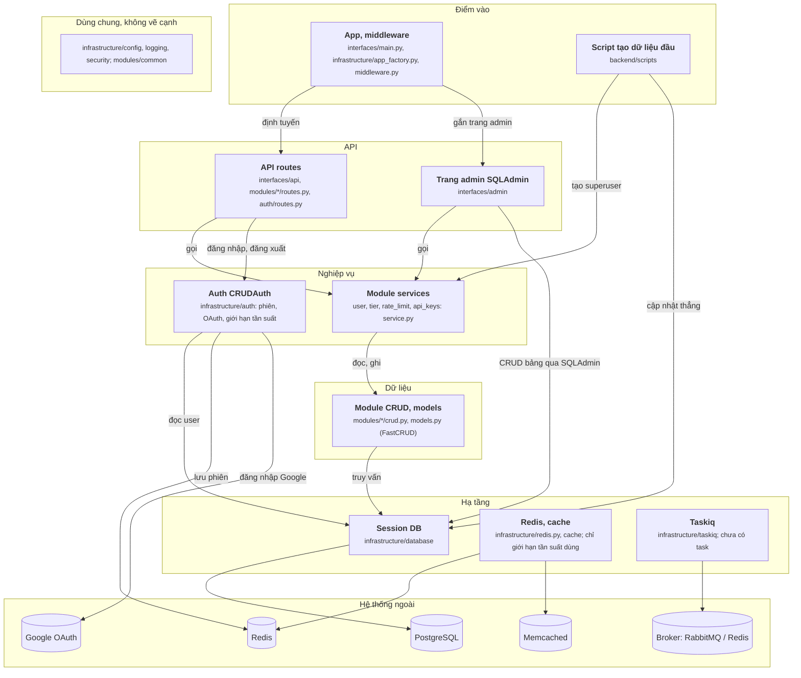

# Sơ đồ igorbenav/FastAPI-boilerplate vẽ tay (28/09/2026)

File này là sơ đồ component của igorbenav/FastAPI-boilerplate (commit 765efec), vẽ tay sau khi đọc mã nguồn, theo `oracle/CHUAN-DAP-AN.md` bản 3. JSON đáp án chưa sửa theo sơ đồ này.

## Sơ đồ

## Cạnh và bằng chứng

Đường dẫn tính từ `backend/`. Mọi dòng đã mở ra đối chiếu.

| Từ | Tới | Bằng chứng |
|---|---|---|
| App | API routes | `src/infrastructure/app_factory.py:273 application.include_router(router)` |
| App | Trang admin | `src/interfaces/main.py:68 create_admin_interface(app)` |
| Script tạo dữ liệu đầu | Module services | `scripts/create_first_superuser.py:64 user = await user_service.create(user_data, session)` |
| Script tạo dữ liệu đầu | Session DB | `scripts/create_first_superuser.py:72 await session.execute(stmt)` |
| API routes | Module services | `src/modules/user/routes.py:52 return await user_service.create(user, db)` |
| API routes | Auth | `src/infrastructure/auth/routes.py:66 user = await crud_auth.authenticate_password(db, form_data.username, form_data.password, request=request)` |
| Trang admin | Module services | `src/interfaces/admin/views/users.py:72 await user_service.anonymize_user(user_id=int(pk), db=db)` |
| Trang admin | Session DB | `src/interfaces/admin/initialize.py:29 engine=get_engine(),` |
| Module services | Module CRUD | `src/modules/user/service.py:95 created_user = await crud_users.create(db=db, object=user_internal, schema_to_select=UserRead)` |
| Auth | Session DB | `src/infrastructure/auth/setup.py:82 session=async_session,` (dòng 83 `user_model=User`) |
| Auth | Redis | `src/infrastructure/auth/setup.py:55 redis_url=settings.SESSION_REDIS_URL if use_redis else None,` |
| Auth | Google OAuth | `src/infrastructure/auth/setup.py:71 "google": OAuthCredentials(` |
| Module CRUD | Session DB | `src/modules/user/crud.py:5 crud_users: FastCRUD = FastCRUD(User)` (FastCRUD chạy truy vấn trên session được truyền vào) |
| Session DB | PostgreSQL | `src/infrastructure/database/session.py:28 return create_async_engine(settings.DATABASE_URL, **options)` |
| Redis, cache | Redis | `src/infrastructure/redis.py:11 return Redis(` |
| Redis, cache | Memcached | `src/infrastructure/cache/backends/memcached.py:59 self.client = aiomcache.Client(` |
| Taskiq | Broker | `src/infrastructure/taskiq/brokers.py:47 broker = AioPikaBroker(url=rabbitmq_url, queue_name="default")` |

## Không vẽ, và vì sao

| Không vẽ | Lý do theo chuẩn |
|---|---|
| `api_rate_limit_dependency` trên các router; `get_current_user`, `get_current_superuser`; service gọi `auth.validate_password` | Kiểm rồi quay về (`check`) |
| Service của module này gọi CRUD của module khác (`crud_tiers.exists`, `crud_rate_limits.exists`) | Nằm trong cùng khối sau khi gộp theo tầng; phần lớn là kiểm tồn tại |
| Route nhận `AsyncSessionDep` rồi truyền xuống service, CRUD | Chỉ truyền đi (`pass`) |
| Lifespan: `create_tables`, `initialize_cache`, `auth.initialize`, đóng Redis, `validate_production_security` | Lắp ráp (`wiring`) |
| Middleware header (giới hạn tần suất, cache phía client, security header), `SessionMiddleware` | Chỉ thêm header, không đọc ghi; gộp vào App |
| CLI `bp` (`cli/`: `deploy`, `env`) | Công cụ sinh file deploy, không thuộc luồng của app |

## Chỗ tôi phải chọn

- **Gộp các module theo tầng.** `user`, `tier`, `rate_limit`, `api_keys` mỗi module có đủ routes, service, crud. Tôi tách theo tầng rồi gộp các module cùng tầng. Các lời gọi chéo giữa module (phần lớn là kiểm tồn tại) nằm trong khối, sơ đồ không còn lưới cạnh qua lại.
- **Auth là một khối Nghiệp vụ.** `CRUDAuth` tự đọc user qua `async_session` và `User`, tự lưu phiên trong Redis riêng (`SESSION_REDIS_URL`), không qua `redis.py`.
- **Trang admin có cạnh thẳng tới Session DB.** SQLAdmin nhận engine và tự CRUD các bảng.
- **Redis, cache và Taskiq vẫn vẽ**, kèm ghi chú. Redis client chỉ phục vụ giới hạn tần suất (kiểm); cache và Taskiq chưa có luồng nào gọi.
- **Script tạo dữ liệu đầu được vẽ**, như ở fullstack: đây là luồng phụ để dựng hệ thống.
