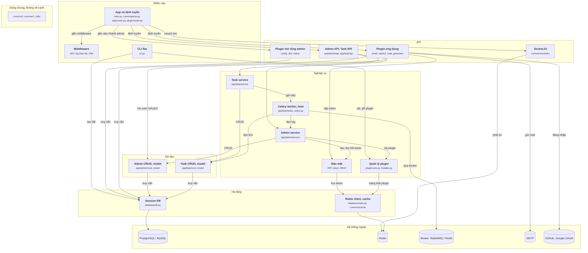

# Sơ đồ fba vẽ tay (28/09/2026)

File này là sơ đồ component của fastapi_best_architecture (commit 123a44a), vẽ tay sau khi đọc mã nguồn, theo `oracle/CHUAN-DAP-AN.md` bản 3. Không sinh bằng script. Khiêm yêu cầu phiên chính tự đọc và tự vẽ (phiên 3, 28/09). JSON đáp án `fastapi-best-architecture.json` chưa sửa theo sơ đồ này.

Mục đích: người mới nhìn là hình dung được luồng. Chỉ vẽ cạnh luồng, một chiều từ trên xuống.

## Sơ đồ

## Cạnh và bằng chứng

Đường dẫn tính từ `backend/`. Mọi dòng đã mở ra đối chiếu.

| Từ | Tới | Bằng chứng |
|---|---|---|
| App | Middleware | `core/registrar.py:156 app.add_middleware(OperaLogMiddleware)` |
| App | Admin API, Task API | `app/router.py:8 router.include_router(admin_v1)` (task: dòng 9 `router.include_router(task_v1)`) |
| App | Plugin mở rộng admin | `plugin/router.py:65 target_router.include_router(` |
| App | Plugin ứng dụng | `plugin/router.py:96 target_router.include_router(plugin_router, ...)` |
| App | Socket.IO | `core/registrar.py:242 app.mount('/ws', socket_app)` |
| CLI | Quản lý plugin | `cli.py:400 plugin_name = await install_zip_plugin(file=path)` |
| CLI | Session DB | `cli.py:211 async_init_engine = create_database_async_engine(...)` |
| Admin API, Task API | Admin service | `app/admin/api/v1/sys/user.py:36 data = await user_service.get_userinfo(db=db, pk=pk)` |
| Admin API, Task API | Task service | `app/task/api/v1/scheduler.py:23 schedulers = await task_scheduler_service.get_all(db=db)` |
| Plugin mở rộng admin | Session DB | `plugin/dict/crud/crud_dict_data.py:24 return await self.select_model(db, pk, deleted=0)` |
| Plugin ứng dụng | Admin CRUD | `plugin/oauth2/service/oauth2_service.py:59 sys_user = await user_dao.get(db, user_social.user_id)` |
| Plugin ứng dụng | Bảo mật | `plugin/oauth2/service/oauth2_service.py:97 access_token_data = await create_access_token(` |
| Plugin ứng dụng | Session DB | `plugin/code_generator/crud/crud_code_gen.py:48 result = await db.execute(stmt)` |
| Plugin ứng dụng | SMTP | `plugin/email/utils/send.py:64 smtp_client = SMTP(` |
| Plugin ứng dụng | OAuth | `plugin/oauth2/api/v1/github.py:21 github_client = GitHubOAuth20(...)` |
| Socket.IO | Redis | `common/socketio/server.py:18 client_manager=socketio.AsyncRedisManager(` |
| Admin service | Admin CRUD | `app/admin/service/auth_service.py:49 user = await user_dao.get_by_username(db, username)` |
| Admin service | Bảo mật | `app/admin/service/auth_service.py:74 access_token_data = await create_access_token(` |
| Admin service | Quản lý plugin | `app/admin/service/plugin_service.py:66 return await install_zip_plugin(file)` |
| Task service | Task CRUD | `app/task/service/scheduler_service.py:33 task_scheduler = await task_scheduler_dao.get(db, pk)` |
| Task service | Celery | `app/task/service/scheduler_service.py:156 celery_app.send_task(name=task_scheduler.task, ...)` |
| Celery | Admin service | `app/task/tasks/db_log/tasks.py:12 await opera_log_service.delete_all(db=db)` |
| Celery | Task CRUD | `app/task/utils/schedulers.py:170 stmt = select(TaskScheduler).where(TaskScheduler.name == name, ...)` |
| Celery | Broker | `app/task/celery.py:61 app = celery.Celery(` (dòng 63 `broker_url=broker_url`) |
| Bảo mật | Redis client | `common/security/token.py:149 async with redis_client.pipeline(transaction=False) as pipe:` |
| Quản lý plugin | Redis client | `plugin/core.py:81 plugin_info = run_await(current_redis_client.get)(...)` |
| Admin CRUD | Session DB | `app/admin/crud/crud_login_log.py:61 await db.execute(sa_delete(LoginLog))` |
| Task CRUD | Session DB | `app/task/crud/crud_result.py:19 return await self.select_model(db, pk)` |
| Session DB | PostgreSQL / MySQL | `database/db.py:59 return create_async_engine(` |
| Redis client | Redis | `database/redis.py:56 super().__init__(connection_pool=pool)` |

## Không vẽ, và vì sao

| Không vẽ | Lý do theo chuẩn |
|---|---|
| Kiểm token, quyền, session, captcha: middleware JWT, `DependsJwtAuth`, `DependsRBAC`, kiểm plugin bật (`PluginStatusChecker`), captcha trong Redis | Kiểm rồi quay về (`check`) |
| API nhận session qua `Depends` rồi truyền xuống service, CRUD | Chỉ truyền đi (`pass`). Cạnh tới DB vẽ ở nơi chạy truy vấn |
| Lúc khởi động và tắt: `create_tables`, `redis_client.init`, `init_otel`, listener cache pub/sub, hook plugin, lệnh CLI chạy worker, beat | Lắp ráp (`wiring`) |
| Log thao tác (middleware đẩy vào hàng đợi, rồi `opera_log_service` ghi DB); OTel, Prometheus | Ghi log, metrics nội bộ |
| `@cached` trong plugin config, dict; cache thông tin user | Cache là helper |
| Worker báo trạng thái qua Socket.IO; admin CRUD xóa `user_social` của plugin oauth2; bảo mật ngắt socket khi thu hồi token | Cạnh đi lên (`up`) |
| Khóa Redis của Celery beat (`schedulers.py:450`) | Chi tiết, không phải luồng |

## Chỗ tôi phải chọn

- **Plugin tách hai khối theo cách nạp.** `config`, `dict`, `notice` gắn vào router admin. `email`, `oauth2`, `code_generator` gắn vào router chính (`plugin/router.py:65` và `:96`).
- **App gộp** `main.py`, `run.py`, `core/registrar.py`, `app/router.py`, `plugin/router.py`: cùng việc dựng app và gắn route.
- **Celery worker và beat một khối, tầng Nghiệp vụ.** Beat đọc lịch từ bảng `task_scheduler`, worker chạy việc do Task service gửi.
- **Redis client và `common/cache` một khối** ở Hạ tầng.
- **Socket.IO nối thẳng Redis ngoài**, vì `AsyncRedisManager` tự tạo kết nối, không qua `database/redis.py`.
- **Observability** (OTel, Prometheus) không có trong sơ đồ: chỉ gắn lúc khởi động và gửi metrics.

- **Sửa 30/09: gộp Admin API và Task API.** Hai nhánh gắn cùng một cách qua `app/router.py`. Luật gộp theo tầng: ở API chỉ tách khi khác cách vào; chỗ rẽ nhánh (admin service, task service) đã hiện ở tầng Nghiệp vụ.
