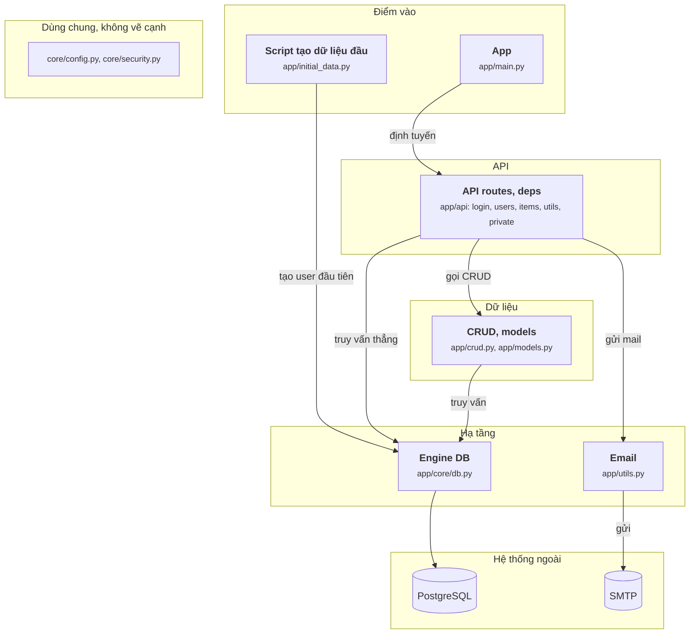

# Sơ đồ full-stack-fastapi-template vẽ tay (28/09/2026)

File này là sơ đồ component của full-stack-fastapi-template (commit cb740b6, phần `backend/`), vẽ tay sau khi đọc mã nguồn, theo `oracle/CHUAN-DAP-AN.md` bản 3. JSON đáp án chưa sửa theo sơ đồ này.

## Sơ đồ

## Cạnh và bằng chứng

Đường dẫn tính từ `backend/app/`. Mọi dòng đã mở ra đối chiếu.

| Từ | Tới | Bằng chứng |
|---|---|---|
| App | API routes | `main.py:35 app.include_router(api_router, prefix=settings.API_V1_STR)` |
| Script tạo dữ liệu đầu | Engine DB | `initial_data.py:13 init_db(session)` |
| API routes | Email | `api/routes/users.py:73 send_email(` |
| API routes | CRUD, models | `api/routes/users.py:68 user = crud.create_user(session=session, user_create=user_in)` |
| API routes | Engine DB | `api/routes/users.py:43 count = session.exec(count_statement).one()` (session mở ở `api/deps.py:22 with Session(engine) as session:`) |
| Email | SMTP | `utils.py:56 response = message.send(to=email_to, smtp=smtp_options)` |
| CRUD, models | Engine DB | `crud.py:15 session.commit()` |
| Engine DB | PostgreSQL | `core/db.py:7 engine = create_engine(str(settings.DATABASE_URL), pool_pre_ping=True)` |

## Không vẽ, và vì sao

| Không vẽ | Lý do theo chuẩn |
|---|---|
| `deps.get_current_user`, `get_current_active_superuser`: giải mã JWT, kiểm user | Kiểm rồi quay về (`check`) |
| `init_db` trong `core/db.py` gọi `crud.create_user` (`core/db.py:33`) | Cạnh đi lên (`up`), từ Hạ tầng lên Dữ liệu |
| `sentry_sdk.init(dsn=...)` trong `main.py`; `CORSMiddleware`; phục vụ frontend tĩnh | Giám sát lỗi, lắp ráp lúc khởi động |
| Gọi `get_password_hash`, `verify_password`, `create_access_token` | `core/security.py` là helper thuần (băm, ký JWT), không đọc ghi ngoài; xếp dùng chung |

## Chỗ tôi phải chọn

- **`api/deps.py` gộp vào API routes**: mọi cạnh ra của nó là mở session (`pass`) hoặc kiểm quyền (`check`), đứng riêng sẽ là khối không có cạnh.
- **`core/security.py` là dùng chung**: không có IO. Khác fba, nơi bảo mật lưu token trong Redis.
- **Routes có cả cạnh tới CRUD và tới DB**, vì một số route tự chạy `session.exec` (`users.py:43`) thay vì qua `crud.py`.
- **Sentry không vẽ**, giống OTel ở fba: chỉ gửi lỗi đi, không thuộc luồng xử lý.
- **Email ở Hạ tầng.** `utils.py` dựng nội dung mail và gửi qua SMTP; dấu hiệu tầng là dòng gửi SMTP. Repo không có tầng Nghiệp vụ riêng: route gọi thẳng CRUD và Email, nên sơ đồ không có khung Nghiệp vụ.
