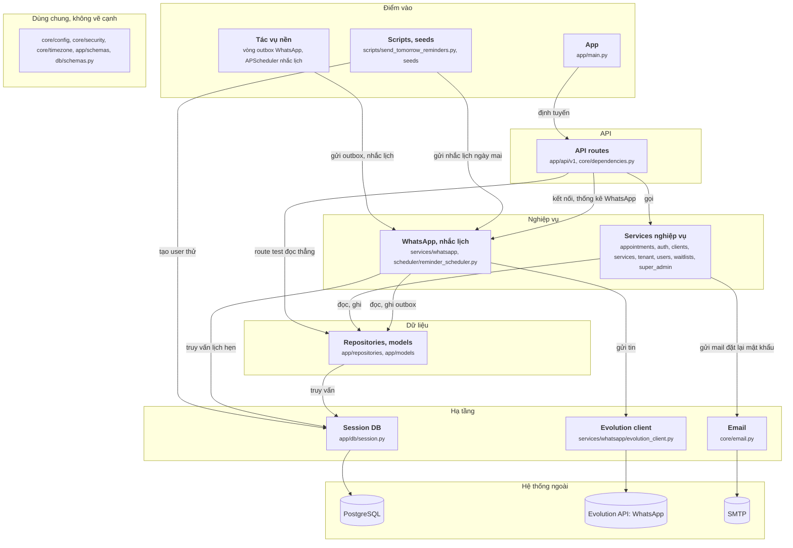

# Sơ đồ kibo-backend vẽ tay (28/09/2026)

File này là sơ đồ component của KIBO-Agenda/kibo-backend (commit 89eb3bb), vẽ tay sau khi đọc mã nguồn, theo `oracle/CHUAN-DAP-AN.md` bản 3. JSON đáp án chưa sửa theo sơ đồ này.

## Sơ đồ

## Cạnh và bằng chứng

Đường dẫn tính từ `app/`. Mọi dòng đã mở ra đối chiếu.

| Từ | Tới | Bằng chứng |
|---|---|---|
| App | API routes | `main.py:60 app.include_router(auth_router, prefix=settings.API_V1_PREFIX)` |
| Tác vụ nền | WhatsApp, nhắc lịch | `services/whatsapp/worker.py:21 processed = await service.process_pending_messages(` (lịch: `services/scheduler/worker.py:30 reminder_scheduler.process_24h_reminders,`) |
| Scripts, seeds | WhatsApp, nhắc lịch | `scripts/send_tomorrow_reminders.py:37 result = await scheduler.process_tomorrow_reminders(` |
| Scripts, seeds | Session DB | `seeds/create_frontend_test_users.py:37 db.add(entity)` |
| API routes | Services nghiệp vụ | `api/v1/appointments/router.py:32 entity = service.create_appointment(` |
| API routes | WhatsApp, nhắc lịch | `api/v1/whatsapp/router.py:298 stats = service.get_stats(business_id=owner_user.tenant_id)` |
| API routes | Repositories | `api/v1/test.py:52 appointment_repo = AppointmentRepository(db)` |
| Services nghiệp vụ | Repositories | `services/appointments/appointment_service.py:223 occupied = self.appointment_repo.list_active_by_user_on_date(` |
| Services nghiệp vụ | Email | `services/auth/auth_service.py:200 send_password_reset_email(normalized_email, reset_link)` |
| WhatsApp, nhắc lịch | Repositories | `services/whatsapp/outbox_service.py:55 return self.outbox_repo.create(` |
| WhatsApp, nhắc lịch | Evolution client | `services/whatsapp/outbox_service.py:125 payload = await self.evolution_client.send_text(` |
| WhatsApp, nhắc lịch | Session DB | `services/scheduler/reminder_scheduler.py:53 all_tenants = db.query(Tenant).all()` |
| Repositories | Session DB | `repositories/appointments/appointment_repository.py:60 self.db.commit()` |
| Session DB | PostgreSQL | `db/session.py:10 engine = create_engine(settings.DATABASE_URL, future=True, pool_pre_ping=True)` |
| Evolution client | Evolution API | `services/whatsapp/evolution_client.py:35 return httpx.AsyncClient(base_url=base_url.rstrip("/"), headers=headers, timeout=20.0)` |
| Email | SMTP | `core/email.py:29 with smtplib.SMTP(settings.SMTP_HOST, settings.SMTP_PORT, timeout=20) as server:` |

## Không vẽ, và vì sao

| Không vẽ | Lý do theo chuẩn |
|---|---|
| `get_current_tenant_user`, `require_owner`, `has_min_plan_tier` (cả trong outbox service) | Kiểm rồi quay về (`check`) |
| Route nhận `db` qua `Depends(get_db)` rồi tạo service; worker `SessionLocal()` rồi truyền cho service | Chỉ truyền đi (`pass`) |
| Lifespan tạo task `run_outbox_worker`, `run_scheduler_lifecycle` | Lắp ráp (`wiring`) |
| `scripts/test_whatsapp_connection.py` gọi thẳng Evolution API bằng httpx | Script thử kết nối thủ công |
| Gọi `get_password_hash`, template engine, variable resolver | Helper thuần; template engine nằm trong khối WhatsApp |

## Chỗ tôi phải chọn

- **Tác vụ nền ở Điểm vào, không ở Nghiệp vụ.** Chuẩn xếp worker vào Nghiệp vụ vì service gửi việc cho worker (như Celery ở fba). Ở kibo không ai gửi việc: vòng outbox và APScheduler tự chạy từ lúc khởi động. Chúng là điểm bắt đầu của luồng nền. Cần làm rõ luật này trong chuẩn.
- **Tách file trong `services/scheduler`.** `worker.py` (khởi động APScheduler) ở Điểm vào; `reminder_scheduler.py` (logic nhắc lịch) ở Nghiệp vụ, gộp với WhatsApp vì cùng gửi tin qua Evolution.
- **`evolution_client.py` tách ra Hạ tầng**, dù nằm trong `services/whatsapp`: nó chỉ tạo client HTTP tới Evolution API.
- **Gộp 8 service nghiệp vụ một khối**, vì cùng tầng, cùng cách gọi repository.
- **Vẽ route test** (`api/v1/test.py`), vì router này được gắn vào app trong `main.py`.
