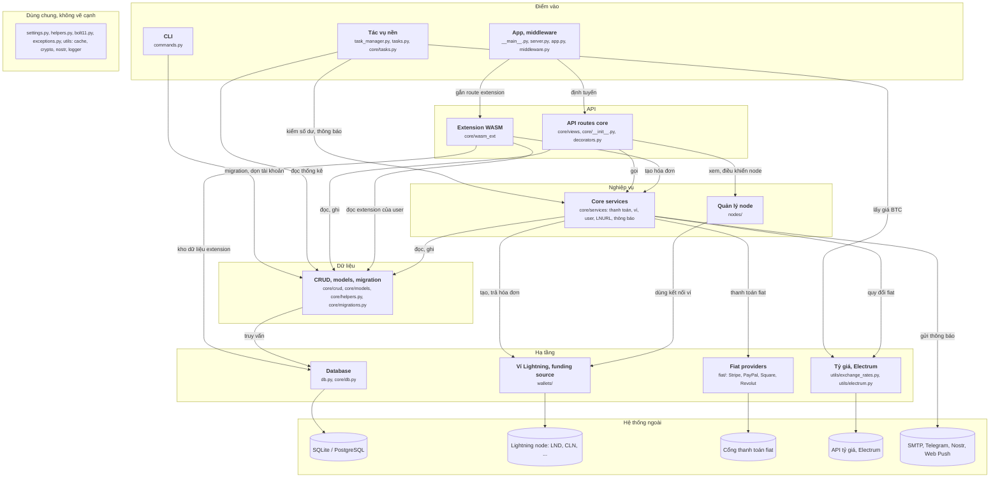

# Sơ đồ lnbits vẽ tay (28/09/2026)

File này là sơ đồ component của lnbits/lnbits (commit 958e4da), vẽ tay sau khi đọc mã nguồn, theo `oracle/CHUAN-DAP-AN.md` bản 3. JSON đáp án chưa sửa theo sơ đồ này.

## Sơ đồ

## Cạnh và bằng chứng

Đường dẫn tính từ `lnbits/`. Mọi dòng đã mở ra đối chiếu.

| Từ | Tới | Bằng chứng |
|---|---|---|
| App | API routes core | `app.py:117 init_core_routers(app)` (gắn ở `core/__init__.py:31 app.include_router(core_app)`) |
| App | Extension WASM | `app.py:562 register_wasm_extension(app, ext.code)` |
| CLI | CRUD, migration | `commands.py:309 await delete_accounts_no_wallets(delta, conn)` (migration: `commands.py:142 loop.run_until_complete(migrate_databases())`) |
| Tác vụ nền | Core services | `core/tasks.py:42 status = await get_balance_delta()` |
| Tác vụ nền | CRUD | `core/tasks.py:39 accounts = await get_accounts(filters=Filters(limit=0))` |
| Tác vụ nền | Tỷ giá | `core/tasks.py:69 price = await btc_price_from_aggregator(currency)` |
| API routes core | Core services | `core/views/payment_api.py:302 payment = await pay_invoice(` |
| API routes core | CRUD | `core/views/admin_api.py:74 admin_settings = await get_admin_settings(account.is_super_user)` |
| API routes core | Quản lý node | `core/views/node_api.py:93 return await node.get_info()` |
| Extension WASM | Core services | `core/wasm_ext/api/host.py:350 payment = await create_payment_request(` |
| Extension WASM | CRUD | `core/wasm_ext/api/background_payments.py:58 user_extension = await get_user_extension(wallet.user, extension_id)` |
| Extension WASM | Database | `core/wasm_ext/storage/crud.py:35 async with Database(f"ext_{ext_id}").connect() as conn:` (dòng 36 `await conn.fetchone(...)`) |
| Core services | CRUD | `core/services/payments.py:399 payment = await create_payment(` |
| Core services | Ví Lightning | `core/services/payments.py:365 invoice_response = await funding_source.create_invoice(` |
| Core services | Fiat providers | `core/services/fiat_providers.py:55 fiat_provider = await get_fiat_provider(payment.fiat_provider)` |
| Core services | Tỷ giá | `core/services/payments.py:180 amount_sat = await fiat_amount_as_satoshis(invoice_data.amount, invoice_data.unit)` |
| Core services | SMTP, Telegram, ... | `core/services/notifications.py:230 with smtplib.SMTP(server, port) as smtp_server:` (Telegram: dòng 177 `httpx.AsyncClient()`; Web Push: dòng 411 `webpush(`) |
| Quản lý node | Ví Lightning | `nodes/base.py:160 def __init__(self, wallet: Wallet):` |
| CRUD | Database | `core/crud/assets.py:72 await db.update("assets", asset)` |
| Database | SQLite / PostgreSQL | `db.py:317 self.engine: AsyncEngine = create_async_engine(` |
| Ví Lightning | Lightning node | `wallets/lndrest.py:110 self.client = httpx.AsyncClient(` (các ví khác tương tự) |
| Fiat providers | Cổng fiat | `fiat/stripe.py:105 self.client = httpx.AsyncClient(base_url=self.endpoint, headers=self.headers)` |
| Tỷ giá | API tỷ giá | `utils/exchange_rates.py:263 async with httpx.AsyncClient(headers=headers) as client:` |

## Không vẽ, và vì sao

| Không vẽ | Lý do theo chuẩn |
|---|---|
| `decorators.py` (`require_admin_key`, `check_user_exists`...), `InstalledExtensionMiddleware` | Kiểm rồi quay về (`check`) |
| Service, CLI mở `db.connect()` rồi truyền `conn` cho CRUD | Chỉ truyền đi (`pass`) |
| Lúc khởi động: `migrate_databases`, `check_admin_settings`, `set_funding_source`, `register_async_tasks`, đăng ký extension | Lắp ráp (`wiring`) |
| Service đẩy hóa đơn nội bộ vào `task_manager.internal_invoice_queue` | Cạnh đi lên (`up`): Nghiệp vụ lên Điểm vào |
| `AuditMiddleware` đẩy nhật ký vào hàng đợi, tác vụ nền ghi `create_audit_entry` | Log nội bộ |
| `tools/codegen` (sinh SDK TypeScript cho extension); extension Python nạp từ thư mục ngoài repo | Công cụ phát triển; code ngoài repo |

## Chỗ tôi phải chọn

- **Tác vụ nền ở Điểm vào**, như ở kibo. `task_manager` tự chạy các vòng định kỳ và vòng nghe hóa đơn từ lúc khởi động (`fundingsource_invoice_producer` đọc `funding_source.paid_invoices_stream()`). Service chỉ đẩy thêm hóa đơn nội bộ vào hàng đợi; cạnh đó đi lên nên không vẽ.
- **`utils/` tách theo file.** `exchange_rates.py`, `electrum.py` gọi dịch vụ ngoài nên ở Hạ tầng; `cache`, `crypto`, `nostr`, `logger` là dùng chung.
- **Migration gộp vào khối Dữ liệu** (`core/helpers.py:89 migrate_databases`), vì nó sửa bảng. CLI gọi migration và các hàm dọn dữ liệu.
- **Gộp hệ thống ngoài theo loại**: hơn 10 dịch vụ ngoài (Telegram, Nostr, Web Push, Stripe, PayPal...) gộp thành 5 nút, để sơ đồ đọc được.
- **Thông báo không thành khối riêng.** Code gửi mail, Telegram, Web Push nằm trong `core/services/notifications.py`, nên cạnh đi thẳng từ Core services ra hệ thống ngoài.
