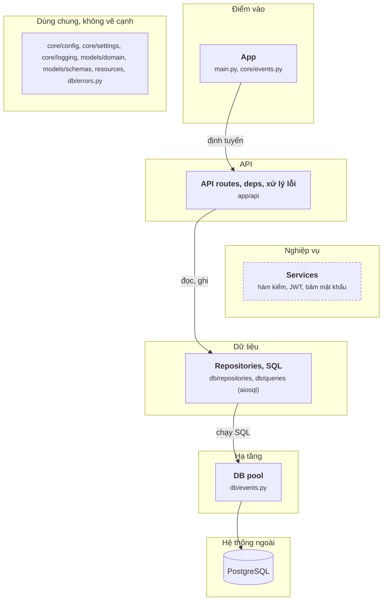

# Sơ đồ fastapi-realworld vẽ tay (28/09/2026)

File này là sơ đồ component của fastapi-realworld-example-app (bản trong `sample-repos/fastapi-realworld-diagram`), vẽ tay sau khi đọc mã nguồn, theo `oracle/CHUAN-DAP-AN.md` bản 3. JSON đáp án chưa sửa theo sơ đồ này.

## Sơ đồ

Khối viền nét đứt không có cạnh luồng.

## Cạnh và bằng chứng

Đường dẫn tính từ `app/`. Mọi dòng đã mở ra đối chiếu.

| Từ | Tới | Bằng chứng |
|---|---|---|
| App | API routes | `main.py:40 application.include_router(api_router, prefix=settings.api_prefix)` (lỗi: `main.py:37 application.add_exception_handler(...)`) |
| API routes | Repositories | `api/routes/articles/articles_resource.py:71 article = await articles_repo.create_article(` |
| Repositories | DB pool | `db/repositories/users.py:11 user_row = await queries.get_user_by_email(self.connection, email=email)`. Kết nối lấy từ pool ở `api/dependencies/database.py:12 return request.app.state.pool`, không qua import |
| DB pool | PostgreSQL | `db/events.py:11 app.state.pool = await asyncpg.create_pool(` |

## Không vẽ, và vì sao

| Không vẽ | Lý do theo chuẩn |
|---|---|
| Route gọi `check_email_is_taken`, `check_article_exists`, `check_article_modification_permissions`; deps `get_current_user_authorizer` | Kiểm rồi quay về (`check`) |
| Route gọi `jwt.create_access_token_for_user`, `get_slug_for_article`; model gọi `security.verify_password` | Helper thuần, không đọc ghi ngoài |
| `get_repository` lấy kết nối từ pool rồi tạo repository | Chỉ truyền đi (`pass`) |
| `add_event_handler("startup", ...)` gọi `connect_to_db`; đóng pool khi tắt | Lắp ráp (`wiring`) |

## Chỗ tôi phải chọn

- **Services để trống cạnh.** Mọi hàm trong `services/` là hàm kiểm hoặc helper thuần. Giữ khối ở tầng Nghiệp vụ, viền nét đứt, để người mới thấy repo này không có lớp nghiệp vụ thật: route gọi thẳng repository.
- **Repositories và `db/queries` một khối.** Repository chỉ gọi hàm SQL do aiosql sinh từ file `.sql`.
- **Cạnh Repositories → DB pool không qua import.** Pool được gắn vào `app.state` lúc khởi động và lấy ra theo request. Đây là luồng chính, không có đường import thay thế (quy tắc 4).
- **`api/dependencies` và `api/errors` gộp vào API routes.** Deps nạp bài viết, user cho route; handler lỗi được gắn cùng lúc gắn router.
- **Models là dùng chung.** `models/domain`, `models/schemas` là kiểu Pydantic, không đọc ghi gì.
