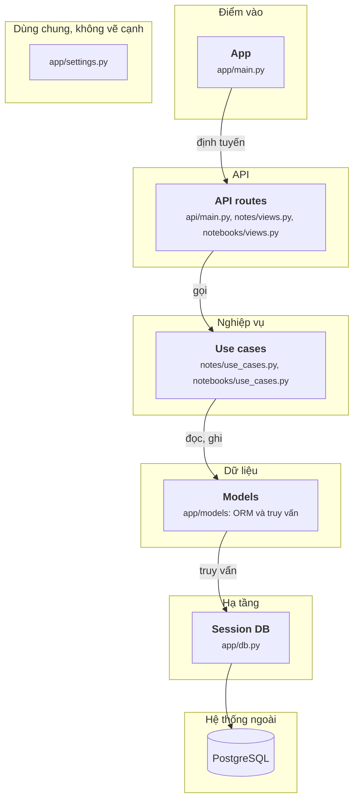

# Sơ đồ rhoboro vẽ tay (28/09/2026)

File này là sơ đồ component của rhoboro/async-fastapi-sqlalchemy (commit 6c08827), vẽ tay sau khi đọc mã nguồn, theo `oracle/CHUAN-DAP-AN.md` bản 3. JSON đáp án chưa sửa theo sơ đồ này.

## Sơ đồ

## Cạnh và bằng chứng

Đường dẫn tính từ `app/`. Mọi dòng đã mở ra đối chiếu.

| Từ | Tới | Bằng chứng |
|---|---|---|
| App | API routes | `main.py:8 app.include_router(api_router, prefix="/api")` |
| API routes | Use cases | `api/notes/views.py:24 return await use_case.execute(data.notebook_id, data.title, data.content)` |
| Use cases | Models | `api/notes/use_cases.py:18 note = await Note.create(session, notebook.id, title, content)` |
| Models | Session DB | `models/notes.py:45 return await session.scalar(stmt.order_by(cls.id))` |
| Session DB | PostgreSQL | `db.py:12 async_engine = create_async_engine(` |

## Không vẽ, và vì sao

| Không vẽ | Lý do theo chuẩn |
|---|---|
| Use case nhận `async_sessionmaker` qua `Depends(get_session)`, tự mở `begin()` rồi truyền session cho model | Chỉ truyền đi (`pass`). Cạnh tới DB vẽ ở Models, nơi chạy truy vấn |
| `schema.py` của từng tính năng, `models/schema.py` | Chỉ dùng làm kiểu |

## Chỗ tôi phải chọn

- **Gộp notes và notebooks** ở mỗi tầng: hai tính năng cùng tầng, cùng cơ chế. Thư mục `api/notes/` bị tách theo tầng: `views.py` ở API, `use_cases.py` ở Nghiệp vụ.
- **Models ở tầng Dữ liệu**, vì model tự chạy truy vấn (`Note.create`, `read_by_id`); repo không có lớp CRUD riêng.
