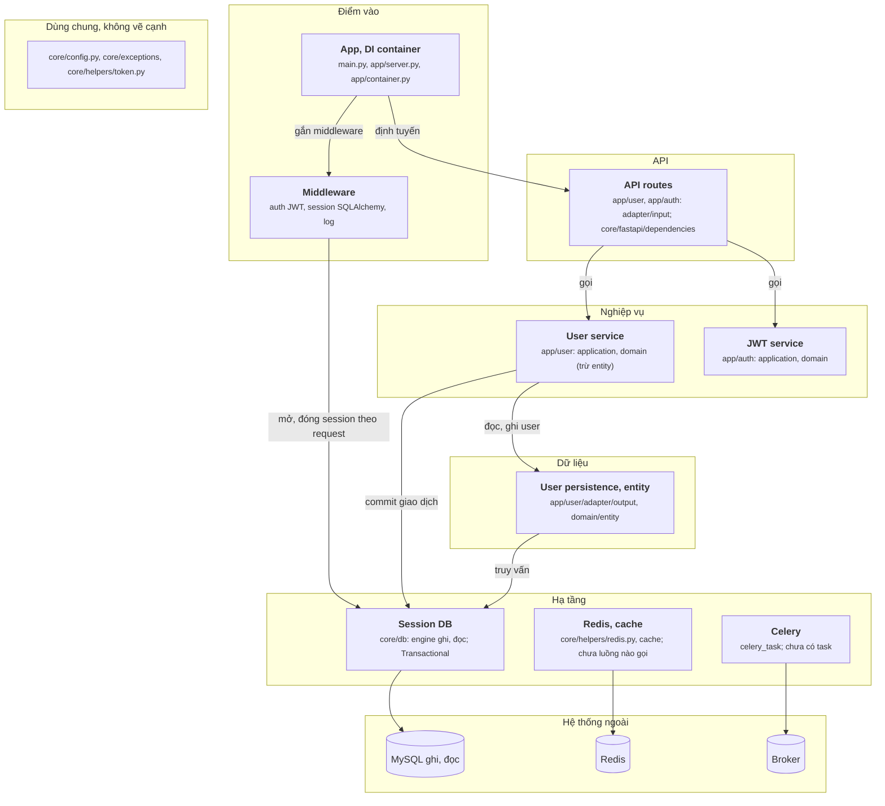

# Sơ đồ teamhide vẽ tay (28/09/2026)

File này là sơ đồ component của teamhide/fastapi-boilerplate (commit df4e6d4), vẽ tay sau khi đọc mã nguồn, theo `oracle/CHUAN-DAP-AN.md` bản 3. JSON đáp án chưa sửa theo sơ đồ này.

## Sơ đồ

## Cạnh và bằng chứng

Mọi dòng đã mở ra đối chiếu.

| Từ | Tới | Bằng chứng |
|---|---|---|
| App | Middleware | `app/server.py:66 Middleware(SQLAlchemyMiddleware),` (gắn ở `app/server.py:84 middleware=make_middleware(),`) |
| App | API routes | `app/server.py:25 app_.include_router(user_router)` |
| Middleware | Session DB | `core/fastapi/middlewares/sqlalchemy.py:21 await session.remove()` (mở ở dòng 14 `set_session_context(...)`) |
| API routes | User service | `app/user/adapter/input/api/v1/user.py:26 return await usecase.get_user_list(limit=limit, prev=prev)` |
| API routes | JWT service | `app/auth/adapter/input/api/v1/auth.py:24 token = await usecase.create_refresh_token(` |
| User service | User persistence | `app/user/application/service/user.py:26 return await self.repository.get_users(limit=limit, prev=prev)` |
| User service | Session DB | `app/user/application/service/user.py:28 @Transactional()` (commit ở `core/db/transactional.py:12 await session.commit()`) |
| User persistence | Session DB | `app/user/adapter/output/persistence/sqlalchemy/user.py:25 result = await read_session.execute(query)` |
| Session DB | MySQL | `core/db/session.py:38 EngineType.WRITER: create_async_engine(config.WRITER_DB_URL, pool_recycle=3600),` |
| Redis, cache | Redis | `core/helpers/redis.py:5 redis_client = redis.from_url(url=f"redis://{config.REDIS_HOST}", decode_responses=True)` |
| Celery | Broker | `celery_task/__init__.py:5 celery_app = Celery(` (dòng 8 `broker=config.CELERY_BROKER_URL`) |

## Không vẽ, và vì sao

| Không vẽ | Lý do theo chuẩn |
|---|---|
| Container DI: `Factory(UserService, ...)`, `Singleton(UserSQLAlchemyRepo)`, `Provide[Container.user_service]` | Lắp ráp (`wiring`) |
| `Cache.init(backend=RedisBackend(), ...)` trong `create_app` | Lắp ráp (`wiring`) |
| Middleware auth giải mã JWT; `PermissionDependency([IsAdmin])` gọi `usecase.is_admin` | Kiểm rồi quay về (`check`) |
| `ResponseLogMiddleware`, dependency `Logging` (không làm gì) | Log nội bộ |
| Service gọi `TokenHelper.encode`, `decode` | Helper thuần, xếp dùng chung |
| `core/repository/base.py` (`BaseRepo`) | Không ai dùng |

## Chỗ tôi phải chọn

- **Container DI gộp vào App.** Container chỉ lắp service với repository. Người mới cần biết nó tồn tại, không cần thấy cạnh của nó.
- **Middleware có cạnh tới Session DB.** Repo này dùng session theo ngữ cảnh request: middleware mở và `remove()` session, service commit qua `@Transactional`. Không có cạnh này thì không hiểu session từ đâu ra.
- **User service và JWT service tách riêng.** Cùng tầng, nhưng chỉ User service chạm dữ liệu; JWT service chỉ ký và giải mã token.
- **Redis, cache và Celery vẫn vẽ**, kèm cạnh tới hệ thống ngoài, và ghi rõ "chưa luồng nào gọi". Repo có cấu hình, nhưng không route hay service nào dùng cache hoặc gửi task.
- **Hai engine ghi và đọc** gộp một hệ thống ngoài "MySQL ghi, đọc".

- **Sửa 30/09: entity ORM sang User persistence.** `domain/entity/user.py` có `__tablename__`, nên thuộc tầng Dữ liệu. Bản vẽ đầu để nó ở User service chỉ vì nằm trong thư mục `domain`, tức là bám thư mục, trái chuẩn.
