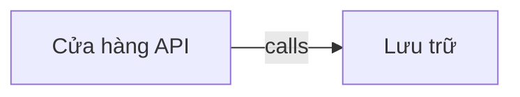

# shop_full — kết quả phân tích (bản sinh tự động)

- Snapshot: `snap:f4964f64b825d8af3f7a92e49254c5e6c506822efac23974978c5d32c175a886`
- Schema 0.1.0; renderer slice-render-v2; template slice-template-v1
- Phạm vi: 2 file trong 1 unit; 0 file bị loại khỏi snapshot

## Sơ đồ component

## Mục lục contract

- table: [tech-specs/LUU-TRU/schema/TBL-SHOP-FULL-LUU-TRU.md](tech-specs/LUU-TRU/schema/TBL-SHOP-FULL-LUU-TRU.md) — component `cmp_12e3f0d56a509f8aa918eb8630467ceb9f3428d97aff1d2174faf6dbe3da840f`
- api: [tech-specs/CUA-HANG-API/api/API-SHOP-FULL-CUA-HANG-API-v1.md](tech-specs/CUA-HANG-API/api/API-SHOP-FULL-CUA-HANG-API-v1.md) — component `cmp_26389ab80ab07e415ca6fce29c0193d3fd1659902ce3fe0ddf2d916fb890a516`

## Mục lục EVT theo topic

- (không có)

## Contract chưa gán được component

- (không có)

## Giới hạn

- `SLICE_SCOPE` (inventory): Lát cắt đầu chỉ nhận route FastAPI và bảng SQLAlchemy Column
- `MODEL_NOT_RUN` (model): Không gọi provider; tên component lấy từ membership

## Giới hạn biểu diễn

- (không có)
